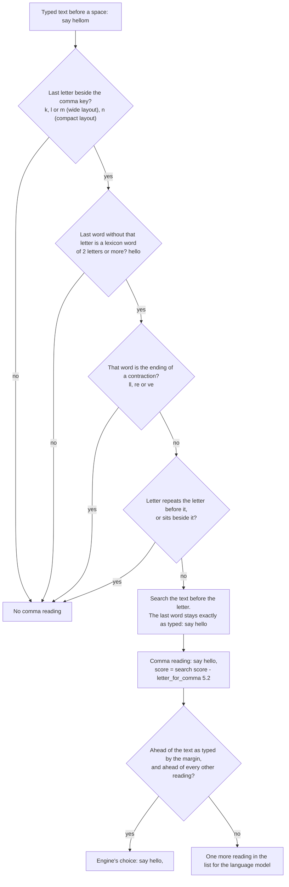

# Design of the comma read from a letter beside the comma key

## The engine reads "hellom" as "hello," with no change to the existing cases

Figure 1. The comma reading of `Engine/duo_engine.c` (`read_last_letter_as_comma`), for the typed
text "say hellom". The margin is `margin_known` 5 when every typed word is a lexicon word, and
`margin_unknown` 0 otherwise.

A person who aims at the comma key and hits the letter beside it types "hellom" for "hello,".
The engine now reads the last typed letter as the comma when two things hold. The letter sits
beside the comma key, and the letters before it spell a lexicon word. On the test half, read once, the engine
repairs 521 of 600 comma slips, where it repaired 0. It keeps all 300 clean words that end in
k, l, m or n, as "them" and "form". Every existing English case set keeps its count of right
cases on both halves.

What to do:

1. Install a build of `engine/comma-slip` through TestFlight.
2. Type "hellom " and check that the field shows "hello, ". Press backspace once: "hellom" comes
   back, and the keyboard keeps it from then on.
3. Type "hellom." and check that the field shows "hello." with no comma.

This page does not settle three things. It does not give the real rate of comma slips in
typing, so the costs rest on generated cases. It gives no number for the period key, because the
engine leaves the period out (Table 4). It gives no number for the keyboard with its language
model. The typing evaluation of `build.yml` ran 72 minutes in run 44011467710, and the job's time
limit stopped it before it wrote its outputs.

## Glossary

| Term | Meaning |
| --- | --- |
| comma slip | A letter key typed in place of the comma key right after a word, as "hellom" for "hello,". |
| comma reading | The engine's reading of the typed text with a comma in place of its last letter. |
| word before the comma | The last typed word without its last letter, as "hello" in "hellom". |
| wide layout, compact layout | The two letter layouts of `Shared/keyboard-layout.json`. The comma key sits right of "m" in the wide layout, and under "n" in the compact layout. |
| clean word | A real word typed right that ends in k, l, m or n, as "them". Any change of it is an error. |
| `letter_for_comma` | The cost of the comma reading in `duo_params`, in natural-log units: 5.2 makes the reading about 181 times less likely. |
| dev half, test half | The two halves of each case file. A sentence with an even Tatoeba id feeds the dev half and one with an odd id the test half. Choices use the dev half. The test half is read once, with the chosen values. |

## Letters beside the comma key and the period key

Table 1. Distance from the center of each mark key to the center of each letter beside it, in key
widths, from `scripts/typing-evaluation/symbol_keys.py` and `Shared/keyboard-layout.json`. Two
keys count as neighbors up to 1.15.

| Layout | Key | Letter | Distance | Shared edge | Weight in the cases |
| --- | --- | --- | --- | --- | --- |
| wide | comma | m | 0.90 | whole side edge | 2 |
| wide | comma | k | 1.10 | 0.45 of the top edge | 1 |
| wide | comma | l | 1.14 | 0.35 of the top edge | 1 |
| wide | period | l | 1.03 | 0.65 of the top edge | 1 |
| compact | comma | n | 1.00 | whole top edge | 1 |
| compact | period | m | 1.00 | whole top edge | 1 |

The nearer the letter to the comma key, the more weight it gets: "m" types half of the comma
slips of the wide layout. Every letter beside the period key also sits beside the comma key in one
of the two layouts.

## Cases of a letter in place of the comma key

Table 2. The task of the new cases, in the eight rows of `scripts/typing-evaluation/README.md`.

| Row | Comma slips |
| --- | --- |
| Input | Two strings: `context`, the 0 to 11 lower-case words before the typed text, and `typed`, one word of 3 to 15 letters a to z. |
| Model | The typing engine: `duo_correct_english` with the English costs, `letter_for_comma` among them. |
| Output | One string: the text the engine leaves in the field when the person presses space. |
| Target | `intended`: the word and a comma or a period, or the clean word as typed. |
| Training signal | None. `letter_for_comma` is chosen on the dev half by the count of comma slips repaired, with every existing dev count kept. |
| Negatives | 300 clean words per half, and every existing case set. |
| Split | The Tatoeba sentence, by id parity. A test sentence with the words of a dev sentence stays out. |
| Eval | Exact match between output and target, ignoring letter case, as a share of cases. |

`scripts/typing-evaluation/build_english_comma_cases.py` writes
`cases/english-comma-slip.dev.jsonl` and `cases/english-comma-slip.test.jsonl`, with 1,800 cases
per half. A slip case takes a word that a Tatoeba sentence writes with the mark right after it.

Table 3. Categories of the new cases, 300 per half each.

| Category | Group | Slip | Example, typed to intended |
| --- | --- | --- | --- |
| `comma_slip_wide` | comma slips | m, k or l in place of the comma, by the weights of Table 1 | hellom to hello, |
| `comma_slip_compact` | comma slips | n in place of the comma | richn to rich, |
| `period_slip_wide` | period slips | l in place of the period at the end of a sentence | rooml to room. |
| `period_slip_compact` | period slips | m in place of that period | foolm to fool. |
| `comma_slip_real_word` | alone | a letter beside the comma key that gives a common word | took to too, |
| `clean_comma_neighbor_word` | clean comma neighbors | none, a real word that ends in k, l, m or n | them to them |

A typed text at Zipf 3.0 or more in wordfreq counts as a common word, and its case goes to
`comma_slip_real_word`. Half of the clean words hold a common word without their last letter, as
"them" holds "the" and "form" holds "for". A comma reading can damage these words most.

## Choices for the comma reading

Each choice below was measured on the dev half. The first column names a rule of the comma
reading, and the last column gives the dev count that decided it.

Table 4. Options and the dev measurement behind each decision.

| Option | Decision | Dev measurement |
| --- | --- | --- |
| No comma reading after "ll", "re" or "ve" | taken | The lexicon holds these endings of "I'll", "you're" and "I've" as words. With the rule, "llm" reads as "ll" with the pack off, as before the comma reading. All 8 case files give the same output for every case with and without the rule. |
| The word before the comma typed exactly | taken | Slips allowed inside that word turn "itll" into "it," in place of "it'll". At cost 5 that turns 30 of 843 `apostrophe_dropped` cases, 4 letter slips and 1 clean case wrong. |
| No comma reading for a letter that repeats the letter before it or sits beside it | taken | The reading for those letters adds 40 comma slips (553 of 600) and turns 6 letter slips wrong, as "breakl" to "break," and "tok" to "to,". |
| `letter_for_comma` 5.2 | taken | 513 of 600 comma slips. From 5.1 to 5.49 every existing dev count stays. 5.0 turns 2 clean cases wrong, as "tom" to "to,". |
| `letter_for_comma` 5.5 or more | not taken | 0 of 600: dropping the letter as an extra key (`insertion` 5.5) always reads the same word at no more cost. |
| A period reading cheaper than the comma reading | not taken | The period takes "l" and "m" from the comma: 320 of 600 comma slips and 517 of 600 period slips, and "hellom" becomes "hello.". |
| A period reading at the cost of the comma or more | not taken | The engine never chooses it, because every letter beside the period key also sits beside the comma key. |
| A comma that ends the reading of two words together | not taken | Typed word by word through `rerank.py`, 13 existing dev cases turn wrong: a space typed late or inside a word, as "letm e" to "let, e" in place of "let me". |
| The next word read with the comma word, its reading kept only when it moves or takes out a space | taken | The same existing dev cases keep their counts (Table 8). |

The engine charges every extra key the same cost, `insertion` 5.5, so it cannot tell "breakl"
from a comma slip. The rule that leaves out a letter beside the letter before it costs 40 comma
repairs and keeps every letter slip.

Table 5. Dev counts per value of `letter_for_comma`, with the two rules of Table 4. The existing
dev counts are those of `english.dev.jsonl`, 973 clean cases and 2,100 letter slips.

| `letter_for_comma` | comma slips of 600 | `comma_slip_real_word` of 300 | clean comma neighbors of 300 | existing clean of 973 | existing letter slips of 2,100 |
| --- | --- | --- | --- | --- | --- |
| off | 0 | 0 | 300 | 957 | 1,943 |
| 3.0 | 518 | 105 | 300 | 950 | 1,943 |
| 4.0 | 514 | 83 | 300 | 952 | 1,943 |
| 5.0 | 513 | 69 | 300 | 955 | 1,943 |
| 5.1 | 513 | 65 | 300 | 957 | 1,943 |
| 5.2 (chosen) | 513 | 62 | 300 | 957 | 1,943 |
| 5.3 | 512 | 61 | 300 | 957 | 1,943 |
| 5.49 | 512 | 56 | 300 | 957 | 1,943 |

The higher `letter_for_comma`, the fewer existing clean cases turn wrong, up to 5.1, and the fewer
real-word comma slips the engine repairs. The comma slips stay between 512 and 518 from 3.0 to
5.49.

## Results of the engine

Table 6. Right cases of the new set. Base is the engine of `engine/model-speed`, without the
comma reading. The test half was read once, with `letter_for_comma` 5.2.

| Category | dev, base | dev | test, base | test |
| --- | --- | --- | --- | --- |
| `comma_slip_wide` | 0/300 | 259/300 | 0/300 | 257/300 |
| `comma_slip_compact` | 0/300 | 254/300 | 0/300 | 264/300 |
| `period_slip_wide`, `period_slip_compact` | 0/600 | 0/600 | 0/600 | 0/600 |
| `comma_slip_real_word` | 0/300 | 62/300 | 0/300 | 61/300 |
| `clean_comma_neighbor_word` | 300/300 | 300/300 | 300/300 | 300/300 |

The engine repairs 86 to 88 percent of the comma slips of each layout and changes no clean word.
Of the 79 test comma slips it misses, 73 have a letter that repeats or sits beside the letter
before it, as "bostonn" and "lookk". The other 6 read as another word, as "beern" to "been".

Table 7. Right cases of every existing English case set, before and after, from
`scripts/typing-evaluation/run_duo_engine.py`, which gives the engine the whole typed text at
once. `english` includes the published misspelling lists.

| Case set | dev, base | dev | test, base | test |
| --- | --- | --- | --- | --- |
| `english` clean | 957/973 | 957/973 | 955/973 | 955/973 |
| `english` letter slips | 1,943/2,100 | 1,943/2,100 | 1,945/2,100 | 1,945/2,100 |
| `english` space slips | 1,321/1,500 | 1,321/1,500 | 1,343/1,500 | 1,343/1,500 |
| `english` other categories | 698/1,351 | 698/1,351 | 708/1,342 | 708/1,342 |
| `english-symbols` | 1,559/1,626 | 1,559/1,626 | 1,569/1,625 | 1,569/1,625 |
| `english-apostrophe-words` | 882/1,623 | 882/1,623 | 888/1,617 | 888/1,617 |

No count changes. The outputs of `english-symbols` and `english-apostrophe-words` are the same
for every case. In `english`, 5 dev outputs and 4 test outputs change. Each of them is wrong
before and after, as "tood runk" to "good run," where "too drunk" was meant.

Table 8. Right dev cases typed word by word through the keyboard rules of
`scripts/lm-rerank/rerank.py`, with the engine's own choice. The cases keep the capitals of the
keyboard, as `scripts/lm-rerank/domain_pack.py` types them. "Pack" is the work area "AI and software". The
stream rows give the words changed per 1,000 typed words of correct sentences, where lower is
better.

| Case set | pack off, base | pack off | pack on, base | pack on |
| --- | --- | --- | --- | --- |
| `english` and `english-symbols` | 6,075/6,799 | 6,075/6,799 | 6,079/6,799 | 6,079/6,799 |
| `english-domain` | 4,029/7,137 | 4,029/7,137 | 6,357/7,137 | 6,357/7,137 |
| `english-apostrophe-words`, word alone | 882/1,623 | 882/1,623 | 882/1,623 | 882/1,623 |
| `english-apostrophe-words`, with the next word | 628/1,623 | 628/1,623 | 628/1,623 | 628/1,623 |
| technical stream, changed words per 1,000 | 23.43 | 23.50 | 13.55 | 13.61 |
| written stream, changed words per 1,000 | 11.83 | 11.83 | 8.61 | 8.61 |
| everyday stream, changed words per 1,000 | 10.80 | 10.80 | 10.80 | 10.80 |

The counts stay. With the pack on and with the pack off, the technical stream changes 1 more word
of 14,765: "vsm" to "vs,". The lexicon lacks "vsm", and "vsm" ends in a lexicon word and a letter
beside the comma key.

On the 6,973 dev inputs of `english` and `english-comma-slip`, the engine takes 7.0 ms of
processor time per input in WSL. Without the comma reading it takes 6.4 to 6.6 ms. The comma reading
runs one more search only when the last word without its last letter is a lexicon word.

## The keyboard with the comma reading

The keyboard asks for the comma reading only when a space ends the word
(`EnglishTypingEngine.readings(previousWord:typed:limit:endsWithSpace:)`). The engine then sets
`last_letter_as_comma` 1, and 0 for a word that a mark or a line break ends.

- "hellom " gives "hello, ". The capitals read the word without the comma, so "Hellom " gives
  "Hello, ".
- One backspace brings back "hellom", and the keyboard keeps that word from then on.
- With the next word, the keyboard reads the two typed words together, as "letm e". It takes
  that reading only when it keeps every typed letter and moves or takes out a space, as "let me".
  Any other reading would take the comma back out, so the comma stays. The next word is then read
  alone, with no word before it, as after a typed comma.
- "hellom." gives "hello.", because the engine reads the "m" as an extra key there.
- The language model gets the comma reading among its 8 readings, as " hello,".

`Tests/CommaSlipTests.swift` holds the tests of these rules. `scripts/lm-rerank/rerank.py`, the
Python copy of the keyboard rules, follows the same rules.

## Limits of the comma reading

- The generated cases do not give the real rate of comma slips against doubled letters and extra
  keys. A letter that repeats or sits beside the letter before it never reads as the comma. That
  rule costs 73 of the 600 comma slips of each half, about 12 percent.
- The engine has no statistic of a comma after a word. Some clean words hold a far more frequent
  word, as "tom" holds "to". Such a word stays only because the margin of a known word is 5.
- A word that the lexicon lacks and that ends in a lexicon word and a letter beside the comma key
  reads as a comma slip, as "vsm" to "vs,". The endings of contractions are the exception: "llm"
  never reads as "ll,". With the work area on, "llm" is a known word and stays as typed.
- The engine reads only the last letter of the typed text. A comma slip in the first word of two
  words typed together, as "hellom world", stays a slip until the person corrects it.

## Files of the comma reading

| File | Change |
| --- | --- |
| `Engine/duo_engine.c`, `Engine/duo_engine.h` | The comma reading, `letter_for_comma` and `last_letter_as_comma` |
| `Shared/TypingEngine.swift`, `Shared/KeyboardTextController.swift`, `Shared/KeyboardTextLogic.swift` | The reading before a space only, the capitals without the comma, and the next word after a comma |
| `Tests/CommaSlipTests.swift`, `Tests/TypingEvaluationTests.swift` | The unit tests, and the new cases typed through the keyboard |
| `scripts/typing-evaluation/build_english_comma_cases.py`, `cases/english-comma-slip.*.jsonl` | The new cases |
| `scripts/typing-evaluation/score.py`, `run_duo_engine.py`, `README.md` | The groups and the task `english-comma-slip` |
| `scripts/lm-rerank/rerank.py`, `apostrophe_words.py` | The same rules in the Python copy of the keyboard |
| `.github/workflows/build.yml` | The score of the new cases of the keyboard as it ships |
