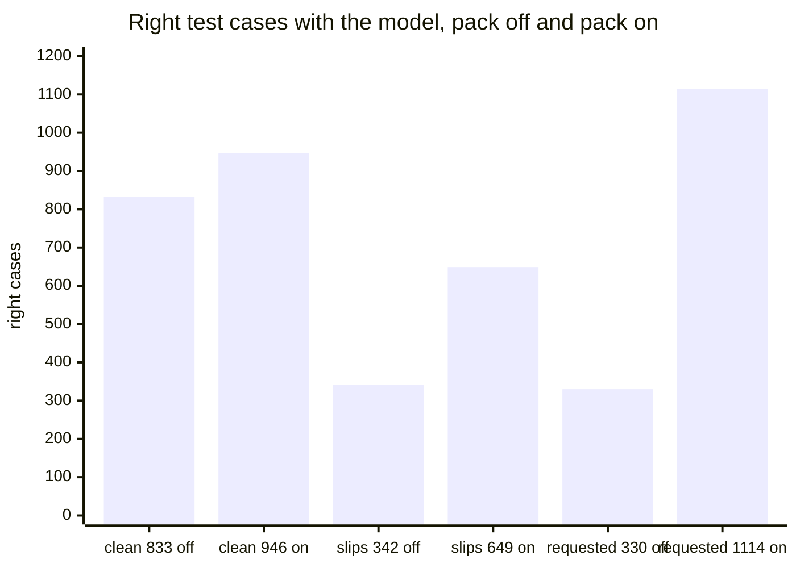

# Design of the vocabulary pack "AI and software" for the English typing engine

## Summary

The vocabulary pack "AI and software" keeps and corrects the words of the field. The pack does
not turn any existing dev case wrong. The numbers below are from the test half. The shipping
keyboard keeps 946 of 950 correctly typed pack words with the pack on and 833 with it off. The
keyboard corrects 649 of 727 slips of those words, against 342.

Figure 1. The pack raises the kept clean words from 833 to 946 of 950, and the corrected slips
from 342 to 649 of 727. The right cases of the requested words rise from 330 to 1,114 of 1,190.
Everyday running text does not change: the keyboard changes 34 of 6,979 words with the pack off
and on.

The pack holds 1,807 words from public text and the 18 words that the user asked for. In the
test half, the keyboard keeps 17 of the 18 requested words in every clean case. The word "todo"
stays in 5 of 24 clean cases, because a typed "todo" is also "to do" with the space missing.

What to do:

1. Install a build of `engine/domain-pack` on the phone through TestFlight.
2. Type the lines of "Phone checks" at the end of this page.
3. Type `duo:work` and a space to turn the work area off, and type it again to turn it on.
4. Read "Decisions for the user" and say which of the 7 choices to change.

The page does not settle the time and memory on the phone with the pack. The keyboard does not
correct a slip after a hyphen, as in "fine-tunign".

## Glossary

| Term | Meaning |
| --- | --- |
| base lexicon | `Shared/lexicon-english.bin`, the word list that the keyboard ships today. |
| work area | A field of work that the person turns on in the keyboard. This page builds one: "AI and software". |
| pack | The words of one work area with their frequencies and preferred forms: `Shared/supplement-ai-software.bin` and `.tsv`. |
| supplement | A second, small lexicon file that the engine reads beside the base lexicon (`duo_lexicon_set_supplement`). |
| new word | A word of the pack that the base lexicon lacks, as "pytorch". |
| raised word | A word of the pack that the base lexicon holds at a frequency 10 times lower or less, as "gpu". |
| requested word | One of the 18 words that the user asked for by name, as "ultrathink" and "worktree". The corpus does not decide it. |
| preferred form | The letter case that the domain text uses most for a word, as "PyTorch". |
| everyday word of the pack | A word of the pack that everyday text writes in another form, as "rag" for "RAG". |
| Zipf | Frequency on a log scale: 3 is once per million words, 6 is once per thousand. |
| domain share | The share of domain text in a person's text that the frequencies of the pack assume. |
| dev half, test half | The two halves of the test cases. Every choice of this page was made on the dev half. The test half was read two times, each time for the design that ships. |
| reading | One way the engine reads the typed letters as words, as "pytorch" and "porch" for "pytorhc". |
| clean case | A case typed without a slip. The keyboard must leave it as typed. |
| slip | One typing error of `keyboard_noise.py`: a neighbour key, a missing, doubled or extra letter, two swapped letters, or a slip at the space bar. |
| engine alone | The choice of `duo_correct_english`, as the keyboard types before its language model is ready. |
| model | The SmolLM2-135M fine-tune `smollm2-lora-typed-seed1.Q4_K_M.gguf` at weight 1.0, margins 0 / 4 / 2 and lead 4. Every number with the model on this page was measured with that file. The app ships the file `smollm2-lora-domain-s100-seed1.Q4_K_M.gguf`, and `scripts/lm-domain/reports/select-tables.md` gives its counts on these cases. |
| protection | The model may not change a typed new word. It chooses among the readings that keep the word. |

## Sources of the domain text

The pack comes from 71.6 million words of public text in 859,014 documents. Each source has a
licence that allows a word list and short quoted sentences in a public repository.

Table 1. Source groups of the domain text. The word counts are those of the build bucket.

| Source group | Sources | Licence | Words |
| --- | --- | --- | --- |
| `arxiv` | Abstracts of cs.CL, cs.LG, cs.AI and cs.SE, the newest 8,000 of each | CC0 1.0 (arXiv metadata) | 4,906,097 |
| `questions-ai` | Stack Exchange sites ai, genai and datascience, dump of 2024-04 | CC BY-SA 4.0, older posts 3.0 and 2.5 | 13,238,915 |
| `questions-software` | Stack Exchange sites softwareengineering and devops, dump of 2024-04 | CC BY-SA 4.0, older posts 3.0 and 2.5 | 49,840,919 |
| `docs-ai` | Documentation of 12 projects, as transformers, vLLM, llama.cpp and the Claude cookbooks | Apache 2.0, MIT or CC BY 4.0 | 1,380,521 |
| `docs-software` | Documentation of 6 projects, as Kubernetes, Docker and GitHub | Apache 2.0 or CC BY 4.0 | 2,200,098 |

`scripts/domain-pack/pack/ai-software.sources.json` names all 27 sources, with the commit and
the licence that GitHub reports for each repository. The collector stops when a reported
licence differs from the one in `sources.json`. `cases/english-domain-ATTRIBUTION.tsv` gives the
address, author, date and licence of each of the 8,511 sources that a case quotes.

A hash of each document's identifier sends it to one of three buckets. The build bucket holds 80
of 100 documents and feeds the pack. The dev and test buckets hold 10 of 100 each and feed the
test cases. A held-out sentence stays out when a build sentence has the same letters. Capitals,
spaces and punctuation do not count. This rule left out 19,622 sentences, and it also covers an
arXiv abstract listed under two categories.

The pack does not use Hacker News comments as a source. The set of terms does not give an open
licence for the text.

## Rules that pick the words of the pack

The method follows the field's term extraction. Compare a word's frequency in domain text with
its frequency in general text. Require the word in more than one source
([TermSuite's weirdness ratio](https://liner.com/review/terminology-extraction-with-term-variant-detection),
[keyness](https://dh-abstracts.library.virginia.edu/works/11926)). Keyboards layer such a list
over their main dictionary. AOSP LatinIME does the same with its
[user and contacts dictionaries](https://git.aicp-rom.com/packages_inputmethods_LatinIME.git/plain/java/src/com/android/inputmethod/latin/Dictionary.java).

1. A source gives a word a rate: its count over the source's words. A source group gives the
   mean rate of its sources. The domain frequency is the mean of the five group rates. The
   largest group does not set a frequency alone. One project's documentation does not set a
   frequency alone either.
2. A word enters when 0.3 times its domain frequency is Zipf 2.5 or more. That is about 3 uses
   in 10 million words. A word of two letters needs Zipf 4.0.
3. A word must be in 2 sources or more, 3 times each, and in 20 documents.
4. That frequency must be 10 times the frequency the keyboard has for the word today.
5. A listed misspelling stays out. A word also stays out when another word meets both
   conditions. The other word is one edit away, and the person writes that word 100 times as
   often. The base lexicon builder uses the same rule.

Table 2. Count of words after each rule, from `ai-software.report.json`.

| Rule | Words |
| --- | --- |
| Frequent enough in the domain text | 15,388 |
| Left out: the keyboard already has the word at about this frequency | 12,345 |
| Left out: in too few sources or documents | 1,138 |
| Left out: a listed misspelling | 2 |
| Left out: one edit away from a far more frequent word | 96 |
| Words from the corpus | 1,807 |
| Of them new words | 1,004 |
| Of them raised words | 803 |

The method finds all 33 words of a seed list that names the obvious terms. Examples include
"gpu", "llms", "kubectl", "agentic" and "finetuning". The seed list is a check and does not add
a word.

`pack/required-terms.tsv` holds the 18 requested words apart from the corpus words. Section
"Requested words" lists them. The builder stops when the corpus or the base lexicon already
gives one.

The pack does not hold a word with a digit, as "k8s" and "s3". The engine reads a digit key as
a slip for a letter, and its lexicon holds letters and apostrophes only.

## Frequencies on the scale of everyday words

A person who works in the area writes domain text some of the time. The pack frequency of a word
is its domain frequency times the domain share. With the share 0.3, a word that is Zipf 5.0 in
domain text gets Zipf 4.48. The domain share puts "llm" (5.37) beside "several" (5.39), and
"kubectl" (4.21) beside "awkward" (4.29). Section "Rule that picks the domain share" gives the
rule and the dev numbers behind 0.3.

## Requested words

The user asked for 18 words by name. `pack/required-terms.tsv` holds them with their source,
"requested by the user". The corpus rules of this page do not pick them.

Table 3. The requested words. The last two columns give the engine's text for the word typed
after "the". The unit tests of `Tests/DomainPackTests.swift` hold these values.

| Requested word | Preferred form | Zipf | Engine with the pack off | Engine with the pack on |
| --- | --- | --- | --- | --- |
| ultrathink | | 4.5 | ultra think | ultrathink |
| ultracode | | 4.5 | ultra code | ultracode |
| worktree | | 4.5 | work tree | worktree |
| worktrees | | 4.5 | work trees | worktrees |
| ultraplan | | 4.5 | ultra plan | ultraplan |
| ultrareview | | 4.5 | ultra review | ultrareview |
| autocompact | | 4.5 | auto compact | autocompact |
| codegen | | 4.5 | code gen | codegen |
| typecheck | | 4.5 | type check | typecheck |
| precommit | | 4.5 | recommit | precommit |
| devcontainer | | 4.5 | de container | devcontainer |
| testflight | TestFlight | 4.5 | test flight | testflight |
| nextjs | Next.js | 4.5 | next is | nextjs |
| swiftui | SwiftUI | 4.5 | swift | swiftui |
| xcode | Xcode | 5.5 | code | xcode |
| pnpm | | 4.5 | pnpm, and the slip "pnmp" stays | pnpm, and the slip "pnmp" becomes "pnpm" |
| vite | | 5.5 | vote | vite |
| todo | | 4.0 | to do | todo |

With the pack off, the engine changes 17 of the 18 words. With the pack on, the engine keeps
all 18. The four preferred forms are the names as their makers write them. The user set the
capitals rule: a typed capital gives the preferred form, and lower case stays.

### Frequency of a requested word

The corpus does not give a count for a requested word. A requested word gets Zipf 4.5: about
once in 30,000 words. Three words have a frequency of their own. The rule reads the dev half,
with the engine alone and with the model.

1. A frequency must keep every existing dev case that types the word right.
2. A word whose clean dev cases are all right at Zipf 4.5 keeps 4.5.
3. Any other word takes the lowest frequency of the grid at which its clean dev cases are all
   right. The grid can lack such a frequency, or rule 1 can forbid it. The word then takes the
   highest frequency that rule 1 allows.

Table 4. Right dev cases of the 15 requested words at Zipf 4.5, with those words at 8
frequencies. The numbers are from the frequency job of run 43187473874.

| Zipf | Clean, model | Clean with a next word, model | Named slips, model | Other slips, model | Controls, model | Capitals, model | All 1,056 cases, model | All 1,056 cases, engine |
| --- | --- | --- | --- | --- | --- | --- | --- | --- |
| 2.0 | 90/90 | 269/270 | 11/18 | 428/583 | 51/51 | 32/44 | 881 | 933 |
| 2.5 | 90/90 | 270/270 | 12/18 | 473/583 | 51/51 | 36/44 | 932 | 981 |
| 3.0 | 90/90 | 270/270 | 15/18 | 502/583 | 51/51 | 38/44 | 966 | 1,006 |
| 3.5 | 90/90 | 270/270 | 18/18 | 517/583 | 51/51 | 38/44 | 984 | 1,017 |
| 4.0 | 90/90 | 270/270 | 18/18 | 538/583 | 51/51 | 38/44 | 1,005 | 1,043 |
| 4.5 (ships) | 90/90 | 270/270 | 18/18 | 547/583 | 51/51 | 38/44 | 1,014 | 1,045 |
| 5.0 | 90/90 | 270/270 | 18/18 | 553/583 | 51/51 | 38/44 | 1,020 | 1,046 |
| 5.5 | 90/90 | 270/270 | 18/18 | 558/583 | 50/51 | 38/44 | 1,024 | 1,047 |

The more frequent the requested words, the more of their slips the model corrects. The three
slips that the user named need Zipf 3.5 with the model. The value 4.5 is one Zipf unit above
3.5. The value 5.5 turns one control wrong: "ultrathin" becomes "ultrathink". At 4.5 all 360
clean cases of the 15 words are right, so rule 2 keeps 4.5 for them.

Table 5. Right dev cases of the three words with a frequency of their own, with the model. Each
word moves alone. The numbers are from the frequency job of run 43187473874.

| Zipf | xcode: clean | xcode: clean with a next word | xcode: typed for "code" | vite: clean | vite: clean with a next word | vite: typed for "vote" or "bite" | todo: clean | todo: clean with a next word | todo: typed for "to do" | todo: existing cases that mean "to do" |
| --- | --- | --- | --- | --- | --- | --- | --- | --- | --- | --- |
| 3.5 | 6/6 | 5/18 | 5/12 | 6/6 | 9/18 | 6/24 | 4/6 | 0/18 | 12/12 | 2/2 |
| 4.0 | 6/6 | 6/18 | 4/12 | 6/6 | 10/18 | 0/24 | 5/6 | 5/18 | 12/12 | 2/2 |
| 4.5 | 6/6 | 9/18 | 3/12 | 6/6 | 11/18 | 0/24 | 6/6 | 9/18 | 0/12 | 0/2 |
| 5.0 | 6/6 | 14/18 | 0/12 | 6/6 | 15/18 | 0/24 | 6/6 | 12/18 | 0/12 | 0/2 |
| 5.5 | 6/6 | 18/18 | 0/12 | 6/6 | 18/18 | 0/24 | 6/6 | 14/18 | 0/12 | 0/2 |

The more frequent the word, the more often the keyboard keeps the word before a next word. By
rule 3, "xcode" and "vite" take Zipf 5.5. For "todo", the grid lacks a frequency at which every
clean case is right. Each value from 4.5 up turns the two existing dev cases wrong, so "todo"
takes 4.0. The engine alone gives the same three values.

At Zipf 4.5 the keyboard changes "the xcode is" to "the code is". The engine reads the two
words again when the person types the second word. The base lexicon holds the pair "code is",
and a word of the pack does not have a pair. The engine scores "code is" 6.4 above "xcode is"
at 4.5. The margin that keeps a typed known word is 5.0.

The price of 5.5 is the slip that spells the word. A typed "xcode" for "code" stays in all 12
dev cases, and a typed "vite" for "vote" or "bite" stays in all 24. The controls do not change:
"code" stays in 4 of 4 dev cases, and "vote", "bite", "site" and "vice" stay in 16 of 16. The
model changes the control "vi te" in 2 of 3 cases at every frequency of the grid.

A typed "todo" is also "to do" with the space missing. Two existing dev cases mean "to do":
"know how todo" and "anything they needed todo". At Zipf 4.0 the keyboard keeps "todo" in 5 of
6 clean cases. With a next word typed, the keyboard keeps "todo" in 5 of 18 cases and writes
"to do" in the other 13.

## Path of the pack into the engine

The pack reaches the engine as a supplement: a second lexicon file of the same format. The
supplement does not hold word pairs. The engine reads the supplement beside the base lexicon.

Figure 2. The supplement adds words to the engine's search. The protection and the table of
preferred capitals act on the result, and one switch turns all three off.

Table 6. Two ways to bring the pack to the engine. They differ in 12 dev controls and 2 dev
stream sentences.

| | Merged lexicon | Supplement (taken) |
| --- | --- | --- |
| Files in the app | A second lexicon of 7,800,967 bytes for the setting "on" | One file of 139,520 bytes per work area |
| Switch at run time | Open the other file | Set or clear one pointer |
| A word the person teaches the keyboard later | Needs a rebuild of the 7.8 MB file | A second small file of the same format |
| A raised word | Takes the pack frequency and keeps its pairs | Takes the higher of its base value and its pack value, and keeps its pairs |
| Engine change | None | A second walk of the letter tree |
| Same output as the other way, engine alone | 7,125 of 7,137 new dev cases, 2,298 of 2,300 stream sentences, 6,799 of 6,799 existing dev cases | the same |
| Right new dev cases, engine alone | 6,345 of 7,137 | 6,357 of 7,137 |

The supplement is chosen because it switches at run time and costs 56 times fewer bytes. The
supplement also has the shape that a store of personally learned words needs. The merged lexicon
stays in the repository as the comparison (`build_merged_lexicon.py`). The keyboard does not
ship the merged lexicon.

A new word does not have a word pair. After any word, a new word gets its own frequency, as a
base word without a listed pair does. The engine scores the word after a new word as it scores
a word after any known word.

The supplement does not join typed words that are all known words. A person who typed "hard
coded" meant two words, also when the pack holds "hardcoded". The base lexicon keeps its own
joins, as before. The merged lexicon joins such words: it turns the control "ultra code" into
"ultracode" and "pre commit" into "precommit".

The engine without a supplement gives the outputs of the engine before the change on every
existing dev task. `duo_english_readings` passes the memory checks of the compiler with the
supplement on 15,559 inputs. `scripts/domain-pack/check_supplement.py` holds 110 checks of the
supplement, the capitals rule and the protection. The engine before the change does not pass the
first supplement check.

The supplement file is mapped from the app bundle, as the base lexicon is. iOS reads its pages
from disk when the engine touches them. So its 140 KB do not count as loaded data. The table of
preferred capitals is 39 KB of text. The keyboard reads the table once into 533 entries and a
set of 1,022 words.

In the simulator the keyboard's footprint before the model loads is 140.4 MB with the work
area, in run 43187473727. Run 43142371994 gave 143.1 MB with the work area, and run 43010544544
gave 142.8 MB before the work area. The spread between runs is larger than the two files of the
work area, 178 KB. The footprint on the phone was not measured.

## Protection of a typed new word from the model

The model must keep a typed word that only the pack holds. The model chooses among the readings
that keep every such word. The text as typed and the engine's own choice always stay among them.
The user decided that the protection stays on.

The model was fine-tuned on everyday sentences. Without the protection, the model changes
correctly typed pack words: "ide" to "ride" and "adamw" to "adam". Other changes include "sft"
to "soft" and "json" to "is on". The pack knows these words better than the model does. The
protection does not cover a raised word because that word is also an everyday word. Examples
include "node", "model" and "token".

The price is the group `term_for_everyday_word`. A slip of an everyday word that spells a new
word of the pack stays as typed. An example is "gpt" for "got". Section
"Results on the dev half" gives both sides of that trade.

## Rule of the preferred capitals

The user decided the rule. When the person means a properly capitalized word, the keyboard
writes that word, and lower case is fine otherwise. The keyboard writes a word of the pack in
one of three forms. The forms are lower case, the preferred form, or all capitals. The typed
capitals pick the form.

1. Without a typed capital, the word stays in lower case: "gpu" stays "gpu".
2. Typed in capitals only, the word stays: "PYTORCH" stays.
3. One capital that the keyboard typed by itself, at the start of a sentence: the preferred
   form. "Gpu" becomes "GPU", and "Vllm" becomes "vLLM".
4. One capital that the person typed: the preferred form. "Gpu" inside a sentence becomes "GPU",
   and "pyTorch" becomes "PyTorch".
5. Two or more capitals: the preferred form or all capitals, whichever differs from the typed
   capitals in fewer letters. A tie goes to the preferred form. "PYTORCh" becomes "PYTORCH", and
   "PYtorch" becomes "PyTorch".
6. An everyday word of the pack keeps a plain first capital. "Rag" stays "Rag" in rules 3 and 4.
7. A corrected slip follows the same rules with the case of its first typed letter. "Pytorhc"
   becomes "PyTorch", and "pytorhc" becomes "pytorch".
8. The rule does not count an apostrophe as a letter: "Gpu's" becomes "GPU's".
9. A first letter typed as a symbol key gets the keyboard's own capital at sentence start. Thus,
   "[ytorch" becomes "PyTorch" there and "pytorch" inside a sentence.
10. The rule does not change a word outside the pack or a pack word that prefers lower case.
11. A preferred form can hold a sign between its letters. The rule counts the letters alone, so
    "Nextjs" becomes "Next.js" and "nextjs" stays.

Table 7. Three rules for the form of a word, on three typed texts inside a sentence.

| Typed | Distance over the letter case alone | Always the preferred form | Intent first (taken) |
| --- | --- | --- | --- |
| gpu | gpu | GPU | gpu |
| Gpu | gpu, one letter away | GPU | GPU |
| PYTORCH | PYTORCH | PyTorch | PYTORCH |

A distance alone undoes a capital that the person typed. Always the preferred form overrides a
person who types in lower case, which the user ruled out. So intent comes first, and the
distance only decides between the preferred form and all capitals.

Table 8. Letter case of the pack's words in the domain text, for the 521 words with a preferred
form excluding everyday words.

| Place | Words | Uses | Preferred form | Plain first capital, as "Gpu" | Lower case |
| --- | --- | --- | --- | --- | --- |
| Inside a sentence | 521 | 361,730 | 85.9% | counted with other forms | 11.6% |
| First word of a sentence, preferred form starts with a capital | 510 | 19,276 | 93.0% | 4.0% | 1.8% |
| First word of a sentence, preferred form starts in lower case | 11 | 256 | 80.9% | 2.7% | 1.2% |

At the start of a sentence, the domain text writes the preferred form 93.0% of the time. Thus,
rule 3 gives the preferred form. The rule also gives the preferred form for the 11 words such as
"vLLM" and "macOS": 80.9%. The table shows how writers of the field spell these words. The table
does not measure the intent of a person who types a capital.

A word is an everyday word of the pack when everyday sentences meet both conditions. The
sentences write the word in another form at least 5 times. That form occurs at least as often as
the preferred form. The pack marks 8 words: pod, azure, compose, rag, llama, terraform, copilot
and ides. The count comes from four of five pairs of Tatoeba ids. The fifth pair feeds the
everyday cases, so those are new text for this rule.

The keyboard does not read a word with a capital after its first letter for slips. Thus, a
corrected slip carries at most one capital, on its first letter. Rule 7 does not need alignment
of the typed letters with the corrected ones.

A case change is a correction like any other. One backspace right after the correction brings
the typed form back. The keyboard keeps that word as typed from then on.

## Work area setting

The work area is on in a new install. The text `duo:work` and a space turns the work area off or
on. The user decided both points. The keyboard takes the text out of the field and names the
new state on the space bar. The keyboard extension stores the switch in its own settings.

## Test cases of the pack

`scripts/typing-evaluation/build_english_domain_cases.py` writes
`cases/english-domain.{dev,test}.jsonl` and `cases/english-domain-stream.{dev,test}.jsonl`. The
build does not change the existing case files.

Table 9. Groups of the new cases.

| Group | The keyboard must | Example, typed to intended | Dev cases | Test cases |
| --- | --- | --- | --- | --- |
| `domain_clean` | keep a word of the pack in a technical sentence | pytorch to pytorch | 950 | 950 |
| `domain_slips` | correct one slip into the word of the pack | weighhts to weights | 723 | 727 |
| `domain_phrases` | repair the space bar in a frequent pair and inside a word of the pack, and keep the pair | linearlayer to linear layer | 1,197 | 1,192 |
| `required` | keep and correct the 18 requested words, and keep the everyday texts near them | ultrathnik to ultrathink, vote to vote | 1,207 | 1,190 |
| `neighbour_controls` | keep a common word one edit away from a word of the pack, and correct its slips to it | tom to tom, tolm to tom | 1,100 | 1,100 |
| `term_for_everyday_word` | (the price of the pack) read a slip that spells a new word of the pack as the common word | aws to was, vite to vote | 206 | 202 |
| `capitals` | write the form that the typed capitals ask for, with the capitals scored | Rnn to RNN, Coat to Coat, Nextjs to Next.js | 1,754 | 1,724 |
| stream, technical | change no word of 1,000 held-out technical sentences in lower case | 14,765 dev words | 1,000 | 1,000 |
| stream, written | change no word of 300 other technical sentences with their capitals and punctuation | 4,648 dev words | 300 | 300 |
| stream, everyday | change no word of 1,000 Tatoeba sentences in lower case | 7,040 dev words | 1,000 | 1,000 |

The context of a technical case is the sentence before the word, as its source wrote it. The
typed word is in lower case, unless the case is about capitals. The dev half has 7,137 cases and
the test half has 7,085.

Each requested word has its own cases in both halves: 1,207 dev cases and 1,190 test cases in
the group `required`. The contexts are written by hand, and each half has its own. A word that
orders a coding agent follows a request, as "please". A word that names a tool follows the
words of a name, as "we use".

- Clean: the word alone, and the word before a next word. The keyboard must keep the word.
- Slips: up to 40 typed texts per word, each with one slip of `keyboard_noise.py`. The three
  slips that the user named have cases of their own.
- Controls: each everyday text near the word, typed correctly. A common word one edit away is
  such a text, as "vote" beside "vite". Two common words with the letters of the word are
  another, as "to do" beside "todo". The contexts are Tatoeba sentences that hold the text. A
  text that Tatoeba lacks, as "work tree", gets written contexts.
- Price: the requested word typed where a Tatoeba sentence has the everyday text. The 48 cases
  per half belong to the group `term_for_everyday_word`.
- Capitals: the four words with a preferred form, typed in lower case, with one capital, in
  capitals only, and with a slip. The 58 cases per half belong to the group `capitals`.

The group `term_for_everyday_word` does not serve as a control. A pack that knows "gpt" does not
also read "gpt" as a slip of "got" from the word alone. The group measures that price.

The technical stream measures every word of held-out text, in the pack or not. The cases of the
other groups take their words from the pack, so they measure the pack's own words.

## Rule that picks the domain share

The rule was fixed before any run with the model was read. The rule compares the shares 0.03,
0.1, 0.3 and 1.0 on one set of words. The comparison uses the configuration that ships: the
model with the pack on.

1. A share stays in when the pack does not turn any clean control case from right to wrong. The
   controls are `neighbour_clean`, `required_control`, `domain_clean_hyphenated`, `phrase_clean`
   and the five capital controls. The gate reads each case, so a gain elsewhere does not hide a
   loss.
2. The pack must change at most as many words of the everyday stream as the pack-off run.
3. Among those shares, choose the share with the most right new dev cases over every group. Each
   case counts the same, also the cases of `term_for_everyday_word`. These weights are those of
   the case files. The weighting does not measure how often each slip happens.
4. A tie goes to the smaller share.

The chosen share must also keep every existing dev category at the pack-off count or more. Each
category of the apostrophe words must also meet that condition.
`scripts/lm-rerank/domain_pack_shares.py` applies the rule.

Table 10. The four shares with the model and the pack on, on the dev half, from run 43187473874.

| Share | Right new dev cases | Lost clean controls | Everyday stream, changed words (pack off) | Technical stream, changed words per 1,000 | Existing dev cases | Passes the gates |
| --- | --- | --- | --- | --- | --- | --- |
| 0.03 | 6,220 | 0 | 25 (25) | 13.07 | 6,543 | yes |
| 0.1 | 6,293 | 0 | 25 (25) | 12.80 | 6,543 | yes |
| 0.3 (chosen) | 6,353 | 0 | 25 (25) | 12.87 | 6,544 | yes |
| 1.0 | 6,418 | 1 | 25 (25) | 12.60 | 6,543 | no |

The higher the share, the more new cases are right. The share 1.0 turns one clean control wrong:
"model" becomes "models". The rule picks 0.3. With the engine alone, the share 1.0 also turns
one existing clean case wrong, "ttyl" to "ttl".

The four jobs ran on three kinds of processor. With the pack off, the four jobs type the same
cases with the same model. They get 6,542 existing cases right on two kinds of processor and
6,543 on the AMD EPYC 7763, where the job of share 0.3 ran.

## Results on the dev half

The pack keeps the words of the field and corrects their slips. The pack does not turn any
existing dev case wrong. All numbers are from the job of share 0.3 in run 43187473874, at commit
835dc5f. That job ran on an AMD EPYC 7763.

Table 11. Right dev cases of the new groups in the four configurations.

| Configuration | domain_clean | domain_slips | domain_phrases | required | neighbour_controls | term_for_everyday_word | capitals | all |
| --- | --- | --- | --- | --- | --- | --- | --- | --- |
| engine, pack off | 745/950 | 322/723 | 869/1197 | 188/1207 | 997/1100 | 144/206 | 764/1754 | 4029/7137 |
| engine, pack on | 949/950 | 631/723 | 947/1197 | 1140/1207 | 990/1100 | 40/206 | 1660/1754 | 6357/7137 |
| model, pack off | 837/950 | 342/723 | 905/1197 | 325/1207 | 1031/1100 | 178/206 | 784/1754 | 4402/7137 |
| model, pack on (ships) | 946/950 | 628/723 | 980/1197 | 1120/1207 | 1029/1100 | 40/206 | 1610/1754 | 6353/7137 |

Table 12. Right dev cases of each category.

| Category | engine, pack off | engine, pack on | model, pack off | model, pack on |
| --- | --- | --- | --- | --- |
| `domain_clean_new` | 200/400 | 399/400 | 299/400 | 399/400 |
| `domain_clean_raised` | 395/400 | 400/400 | 388/400 | 397/400 |
| `domain_clean_hyphenated` | 150/150 | 150/150 | 150/150 | 150/150 |
| `domain_slip_new` | 0/343 | 270/343 | 0/343 | 263/343 |
| `domain_slip_raised` | 322/380 | 361/380 | 342/380 | 365/380 |
| `phrase_clean` | 292/300 | 294/300 | 293/300 | 296/300 |
| `phrase_space_missing` | 104/150 | 115/150 | 106/150 | 118/150 |
| `phrase_space_to_letter` | 128/150 | 135/150 | 139/150 | 141/150 |
| `phrase_space_transposed` | 127/150 | 128/150 | 134/150 | 135/150 |
| `term_space_extra` | 108/150 | 137/150 | 114/150 | 145/150 |
| `term_letter_to_space` | 110/150 | 138/150 | 119/150 | 145/150 |
| `hyphen_second_part_slip` | 0/147 | 0/147 | 0/147 | 0/147 |
| `required_clean` | 35/108 | 107/108 | 75/108 | 107/108 |
| `required_clean_next_word` | 70/324 | 310/324 | 169/324 | 311/324 |
| `required_slip_named` | 0/18 | 18/18 | 0/18 | 18/18 |
| `required_slip` | 0/674 | 622/674 | 0/674 | 603/674 |
| `required_control` | 83/83 | 83/83 | 81/83 | 81/83 |
| `neighbour_clean` | 398/400 | 398/400 | 387/400 | 387/400 |
| `neighbour_slip` | 338/400 | 338/400 | 365/400 | 365/400 |
| `neighbour_slip_between` | 261/300 | 254/300 | 279/300 | 277/300 |
| `neighbour_slip_onto_term` | 108/158 | 28/158 | 133/158 | 28/158 |
| `requested_term_for_everyday_word` | 36/48 | 12/48 | 45/48 | 12/48 |
| `capital_lower_stays` | 107/150 | 150/150 | 122/150 | 149/150 |
| `capital_deliberate` | 29/150 | 150/150 | 31/150 | 149/150 |
| `capital_sentence_start` | 22/150 | 150/150 | 23/150 | 149/150 |
| `capital_inner` | 0/100 | 100/100 | 0/100 | 100/100 |
| `capital_preferred_stays` | 97/100 | 100/100 | 100/100 | 100/100 |
| `capital_all_capitals_stay` | 100/100 | 100/100 | 100/100 | 100/100 |
| `capital_two_capitals_nearest` | 0/60 | 60/60 | 0/60 | 60/60 |
| `capital_slip_lower` | 29/150 | 118/150 | 29/150 | 112/150 |
| `capital_slip_deliberate` | 18/150 | 114/150 | 16/150 | 109/150 |
| `capital_slip_sentence_start` | 3/87 | 74/87 | 4/87 | 56/87 |
| `capital_plain_word_keeps_capital` | 90/100 | 100/100 | 98/100 | 100/100 |
| `capital_possessive` | 24/51 | 51/51 | 27/51 | 51/51 |
| `capital_symbol_first` | 8/120 | 109/120 | 11/120 | 109/120 |
| `capital_control_everyday_start` | 8/8 | 8/8 | 7/8 | 7/8 |
| `capital_control_everyday_deliberate` | 7/7 | 7/7 | 5/7 | 6/7 |
| `capital_control_everyday_lower` | 7/7 | 7/7 | 5/7 | 6/7 |
| `capital_control_ordinary_word` | 150/150 | 150/150 | 147/150 | 147/150 |
| `capital_control_collision_lower` | 56/56 | 56/56 | 50/56 | 50/56 |
| `capital_requested` | 9/58 | 56/58 | 9/58 | 50/58 |

Every clean control is at the pack-off count or more in both pairs of columns. Most wrong
capital cases with the pack on are slips that the keyboard left uncorrected.

Table 13. Right dev cases of each requested word. Without a mark, a column is with the pack on.
A clean case types the word alone or before a next word.

| Requested word | Clean, model, pack off | Clean, engine | Clean, model | Slips, engine | Slips, model | Controls, model | Typed for an everyday text, model | Capitals, model |
| --- | --- | --- | --- | --- | --- | --- | --- | --- |
| ultrathink | 22/24 | 24/24 | 24/24 | 52/52 | 52/52 | 3/3 |  |  |
| ultracode | 24/24 | 24/24 | 24/24 | 46/46 | 40/46 | 3/3 |  |  |
| worktree | 3/24 | 24/24 | 24/24 | 36/40 | 36/40 | 3/3 |  |  |
| worktrees | 0/24 | 24/24 | 24/24 | 39/40 | 38/40 | 3/3 |  |  |
| ultraplan | 23/24 | 24/24 | 24/24 | 40/40 | 40/40 | 3/3 |  |  |
| ultrareview | 12/24 | 24/24 | 24/24 | 40/40 | 40/40 | 3/3 |  |  |
| autocompact | 24/24 | 24/24 | 24/24 | 40/40 | 40/40 | 3/3 |  |  |
| codegen | 24/24 | 24/24 | 24/24 | 40/40 | 36/40 | 3/3 |  |  |
| typecheck | 16/24 | 24/24 | 24/24 | 40/40 | 40/40 | 3/3 |  |  |
| precommit | 18/24 | 24/24 | 24/24 | 40/40 | 39/40 | 3/3 |  |  |
| devcontainer | 18/24 | 24/24 | 24/24 | 40/40 | 39/40 |  |  |  |
| testflight | 3/24 | 24/24 | 24/24 | 40/40 | 39/40 | 3/3 |  | 15/15 |
| nextjs | 20/24 | 24/24 | 24/24 | 38/40 | 32/40 |  |  | 8/14 |
| swiftui | 8/24 | 24/24 | 24/24 | 37/40 | 34/40 |  |  | 15/15 |
| xcode | 1/24 | 24/24 | 24/24 | 29/32 | 29/32 | 4/4 | 0/12 | 12/14 |
| pnpm | 24/24 | 24/24 | 24/24 | 22/23 | 20/23 |  |  |  |
| vite | 3/24 | 24/24 | 24/24 | 21/27 | 20/27 | 17/19 | 0/24 |  |
| todo | 1/24 | 9/24 | 10/24 | 0/32 | 7/32 | 9/9 | 12/12 |  |
| ultra, ultrathin, ultrasound |  |  |  |  |  | 18/18 |  |  |
| all | 244/432 | 417/432 | 418/432 | 640/692 | 621/692 | 81/83 | 12/48 | 50/58 |

With the model, the keyboard keeps 17 of the 18 requested words in each of their 24 clean dev
cases. The keyboard keeps "todo" in 10 of 24. With the pack off, the model keeps 244 of the 432
clean cases. The model corrects 621 of 692 slips, and the engine alone corrects 640.

The controls are right in 81 of 83 cases with the pack off and on. The two wrong cases type the
control "vi te", and the model changes that text. A typed "xcode" for "code" stays in 12 of 12
cases, and a typed "vite" for "vote" or "bite" stays in 24 of 24. Of the 8 wrong capital cases,
5 are slips of "nextjs" that the model leaves as typed.

Table 14. Changed words of clean running text on the dev half, per 1,000 typed words.

| Configuration | Technical, 14,765 words | Technical, changed sentences that hold a changed pack word | Written, 4,648 words | Everyday, 7,040 words |
| --- | --- | --- | --- | --- |
| engine, pack off | 23.43 (346 words) | 86 | 11.83 (55) | 10.80 (76) |
| engine, pack on | 13.55 (200) | 2 | 8.61 (40) | 10.80 (76) |
| model, pack off | 17.00 (251) | 49 | 11.40 (53) | 3.55 (25) |
| model, pack on (ships) | 12.87 (190) | 6 | 10.33 (48) | 3.55 (25) |

With the model, the pack lowers changed words of technical text from 17.00 to 12.87 per 1,000.
The pack does not change the everyday text: 25 words with the pack off and on. The keyboard
still changes technical text 3.6 times as often as everyday text.

Table 15. Right existing dev cases. The grouping does not include the last two categories.

| Configuration | clean | letter slips | space slips | symbol slips | clean symbols | apostrophe_missing | real_word_slip | all dev cases | apostrophe words, word | apostrophe words, next word |
| --- | --- | --- | --- | --- | --- | --- | --- | --- | --- | --- |
| engine, pack off | 957/973 | 1943/2100 | 1299/1500 | 1131/1197 | 427/429 | 255/300 | 62/300 | 6074/6799 | 882/1623 | 628/1623 |
| engine, pack on | 961/973 | 1943/2100 | 1299/1500 | 1131/1197 | 427/429 | 255/300 | 62/300 | 6078/6799 | 882/1623 | 628/1623 |
| model, pack off | 954/973 | 2057/2100 | 1388/1500 | 1165/1197 | 427/429 | 295/300 | 257/300 | 6543/6799 | 1264/1623 | 1432/1623 |
| model, pack on (ships) | 954/973 | 2057/2100 | 1388/1500 | 1165/1197 | 428/429 | 295/300 | 257/300 | 6544/6799 | 1264/1623 | 1432/1623 |

With the engine alone or the model, the pack does not turn any existing dev case from right to
wrong. The pack does not turn any apostrophe case from right to wrong either. The pack turns 4
existing cases right with the engine alone: "postgres", "websocket", "finetune" and "xcode". The
pack turns 1 right with the model, "readme.md". Each of the 24 existing categories and each of
the 10 apostrophe categories keeps its count or gains.

The model counts of Table 15 are one case higher than the pinned numbers of
`scripts/lm-keyboard/compare.py`. The pinned numbers come from a job on another processor.

Table 16. New dev cases that the pack turns from right to wrong, outside `term_for_everyday_word`.

| Configuration | Cases | Examples, typed to shown, with the intended text |
| --- | --- | --- |
| engine | 11 | "lofs" to "logs" (lots), "nosde" to "node" (nose), "pseudoc ode" to "pseudocode" (pseudo code) |
| model | 7 | "sparwe" to "sparse" (spare), "deckding" to "decoding" (deciding), "vectorbstore" to "vectorstore" (vector store) |

All 18 are slips. Some are slips of everyday words that sit closer to words of the pack. Others
are slips at the space bar whose letters spell joined words of the pack.

### Price and gain of the protection

Table 17. The model with the pack on, with and without the protection, on the dev half.

| | With the protection (ships) | Without |
| --- | --- | --- |
| `domain_clean_new` | 399/400 | 389/400 |
| `required` | 1120/1207 | 1115/1207 |
| `capitals` | 1610/1754 | 1596/1754 |
| `term_for_everyday_word` | 40/206 | 143/206 |
| All new dev cases | 6353/7137 | 6427/7137 |
| Technical stream, changed words | 190 | 192 |
| Existing dev cases | 6544/6799 | 6544/6799 |

The protection keeps 10 more of 400 clean new words and 14 more capital cases. The protection
also keeps a requested word before a next word in 5 more cases, as "xcode and". The protection
leaves 103 more of the 206 slips that spell a new word of the pack. By the count of cases, the
protection gives fewer right cases.

The protection ships because a correctly typed word of the person's own field must stay. The
user decided that point. With the protection off, the model turns "json" into "is on" and
"xcode and" into "code and". The 206 cases were built to hit a word of the pack. Thus, their
count does not say how often such a slip happens.

### Supplement against the merged lexicon

With the engine alone, the supplement and the merged lexicon give the same output in 7,125 of
the 7,137 new dev cases. The output is the same in all 6,799 existing dev cases and in 2,298 of
2,300 stream sentences. Each difference comes from the rule against joining typed known words.

The merged lexicon joins 12 controls of the requested words, as "ultra code" to "ultracode". In
the stream, the merged lexicon turns "auto scaling" into "autoscaling" and "dev container" into
"devcontainer". The supplement keeps the two words in each of these 14 texts. The numbers are
from the engine job of run 43187473874.

### Keyboard code against the harness

The keyboard's own code types the same dev cases in the iOS simulator. Run 43187473727 has the
keyboard and the harness on one machine. The two give the same output in all 13,936 dev cases.
They make the same choice in all 14,628 corrections that went to the model. A case about
capitals is compared with its capitals.

With the model the keyboard gets 6,350 of the 7,137 new dev cases right. The keyboard gets
6,537 of the 6,799 existing ones. The harness on that machine gets the same two counts. The
keyboard's scorer and the harness scorer give the same answers in all 13,930 requests there.

The scorer reads a long context in calls of 31 tokens at most. The calls of one context differ
in size by one token at most. llama.cpp computes a call of one token with another routine, and
its sums differ in the last bits on the macOS runner. `scripts/lm-keyboard/README.md` gives the
request that shows the effect.

## Results on the test half

The test half was measured two times, each time for the design that ships. The first read was
run 43142372002, before the 16 later requested words. The second read is run 43187473874 at
commit 835dc5f, after the addition of those words and their cases.

Between the two reads, the pack gained the 16 words, and three of them got a frequency of their
own from dev cases. Every setting was chosen on the dev half. We did not tune a setting on the
test half. The numbers below are those of the second read.

Table 18. Right test cases of the new groups in the four configurations.

| Configuration | domain_clean | domain_slips | domain_phrases | required | neighbour_controls | term_for_everyday_word | capitals | all |
| --- | --- | --- | --- | --- | --- | --- | --- | --- |
| engine, pack off | 736/950 | 322/727 | 840/1192 | 192/1190 | 1012/1100 | 140/202 | 748/1724 | 3990/7085 |
| engine, pack on | 949/950 | 652/727 | 925/1192 | 1131/1190 | 1007/1100 | 32/202 | 1638/1724 | 6334/7085 |
| model, pack off | 833/950 | 342/727 | 892/1192 | 330/1190 | 1054/1100 | 170/202 | 788/1724 | 4409/7085 |
| model, pack on (ships) | 946/950 | 649/727 | 956/1192 | 1114/1190 | 1053/1100 | 32/202 | 1592/1724 | 6342/7085 |

The test numbers follow the dev numbers of Table 11. The 5,953 cases of the first read are in
the test half unchanged, and the engine gives each of them the same output in both reads.

With the model and the pack on, the second read gets 5,324 of those cases right, and the first
read got 5,326. The first read ran on an AMD EPYC 7763, and the second ran on an AMD EPYC 9V45.
Between the two, 12 outputs of the model differ. With the pack off, 26 outputs differ.

Table 19. Right test cases of each requested word. Without a mark, a column is with the pack on.
A clean case types the word alone or before a next word.

| Requested word | Clean, model, pack off | Clean, engine | Clean, model | Slips, engine | Slips, model | Controls, model | Typed for an everyday text, model | Capitals, model |
| --- | --- | --- | --- | --- | --- | --- | --- | --- |
| ultrathink | 22/24 | 24/24 | 24/24 | 52/52 | 52/52 | 3/3 |  |  |
| ultracode | 24/24 | 24/24 | 24/24 | 46/46 | 45/46 | 3/3 |  |  |
| worktree | 3/24 | 24/24 | 24/24 | 38/40 | 30/40 | 3/3 |  |  |
| worktrees | 0/24 | 24/24 | 24/24 | 40/40 | 36/40 | 3/3 |  |  |
| ultraplan | 23/24 | 24/24 | 24/24 | 40/40 | 40/40 | 3/3 |  |  |
| ultrareview | 9/24 | 24/24 | 24/24 | 40/40 | 40/40 | 3/3 |  |  |
| autocompact | 24/24 | 24/24 | 24/24 | 40/40 | 40/40 | 3/3 |  |  |
| codegen | 24/24 | 24/24 | 24/24 | 40/40 | 36/40 | 3/3 |  |  |
| typecheck | 21/24 | 24/24 | 24/24 | 39/40 | 40/40 | 3/3 |  |  |
| precommit | 14/24 | 24/24 | 24/24 | 40/40 | 40/40 | 3/3 |  |  |
| devcontainer | 23/24 | 24/24 | 24/24 | 40/40 | 40/40 |  |  |  |
| testflight | 3/24 | 24/24 | 24/24 | 40/40 | 40/40 | 3/3 |  | 15/15 |
| nextjs | 17/24 | 24/24 | 24/24 | 38/40 | 36/40 |  |  | 14/14 |
| swiftui | 12/24 | 24/24 | 24/24 | 40/40 | 37/40 |  |  | 12/15 |
| xcode | 4/24 | 24/24 | 24/24 | 30/32 | 31/32 | 4/4 | 0/12 | 14/14 |
| pnpm | 18/24 | 24/24 | 24/24 | 13/13 | 10/13 |  |  |  |
| vite | 4/24 | 24/24 | 24/24 | 19/22 | 16/22 | 19/19 | 0/24 |  |
| todo | 0/24 | 4/24 | 5/24 | 0/28 | 7/28 | 11/11 | 12/12 |  |
| ultra, ultrathin, ultrasound |  |  |  |  |  | 18/18 |  |  |
| all | 245/432 | 412/432 | 413/432 | 635/673 | 616/673 | 85/85 | 12/48 | 55/58 |

With the model, the keyboard keeps 17 of the 18 requested words in each of their 24 clean test
cases. "xcode" and "vite" are among the 17. The keyboard keeps "todo" in 5 of 24, by the rule
for its frequency. With the pack off, the model keeps 245 of the 432 clean cases.

The controls are right in 85 of 85 cases. The model corrects 616 of 673 slips, and the engine
alone corrects 635. The column "Typed for an everyday text" is the price. A typed "xcode" for
"code" stays in 12 of 12 cases, and a typed "vite" for "vote" or "bite" stays in 24 of 24.

Table 20. Changed words of clean running text on the test half, per 1,000 typed words.

| Configuration | Technical, 15,021 words | Written, 4,681 words | Everyday, 6,979 words |
| --- | --- | --- | --- |
| engine, pack off | 22.97 (345 words) | 13.89 (65) | 13.61 (95) |
| engine, pack on | 12.12 (182) | 8.97 (42) | 13.61 (95) |
| model, pack off | 15.31 (230) | 13.46 (63) | 4.87 (34) |
| model, pack on (ships) | 10.45 (157) | 10.90 (51) | 4.87 (34) |

With the model, the pack lowers changed words of technical text from 15.31 to 10.45 per 1,000.
The everyday text does not change: 34 words with the pack off and on.

With the model, the pack does not turn any test case of a clean control from right to wrong.
Among the clean controls, `neighbour_clean` stays at 390 of 400. The count for `phrase_clean`
goes from 292 to 294 of 300.

The pack turns 6 slips outside `term_for_everyday_word` wrong. Four are slips at the space bar,
as "feedbforward" to "feedforward" for "feed forward". The other two are "t oken" to "tokens"
for "token", and "lls" to "ls" for "los".

## Effect of the model on the words of the field

The model helps on four measures and lowers five. Table 11 and Table 14 give the numbers.

- The model helps: phrases 947 to 980 and neighbour controls 990 to 1,029. The technical stream
  improves from 13.55 to 12.87 changed words per 1,000. The everyday stream improves from 10.80
  to 3.55.
- The model lowers clean pack words from 949 to 946, and slips of pack words from 631 to 628.
  The requested words fall from 1,140 to 1,120. The written stream rises from 8.61 to 10.33
  changed words per 1,000.
- The capitals fall from 1,660 to 1,610. In 67 capital cases the engine is right and the
  model is wrong, and in 17 the model is right and the engine is wrong. Of the 67, 49 are slips
  that the engine corrects, and 21 of the 49 are at the start of a sentence. Another 12 are
  controls that the model changes with the pack off too.
- With the pack off, the model keeps 837 of 950 clean pack words. The model changes 17.00 of
  1,000 words of technical text against 3.55 of everyday text. The model knows the words of the
  field less well than everyday words.

## Use of the pack by the next fine-tune

Technical clean text in the training data looks necessary. The model was trained on everyday
sentences in lower case. With the pack off, the model changes technical text 4.8 times as often
as everyday text. The counts are 17.00 against 3.55 words per 1,000. The fine-tuning worker
found that clean running text in training cuts the changed correct words by more than half. That
text was everyday text.

A later training round can take these steps. The page does not build them.

1. Add clean running technical text, typed word by word with the work area on. Each list must
   hold the readings that the engine gives with the supplement.
2. Take that text from the build bucket alone. `collect_corpus.py` writes held-out sentences
   only today, so it needs one more output, a sample of build sentences. The dev and test
   documents of this page must stay out of training.
3. Add slips of pack words in technical sentences, built as `domain_slip_new` and
   `domain_slip_raised` are. Add slips at the start of a sentence, where the model lowers the
   engine most.
4. Keep the capitals and punctuation of the source in the text before the word. The contexts of
   the new cases have them. The everyday training text does not keep the capitals and
   punctuation.
5. Use `cases/english-domain.dev.jsonl` and the three streams as selection sets. Keep the
   existing rule: the clean running text must stay at least as good.
6. Measure the protection again with the new model. A model that keeps `domain_clean_new`
   without it can give back the 103 cases of `term_for_everyday_word`.

## Work area in the sentence proofreader

The proofreader (`Shared/SentenceProofreader.swift`) does not know the work area today. It can
"fix" a word of the pack that the keyboard just kept. Three changes would pass the area on:

1. Add one sentence to `SystemModelProofreader.instructions` when the area is on: "The person
   writes about AI and software."
2. Add one line to each request with the pack's words from the sentence. The line reads:
   "These words are
   correct: PyTorch, vLLM, ultrathink." The list is short, because it holds only the
   words of that sentence.
3. In `KeyboardTextLogic.acceptedProofreading`, drop an answer that changes or removes a word of
   the pack that the sentence held.

The page does not build these changes.

## Decisions for the user

The user decided three points of this page. The protection of a typed new word stays on. The
switch stays the typed text `duo:work`, and the work area is on in a new install. The pack
holds the 16 further words that the user asked for.

Table 21. Choices that are still the user's, with what ships now.

| # | Decision | Ships now | The other way |
| --- | --- | --- | --- |
| 1 | Domain share | 0.3, the pick of the rule (Table 10). | 1.0 corrects 35 more slips of pack words and turns "model" into "models" in one control. |
| 2 | A typed capital on a word of the pack that is also a name | The preferred form: "Lora" becomes "LoRA". One backspace keeps "Lora" from then on. | Mark more words as everyday words by hand. |
| 3 | Frequency of a requested word | Zipf 4.5 (Table 4). | 5.0 corrects 6 more of 583 slips. |
| 4 | Frequency of "xcode" and "vite" | Zipf 5.5. Each word stays before a next word in 18 of 18 dev cases. A typed "xcode" for "code" stays, and a typed "vite" for "vote" stays. | 4.5: the two words stay in 20 of 36 dev cases. The keyboard then corrects 3 of the 36 slips that spell the words (Table 5). |
| 5 | Frequency of "todo" | Zipf 4.0. Before a next word, "todo" becomes "to do" in 13 of 18 dev cases. | 4.5: "todo" stays in 9 of 18 dev cases. A typed "todo" for "to do" then stays, and two existing dev cases turn wrong. |
| 6 | A slip after a hyphen, as "fine-tunign" | Not corrected, as before the pack. | Let the keyboard read the word after a hyphen, which also changes everyday text. |
| 7 | More requested words | The 18 words of Table 3. | See the list below. |

The corpora miss more words of coding agents and of developer tools. The keyboard leaves these
words as typed and does not correct their slips: "tmux", "ripgrep", "vercel", "supabase" and
"litellm". The same applies to "langfuse", "wandb", "runpod", "vibecoding" and "llamacpp". The
pack does not include any of these words.

## Limits of this design

- The frequencies come from written text: papers, questions and documentation. A person's chat
  about the same work uses other words more often.
- The Stack Exchange dump ends in 2024-04. Newer words reach the pack through arXiv and the
  documentation only.
- A typed capital gives the preferred form for a word of the pack that is also a name. "Lora"
  becomes "LoRA". The pack knows 8 everyday words. The list does not include a name outside
  Tatoeba.
- The keyboard infers its own capital from the place in the text. The keyboard does not record
  whether the person or the automatic shift made the capital.
- The cases take their words from the pack and give the context ready in the field. Outside the
  group `term_for_everyday_word`, the case set does not include a slip that spells a known word.
  The case set does not cover a slip of a pack word shorter than 4 letters.
- The posts of one Stack Exchange thread can sit in two buckets. One thread does not bring a
  word into the pack, because a word needs 20 documents in 2 sources.
- The keyboard does not read a word after a hyphen, so a slip there stays: 0 of 147 dev cases.
- The time per correction on the phone with the supplement was not measured.
- A word of the pack does not have a word pair. When an everyday text is one slip away, the
  engine can take that text once the person types the next word. "xcode" and "vite" need Zipf
  5.5 to stay. "todo" at Zipf 4.0 becomes "to do" in 13 of 18 dev cases with a next word.
- In 59 test cases, the context and the typed text are those of a dev case. Their source
  sentences differ and start with the same words.
- The contexts of the requested words are written by hand. Public text does not hold most of
  these words yet.

## Phone checks

Type each line in a field that capitalizes sentences, such as Notes. The engine alone gives
these results in the harness and in the unit tests of the simulator. Phone testing does not
cover these lines yet.

Table 22. Lines to type on the phone, each followed by a space.

| Type | Expect |
| --- | --- |
| the pytorch tokenizer and the evals | no change. With the work area off, the engine alone gives "porch" and "evils". |
| we trained the llm with pytorch on two gpus | no change |
| we trained it with pytorhc | "pytorch" |
| we trained it with Pytorhc | "PyTorch" |
| Gpu (as the first word, with the automatic capital) | "GPU" |
| we need one more Gpu | "GPU" |
| we need one more gpu | no change |
| I use PYTORCH | no change |
| please ultrathink about this and use ultracode | no change |
| please ultrathnik | "ultrathink" |
| use ultracoed | "ultracode" |
| an ultrathin ultrasound | no change |
| open the worktree and run the typecheck | no change |
| the devcontainer runs the precommit and the codegen | no change |
| please ultraplan this and ultrareview it | no change |
| we run vite and pnpm | no change |
| we build with Xcode and ship with Testflight | "TestFlight", and "Xcode" stays |
| we use Nextjs and Swiftui | "Next.js" and "SwiftUI" |
| we use nextjs | no change |
| add a todo | no change |
| I have a lot todo | "to do" |
| it is hard coded | no change, two words |
| It was Monday and Tom saw us | no change |
| we trained it with Pytorch, then one backspace | "PyTorch", then "Pytorch", and "Pytorch" stays from then on |
| duo:work | the text goes away, and the space bar shows "AI and software words off" |

## Files of the pack

| File | Content |
| --- | --- |
| `scripts/domain-pack/collect_corpus.py`, `sources.json` | The collector of the domain text, and its sources |
| `scripts/domain-pack/build_pack.py` | The rules of this page, from the counts to the pack |
| `scripts/domain-pack/pack/` | The corpus words with every number, the phrases, the sources, and the requested words |
| `scripts/domain-pack/check_supplement.py` | The checks of the supplement, the capitals rule and the protection |
| `scripts/domain-pack/build_merged_lexicon.py` | The comparison lexicon of Table 6 |
| `scripts/domain-pack/attribute_cases.py` | The attribution table of the case sources |
| `scripts/domain-pack/requested_frequency.py` | The comparison of frequencies for the requested words, and for one word with `--word` |
| `Engine/duo_engine.c`, `Engine/duo_engine.h` | The supplement |
| `Shared/PreferredCapitals.swift` | The rule of the preferred capitals, and the protection |
| `Shared/KeyboardTextController.swift` | The work area in the keyboard, and its switch |
| `scripts/lm-rerank/rerank.py` | The same supplement, rule and protection in the harness |
| `scripts/lm-rerank/domain_pack.py`, `domain_pack_table.py`, `domain_pack_shares.py` | The measurement, its tables, and the share rule |
| `scripts/typing-evaluation/build_english_domain_cases.py` | The new cases |
| `Tests/DomainPackTests.swift` | The unit tests of the rule, the engine and the keyboard |
| `docs/domain-pack-design-review.md` | The Codex review of this design |
