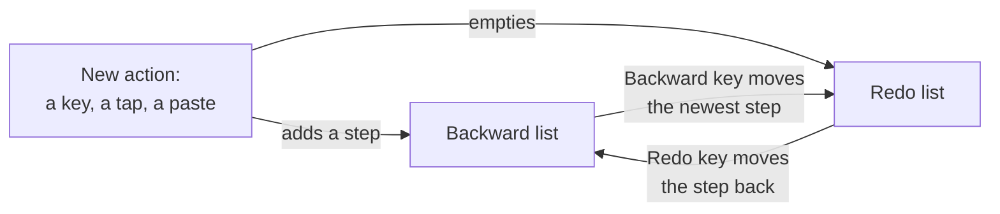

# Edit history: the Backward key and the Redo key

The Backward key takes the newest step of the edit history back. The Redo key makes that step
again. Both keys are in the top row, right of the typing speed, in every layer and every layout.

## Terms

| Term | Meaning |
| --- | --- |
| Step | The change that one action of the person made to the text field. |
| Edit history | The steps of the keyboard's own edits, in two lists. |
| Backward list | The steps that the Backward key can take back, the newest one last. |
| Redo list | The steps that the Backward key took back, which the Redo key can make again. |

## Why the keyboard keeps its own history

iOS gives a keyboard no call for the undo of the app. A keyboard can only type text at the
cursor, delete text before the cursor, move the cursor, and read some text around the cursor.
So the keyboard stores each of its own edits as a step (`Shared/EditHistory.swift`), and the
Backward key deletes and types text to take a step back.

The history holds only the edits of this keyboard. A paste from the app's own menu and an edit
that the app made are no steps of the history.

## The two keys

The more steps the Backward key takes back, the more steps the Redo list holds.

- The Backward key always shows. Its symbol is gray while the Backward list is empty, and a
  press then shows "Nothing to undo" on the space bar.
- The Redo key shows only while the Redo list holds a step. The key stands right of the
  Backward key. While the key is hidden, the prediction strip has its width too.
- A new action that changes the text empties the Redo list, so the Redo key hides again.
- An action that changes no text keeps the Redo list: Copy, Select All, a switch of the layer.

## What one step is

| Action | Step |
| --- | --- |
| Typed characters | One word, with the spaces and marks typed after it. A letter after a space or a mark starts a new step. |
| Delete key | All the deletes in a row. |
| Correction, space removal, period for two spaces | A step of its own, after the step of the typed character. |
| Tap on a predicted word, an emoji or the proofreader's fix | One step. |
| Paste, Cut, forward delete | One step. |
| A key after Select All | One step: all the text and the new character. |
| Pinyin letters | The letters typed in a row. |
| Picked candidate | One step. The Backward key brings the Pinyin letters back, with their candidates. |

The Backward key takes a correction back and keeps the typed space: "the " becomes "teh "
again. The keyboard then keeps that word as typed, as after a delete right after a correction.

The history holds at most 200 steps. An older step leaves the history.

## Where the history ends

The keyboard edits only at the cursor, so a step can be taken back only where the keyboard made
it. Each of these events empties both lists:

- A move of the cursor: a cursor key, the held space bar, Home, End, or a touch in the text.
- A change of the text by the app, such as a chat app that takes the sent text out.
- A move to another text field.
- The keyboard leaves the screen.
- A delete of text that the keyboard could not read, because the app handed out only a part of
  its text.

The keyboard checks the place before each step. The keyboard stores the last 48 characters
before the cursor after each change of the history. The Backward key and the Redo key edit the field only
when the text before the cursor still ends with those characters, and with the text that the
step takes out. So a history that no longer fits the field changes no text.

## The typing speed

Text that the Backward key or the Redo key takes out leaves the typing speed, as with a delete.
Text that the two keys put back does not count, because the person did not type it then.

## Files

| File | Content |
| --- | --- |
| `Shared/EditHistory.swift` | The step, the two lists, and the rule that joins steps. |
| `Shared/KeyboardTextController.swift` | The recording of each action, and the edits of the two keys ("Edit history"). |
| `Shared/KeyboardView.swift` | The two keys: the gray Backward key and the hidden Redo key. |
| `Shared/KeyboardLayout.swift` | `drawnWeights`: the widths of the top row while the Redo key is hidden. |
| `Tests/EditHistoryTests.swift` | The tests of the rules, of the two keys and of their place in the top row. |
| `scripts/keyboard-preview/check_layout.py` | Rules 12 and 13: the order and the widths of the keys in the top row. |
