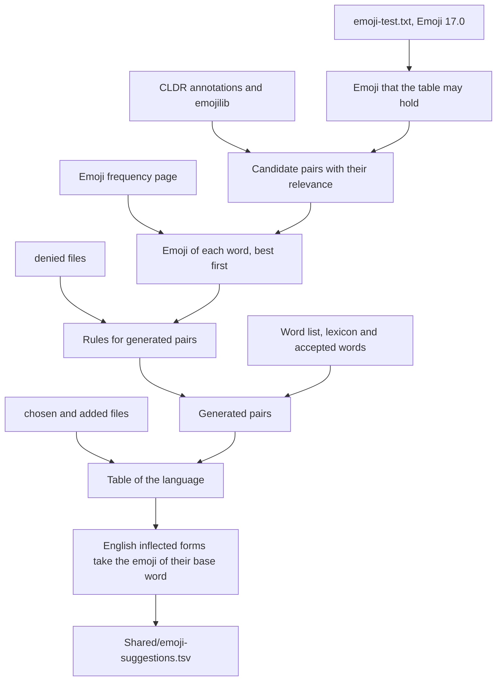

# Emoji suggestions

The keyboard offers one or two emoji for a word, as the iOS keyboard does: "good" and
"好" offer 👍. This page describes the table of words and emoji, and where the emoji show.

## Where the emoji show

The candidate row is the row of words that lies over the prediction strip while it shows.
Select All, Cut, Copy and Paste stay in view beside it. The prediction strip is the part of the top
row between Select All and Cut, and [prediction-strip.md](prediction-strip.md) describes it.

- **English:** when the word right before the cursor is in the table, its emoji take the first
  places of the prediction strip. The word is the word the person is typing, or the word
  before one space. The predicted words follow the emoji. The emoji take no row of their own.
  - The keys of the top row keep their place and their size when emoji come and go.
  - A tap on an emoji types that emoji. The emoji takes touches over the full height of the
    row and up to the keyboard's upper edge. Every other touch on the row reaches its key, and
    the row reacts at once after the emoji leave.
  - A tap puts the emoji in place of the word, as the iOS keyboard does: "good " and a tap on
    👍 give "👍 ". The space after the word stays. One delete right after the tap brings the
    word back, as one delete after an autocorrection does, and the word stays open to later
    corrections. The tap runs no autocorrection, and typing keeps its autocorrection.
  - While the proofreader's fix shows, the candidate row covers the prediction strip, so the
    row shows the emoji after the fix.
- **Chinese:** when the first Pinyin candidate is a word in the table, its emoji come right
  after that candidate. A tap types the emoji in place of the word, and the emoji takes the
  Pinyin letters of the word. The space bar and the digit keys still pick the Pinyin
  candidates in their own order.
- A field without autocorrection gets no emoji. The keyboard reads such a field from the
  field's settings, as for autocorrection: an address, an email or a number field, or a field
  that turns autocorrection off. iOS does not show a third-party keyboard in a password field.
- An emoji is not a mark, so it takes no space removal. A mark after the emoji and one space
  keeps that space.

## The table

`Shared/emoji-suggestions.tsv` holds one line for each word: the language, the word, and one
or two emoji. No word has more than two emoji.

| Language | Words | Pairs | Different emoji | Words with two emoji |
| --- | --- | --- | --- | --- |
| English | 4,868 | 5,585 | 1,161 | 717 |
| Chinese | 3,169 | 3,442 | 1,187 | 273 |

Most words have one emoji: one English word in seven has two, and one Chinese word in twelve.

| Language | Examples |
| --- | --- |
| English | good 👍 👏, love ❤️ 😍, congrats 🎉 👏, lol 😂 🤣, thx 🙏, melting 🫠, salute 🫡, moose 🫎, dogs 🐶 🐕, laughed 😂 🤣 |
| Chinese | 好 👍, 哈哈 🤣 😆, 加油 💪 ⛽, 拜拜 👋, 么么哒 😘, 恭喜 🎉 👏, 红包 🧧, 奶茶 🧋, 火锅 🍲, 饺子 🥟 |

The table holds names of things, feelings, chat words and inflected forms.

By the word counts of SymSpell's list, 15.5% of running English words show emoji, and 3.5%
show two emoji.

## Terms

| Term | Meaning |
| --- | --- |
| Pair | One word with one of its emoji. |
| Source | A published list that gives words to each emoji: the [CLDR](https://cldr.unicode.org/ "Common Locale Data Repository: Unicode's data of names and keywords in many languages") annotations, and emojilib for English. |
| Annotation | The keywords and the spoken name that CLDR gives an emoji in one language. |
| Fully-qualified emoji | The complete form of an emoji in [emoji-test.txt](https://www.unicode.org/reports/tr51/ "Unicode Technical Standard 51 describes the emoji data files"), with every variation selector. |
| Named emoji | An emoji whose name is the word, or whose name has the word as its head word. |
| Head word | The last word of the main part of an emoji name that says what the emoji shows: "cake" in "birthday cake". |
| Agreed keyword | A word that CLDR and emojilib both give the emoji as a keyword. |
| Place | The rank of an emoji by its use, 0 for the most used emoji. |
| Base word | The word that an inflected English word comes from: "dog" for "dogs". |
| Frequent word | An English word among the 5,000 most frequent words of SymSpell's list, or a Chinese word of one character. |

Each term keeps this one meaning on the page.

## How the script builds the table

`scripts/emoji-table/build_emoji_table.py` generates pairs from the sources, and the
hand-written files beside the script correct the result.



The generated pairs come first, the chosen pairs win over them, and the inflected forms come last.

### 1. The emoji that the table may hold

`emoji-test.txt` of Emoji 17.0 lists 3,944 fully-qualified emoji. The script leaves out four kinds:

- the skin tone variants,
- the gender variants: a joined sequence with the female sign, the male sign, the man emoji
  or the woman emoji,
- the keycaps,
- all flags of countries and regions.

1,447 emoji stay, and CLDR annotates 1,436 of them.

### 2. The candidate pairs and their relevance

Each word that a source gives an emoji is a candidate pair. The relevance of the pair says how
close the word is to the emoji.

| Relevance | English | Chinese |
| --- | --- | --- |
| Name | The word is the whole name: "moose" 🫎. | The word is the whole name: "融化" 🫠. |
| Head word | The word is the head word of the name: "cake" for "birthday cake" 🎂, "melting" for "melting face" 🫠. A keyword that is another form of the head word counts too: "melt". | A keyword of two characters or more ends the name: "蛋糕" for "生日蛋糕" 🎂. The name without "脸" or "头" counts too: "狗" for "狗脸" 🐶. |
| Agreed keyword | CLDR and emojilib both give the word. | Chinese has one source, so no pair has this relevance. |
| Keyword | One source gives the word. | CLDR gives the word. |

The closer the word is to the name of the emoji, the higher the relevance.

Words such as "face", "person", "hand" and "button" say little about an emoji, so they are no
head words. A name in quotation marks and a name that starts with "no" give no head word.

### 3. The order of the emoji of a word

The script orders the emoji of a word by three keys:

1. A named emoji comes before an emoji with an agreed keyword. An emoji with a plain keyword
   comes last.
2. Among equals, the emoji with the better place comes first.
3. Among equals again, the whole name comes before the head word.

The places come from the Unicode emoji frequency page. Its table ranks 1,135 of the 1,447
emoji: the emoji of Emoji 5.0 and before, by their use in 2019. The other 312 emoji are newer
than the page. Each of them takes place 592, the median place of the ranked emoji. So a new
emoji wins for its own name, and it stands among the emoji of average use for a keyword.

### 4. The rules for generated pairs

1. A denied word gets no pair. A denied pair and a denied emoji leave the candidates.
2. An English word has three letters or more. The word is among the 60,000 most frequent
   words of SymSpell's list, or `accepted-words-en.txt` holds it.
3. A Chinese word is a word text of `Shared/lexicon-pinyin.bin`, or `accepted-words-zh.txt`
   holds it.
4. A frequent word keeps only its named emoji. Such a word has many senses, and a keyword is
   seldom the sense that the person means.
5. A word that the sources give to more than 6 emoji keeps only its named emoji. Such a word
   is too general to mean one emoji.
6. An emoji of the groups Symbols and Flags needs a word that names it. A keyword of a sign
   or a shape is seldom a good match.
7. The first emoji of a word is the best emoji by the order of step 3.
8. A word gets a second emoji in two cases. Both emoji are named emoji. Or both emoji have
   an agreed keyword, and the second is among the 300 most used emoji.

The word limit of 60,000 keeps everyday words such as "cupcake", "dumpling" and "shrugging",
which stand between place 30,000 and place 60,000. Past place 60,000 the annotated words are
mostly rare names such as "annelid" and "sauropod".

### 5. English inflected forms

An inflected form that has no emoji of its own takes the emoji of its base word: "dogs" from
"dog", "cries" from "cry", "loved" from "love". The form must pass four checks:

1. The form is a word of the word list, and the deny list does not hold it.
2. The base word has emoji from the rules or from the chosen file.
3. The form is less frequent than its base word. A more frequent form has a meaning of its
   own: "building" is more than a form of "build".
4. An "-ing" form or an "-ed" form is a verb form. The first emoji of its base word must
   show a face, a gesture or a person. Such an emoji stands for a feeling or an action.
   So "laughed" takes the emoji of "laugh", and "booked" takes no emoji from "book".

1,806 of the English words are inflected forms that take the emoji of their base word.

### 6. The hand-written files

The files lie in `scripts/emoji-table/`, one set for each language.

| File | Content | English | Chinese |
| --- | --- | --- | --- |
| `chosen-<language>.tsv` | Words with their emoji, chosen by hand. These pairs win over the generated pairs of the word. | 1,167 words | 777 words |
| `added-<language>.tsv` | The chosen pairs that no source holds. | 189 pairs | 421 pairs |
| `denied-<language>.tsv` | Words, pairs and emoji that the table must not hold. | 1,159 lines | 642 lines |
| `accepted-words-<language>.txt` | Words that the word list or the lexicon lacks. | 59 words | 14 words |

The added files show which pairs rest on a choice by hand alone: 3% of the English pairs and
12% of the Chinese pairs.

The chosen files hold the frequent words, the chat words and the pairs where the sources give
a weak emoji. The Chinese annotations hold few chat words, so most Chinese chat words are added
pairs: "拜拜" 👋, "么么哒" 😘, "点赞" 👍.

The denied files hold these groups, each under its own heading:

- the clock faces and one rude gesture, as emoji that match almost no typed word,
- function words, number words, and words too general to mean one emoji,
- words for groups of people: nationality and country, ethnicity, religion, gender, sexual
  orientation, disability and age group,
- profanity, sexual words, slurs and words of violence,
- words and pairs that the review found wrong or awkward,
- for English, the words that the tests type as words without emoji: "see", "today",
  "tomorrow" and "goodness",
- for English, short words that start many common words, such as "yo" inside "you".

The accepted English words are chat words ("lol", "omw", "thx") and everyday words that
SymSpell's list lacks ("airplane", "donut", "tv"). The accepted Chinese words are chat words
of several lexicon words, such as "辛苦了". The typing engine builds its first candidate from
several words, so such a word can be the first candidate.

### 7. The checks of the build

The script stops with a message in each of these cases:

- The SHA-256 of a source file differs from `scripts/emoji-table/source-hashes.json`.
- A chosen word is outside the word list or the lexicon, and the accepted words do not hold it.
- A chosen emoji is an emoji that the table may not hold, or its form is not fully-qualified.
- A chosen pair has no source, and the added file does not list it. For an English word, the
  source may give the emoji to the word or to its base word.
- An added pair has a source, or the chosen file does not hold it.
- A word or a pair is in the chosen file and in the denied file.
- A denied pair is a pair that no source holds.
- An accepted word is in the word list or the lexicon.
- A word has no emoji, more than two emoji, or the same emoji twice.

## The checks of the finished table

`scripts/emoji-table/check_table.py` reads the table as the keyboard does. The script stops on
a line that the reader `EmojiSuggestions` would stop on: a line without three fields, an
unknown language, an empty word, or a count of emoji other than one or two. The script also
stops on a word that is twice in a language, and on an English word with a capital. An emoji
that is not fully-qualified stops the script too. The script checks the words that the tests
type: "good" has 👍 👏, "office" has 💻, "好" has 👍, "你好" has 👋, and "the", "see" and "我"
have none.

`scripts/emoji-table/precision-sample/sample_pairs.py` draws 300 pairs of each language with
the seed 20261120. The files `judged-en.tsv` and `judged-zh.tsv` in the same folder hold a
judgment for each pair: good, acceptable or bad.

| Language | Good | Acceptable | Bad |
| --- | --- | --- | --- |
| English | 244 | 56 | 0 |
| Chinese | 261 | 39 | 0 |

No pair of the sample is bad. These counts are too good as an estimate for the whole table:
the first judgment of the sample found one bad pair in each language, and the deny lists
hold both words now. The estimate for the whole table is 1 bad pair in 300 for each language.

## Commands

```
python scripts/emoji-table/build_emoji_table.py
python scripts/emoji-table/build_emoji_table.py --candidates en good happy
python scripts/emoji-table/build_emoji_table.py --review --output build/emoji-table/draft.tsv
python scripts/emoji-table/check_table.py
python scripts/emoji-table/precision-sample/sample_pairs.py
python scripts/emoji-table/precision-sample/sample_pairs.py --check
```

1. The first command builds and checks the pairs, and writes `Shared/emoji-suggestions.tsv`.
2. The second command prints every emoji that the sources give each word, best first, with
   its relevance and its place.
3. The third command writes the table to another file. The command also writes
   `build/emoji-table/review-<language>.tsv`: each word with the origin of its emoji.
4. The fourth command checks the table.
5. The fifth command prints the precision sample.
6. The sixth command checks that the judged files hold the sample, and prints the counts.

The scripts use the standard library of Python only. The build downloads the sources into
`build/emoji-table/`.

`scripts/prediction-strip/benchmark/rules.py` reads the English part of the table, because
the emoji take the first places of the prediction strip.

## Sources and licenses

| Source | Version | Use | License |
| --- | --- | --- | --- |
| [Unicode CLDR](https://cldr.unicode.org/) emoji annotations, files `annotations/en` and `annotations/zh` of the npm package `cldr-annotations-full` | 49.0.0 | Keywords and names of the emoji | [Unicode License v3](https://www.unicode.org/license.txt) |
| [emoji-test.txt](https://unicode.org/Public/17.0.0/emoji/emoji-test.txt) | Emoji 17.0 | The list of the emoji, with their groups | [Unicode License v3](https://www.unicode.org/license.txt) |
| [emojilib](https://github.com/muan/emojilib), file `dist/emoji-en-US.json` of the npm package `emojilib` | 4.0.3 | English keywords of the emoji | MIT |
| [Unicode emoji frequency](https://home.unicode.org/emoji/emoji-frequency/) | Table of 2019 on the page | The order of the emoji by use | [Unicode Terms of Use](https://www.unicode.org/copyright.html) |
| SymSpell `frequency_dictionary_en_82_765.txt` | master branch | The English word list | MIT |
| `Shared/lexicon-pinyin.bin` | The file of the repository | The check that a Chinese word exists | LGPL 2.1 or later for its source data, see [lexicon-NOTICE.txt](../Shared/lexicon-NOTICE.txt) |

The data in the table file comes from the sources under Unicode License v3 and MIT, and from
the choices by hand. The build takes no word from the lexicon: the lexicon only confirms that
a word of the annotations or of the chosen files exists.

`scripts/emoji-table/source-hashes.json` holds the SHA-256 of each downloaded file. The
Unicode License v3 and the MIT license allow the use, copy and change of the data with the
copyright notice. The table file names both in its header lines.

The frequency page is content of the Unicode website. The Unicode Terms of Use allow free
access and use of that content, and they give no license to copy the content into a product.
The build reads the order of the emoji from the page, and the table holds no copy of the page.
