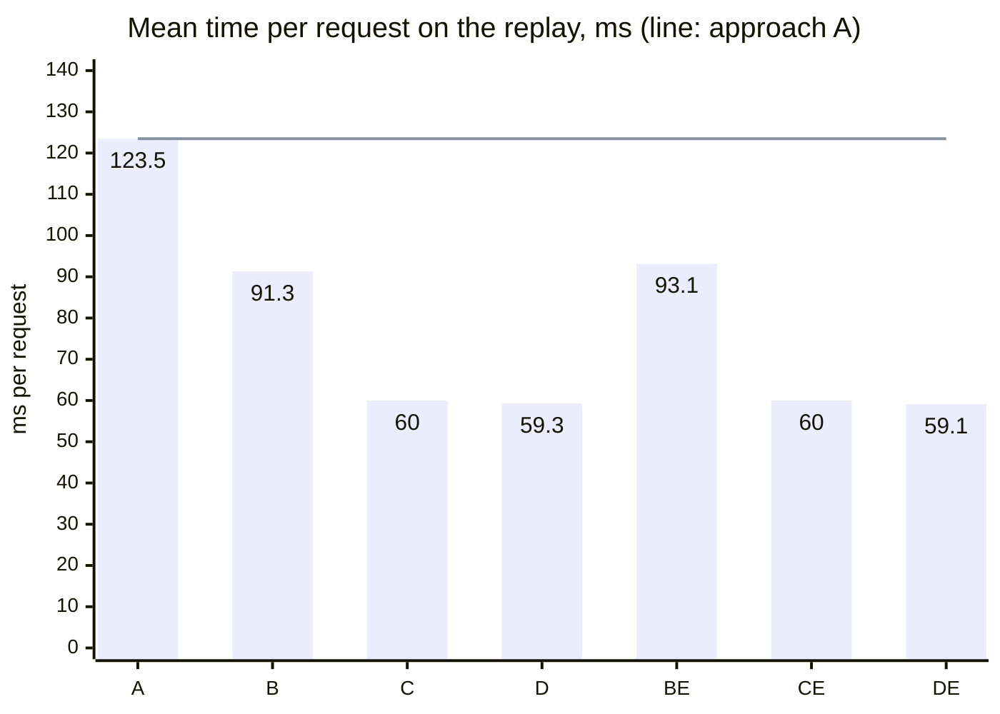

# Results of the reuse of the language model's cache

## Summary

The keyboard reads with approach DE: the anchored window with two slots. On the replay it
takes 59.1 ms per request against 123.5 ms without reuse, 52% less, at 2 threads on the local PC.
It changes 4 of 41,556 decisions, all in the technical stream. It keeps all six dev counts and the
work area count of the full read. The selection rule of `docs/kv-reuse-design.md`, committed in
0ae5d9f before any accuracy number of C, D or E existed, picked it.

Figure 1. Mean time per request of each approach, against the line of approach A. The more of a
long context the cache keeps, the less time a request takes. C, D, CE and DE keep 84% to 86% of
the window tokens and take about 60 ms.

1. Install a TestFlight build of `engine/kv-reuse` on the iPhone Duo and type a few sentences in
   Notes. Then type `duo:lm` and a space. The `reranker` lines give the time per space press and
   the share of context tokens that came from the cache.
2. Expect the gain to show in long text. In the dev cases, where each case has its own short
   field, the time falls from 55.9 ms to 51.5 ms only (Table 2).

D and DE differ by 0.3 ms, and a second pass of A took 1.1 ms more than the first. So D and DE are
equal within the noise of the machine. The rule picks the faster mean, which is DE. DE holds one
saved window of about 2.2 MB in memory beside the cache.

This page does not give the phone's time. No run measured it.

## Glossary

`docs/kv-reuse-design.md` defines the approaches and the terms. The short forms:

| Term | Meaning |
| --- | --- |
| A | No reuse: every request clears the cache and reads its whole window. |
| B | Prefix reuse: the model reads only the window tokens after the start that the window shares with the stored window. |
| C | B, and when the window moves, the cache drops its oldest tokens and shifts the others. |
| D | The anchored window: a window that keeps its first token while a long context grows, and starts again at the last 64 tokens when it is full. |
| BE, CE, DE | B, C and D with two slots: two stored windows, one in the cache and one saved in memory. |
| B1 | B, built with `MIN_UNREAD_TOKENS` 1, so a request may read its window in a call of one token. |
| window | The start token and at most 96 tokens of the context, the text the model reads. |
| reuse share | Window tokens the cache already held, divided by all window tokens of the requests. |
| decision | The reading that a correction shows. |
| replay | The 13,936 dev cases, each in its own field, and 2,600 stream sentences typed as running text, 10 per field (`scripts/kv-reuse/replay.py`). |

## Speed

The speed pass timed the 10,560 requests of every fourth document of A's replay, in order, one
approach at a time, alone on the machine. The machine is an Intel i9-13900K in WSL, with the Linux
build of the scorer against llama.cpp b4846, at 2 threads.

Table 1. Time per request and reuse share, over the 10,560 requests.

| Approach | mean ms | median ms | 95th percentile ms | window calls, mean ms | candidate calls, mean ms | tokens read | reuse share |
| --- | --- | --- | --- | --- | --- | --- | --- |
| A | 123.5 | 106.7 | 224.6 | 79.4 | 43.0 | 667,279 | 0.0% |
| B | 91.3 | 59.5 | 225.0 | 47.6 | 43.2 | 457,916 | 43.4% |
| C | 60.0 | 58.3 | 83.7 | 15.8 | 43.7 | 256,838 | 85.2% |
| D | 59.3 | 57.5 | 83.6 | 15.3 | 43.6 | 256,850 | 83.8% |
| BE | 93.1 | 60.9 | 229.7 | 48.2 | 44.0 | 457,425 | 43.5% |
| CE | 60.0 | 58.5 | 83.5 | 15.6 | 43.8 | 254,192 | 85.7% |
| DE | 59.1 | 57.4 | 83.1 | 15.0 | 43.4 | 256,115 | 84.0% |
| B1 | 90.4 | 59.2 | 221.3 | 47.0 | 43.0 | 457,797 | 43.5% |
| A, second pass | 124.5 | 107.2 | 226.4 | 80.2 | 43.3 | 667,279 | 0.0% |

The reuse takes time off the window calls only. The candidate calls take about 43 ms in every
approach. The more window tokens the cache keeps, the less time the window calls take. They take
79.4 ms for A, 47.6 ms for B and 15.0 ms for DE.

Table 2. Mean ms per request per part of the replay, with the reuse share in brackets.

| Approach | dev cases | work area cases | everyday stream | technical stream | written stream |
| --- | --- | --- | --- | --- | --- |
| requests | 2,026 | 1,639 | 2,203 | 3,729 | 963 |
| A | 55.9 (0%) | 65.7 (0%) | 124.4 (0%) | 171.7 (0%) | 175.2 (0%) |
| B | 51.3 (23%) | 60.1 (21%) | 59.6 (87%) | 133.0 (34%) | 139.2 (30%) |
| C | 51.8 (23%) | 61.5 (21%) | 58.8 (89%) | 64.0 (91%) | 61.4 (92%) |
| D | 52.0 (23%) | 61.4 (21%) | 59.5 (89%) | 61.9 (90%) | 60.7 (90%) |
| BE | 53.3 (24%) | 62.3 (22%) | 60.7 (87%) | 134.9 (34%) | 141.9 (30%) |
| CE | 53.8 (24%) | 62.7 (22%) | 59.8 (89%) | 62.3 (92%) | 59.8 (92%) |
| DE | 51.5 (24%) | 60.3 (22%) | 58.0 (89%) | 63.2 (90%) | 59.3 (90%) |
| B1 | 51.5 (23%) | 60.7 (21%) | 58.9 (87%) | 130.7 (34%) | 138.3 (30%) |

The longer the text before the word, the more the reuse saves. A dev case has a short field, so
every approach saves about 4 ms there. In the technical and written streams, 46% and 54% of A's
requests fill the whole window of 96 context tokens. There the window of B moves at every press, so B
keeps only 30% to 34%, while C and D keep about 90%.

## Accuracy

Each approach typed the whole replay with its own decisions: 42,390 requests and 41,556
corrections. Every run with reuse also read each request again from an empty cache, the check of
`duo_lm_scorer_set_check`.

Table 3. Decisions that differ from A, and the right cases of the dev counts.

| Approach | decisions that differ | share of A's 41,556 | clean | letter slips | space slips | symbol slips | clean symbols | all 6,799 | work area, of 7,137 | widest difference from a fresh read |
| --- | --- | --- | --- | --- | --- | --- | --- | --- | --- | --- |
| A | 0 | 0% | 957 | 2052 | 1387 | 1164 | 429 | 6538 | 6619 | none |
| B | 0 | 0% | 957 | 2052 | 1387 | 1164 | 429 | 6538 | 6619 | 0 |
| C | 4 | 0.010% | 957 | 2052 | 1387 | 1164 | 429 | 6538 | 6619 | 10.37 |
| D | 4 | 0.010% | 957 | 2052 | 1387 | 1164 | 429 | 6538 | 6619 | 0 |
| BE | 0 | 0% | 957 | 2052 | 1387 | 1164 | 429 | 6538 | 6619 | 0 |
| CE | 4 | 0.010% | 957 | 2052 | 1387 | 1164 | 429 | 6538 | 6619 | 10.37 |
| DE | 4 | 0.010% | 957 | 2052 | 1387 | 1164 | 429 | 6538 | 6619 | 0 |
| B1 | 0 | 0% | 957 | 2052 | 1387 | 1164 | 429 | 6538 | 6619 | 0 |

Every approach keeps the dev counts and the work area count of A. The A row equals the local x86
harness of `scripts/lm-keyboard/README.md`, Table 1. B, BE and B1 give the numbers of a fresh
read in every request. D and DE give the numbers of a fresh read of their own window. C and CE
read keys that saw dropped tokens, and one number moved by 10.37 from a fresh read.

The four changed decisions of DE, all in the technical stream:

| Field and correction | typed | A | DE |
| --- | --- | --- | --- |
| technical field 14, correction 127 | to | tom | to |
| technical field 29, correction 115 | roomsection id | room section id | roomsection id |
| technical field 32, correction 96 | thus | this | thus |
| technical field 48, correction 106 | euv observation | euv observation | uv observation |

DE keeps the typed text in three of the four and moves one typed word to another. In the
technical stream, DE leaves 29 of 14,765 words changed against 30 for A. The everyday stream (4 of
8,439) and the written stream (8 of 4,648) are the same for every approach.

Table 4. Numbers on the 10,560 requests of the speed pass, against A's numbers.

| Approach | requests whose numbers differ | widest difference | median of those | decisions that differ |
| --- | --- | --- | --- | --- |
| B, BE, B1 | 0 | 0 | 0 | 0 |
| C | 2,215 | 4.94 | 0.81 | 1 |
| CE | 2,246 | 5.19 | 0.85 | 1 |
| D | 2,218 | 6.19 | 0.77 | 0 |
| DE | 2,214 | 6.19 | 0.77 | 0 |
| A, second pass | 0 | 0 | 0 | none |

Only the requests with a context of more than 96 tokens get other numbers in C and D. Their numbers
move by 0.8 in the median, and the decisions still hold in all but a few cases.

## Calls of one token

B1 reads a window in a call of one token whenever one token is new. On the i9-13900K its numbers
equal A's in all 10,560 requests and its decisions in all 41,556 corrections (Tables 3 and 4). On
the macOS runner a call of one token gave a candidate a number 0.47 away from a call of more tokens
(`scripts/lm-keyboard/README.md`). So the keyboard keeps the rule of two unread tokens, which costs
no time here: B1 takes 90.4 ms against 91.3 ms for B.

Table 5. Median time of the window calls of B by the count of tokens the model read.

| tokens read | 2 | 3 | 4 | 5 | 6 | 8 | 10 | 12 | 16 |
| --- | --- | --- | --- | --- | --- | --- | --- | --- | --- |
| median ms | 7.0 | 8.9 | 9.6 | 12.1 | 12.9 | 15.7 | 18.7 | 21.7 | 28.0 |

The more tokens a call reads, the more time it takes. A fit over the counts of 2 to 23 tokens
gives 1.5 ms per token and 3.9 ms per call. One call for the new window tokens and the candidates
would save at most about 3.9 ms of the 59.1 ms of DE. That needs calls of more than 31 tokens, so the memory for scores
grows, or a token in nine sequences at once. The keyboard keeps the separate calls.

## The simulator and the agreement check

The workflow "Language model in the keyboard" ran every unit test in run 43625399707 at commit
9fca513. It also typed the dev cases through the keyboard's Swift code with DE. All 363 tests
passed. The
baseline is run 43551351295 at commit 51568f1 on `ui/space-before-mark`, which read every request
in full.

Table 6. Time added to each space press in the simulator, mean, median and 95th percentile in ms.

| Case file | corrections | without reuse, run 43551351295 | DE, run 43625399707 | reuse share of DE |
| --- | --- | --- | --- | --- |
| `english.dev.jsonl` | 6,234 | 171.3, 122.3, 322.3 | 81.4, 60.4, 86.5 | 33.2% |
| `english-symbols.dev.jsonl` | 1,826 | 113.9, 103.0, 200.0 | 82.3, 82.4, 113.7 | 27.9% |
| `english-domain.dev.jsonl` | 6,566 | 159.2, 90.1, 188.6 | 86.1, 72.7, 136.2 | 28.6% |

The simulator shares 3 cores of a macOS runner, and its times change from one runner machine to the
next. So Table 6 gives the order of the gain, and the replay of Table 1 gives its size. The case
files hold single cases, so the reuse share stays near 30%.

The keyboard's outputs equal those of run 43551351295 in every case of every case file, with the
model and with the engine alone. Its choice is the same in all 14,626 corrections.

Table 7. The agreement check on the 13,928 distinct requests of the harness, in order, in run
43625399707.

| Runner | full read against `lm_score` | prefix reuse against `lm_score` | keyboard's mode against a fresh read | keyboard's mode against `lm_score` |
| --- | --- | --- | --- | --- |
| x86, Intel Xeon Platinum 8370C | same bytes | same bytes; fresh read: widest difference 0 | widest difference 0 | 2 answers differ, the 2 requests with a context of more than 96 tokens |
| macOS, Apple M1 (virtual), the app's framework | same bytes | same bytes; fresh read: widest difference 0 | widest difference 0 | 2 answers differ, the 2 requests with a context of more than 96 tokens |
| ARM, Neoverse-N2, a report | 210 differ | 9,346 differ | not checked | 8,821 differ |

The workflow keeps its full-read check. On x86 and macOS, the prefix reuse gives
the bytes of `lm_score`. The keyboard's mode gives the numbers of a fresh read in every bit. The
keyboard's mode may differ from `lm_score` only where its context holds more than 96 tokens, and the
workflow fails on any other difference. On the ARM runner the i8mm kernels pair the rows of a
call, so the call boundaries move the numbers there.

The compare job matched the keyboard against the macOS harness, which reads every window in full.
The same choice holds in all 14,626 corrections, and no case output differs. The six dev counts are
957, 2,055, 1,386, 1,164, 429 and 6,539, and the work area count is 6,616, on both sides. The model
numbers differ by 0.000003 in the median and 0.000005 at the 99th percentile, the rounding of 5
decimals. The widest differences come from the 2 corrections whose context holds more than 96
tokens. They are 1.005 for a log probability and 1.27 for a space-after term.

## Method

1. `scripts/kv-reuse/replay.py` typed the replay through the Python copy of the keyboard's rules
   and `kv_replay`, without a table of earlier answers. It ran once per approach, all at once.
2. `scripts/kv-reuse/jobs/speed.sh` sent the requests of every fourth document of A's replay
   through each approach, one at a time, alone on the machine.
3. `scripts/kv-reuse/analyze.py` gave the tables and applied the selection rule.
4. The replay ran the scorer of commit 43a28d9. The keyboard's scorer adds a count of long
   contexts and a buffer for an empty context, and neither changes a number.

## Limits

- No run measured the phone. The device part of the app's framework holds neither the dot-product
  nor the i8mm instructions (`scripts/lm-keyboard/README.md`, Table 7). So its products should not
  depend on the call boundaries. This conclusion comes from the build, and no run checked it.
- On the ARM runner with i8mm, prefix reuse moves the numbers by 0.20 in the median and 1.33 at
  most, because its kernels pair the rows of a call. The app's framework holds no i8mm instruction.
- The speed pass timed a quarter of the replay's requests, the same quarter for every approach.
- D and DE differ by 0.3 ms. Two passes of A differ by 1.1 ms.
