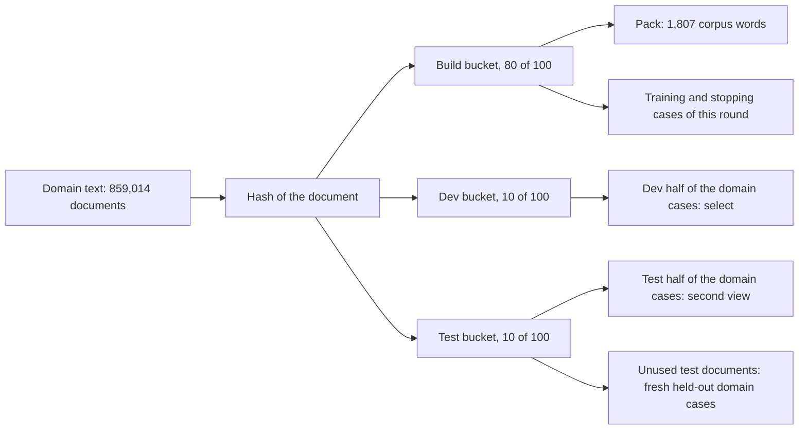
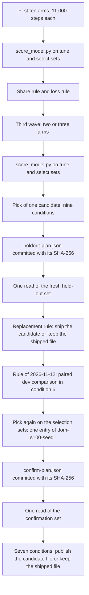

# Design of the domain round of the re-ranker fine-tune with the work area on

## Summary

The domain round trains SmolLM2-135M fine-tunes on everyday lists plus build-bucket domain text.
It compares them with the shipped file on sets typed with the work area "AI and software" on.

1. Read "Eight-row task table of the re-ranker" and "Decoder table of the arms".
2. Score any model file on every evaluation set with one command:
   `python3 scripts/lm-domain/score_model.py --shim SHIM --lm LM_SCORE --model FILE.gguf --data build/lm-domain/data --name NAME --out build/lm-domain/results/NAME`.
3. Train the arms with `scripts/lm-domain/run_train_queue.py --queue scripts/lm-domain/train-queue.json`.
4. Pick at most one candidate with the rule in "Pick of one candidate on the selection sets".
5. Commit `scripts/lm-domain/holdout-plan.json` with its SHA-256, then read the fresh held-out set once.
6. Replace the shipped file only when the candidate passes "Replacement rule on the fresh held-out set".
7. Read "Confirmation round of `dom-s100-seed1`" for the rule of 2026-11-12: one candidate, one setting, and one read of a new set.

This design does not settle the owner's slip rate on the phone. It does not measure phone time or memory.

## Glossary

| Term | Meaning |
| --- | --- |
| work area | The field of work that the person turns on in the keyboard. The keyboard ships one, "AI and software", and it is on by default. |
| pack | The words of the work area: `Shared/supplement-ai-software.bin` and `.tsv`, 1,825 words. Of them 1,807 come from the domain text, and the user asked for 18 by name. |
| reading | One way the engine reads the typed letters as words, as "pytorch" and "porch" for "pytorhc". |
| list | The readings of one correction, with the text before the span, the typed span and the target. |
| clean case, clean list | A case whose typed letters are the intended letters. A list whose target is the reading as typed. |
| setting | The weight, the three margins and the space-after switch of `scripts/lm-rerank/rerank.py`. Every setting here also holds the keyboard's apostrophe step. |
| shipped file | `smollm2-lora-typed-seed1.Q4_K_M.gguf` of the release `lm-finetune-smollm2-lora-v1`, the reference file of this round. The app holds the candidate file of this round in its place. |
| shipped setting | Weight 1.0, margins 0 from typed, 4 to typed, 2 other, space-after on. |
| engine alone | The choice of `duo_correct_english`, without a language model. |
| perfect chooser | A search that knows the intended text and takes readings from the engine's lists (`harness.perfect_typing`). |
| share of the gap closed | (model - engine alone) / (perfect chooser - engine alone), in right cases or in changed words of one set. |
| changed word | A word of clean running text that the field does not hold as typed. |
| build bucket | The 80 of 100 documents of the domain text that built the pack. The dev and test buckets hold 10 each. |
| domain share | The limit S on the field `u` of a domain training case. An arm with share S trains on the cases with `u` under S. |
| withheld word | One pack word in five. It gets no slip case in training. It still stands in clean running text. |
| real misspelling | A wrong form that a person wrote, from a public list or corpus. |
| non-word slip | A generated slip case outside `real_word_slip`: letter, space and symbol slips and `apostrophe_missing`. |
| net loss | For two files on the same cases: the cases that only the first file has right, less the cases that only the second file has right. |
| paired bootstrap | A draw takes the cases of one part again with replacement, as many as the part holds, and counts the net loss of the draw. |
| confirmation set | The set of 2026-11-12 that no model has scored. It shares no source with a training list, a selection set or an earlier held-out set. |

## Eight-row task table of the re-ranker

The task is the task of rounds 1 and 2. The domain round changes the Input row and the Training signal row.

Table 1. Task definition, with the range of every row.

| Row | Content | Range |
| --- | --- | --- |
| Input | One list per correction: the text before the span, the typed span, and 2 to 8 readings from `duo_english_readings`. Each reading has an engine score, a slip cost, an as-typed flag and a chosen flag. | Text before the span cut to its last 96 tokens. Typed span of 2 to 23 characters. Readings of 1 to 32 tokens. |
| Model | SmolLM2-135M causal language model with LoRA rank 16 and alpha 32 on all attention and MLP projections. The base weights stay frozen. | 4,884,480 trained weights of 134,515,008 base weights. The merged model ships as a Q4_K_M GGUF of 105.5 MB. |
| Output | Two log probabilities per reading: of the reading's tokens, and of a space after it. | Both in nats, at most 0. The keyboard then picks one reading index, 0 to 7. |
| Target | The index of the reading that the perfect chooser takes. In a clean case that is the reading as typed. The case builder produced the intended text. | One index per list, 0 to 7. A list without such a reading stays out. |
| Training signal | Listwise cross-entropy at the target. The logit of a reading is engine score + token log probability + space log probability. Two arms use other losses (Table 5). The loss updates the LoRA weights only. | Weight 1 and zero margins in training. The phone uses a setting from the grid of 2,160. |
| Negatives | The engine's other readings in the same list. In a clean list the corrections are the negatives. | 1 to 7 per list. |
| Split | Everyday text: by SHA-256 of the Tatoeba sentence id (rounds 1 and 2). Domain text: by SHA-256 of the document, build bucket for training, dev and test buckets for evaluation. | "Evaluation cases that share text with training" names the overlap that this split leaves. |
| Eval | Each case is typed through the keyboard rules with the work area on. The count is the exact match of the field text, per group. Clean running text counts changed words. | Right cases per group, and changed words per stream, never added into one total. |

## Starting point of the shipped file with the work area on

The shipped file lowers the engine's count on slips of pack words, and it changes technical text 3.6 times as often as everyday text.
The numbers come from `docs/domain-pack-design.md`, run 43122414341, dev half. That run used the pack before the 16 newest requested words joined it. The harness of this round measures the same counts on the pack of today.

Table 2. Engine alone and shipped file on the dev half of the domain cases, work area on, shipped setting.

| Count on the dev half | Engine alone | Shipped file | Change by the model |
| --- | --- | --- | --- |
| `domain_clean`, right of 950 | 949 | 946 | -3 |
| `domain_slips`, right of 723 | 631 | 627 | -4 |
| `domain_phrases`, right of 1,197 | 947 | 980 | +33 |
| `required`, right of 164 | 164 | 158 | -6 |
| `neighbour_controls`, right of 1,100 | 990 | 1,028 | +38 |
| `capitals`, right of 1,696 | 1,604 | 1,558 | -46 |
| `capital_slip_sentence_start`, right of 87 | 74 | 56 | -18 |
| Technical stream, changed of 14,765 words | 203 | 189 | -14 |
| Written stream, changed of 4,648 words | 40 | 47 | +7 |
| Everyday stream, changed of 7,040 words | 76 | 25 | -51 |

The model helps most on everyday text and on the space bar. It lowers four groups of pack words, most at the start of a sentence.

## Sets of the domain round and the role of each

Table 3. Each set, its source and its one role. Every set is typed with the work area on.

| Set | Role | Content | Size |
| --- | --- | --- | --- |
| train, everyday | The loss | Cases of rounds 1 and 2: generated slips, clean running text, Wikipedia misspellings | 126,196 cases |
| train, domain | The loss of the domain arms | Cases from build-bucket sentences (Table 4) | 35,727 cases at share 1.0 |
| stop | A loss curve per arm, written every 1,000 steps. It chooses no weights. | A seeded sample of 2,000 lists from each of three sets: the stopping lists of round 1, those of round 2, and domain stopping lists from 1 build document in 20 | 6,000 lists |
| tune | The setting of each arm | Generated tuning cases of round 1, clean running text of the tune bucket | 6,748 cases, 1,300 sentences (8,487 words) |
| select | The pick of one candidate | Generated dev half, apostrophe words, published dev misspellings, clean running text of the select bucket, GitHub typos of the select half, dev half of the domain cases and streams | 6,799, 1,623, 751 cases, 8,439 words, 2,500 cases, 7,137 cases, 2,300 sentences |
| domain test | A second view of every arm. It decides no pick. | Test half of the domain cases and streams | 7,085 cases, 2,300 sentences |
| fresh held-out | The replacement decision of the first candidate, read once on 2026-11-12 | New cases that no model and no selection had scored ("Fresh held-out set") | fixed in `holdout-plan.json` |
| confirmation | The replacement decision of `dom-s100-seed1`, read once | New cases from sources that no earlier set holds ("Confirmation round of `dom-s100-seed1`") | fixed in `confirm-plan.json` |

Figure 1. A build document feeds the pack and the training lists. A dev or test document feeds evaluation only.

The test half of the domain cases was read once for the pack design. This round reads it for every arm. So it counts as development data from here on, and the final claim rests on the fresh held-out set.

## Evaluation cases that share text with training

The everyday parts of the domain cases come from Tatoeba, and the training sentences of rounds 1 and 2 come from Tatoeba too.
The two were built apart, so some domain evaluation cases share their sentence with a training case. The Codex review counted 117 dev cases, 63 dev stream sentences, 146 test cases and 67 test stream sentences.
Every model of this round trained on those sentences, the shipped file included.

`audit_overlap.py` writes the ids of these cases to `build/lm-domain/data/overlap.json`. It marks two kinds of case.

1. A domain case or stream sentence whose Tatoeba source is the source of a training case of round 1 or round 2.
2. A domain slip case whose typed and intended pair is the pair of a training case of any round.

The pick and the tables of the domain sets leave the marked cases out, for every arm. A second table shows the marked cases alone.

## Domain training lists from build-bucket sentences

`collect_train_sentences.py` reads the 27 sources of the pack with the cleaning of `collect_corpus.py`. It keeps up to 12,000 sentences per source from the build bucket: 196,093 sentences.
`build_domain_train_cases.py` turns 26,085 of them into cases, and `build_lists3.py` types each case with the work area on.

Table 4. Kinds of domain training case. The counts are training cases at share 1.0.

| Kind | Example, typed to intended | Cases | Reason |
| --- | --- | --- | --- |
| `clean_stream_technical` | a whole sentence in lower case, each word a clean list | 5,198 sentences | The model changes technical text 3.6 times as often as everyday text |
| `clean_stream_written` | a whole sentence with its capitals and punctuation | 2,095 sentences | The written stream is the one stream the model makes worse |
| `domain_train_slip_new`, `_raised` | "pytorhc" to "pytorch", after the words before it | 11,033 | The model lowers the engine on slips of pack words |
| `domain_train_clean_new`, `_raised` | "pytorch" to "pytorch", the twin of each slip case | 11,033 | A slip case alone would teach the model to change pack words |
| `domain_train_term_space` | "py torch" to "pytorch" | 2,743 | Slips at the space bar inside a pack word |
| `domain_train_phrase_space`, `_clean` | "linearlayer" to "linear layer", and the pair typed right | 2,224 and 1,401 | Slips at the space bar in frequent pairs of the field |

One slip case in eight opens the field, because the model lowers the engine most at the start of a sentence.

Four rules keep evaluation text out of these cases.

1. A build sentence with the letters of a held-out sentence of the pack's corpus stays out.
2. A slip case never has the typed text and the intended text of a slip case of the domain dev or test half. The two halves hold 6,377 such pairs, and the builder skipped 2,872 draws for this rule.
3. A slip case never has the typed text of a published dev misspelling or of a GitHub typo of the select half. A clean case can hold a correct word that is also the typed text of a real-word typo, as "parameters".
4. A withheld word gets no slip case, no twin and no space case, and a pair with a withheld word gets no phrase case: 337 of 1,807 corpus words. The builder takes its words from the corpus words of the pack. So the 18 requested words get no such case either, also where the domain text holds them, as "worktree". The report counts the dev and test slips of both kinds of word apart.

The protection of a typed new word is off when the lists are built. A list then holds every reading, and the model learns to keep a pack word by itself. The evaluation runs with the protection on, as the keyboard ships, and once more without it.

Every domain case names its source document. `scripts/lm-domain/reports/domain-train-ATTRIBUTION.tsv` gives the address, the author, the date and the licence of each document. The sources are arXiv abstracts (CC0), Stack Exchange posts (CC BY-SA) and documentation of 18 projects (Apache 2.0, MIT or CC BY 4.0). The round does not use Hacker News text.

## Everyday lists built again with the work area on

Every new arm except the bridge arm trains on everyday lists that `build_lists3.py` builds again from the cases of rounds 1 and 2.
The builder differs from the list builder of rounds 1 and 2 in three ways.

1. The engine reads with the supplement. It can list a pack word beside an everyday word, as "gpt" beside "got". The model then learns to keep the everyday word in everyday text.
2. The field keeps the typed capitals and the preferred capitals, as the keyboard does with the work area on.
3. The target of a clean case is the reading as typed. The builder of rounds 1 and 2 takes the longest reading that keeps the field a start of the intended text. In clean running text that rule takes a reading that adds the next word, as "pay attention in" for the typed "pay attention". 200 of the 54,759 clean running-text lists of round 2 have such a target, and the lists after it in the sentence are lost.

The lists were built with the pack of commit 8661a70. The final pack of commit f48cd80 changes the frequency of "xcode", "vite" and "todo".
The rule for a rebuild: build the stopping lists again with the final pack, and rebuild every list when more than 0.5 percent of them differ or one target differs.
`compare_lists.py` counts 32 of 7,456 domain lists and 9 of 11,183 everyday lists with other readings, and the same target in every list. So the training lists stay. Every score of this round uses the final pack.

The bridge arm `ce-c1-seed1` trains on the lists of round 2 as they are. So `dom-s0` against `ce-c1` compares two whole list builds, and it does not isolate the supplement.

## Decoder table of the arms

Table 5. Every label of this round in plain words. All arms are SmolLM2-135M LoRA fine-tunes in the typed format, shipped as Q4_K_M.

| Label | Plain meaning | Reason it exists |
| --- | --- | --- |
| `engine` | The engine's own choice | Lower end of every gap |
| `perfect` | The perfect chooser over the engine's lists | Upper end of every gap |
| `ship` | The shipped file at the shipped setting | The reference of every rule |
| `mix-seed1`, `-seed2`, `-seed3` | Round 2 fine-tunes on everyday lists with clean running text, three seeds | The strongest round 2 recipe, and its seed spread |
| `soup-mix` | The mean of the weights of the three `mix` seeds, one file | Step 5 of the research report: an average of existing seed files |
| `soup-r1` | The mean of the weights of the shipped file and seeds 2 and 3 of its recipe | The same average for the round 1 recipe |
| `ce-c1-seed1` | The lists of `mix-seed1` with the recipe of this round (Table 6) | The bridge between round 2 and this round: same lists, new schedule |
| `dom-s0-seed1`, `-seed2` | The recipe of this round on the everyday lists built again, without domain text | The base of every arm below |
| `ce-c4-seed1`, `-seed2` | `dom-s0` with the cross-entropy times 4 on clean lists | The control of the expected-cost arm: same lists, steps and seeds |
| `ec-c4-seed1`, `-seed2` | `dom-s0` with the expected-cost loss, cost 4 for a changed correct word | Step 4 of the research report |
| `dom-s15-seed1`, `dom-s40-seed1`, `dom-s100-seed1` | `dom-s0` plus the domain lists at share 0.15, 0.4 and 1.0 | Three mix ratios of domain text |
| `dom-best-seed2`, `-seed3` | Seeds 2 and 3 of the share that the rule in "Third wave of arms" picks | A replication of the picked share |
| `dom-best-loss` | The picked share with the loss that the same section picks, when one helps | Domain text and a loss change together |

## Recipe and losses of the new arms

Every new arm keeps the round 2 recipe except the schedule. It takes 11,000 steps and keeps the weights of the last step.
So every result of this round holds for one fixed budget of steps. The round does not test another budget.

Table 6. Settings that the new arms share with `mix-seed1`, and the settings that differ.

| Setting | `mix-seed1` | New arms |
| --- | --- | --- |
| Base model, LoRA rank, targets, dropout | SmolLM2-135M, 16, all projections, 0.05 | the same |
| Optimizer, learning rate, weight decay, clip | AdamW, 2e-4, 0.01, 1.0 | the same |
| Lists per step, warm-up | 32, 300 steps | the same |
| Token and batch code | `train.py`: `encode`, `make_packed_batch`, `logits_of_lists` | the same functions, called from `train3.py` |
| Cosine decay | over 21,980 steps (4 epochs) | over 11,000 steps |
| Learning rate at step 11,000 | about 1.0e-4 | 0 |
| Steps taken | 13,500, stopped early on the stopping loss | 11,000, the same for every arm |
| Weights kept | step 11,000, the lowest stopping loss | step 11,000, the last step |
| Micro-batch | 800 padded tokens | 1,500 padded tokens |

The step count 11,000 is the best step of `mix-seed1`. A run does not stop early, so every arm takes the same steps.
The micro-batch does not change the loss of a step. It changes the dropout masks, as a seed does.
An arm with more lists sees each everyday list fewer times. The results page gives the list counts, the share of clean lists and the times each list is seen, per arm.
The stopping curve of each arm is a check of the fixed budget. The results page names every arm whose last stopping loss lies more than 2 percent above its lowest one.

The two loss arms change the loss of one list. With p the softmax share of the target, and `clean` 1 for a clean list:

    cross-entropy, clean weight c:   (1 + (c - 1) * clean) * (-log p)
    expected cost, clean cost c:     (1 + (c - 1) * clean) * (1 - p) + 0.1 * (-log p)

The expected cost is exact, because a list holds at most 8 readings. A wrong reading costs 1 on a slip list and c on a clean list. The weight of the model score stays 1 and the logit has no bias term in both arms. The phone rule has no bias term, and the model reads the typed span itself.

## Counts of the harness for every arm

`score_model.py` writes the same counts for every model file. `harness.py` types each set as the keyboard ships: supplement on, typed capitals kept, preferred capitals, protection on.

1. The engine alone and the perfect chooser type every evaluation set. Their counts are the two ends of each gap.
2. The model types the tuning sets at each of the 2,160 settings. `select_setting.py` then names one setting per rule (Table 7).
3. The model types every evaluation set at each named setting.
4. The model types the domain sets once more at the shipped setting without the protection.

The apostrophe step of a setting has its own lead. `tune_apostrophe.py` picks it per file and setting on the dev half of the apostrophe words, by the rule of `scripts/lm-rerank/apostrophe_words.py`.
A lead of the grid 0.5 to 8 is allowed when it keeps every category of the generated dev half, and the two clean controls of the apostrophe words, at the count of the same setting without the step. The allowed lead with the most right next-word cases wins, and the first lead of the grid wins a tie.
The pick reads an entry at its own lead. The tables also show every file at lead 4, the lead of `ship`.

The perfect chooser keeps a clean case as typed, so its count is exact there. For a case with a slip it searches the readings that keep the field a start of the intended text, for 40 typings at most. Its count is then a lower bound of the true ceiling. The perfect chooser sees the lists that the model sees, so the protection of a typed new word binds it too.

Table 7. Rules that name a setting from the grid. Among the allowed settings, the one with the most right generated tuning cases wins. A tie goes to fewer changed words, then to the earlier grid row.

| Rule | Allowed settings |
| --- | --- |
| `shipped` | The shipped setting alone |
| `control-rule` | Clean and clean-symbol groups at least the engine's, and changed tune words at most the engine's (round 2) |
| `ceiling-0.3` | Changed words at most 0.3 percent of the 8,487 words of the tune running text: 25 words |
| `ceiling-0.2` | Changed words at most 0.2 percent: 16 words |

The report gives, per arm and set, the right cases, the perfect chooser's count and the share of the gap closed. For clean running text the share uses changed words: (engine - model) / (engine - perfect chooser).

## Pick of one candidate on the selection sets

The pick uses the selection sets only. An entry is one scored file at one of three settings: `shipped`, `ceiling-0.3` or `ceiling-0.2`.
Every file is an entry: the new arms, the two `soup` files, the three `mix` seeds, and the shipped file at its two ceiling settings. `ship` is the shipped file at the shipped setting, and it is the reference.
An entry qualifies when all nine conditions hold against `ship`.

1. Its changed words on the select stream are at most those of `ship`.
2. Its right cases in the dev groups clean and clean symbols are each at least those of `ship`.
3. Its right real misspellings are at least those of `ship`. The count pools the 751 published dev misspellings and the 1,500 `github_misspelling` cases.
4. Its right non-word slips of the dev half are at least those of `ship` less 25 (0.5 percent of 5,097).
5. Its right `real_word_slip` cases of the dev half keep at least half of the gain of `ship` over the engine alone.
6. It passes the paired dev comparison with `ship` ("Paired dev comparison of pick condition 6"). The comparison covers all dev cases and each of the three slip groups.
7. Its right clean cases of the domain dev half, pooled, are at least those of `ship`. Its right slip cases of the domain dev half, pooled without the price categories, are at least those of `ship` less 0.5 percent of their count. Its right cases of the group `required` are at least those of `ship` less 1 percent of their count.
8. Its right apostrophe words, alone and with the next word, are each at least those of `ship` less 8 (0.5 percent of 1,623).
9. Its file passes the parity check at 0.05 nats, on everyday lists and on domain lists. The check compares PyTorch float32 with `lm_score` on an F32 GGUF, with a 32-bit key and value cache and without flash attention (`jobs/parity-kv32.sh`, read by `summarize3.py --parity-name parity-kv32.json`). The user chose this reading on 2026-11-12, as the coordinator relayed. The tables also give the f16 file of `check_parity.py` and the F32 file with the standard `lm_score`, for the report only.

The candidate is the qualified entry with the fewest changed words on the technical and written dev streams together (19,413 words). A tie goes to more right domain dev cases, then to fewer changed words on the select stream, then to the first label in Table 5.
When no entry qualifies, there is no candidate, and the shipped file stays at the shipped setting. The fresh held-out set is then read for the report only.

Conditions 1 to 5 are the conditions of round 2 with its bands. Condition 1 allows a tie, because this round exists for technical text and the everyday count must only hold.
A clean case of condition 7 is a domain case whose typed letters are its intended letters, capitals apart. The price categories are `neighbour_slip_onto_term` and `requested_term_for_everyday_word`.
The report shows `github_real_word` and no rule uses it, as in round 2. Many of its edits fix grammar.

## Paired dev comparison of pick condition 6

Condition 6 compares an entry with `ship` on the same dev cases. The user approved this form on 2026-11-12, in place of fixed dev counts from another run.
`paired_dev.py` applies it, and `summarize3.py` calls it for every entry.

The comparison takes the net loss of the entry against `ship` and a non-inferiority margin. A part of the dev half passes when two tests agree.

1. Paired bootstrap: fewer than 5 percent of the draws give a net loss of the margin or more. The script sums the multinomial probabilities of the draws, so the share has no random part.
2. Score test of Tango for paired shares: it rejects, at the one-sided level 0.05, that the true net loss is the margin or more. The source is Statistics in Medicine 17, 1998, pages 891 to 908.

The level 0.05, one-sided, is the level of condition 1 of the replacement rule. The bootstrap share is an approximate level, and the score test is the calibrated test for paired shares.
An entry passes condition 6 when all four parts of Table 11 pass. Every part must pass, so one entry needs no correction for four tests.
The comparison is a gate on development data. It does not correct for the pick among 53 entries, and the confirmation read is the test of the picked entry.

Table 11. Parts of the paired dev comparison and their margins.

| Part | Cases | Margin | Margin in cases |
| --- | --- | --- | --- |
| All dev cases | 6,799 | 0.5 percent | 34 |
| Letter slips | 2,100 | 1 percent | 21 |
| Space slips | 1,500 | 1 percent | 15 |
| Symbol slips | 1,197 | 1 percent | 12 |

The more cases only one of the two files has right, the smaller the net loss that passes. At 60, 88 and 120 such cases of the 6,799, a net loss of 20, 18 and 14 cases passes.

The groups clean and clean symbols are not in Table 11, because condition 2 allows no loss there. Conditions 4 and 5 still bind the non-word slips and the real-word slips.
The margins are engineering tolerances, and they were written with the dev counts of every entry known. They take the bands that this design already uses for a loss that the owner accepts. A pooled slip count has a band of 0.5 percent (conditions 4, 7 and 8). One part of a pooled count has a band of 1 percent (condition 7, and condition 5 of the replacement rule).
In use, a net loss at the margin means 1 more wrong correction in 200 generated everyday cases. The conditions on clean text still allow no loss, on the dev half and in the read.

Table 12 describes the seed spread beside these margins. Three `mix` seeds and three `dom-s100` seeds give 12 pairs of files of one recipe, at the shipped setting and at the `ceiling-0.3` setting.
The 12 pairs come from 6 files, so they are not 12 independent measurements. The table shows how the comparison treats files of one recipe, and it does not prove that a loss at the margin is harmless.

Table 12. Net loss between two seeds of one recipe on all 6,799 dev cases, worse seed against better seed.

| Recipe | Setting | Dev totals of seeds 1, 2, 3 | Net loss of the three pairs | Pairs that pass the comparison |
| --- | --- | --- | --- | --- |
| `mix` | shipped | 6,556, 6,534, 6,543 | 22, 13, 9 | 2 of 3 |
| `mix` | `ceiling-0.3` | 6,549, 6,538, 6,543 | 11, 6, 5 | 3 of 3 |
| `dom-s100` | shipped | 6,541, 6,528, 6,530 | 13, 11, 2 | 1 of 3 |
| `dom-s100` | `ceiling-0.3` | 6,538, 6,545, 6,537 | 7, 1, 8 | 3 of 3 |

The largest net loss between two seeds is 22 cases. The margin of 34 cases is 3.2 times the standard deviation of the difference of two seeds, 10.5 cases.
The comparison bars 3 of the 12 pairs. All three miss the space slips, at net losses of 12, 12 and 9 cases. One of them also misses the part of all dev cases, at a net loss of 22.
So the comparison does not pass every file of a known recipe.
For comparison, a fixed count of 6,542 allows a net loss of 2 cases, because `ship` has 6,544 in this harness. That is 0.2 standard deviations of a seed pair.

The dev counts of every entry were known when these margins were written, and so were the held-out counts of `dom-s100-seed1`. So the margins are no independent choice, and a reader must weigh the pick with that in mind.
For `dom-s100-seed1` at `ceiling-0.3` the result does not rest on the exact margin. `ship` alone has 47 cases right, and the entry alone has 41. The bootstrap share is 0.0018, and the score test gives p = 0.0023.
With condition 6 in this form, 49 of 53 entries pass it. Three entries pass all nine conditions: `soup-mix` at `ceiling-0.3` and at `ceiling-0.2`, and `dom-s100-seed1` at `ceiling-0.3`.

## Third wave of arms

The queue first trains ten arms: `ce-c1-seed1`, `dom-s0-seed1`, `dom-s40-seed1`, `dom-s100-seed1`, `dom-s15-seed1`, `ce-c4-seed1`, `ec-c4-seed1`, `dom-s0-seed2`, `ce-c4-seed2` and `ec-c4-seed2`.
Two rules, fixed here, name the arms of the third wave from their select counts. `summarize3.py` applies both.

1. Share rule. Take the shares 0.15, 0.4 and 1.0 whose seed 1 arm passes conditions 1 to 5 at the shipped setting. Among them, the share with the fewest changed words on the technical and written dev streams gets seeds 2 and 3. A tie goes to the smaller share. When no share passes, the three shares compete the same way. The rule waits for all three arms.
2. Loss rule. The score of an arm is its right dev cases plus its right real misspellings, at its `ceiling-0.3` setting. A loss helps when two things hold for seed 1 and for seed 2. Its score is at least 10 above the score of `dom-s0` of the same seed. Its changed words on the select stream are at most those of `dom-s0` of the same seed. The helping loss with the higher mean score trains once on the picked share (`dom-best-loss`). A tie goes to `ce-c4`. A loss with a missing arm, or an arm without a `ceiling-0.3` setting, does not help. When no loss helps, the third wave has two arms.

The search stops after the third wave. The round does not train an arm that this page does not name.
The seed 1 arm of the picked share won a comparison, so its counts lean high. The results page gives seeds 2 and 3 as the replication, apart from seed 1.

Figure 2. Order of the round. Every choice before a read uses the tuning and selection sets only.

## Fresh held-out set

The fresh held-out set holds cases that no model and no selection has scored. `build_fresh_holdout.py` builds it, and `check_fresh_holdout.py` checks its rules apart from the build code.

Table 8. Parts of the fresh held-out set and the source of each.

| Part | Source | Rule that makes it fresh |
| --- | --- | --- |
| generated, 6,727 cases | Tatoeba sentences of the round 2 held-out buckets 0 to 2 | The sentence passes the filters of round 2, and it is the source of no round 2 held-out case |
| stream, everyday, 4,000 sentences | The same buckets | The same rule |
| github, 1,500 and 458 cases | GitHub Typo Corpus, held-out half by the hash of the right word | The row and its typed and right pair are no pick of round 2 |
| birkbeck, 600 pairs | Roger Mitton's Birkbeck list | The pair is in no earlier case of any round |
| domain cases, 4,611 cases | Test-bucket sentences of the pack's corpus, and Tatoeba sentences of the held-out buckets for the everyday controls | The document is the source of no dev or test case of the pack, and the sentence has the letters of no sentence of such a document |
| stream, technical and written, 1,300 sentences | The same sentences | The same rule |

Three more rules bind the set.

1. A Tatoeba sentence passes the filters of `build_cases2.py`: it is no source of a round 1 case, and its words differ from every such source. It is also no source of a dev or test case of the pack. The held-out buckets hold 204 such sources, and the checker found 19 of them in a first build of the set.
2. A fresh domain slip case never has the typed and intended pair of a training case or of a dev or test case of the pack. A fresh domain case never equals such a case.
3. A word of a list-based clean category and an open word of a stream stand in no training sentence.

The builder reads the round 2 held-out files for one purpose: the sentence ids and the list words that must stay out. It repeats the seeded GitHub and Birkbeck picks of round 2 with that round's own code. It prints counts only, and no person reads those files or their results.
The set, its six SHA-256 values and its sizes are fixed before any candidate result exists. `scripts/lm-domain/reports/fresh-holdout-report.json` holds them.

## Replacement rule on the fresh held-out set

`holdout-plan.json` names every arm, file, SHA-256 and setting, and the candidate. It is committed before the read. `read_fresh_holdout.py` refuses a second read.
The candidate replaces `ship` when all seven conditions hold on the fresh held-out set.

1. It changes fewer words of the technical and written streams than `ship`, and the difference holds over documents. A document counts for the candidate when it has fewer changed words there, and for `ship` when it has more. The exact one-sided sign test over these documents gives p < 0.05.
2. Its changed words on the everyday stream are at most those of `ship`.
3. Its right cases in the generated groups clean and clean symbols are each at least those of `ship`.
4. Its right non-word slips are at least those of `ship` less 0.5 percent of their count.
5. Its right real misspellings, pooled, are at least those of `ship`. Each source alone is at least that of `ship` less 1 percent of its cases.
6. Its right `real_word_slip` cases keep at least half of the gain of `ship` over the engine alone.
7. Its right clean domain cases, pooled, are at least those of `ship`. Its right domain slip cases, pooled, are at least those of `ship` less 0.5 percent of their count.

Condition 1 asks for the improvement that the round exists for, in the unit of the pick: changed words. Conditions 2 to 7 bound each observed loss, and the report gives a 95 percent interval beside each difference.
A candidate that passes also needs green runs of the existing CI workflows on this branch before it ships.

## Confirmation round of `dom-s100-seed1`

The user approved this round on 2026-11-12, after the one read of the fresh held-out set. It tests one file at one setting on a new set, once.

### Candidate and setting of the confirmation round

The candidate file is `dom-s100-seed1`: `dom-s100-seed1.Q4_K_M.gguf`, SHA-256 `8c0835e0eeb4787b853b4223facc14612d4d1b6c4bd7e33f7ad1ff9fc167dec8`.
With condition 6 as the paired dev comparison, three entries pass the nine pick conditions. The pick takes the one with the fewest changed technical and written dev words: `dom-s100-seed1` at `ceiling-0.3` with 38, against 140 for `soup-mix`.

The file has two entries, `shipped` and `ceiling-0.3`. Its `ceiling-0.2` setting is its `ceiling-0.3` setting.
The setting rule: take the entry that passes all nine pick conditions. When both pass, take the one with fewer changed technical and written dev words. When none passes, there is no candidate and no read.
The entry `shipped` misses condition 8: 1,208 right apostrophe words, and the condition asks for 1,256. The entry `ceiling-0.3` passes all nine.
So the candidate setting is weight 1.5, margins 1 from typed, 4 to typed and 2 other, with space-after on.
Its lead of the apostrophe step is 0.5. `tune_apostrophe.py` picked that lead on the dev half of the apostrophe words, by the rule of "Counts of the harness for every arm".

The counts of both entries on the fresh held-out set are seen: both passed its seven conditions as arms for the report. The pick and the setting rule read the selection sets only.
So the fresh held-out set is no test of this candidate, and the confirmation set is its one test.

### Confirmation set

`build_fresh_holdout.py --label confirm --earlier build/lm-domain/data/fresh-holdout` builds the confirmation set with the code and the rules of the fresh held-out set.
It adds three rules. The set shares no source with the fresh held-out set. A GitHub or Birkbeck pair of the set is the pair of no earlier real misspelling, in either list. Earlier means round 2 and the fresh held-out set. A GitHub case shares no commit with a case of the select half, of round 2 or of the fresh held-out set.
The fresh held-out set did not have the commit rule. Of its 1,958 GitHub cases, 29 share a commit with a case of the select half. A commit can hold several edits, and the halves split by the right word. `check_fresh_holdout.py --earlier` checks that rule apart from the build code, as rule 11.

Table 13. Parts of the confirmation set, the source of each and its size.

| Part | Source | Size | Size in the fresh held-out set |
| --- | --- | --- | --- |
| generated | Tatoeba sentences of the round 2 held-out buckets 0 to 2 that feed no earlier case | 6,709 cases, of them 971 clean and 419 clean symbols | 6,727, of them 971 and 429 |
| stream, everyday | The same buckets | 4,000 sentences, 25,904 words | 4,000 sentences, 25,974 words |
| github misspellings | GitHub Typo Corpus, held-out half: rows whose pair and commit no earlier case holds | 1,500 cases | 1,500 |
| birkbeck | Roger Mitton's Birkbeck list: pairs in no earlier case | 600 pairs | 600 |
| domain cases | Test-bucket documents of the pack's corpus that feed no earlier case, and Tatoeba sentences for the everyday controls | 4,480 cases | 4,611 |
| stream, technical and written | The same documents | 1,300 sentences, 19,249 words | 1,300 sentences, 19,925 words |
| real-word errors, for the report | RWSE Wikipedia Revision Dataset (Torsten Zesch, CC BY 4.0), sentences of Wikipedia under CC BY-SA | 375 cases | 458 GitHub rows |

Table 14. Cases behind each count that a condition of the read uses, in the two sets.

| Count | Confirmation set | Fresh held-out set |
| --- | --- | --- |
| Generated clean, clean symbols (condition 3) | 971, 419 | 971, 429 |
| Non-word slips (condition 4) | 5,019 | 5,027 |
| GitHub misspellings, Birkbeck (condition 5) | 1,500, 600 | 1,500, 600 |
| Real-word slips (condition 6) | 300 | 300 |
| Domain clean, domain slips (condition 7) | 2,642, 1,838 | 2,656, 1,955 |

The domain slips are 6 percent fewer than in the fresh held-out set, because the pairs of that set stay out. Every other count is within 3 percent. Three sources were short.

1. The held-out half of the GitHub Typo Corpus has no unused real-word row. The set takes real-word errors from the RWSE Wikipedia Revision Dataset, which has 603 instances. Of them 375 pass the filters and hold no pair of an earlier real misspelling. No condition reads this part, as no condition reads `github_real_word`.
2. The word list has 119 unused tokens with one digit, and the category `clean_symbol_token` held 129 in the earlier sets. The set takes the 119, so its group clean symbols has 419 cases, against 429 in the earlier sets. The test-bucket domain text holds 44 more such tokens, as "conv2d" and "int4". They stay out, because domain tokens can favour a file that trained on domain text, and condition 3 allows no loss.
3. One reading of the sentences gives 19 of 27 slips of the key "1" inside a word. For this set the generator reads the sentences up to 20 times with new word positions (`SENTENCE_READINGS` in `scripts/lm-finetune/build_cases.py`). The first reading is the reading of the earlier sets, and a rebuild of the fresh held-out set gives its six SHA-256 values.

The requested words get new contexts, written for this set, because their earlier contexts are cases of earlier sets.
After a later reading, a sentence can feed two cases of one symbol category. So an interval that takes the cases as independent is a little narrow there.
The set, its seven SHA-256 values and its sizes are fixed before any model scores it. `scripts/lm-domain/reports/confirm-holdout-report.json` holds them.

### Conditions of the confirmation read

The candidate passes when all seven conditions of "Replacement rule on the fresh held-out set" hold on the confirmation set, with `ship` as the reference. The conditions apply as written there.
Condition 3 stays a count without a band: the right clean cases and the right clean-symbol cases are each at least those of `ship`. The paired dev comparison replaces pick condition 6 only, and no condition of the read uses it.
A smaller part gives a wider interval. The report gives the size of each part and a 95 percent interval beside each difference.

Four things are in the plan for the report, and they decide nothing.

1. The arms `dom-s100-seed1` at `shipped`, `dom-s100-seed2` and `dom-s100-seed3` at their `ceiling-0.3` settings, and `soup-mix` at `ceiling-0.3`.
2. The real-word errors of Wikipedia.
3. The paired comparison of each arm with `ship` on the generated cases, with the margins of Table 11.
4. The engine alone and the perfect chooser.

`scripts/lm-domain/confirm-plan.json` names the seven files with their SHA-256 values, every arm with its file, SHA-256, setting and lead, the reference and the candidate.
`make_holdout_plan.py --expect-candidate` stops unless the pick names `dom-s100-seed1` at `ceiling-0.3`.
The plan is committed before the read, and the commit message holds its SHA-256. `read_fresh_holdout.py` takes that value as `--plan-sha256` and stops when the plan file has another value.
It first checks the plan and the SHA-256 value of every file. Then it creates `read-started.json` in the folder of the set, with the value and the output folder, before any model types a case.
From then on it refuses another plan and another output folder, and it refuses an output folder that holds a result. Every start adds a line to `read-attempts.jsonl`.
These guards are files on this machine. The script does not ask Git whether the plan is committed, so the agent that starts the read checks that the working tree equals the plan commit.
The report gives the interval of the technical and written streams over documents, and an interval for each of the two clean groups.

After a pass, five steps follow, and the app keeps the shipped file until the user decides.

1. State the parity of the candidate file under the reading of pick condition 9.
2. Count the corrections where the Q4_K_M file takes another reading than PyTorch float32, with the apostrophe step on.
3. Run the Linux harness and the CI workflows on this branch with the candidate file.
4. Publish the file as the GitHub pre-release `lm-domain-candidate-1`, with its licences and attributions.
5. Write the counts into `docs/lm-domain-results.md`.

After a miss, the shipped file stays, and the report names the condition and its counts. No other setting and no other arm is read on the confirmation set as a candidate.

## Controls of the domain round

Table 9. Each control and the question it answers. A comparison between two arms compares two whole recipes.

| Control | Question |
| --- | --- |
| `ce-c1-seed1` against `mix-seed1` | Does the fixed schedule of this round change the result on the same lists? |
| `dom-s0-seed1` against `ce-c1-seed1` | Do the everyday lists built again change the result? The supplement, the capitals and the target rule change together. |
| `dom-s15`, `dom-s40`, `dom-s100` against `dom-s0` | Does domain text help, and at which share does everyday text start to lose? Domain text, the share of clean lists and the times each everyday list is seen change together. |
| `ec-c4` against `ce-c4`, paired by seed | Does the expected-cost form add to a plain weight on clean lists? |
| `ce-c4` against `dom-s0`, paired by seed | Does the weight on clean lists alone move the trade between changed words and repairs? |
| `mix` seeds 1 to 3, `dom-s0` seeds 1 and 2, `dom-best` seeds 2 and 3 | Is a difference between two arms larger than the seed spread? |
| Every file at the shipped setting and at its ceiling settings, the shipped file included | Is a difference due to the weights or to the setting? |
| Slips of withheld words apart from slips of trained words | Does a domain arm correct a pack word whose slips it never trained on? |
| The domain sets with and without the protection | Does a domain arm keep typed new words by itself? |
| Perfect chooser on every set | Is a remaining error a model error or a list that lacks the target? |
| Stopping loss per 1,000 steps, everyday and domain apart | Does a domain arm lose everyday fit while it gains domain fit? |
| Domain cases that share text with training, apart | Does a count rest on text that the models trained on? |
| One read of the fresh held-out set | Is the pick an over-fit to the selection sets? |

## Audit of the remaining errors of the shipped file

The perfect chooser marks each error of `ship` whose intended text it does not reach. A hand pass then labels 200 errors of `ship` on the dev half and 200 on `github_misspelling` of the select half.
`scripts/lm-domain/label-rule.md` fixes the sample, the labels and their order before the pass. The sample is the first 200 errors in the order of SHA-256 of the case id.

Table 10. Labels of the hand pass, in the order of their test. The first label whose rule holds is the label.

| Label | Rule |
| --- | --- |
| label noise | The shown text is also correct in this context, or the intended text is itself wrong |
| engine recall | The perfect chooser does not reach the intended text |
| model error | The lists hold the intended text, and the shown text is wrong in this context |
| unclear | The labeller cannot decide between two labels |

## Compute plan

- Cases: Python on this machine. Lists and scoring: the engine and `lm_score` in WSL.
- Training: the local RTX 4090, under the lock file `build/gpu.lock`. Four arms train at the same time, each with a cap of 3.2 GB. Four arms use the whole card: one step takes 0.75 s for each of four arms, and 0.63 s for one arm alone.
- An arm takes about 2.3 hours beside three others. The queue holds the lock while an arm runs, and starts the next arm when a place is free.
- One call of the engine takes about 0.09 s with the supplement on. `warm_readings.py` reads every span of the harness sets once, in 10 processes, and `score_model.py` reads its file.
- Every long job runs through `scripts/lm-domain/detach.ps1`. The job outlives the shell that starts it, writes a log and a state file, and goes on from its files when it starts again.
- Conversion: `convert_hf_to_gguf.py` and `llama-quantize` of llama.cpp b4846, then the token and score checks of `check_parity.py`. The token check reads the Q4_K_M file, and the score check reads the f16 file.

## Limits of this design

- The generator made every domain slip. A real slip of a pack word on the phone can differ.
- The domain text is written text: papers, questions and documentation. Chat about the same work uses other words.
- The domain cases take their words from the pack. This round does not build slips of everyday words in technical sentences.
- Every arm starts from the stock SmolLM2-135M. The round does not test further training of the shipped file.
- Every arm keeps its last-step weights at one budget of 11,000 steps. An arm that fits faster or slower than `mix-seed1` is not at its own best step.
- The round does not hold a control with the share of clean lists and the everyday exposure of a domain arm, without domain text.
- The loss comparison has two seeds per loss. A difference inside the seed spread is not a result.
- The pick and the replacement rule test observed counts. A condition that holds by one case can turn on chance.
- The paired dev comparison bounds the net loss on the dev half at about 18 cases. It does not show that an entry equals `ship`.
- The margins of the paired dev comparison were written with the dev counts of every entry known.
- The candidate of the confirmation round was named after its counts on the fresh held-out set were seen. Only the confirmation set tests it.
- One person's labels in the audit are noisy. The rule is written before the pass, and the labels are a diagnostic.
- The slip rate of the owner is not measured.
