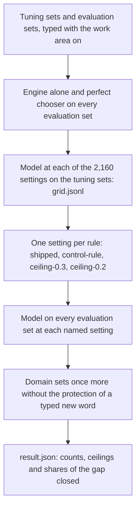

# Model-search harness of the re-ranker with the work area on

## Summary

One command scores a model file on every evaluation set, with the ceiling of each set and a setting per rule.

1. Build the engine shim and `lm_score` once, in WSL or on Linux: `bash scripts/lm-rerank/build_on_linux.sh llama`.
2. Fill the file of engine readings once: `python3 scripts/lm-domain/warm_readings.py --shim SHIM --data build/lm-domain/data --workers 10`.
3. Score a model file:
   `LD_LIBRARY_PATH=LLAMA_LIB python3 scripts/lm-domain/score_model.py --shim SHIM --lm LM_SCORE --model FILE.gguf --data build/lm-domain/data --name NAME --out build/lm-domain/results/NAME`.
4. Write the tables and apply the rules: `python3 scripts/lm-domain/summarize3.py --results build/lm-domain/results --data build/lm-domain/data --parity build/lm-domain/parity --out build/lm-domain/summary`.

This page does not hold a result. `docs/lm-domain-design.md` gives the arms and the rules, and `docs/lm-domain-results.md` gives the numbers.

## Glossary

| Term | Meaning |
| --- | --- |
| work area | The vocabulary "AI and software" that the keyboard ships turned on. Every typing of the harness runs with it on. |
| reading | One way the engine reads the typed letters as words. |
| setting | The weight, the three margins and the space-after switch of the keyboard's rule. |
| engine alone | The engine's own choice, without a model. |
| perfect chooser | A chooser that takes the intended reading whenever the engine lists it. Its count is the ceiling of a set. |
| share of the gap closed | (model - engine alone) / (perfect chooser - engine alone). |
| changed word | A correctly typed word of running text that the keyboard changes. |
| arm | One model file with a name, as `ship` for the shipped file. |

## Steps of one scoring run

Figure 1. `score_model.py` types the tuning sets 2,160 times and each evaluation set once per named setting.

## Evaluation sets and tuning sets

Table 1. Sets that `harness.load_sets` reads. A set of the folder `build/lm-domain/data/everyday` comes from rounds 1 and 2.

| Name | Role | Content | Count |
| --- | --- | --- | --- |
| `tune_generated` | tuning | Generated tuning cases of round 1 | right cases per group |
| `tune_stream` | tuning | Clean running text of the tune bucket, 8,487 words | changed words |
| `dev` | evaluation | `english.dev.jsonl` and `english-symbols.dev.jsonl`, 6,799 cases | right cases per group |
| `apostrophe_word`, `apostrophe_next_word` | evaluation | The apostrophe words alone and with the next word, 1,623 cases each | right cases |
| `published_dev` | evaluation | Published misspellings of the dev half, 751 cases | right cases per list |
| `stream_select` | evaluation | Clean running text of the select bucket, 8,439 words | changed words |
| `github_select` | evaluation | GitHub typos of the select half, 1,500 and 1,000 cases | right cases per category |
| `domain_dev`, `domain_test` | evaluation | The two halves of `english-domain.*.jsonl` | right cases per group |
| `domain_stream_dev`, `domain_stream_test` | evaluation | Technical, written and everyday running text | changed words per stream |

## Setting rules of the changed-word ceilings

`select_setting.py` names one setting per rule from the 2,160 grid rows of one model.
Among the allowed settings, the one with the most right generated tuning cases wins.

Table 2. Rules that name a setting.

| Rule | Allowed settings |
| --- | --- |
| `shipped` | Weight 1.0, margins 0 / 4 / 2, space-after on |
| `control-rule` | Clean groups at least the engine's, and changed tune words at most the engine's |
| `ceiling-0.3` | At most 25 changed words of the 8,487 tune words |
| `ceiling-0.2` | At most 16 changed words |

The script also runs alone on a grid of round 2:
`python3 scripts/lm-domain/select_setting.py --grid GRID.jsonl --words 8487 --control-clean N --control-clean-symbols N --control-changed-words N`.

## Files of the harness

Table 3. Scripts in `scripts/lm-domain`, by their step.

| Script | Step |
| --- | --- |
| `harness.py` | The sets, the typing with the work area on, the counts, and the stored answers of `lm_score` |
| `warm_readings.py` | The engine readings of every span, in several processes |
| `score_model.py` | The scoring of one model file |
| `select_setting.py` | The setting rules |
| `run_eval_queue.py`, `eval-queue.json` | The scoring of several model files at the same time |
| `summarize3.py` | The tables, the pick and the rules of the third wave |
| `paired_dev.py` | The paired dev comparison of pick condition 6, and the net loss between seeds of one recipe |
| `dump_errors.py`, `label-rule.md` | The wrong cases of one arm with their readings, and the rule for their labels |
| `collect_train_sentences.py`, `build_domain_train_cases.py`, `build_lists3.py` | The domain training lists |
| `attribute_training.py`, `reports/domain-train-ATTRIBUTION.tsv` | The source, author and licence of each training document |
| `train3.py`, `make_train_queue.py`, `run_train_queue.py`, `post_arm.sh` | The fit, its queue, and the conversion with the parity check |
| `average_weights.py` | One model from the mean of the weights of several fine-tunes |
| `build_fresh_holdout.py`, `check_fresh_holdout.py`, `read_fresh_holdout.py` | The fresh held-out set and the confirmation set, their checks, and the one read of each |
| `make_holdout_plan.py`, `holdout-plan.json`, `confirm-plan.json` | The plan of a read: the files of the set, the arms, the settings and the candidate |
| `decision_changes.py` | The corrections where a Q4_K_M file takes another reading than its F32 file with a 32-bit cache, with the apostrophe step on |
| `candidate.json`, `check_candidate_harness.py`, `.github/workflows/lm-domain-candidate.yml` | The candidate file of the domain round, its setting, and the workflow that types the dev cases with it on an x86 and an ARM Linux runner |
| `detach.ps1`, `job.sh`, `jobs/` | Long jobs that outlive the shell that starts them |

## Files that one scoring run writes

Table 4. Content of `build/lm-domain/results/NAME`.

| File | Content |
| --- | --- |
| `result.json` | The counts of every set for the engine alone, the perfect chooser and the model at each named setting, with the shares of the gap closed |
| `grid.jsonl` | One row per setting: right generated tuning cases, their groups, and changed tune words |
| `answers.jsonl` | Every request to `lm_score` with its answer, for the SHA-256 of this model file |
| `outputs.RULE.jsonl` | The field text of every case at the setting of the rule |
| `outputs.engine.jsonl`, `outputs.perfect.jsonl` | The same for the engine alone and the perfect chooser |

## Restart of a stopped job

A stopped job goes on from its files when it starts again.

- `score_model.py` reads `answers.jsonl` and `grid.jsonl`, and asks `lm_score` only for a request without a stored answer.
- `run_eval_queue.py` leaves out an arm with a `result.json`.
- `train3.py` saves its state every 1,000 steps, and `run_train_queue.py` leaves out an arm with a `train-result.json`.
- Start a long job with `powershell -File scripts/lm-domain/detach.ps1 -Name NAME -Where wsl -Script scripts/lm-domain/jobs/NAME.sh`. The log is `build/lm-domain/logs/NAME.log`, and `build/lm-domain/state/NAME.done` holds the exit code.

## Cost of one scoring run

One engine call takes about 0.09 s with the supplement on, and one request to `lm_score` takes about 0.1 s at 2 threads.
The sets hold about 150,000 spans. `warm_readings.py` reads them once, and every scoring run reads its file.
