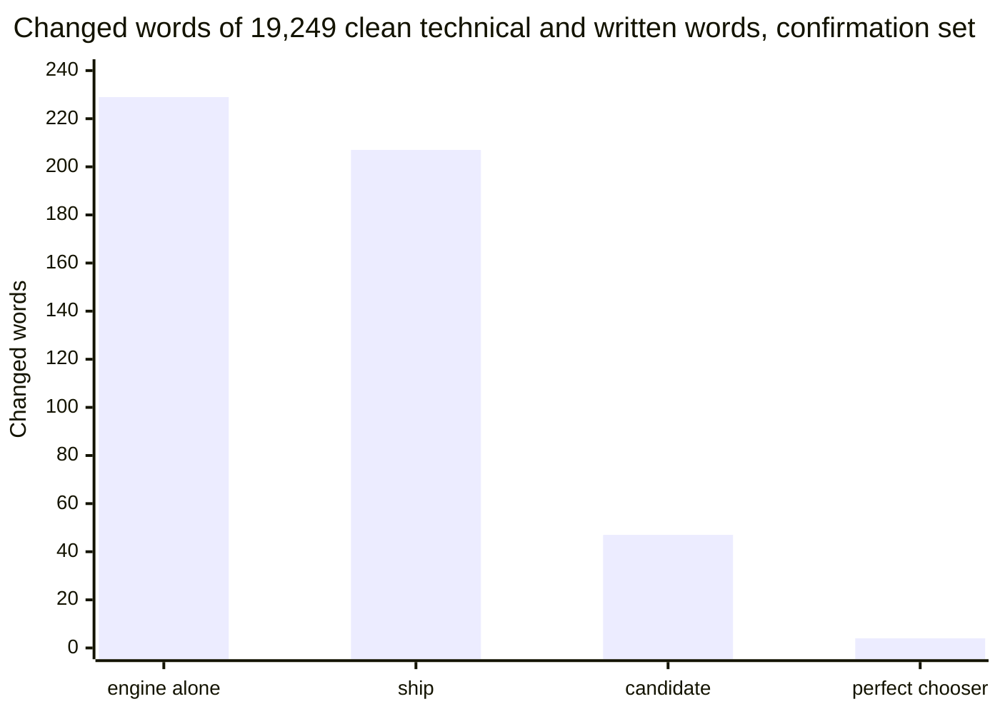

# Results of the domain round of the re-ranker fine-tune with the work area on

## Summary

The candidate `dom-s100-seed1` at its ceiling setting passed all seven conditions in the one read of the confirmation set. The app still ships `smollm2-lora-typed-seed1.Q4_K_M.gguf`.

1. Decide whether the app takes the candidate file. It is the asset of the pre-release `lm-domain-candidate-1`, with weight 1.5, margins 1 / 4 / 2, space-after on and lead 0.5.
2. Read Table 2 for the counts of the read. Condition 3 holds by 1 case on the clean symbols: 417 against 416 of 419.
3. Read Table 3 for the arms of the report. Two of the four miss a condition on clean text.
4. Read `scripts/lm-domain/reports/select-tables.md` for every arm on every selection set and on the test half.

This page does not settle the slip rate of the owner. Every number was measured on the symbol cases before the comma and period keys moved.

Figure 1. The candidate changes 47 correctly typed technical and written words, `ship` changes 207, the engine alone 229 and the perfect chooser 4.

## Glossary

| Term | Meaning |
| --- | --- |
| `ship` | The shipped file at the shipped setting: weight 1.0, margins 0 / 4 / 2, lead 4. |
| `soup-mix` | The mean of the weights of the three `mix` seeds of round 2. |
| `dom-s100` | A fine-tune of this round on everyday lists plus all 129,760 domain lists. |
| candidate | `dom-s100-seed1` at its ceiling setting: weight 1.5, margins 1 / 4 / 2, lead 0.5. |
| confirmation set | The set of 2026-11-12 that shares no source with a training list, a selection set or an earlier held-out set. |
| net loss | The cases that only `ship` has right, less the cases that only the other file has right. |
| ceiling setting | The setting with the most right tuning cases among those that change at most 0.3 percent of clean tune words. |
| perfect chooser | A search that knows the intended text and takes readings from the lists of the engine. |
| changed word | A correctly typed word of running text that the keyboard changes. |

## Pick of one candidate on the selection sets

The first pick named `soup-mix` at its ceiling setting (weight 1.5, margins 1 / 8 / 2, lead 4). Its condition 6 was a set of fixed dev counts from another run, and `dom-s100-seed1` at its ceiling setting missed that condition alone.
With the paired dev comparison as condition 6, three entries of 53 pass the nine conditions. The pick then names `dom-s100-seed1` at its ceiling setting (weight 1.5, margins 1 / 4 / 2, lead 0.5). It changes 38 technical and written dev words, against 140 for `soup-mix`.
On the 6,799 dev cases `ship` alone has 47 cases right, and the candidate alone has 41. That net loss of 6 cases passes the margin of 34: the bootstrap share is 0.0018, and the score test gives p = 0.0023.
The commit e3685db holds the rule, and `docs/lm-domain-confirmation-review.md` holds the Codex review of it.

Table 1. Selection sets, work area on. A changed count is changed correct words.

| Count | engine alone | perfect chooser | `ship` | `soup-mix`, ceiling | `dom-s100-seed1`, ceiling |
| --- | --- | --- | --- | --- | --- |
| Dev right, of 6,799 | 6,078 | 6,704 | 6,544 | 6,560 | 6,538 |
| GitHub misspellings right, of 1,500 | 1,269 | 1,447 | 1,280 | 1,288 | 1,295 |
| Select stream, changed of 8,439 words | 96 | 0 | 68 | 22 | 13 |
| Technical and written streams, changed words | 240 | 3 | 238 | 140 | 38 |
| Domain dev slips right, of 3,466 | 2,892 | 3,285 | 2,909 | 2,932 | 3,148 |
| Apostrophe word, next word, of 1,623 | 882, 628 | 1,604, 1,597 | 1,264, 1,432 | 1,317, 1,448 | 1,257, 1,459 |

The more domain lists an arm trains on, the fewer technical words it changes: 149, 103, 81 and 57 changed words at share 0, 0.15, 0.4 and 1.0.

## One read of the confirmation set

The candidate passes all seven conditions of the replacement rule on the confirmation set.
The plan was committed at 6749cbf before the read, with the SHA-256 value `6313db6c70c9a8a6bf14783d7a087b3d06be64bf356b5a7f5df37e24c926a467`. No model scored the set before that commit.

Table 2. Confirmation set, with the size of each part beside its count. `ship` is the reference.

| Count | engine alone | perfect chooser | `ship` | candidate | Condition |
| --- | --- | --- | --- | --- | --- |
| Technical and written streams, changed of 19,249 words | 229 | 4 | 207 | 47 | 1 holds: fewer changed words in 133 documents, more in 11, of 959 |
| Everyday stream, changed of 25,904 words | 363 | 0 | 164 | 48 | 2 holds |
| Generated clean right, of 971 | 935 | 971 | 942 | 949 | 3 holds, by 7 cases |
| Generated clean symbols right, of 419 | 411 | 419 | 416 | 417 | 3 holds, by 1 case |
| Non-word slips right, of 5,019 | 4,604 | 4,952 | 4,852 | 4,858 | 4 holds: the floor is 4,827 |
| GitHub misspellings right, of 1,500 | 1,273 | 1,460 | 1,302 | 1,307 | 5 holds: pooled 1,645 against 1,631 |
| Birkbeck right, of 600 | 333 | 417 | 329 | 338 | 5 holds |
| Real-word slips right, of 300 | 57 | 298 | 250 | 257 | 6 holds: the floor is 154 |
| Domain clean right, of 2,642 | 2,632 | 2,642 | 2,616 | 2,625 | 7 holds, by 9 cases |
| Domain slips right, of 1,838 | 1,488 | 1,685 | 1,496 | 1,613 | 7 holds |
| Generated right, of 6,709 | 6,007 | 6,640 | 6,460 | 6,481 | for the report |
| Slips of withheld words right, of 223 | 194 | 223 | 193 | 212 | for the report |
| Real-word errors of Wikipedia right, of 375 | 29 | 286 | 125 | 122 | for the report |

The candidate changes 160 fewer technical and written words than `ship`, and the one-sided sign test over documents gives p under 0.001.
The 95 percent interval of the difference to `ship` is 129 to 193 fewer changed technical and written words, over documents. For the everyday stream it is 89 to 145 fewer changed words.
For the right cases the intervals are 0 to 14 more clean cases, 0 to 3 more clean symbols and 0 to 18 more domain clean cases. For the domain slips the interval is 94 to 139 more.
The candidate corrects 212 of 223 slips of withheld words, against 193 for `ship`. So the gain holds for pack words whose slips the arm never trained on.
The paired comparison on the 6,709 generated cases is for the report: `ship` alone has 32 cases right, and the candidate alone has 53.

Table 3. Arms of the report on the confirmation set. They decide nothing.

| Count | `ship` | candidate | `dom-s100-seed1`, shipped setting | `dom-s100-seed2`, ceiling | `dom-s100-seed3`, ceiling | `soup-mix`, ceiling |
| --- | --- | --- | --- | --- | --- | --- |
| Technical and written streams, changed of 19,249 words | 207 | 47 | 71 | 49 | 45 | 125 |
| Everyday stream, changed of 25,904 words | 164 | 48 | 66 | 26 | 9 | 34 |
| Generated clean, of 971, and clean symbols, of 419 | 942, 416 | 949, 417 | 943, 414 | 940, 416 | 946, 419 | 943, 416 |
| Non-word slips right, of 5,019 | 4,852 | 4,858 | 4,847 | 4,848 | 4,846 | 4,864 |
| GitHub misspellings, of 1,500, and Birkbeck, of 600 | 1,302, 329 | 1,307, 338 | 1,321, 344 | 1,329, 334 | 1,318, 335 | 1,310, 337 |
| Real-word slips right, of 300 | 250 | 257 | 245 | 260 | 255 | 262 |
| Domain clean, of 2,642, and domain slips, of 1,838 | 2,616, 1,496 | 2,625, 1,613 | 2,624, 1,608 | 2,611, 1,620 | 2,617, 1,615 | 2,621, 1,508 |
| Conditions passed, of 7 | reference | 7 | 6 | 5 | 7 | 7 |

All three `dom-s100` seeds change 45 to 49 technical and written words at their ceiling settings, against 207 for `ship`.
The conditions on clean text are the ones that turn on a few cases. `dom-s100-seed1` at the shipped setting misses condition 3 by 2 clean symbols. `dom-s100-seed2` misses condition 3 by 2 clean cases and condition 7 by 5 domain clean cases.

## One read of the fresh held-out set

The first candidate, `soup-mix` at its ceiling setting, missed condition 3 on the fresh held-out set: 941 clean generated cases right, against 946 for `ship`. It passed the other six conditions.
The plan was committed at c0bdee5 before the read, with the SHA-256 value `9df4367654841b0b4e4edf39cb53bda981c9d3084ed1c9c1fa3c72bbf976c4ca`.
The counts of `dom-s100-seed1` in Table 4 were seen before it became the candidate. So Table 4 is no test of the candidate, and Table 2 is.

Table 4. Fresh held-out set. Only `soup-mix` was the candidate of this read. The other arms were in the plan for the report.

| Count | engine alone | perfect chooser | `ship` | `soup-mix`, ceiling | `full-mix-seed1` | `dom-s100-seed1` | `dom-s100-seed1`, ceiling |
| --- | --- | --- | --- | --- | --- | --- | --- |
| Generated right, of 6,727 | 6,070 | 6,663 | 6,494 | 6,501 | 6,511 | 6,482 | 6,493 |
| Generated clean, clean symbols | 945, 421 | 971, 429 | 946, 423 | 941, 426 | 947, 425 | 946, 423 | 946, 426 |
| Everyday stream, changed of 25,974 words | 361 | 0 | 188 | 46 | 35 | 63 | 39 |
| GitHub misspellings right, of 1,500 | 1,309 | 1,461 | 1,336 | 1,337 | 1,356 | 1,358 | 1,345 |
| Birkbeck right, of 600 | 329 | 441 | 339 | 346 | 345 | 347 | 337 |
| Domain cases right, of 4,611 | 4,215 | 4,457 | 4,192 | 4,218 | 4,197 | 4,364 | 4,368 |
| Domain slips right, of 1,955 | 1,567 | 1,801 | 1,570 | 1,595 | 1,572 | 1,727 | 1,728 |
| Slips of withheld words right, of 247 | 217 | 247 | 203 | 209 | 208 | 234 | 232 |
| Technical and written streams, changed of 19,925 words | 202 | 4 | 215 | 118 | 120 | 60 | 43 |
| Held-out conditions passed, of 7 | | | reference | 6 | 7 | 7 | 7 |

The two sets agree on the candidate: it changes 43 and 47 technical and written words, against 215 and 207 for `ship`.
`soup-mix` at its ceiling setting passes 6 conditions on the fresh held-out set and 7 on the confirmation set. Its clean count lies 5 cases under `ship` on the first set and 1 case over `ship` on the second.

## Parity of the converted files

The conversion keeps the tokens, the prompt and the weights. With an F32 file and a 32-bit cache, `lm_score` is within 0.0003 nats of PyTorch float32 for all 20 files. `scripts/lm-domain/reports/parity-table.md` gives every file.
The f16 file of `check_parity.py` passes the 0.05 limit for 5 of 20 files, and an F32 file with the standard `lm_score` for 15 of 20. The differences come from 16-bit weights and the 16-bit key and value cache of llama.cpp.
The Q4_K_M file that the phone runs takes another reading than PyTorch float32 in 181 to 270 of about 46,970 corrections: 270 for `ship`, 235 for `soup-mix`, 181 for `dom-s100-seed1`. Those counts are at the shipped setting without the apostrophe step.

## Candidate file: parity, decisions and harness

The candidate file is `dom-s100-seed1.Q4_K_M.gguf` of this round: 105,453,504 bytes, SHA-256 `8c0835e0eeb4787b853b4223facc14612d4d1b6c4bd7e33f7ad1ff9fc167dec8`. The release names it `smollm2-lora-domain-s100-seed1.Q4_K_M.gguf`.

- Parity under the reading of pick condition 9: the F32 file with a 32-bit cache is within 0.0001 nats of PyTorch float32, with no token mismatch. That holds on the everyday lists and on the domain lists, and the limit is 0.05.
- Decisions with the apostrophe step, at the candidate setting: the Q4_K_M file takes another reading than the F32 file with a 32-bit cache in 261 of 46,956 corrections. These are the corrections of the six selection sets, and without the step the count is 245.
- On the two sets of apostrophe words the count is 34 of 2,144 corrections with the step, and 43 without it. `scripts/lm-domain/decision_changes.py` counts both.
- The same count for `ship` at the shipped setting is 271 of 46,950 corrections with the step and 270 without it. On the apostrophe words it is 69 of 2,144 with the step.
- Harness of the keyboard workflow: `scripts/lm-keyboard/harness_trace.py` with the candidate file and its setting gets 6,538 of 6,799 dev cases right. The harness of this round gives the same count, and `scripts/lm-domain/candidate.json` holds the counts per group.
- Run 43389818855 of the workflow "Domain candidate file in the Linux harness" passes. Its x86 job fetches the file of the pre-release and gets the same counts as the local run. The keyboard's scorer and `lm_score` give the same answers byte for byte on 13,930 requests.
- The ARM job of that run gets 6,536 of 6,799 dev cases right, 2 fewer than the x86 job. The shipped file shows the same step in run 43258534212: 6,543 on x86 and 6,541 on ARM.
- Run 43389818826 of the workflow "Language model in the keyboard" passes on the commit 4ba1043. That workflow types with the shipped file, on Linux and in the simulator.

## Remaining errors of the shipped file

Table 5. Labels of 200 errors of `ship` per set, by `scripts/lm-domain/label-rule.md`.

| Set | label noise | engine recall | model error | unclear |
| --- | --- | --- | --- | --- |
| Dev half | 143 | 40 | 17 | 0 |
| GitHub misspellings | 137 | 19 | 42 | 2 |

Most remaining errors are label noise: a short context that fits both texts, or a spelling variant. The perfect chooser does not reach the intended text in 95 of the 255 dev errors and in 53 of the 220 GitHub errors.

## Other findings

- Setting selection under a ceiling: for `ship` the 0.3 percent ceiling halves the changed words and loses 181 domain slips and 77 GitHub misspellings on the selection sets. On the held-out set it misses two conditions.
- Loss arms: the clean-weighted cross-entropy and the expected-cost loss both score below the base arm of their seed. The loss rule picks neither.
- Apostrophe step: lead 4 fits the shipped file only. At its own lead every arm gets at least as many next-word cases right as `ship`, except `dom-s100-seed2`.
- List builder of rounds 1 and 2: 200 of 54,759 clean running-text lists of round 2 have a target that adds the next word. No arm writes a repeated word on the selection streams, so the effect is not visible there.

## Limits of these results

- Condition 3 holds by 1 case on the clean symbols, and the 95 percent interval of that difference starts at 0. A condition that holds by one case can turn on chance.
- The candidate was named after its counts on the fresh held-out set were seen. The margins of the paired dev comparison were written with the dev counts known. The confirmation set is its one independent test.
- The group clean symbols of the confirmation set has 419 cases, and the domain slips are 1,838 against 1,955 in the fresh held-out set. Smaller parts give wider intervals.
- The app does not hold the candidate file. No run types the cases through the keyboard's own code on the simulator with it.
- The decision count compares the Q4_K_M file with the F32 file and a 32-bit cache. That reading is within 0.0003 nats of PyTorch float32 for every file.
- The loss comparison has two seeds per loss.
