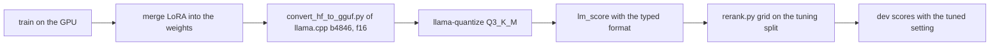

# Design of the distilgpt2 fine-tune for the English re-ranker

## Summary

This design tests one question. Does a distilgpt2 fine-tuned to pick the intended reading choose
better than the stock distilgpt2 re-ranker? Both see the engine's readings at each correction.

1. Build training, stopping and tuning cases from Tatoeba sentences that dev and test do not use.
   Apply the leakage rules in "Leakage rules for the new sentences" first.
2. Train two arms on the same lists: a LoRA fine-tune and a full fine-tune of distilgpt2.
   Both use a listwise cross-entropy loss over the readings.
3. Convert each arm the way the phone runs it: merge, convert with llama.cpp b4846, and
   quantize to Q3_K_M.
4. Tune the weight and margins of every arm on the tuning split. This includes the stock
   re-ranker. Then score every arm on dev, and pick one fine-tuned arm.
5. Read the test half once, at the end. The test comparison of the chosen arm with the retuned
   stock re-ranker decides the question.

This design does not settle the phone time of the new input format. It does not settle how
often each slip happens in real typing either.

## Glossary

| Term | Meaning |
| --- | --- |
| reading | One way to read the typed span as words, from `duo_english_readings` in `Engine/duo_engine.c`. The text as typed is always one reading. |
| engine score | The engine's log probability of a reading, slips included. |
| slip cost | The part of the engine score that the assumed slips cost. |
| list | The readings at one correction, with the text before the span, the typed span, and the target. |
| target | The longest reading that keeps the field a prefix of the intended text. |
| model score | The two numbers `lm_score` returns for a reading. One is the log probability of its tokens. The other is the log probability that the next token starts with a space. |
| setting | The weight, the three margins and the space-after switch of the re-ranker (`scripts/lm-rerank/rerank.py`). |
| tuning split | New cases from new sentences, with the category counts of dev. It chooses the setting of every arm. |
| stopping split | New cases from other new sentences. It chooses the checkpoint of each fine-tune. |
| published misspellings | The cases from Roger Mitton's lists, built by `build_external_english_cases.py`. Our generator did not make them. |

## Arms and controls

Table 1. Every arm, named by how it is fit. Later tables use these labels.

| Label | Model and fit | Input format | Setting chosen on | Why it exists |
| --- | --- | --- | --- | --- |
| `control` | The engine's own choice, without a model | none | nothing to choose | The baseline of every gain |
| `no-model` | The margins on the engine score alone | none | tuning split | The gain of margins without a model |
| `linear-features` | A linear listwise chooser on engine features, trained by Adam, no language model | none | tuning split | Tests whether a plain recalibration of the engine gives the gain |
| `stock-dev` | Shipped distilgpt2 Q3_K_M, not trained | stock | dev, as published | The re-ranker as it stands today |
| `stock-tuned` | Shipped distilgpt2 Q3_K_M, not trained | stock | tuning split | The stock re-ranker on equal terms with the fine-tunes |
| `stock-typed` | Shipped distilgpt2 Q3_K_M, not trained | typed | tuning split | The effect of the typed format on an untrained model |
| `stock-converted` | Hugging Face distilgpt2 through our converter and quantizer, not trained | stock | published setting, then tuning split | The effect of our conversion on the stock model |
| `lora` | distilgpt2, LoRA fine-tune, merged, Q3_K_M | typed | tuning split | The method the request names |
| `full` | distilgpt2, full fine-tune, Q3_K_M | typed | tuning split | The second arm |
| `lora-stock-format` | distilgpt2, LoRA fine-tune, merged, Q3_K_M | stock | tuning split | The effect of training without the typed span |
| `chosen-no-context` | The chosen method, trained and scored without the text before the span | typed | tuning split | Tests whether the fine-tune uses the context |
| `oracle` | The greedy oracle of `rerank.py` | none | nothing to choose | The ceiling of a chooser that knows the target, one correction at a time |

Each of `lora` and `full` trains with seeds 1 and 2. Seed 1 gives the arm's result. Seed 2
measures the spread between two runs of one method.

The `linear-features` chooser scores a reading by a weighted sum of eight numbers:

1. the engine score,
2. the slip cost,
3. the engine score less the slip cost,
4. 1 for the reading as typed, else 0,
5. 1 for the engine's choice, else 0,
6. the change in word count from the typed span,
7. the change in length from the typed span,
8. the edit distance from the typed span.

It trains on the training lists with the listwise loss, and stops on the stopping lists.

## Input format per reading

The model reads the text before the span, then the typed span, then the reading.

Table 2. The stock format and the typed format, for the typed span "sutar" after "how much".

| Part | Stock format | Typed format |
| --- | --- | --- |
| Text the model reads first | `<|endoftext|>How much` | `<|endoftext|>How much \| sutar \|` |
| Text of one reading | ` sugar` | ` sugar` |
| Empty text before the span | the reading follows the start token | `<|endoftext|>\| sutar \|`, then ` sugar` |

- The text before the span gets the capitals a person would see, as `language_model_text` in
  `rerank.py` gives them. The typed span stays lower case, as the engine reads it.
- A reading at the start of the field gets its capital. The real text before the span decides
  this, so the bar text does not count.
- A typed span cannot hold a bar. `correctableWord` in `Shared/KeyboardTextLogic.swift` takes
  only letters, apostrophes, digits and the symbols beside letter keys. The text before the span
  can hold a bar. The dev and test cases do not.
- A span of two typed words keeps its space, as in `| tob e |`.
- `lm_score.c` keeps the last 96 tokens of the first text. The typed span sits at its end, so a
  long context loses its oldest words first.
- Training tokenizes the first text and each reading apart, as `lm_score.c` does. A check
  compares the Hugging Face tokens with the llama.cpp tokens, after the repair of token -1.

The keyboard holds the three inputs in `correctLastWord` (`Shared/KeyboardTextController.swift`).
The text before the span is `before` without `shownSpan`. The typed span is `typedSpan`, which
keeps the letters as typed across corrections. The readings come from `duo_english_readings`.
Today the spell checker takes only the previous word and the typed span. A keyboard build of the
re-ranker must pass the text before the span and the readings as well.

## Score and loss

The fine-tune trains the score that the re-ranker uses. For reading i, e_i is the engine score.
The model score m_i is the token log probability plus the space-after log probability. The
training logit is z_i = e_i + m_i. This equals the combined score of `rerank.py` at weight 1,
with the space-after term on.

The loss is the listwise cross-entropy: minus the log of the softmax of z at the target. The
mean runs over the lists of a batch. A list with one reading does not offer a choice, so it is
left out. A list without a target is left out too. Both rules apply to training only. Every
evaluation case counts.

The engine score acts as a fixed prior inside the logit. The gradient of the loss on m_i is the
softmax share of reading i, less 1 at the target. So a list gives a small gradient when engine
and model together already put most weight on the target. The tuning split then sets the weight,
the margins and the space-after switch, which the loss does not hold.

## Clean cases and over-correction

A clean case is text typed without a slip. Its target is the reading as typed. Five parts of the
design keep the model from changing clean text.

1. Clean cases make up one third of the training cases. Dev holds one fifth. The report gives
   the share of clean lists after the build, which differs from the share of cases.
2. Each clean list pushes the reading as typed above every correction.
3. The re-ranker keeps the engine's choice unless another reading scores higher by a margin.
4. The tuning rule keeps as many clean cases right as the control, on the tuning split.
5. The pick among arms needs the clean groups of dev at or above the control.

A count of clean cases can hide a clean case that breaks while another is repaired. The report
gives both numbers per arm and per clean category.

## Training mix

The training cases use the 24 categories of dev, from the same generators:
`build_english_cases.py` and `build_english_symbol_cases.py`.

Table 3. Training cases per category, before the leakage rules drop a few.

| Categories | Count per category | Cases |
| --- | --- | --- |
| 14 slip categories of `english.*.jsonl`: 7 letter, 5 space, `apostrophe_missing`, `real_word_slip` | 4,000 | 56,000 |
| 4 symbol slip categories | 3,990, or 3,993 for `symbol_inner_letter` | 15,963 |
| 6 clean categories | 6,000 | 36,000 |
| All | | 107,963 |

The symbol categories split their count evenly over the symbol keys, as the generator does. So
4,000 becomes 3,990 over 15 keys and 3,993 over 11 keys.

Three clean categories need a new word list.

- `clean_rare` takes words of rank 20,000 to 60,000 in wordfreq, as the generator does. It
  leaves out the words that dev and test cases use.
- `clean_names_and_terms` cannot reuse `inputs/names_and_terms.txt`. Dev and test split that
  whole list between them. It takes wordfreq tokens of rank 60,000 to 400,000 instead. A token
  stays only when no word at least 100 times as frequent sits one edit away. The lexicon builder
  uses the same rule to tell a rare word from a slip. These tokens differ from the hand-picked
  names of dev, so the report treats this category with care.
- `clean_symbol_token` cannot reuse `inputs/symbol_tokens.txt` either. It takes wordfreq tokens
  with one digit and one letter or more, at Zipf 1.0 or more, outside that list.

## Leakage rules for the new sentences

The export that built dev and test is the local Tatoeba file with SHA-256 `1a2d75ac...`. It holds
2,040,567 sentences, and 1,611,121 pass the generator's filter. The data build on GitHub fetches
the current export, which holds newer sentences too. It drops a sentence on any of these rules.

1. Its ID is the source of a dev or test case. This drops 13,541 sentences.
2. Its words equal the words of a dev or test source sentence. This drops 67 more.
3. Its words equal a dev or test context. This drops 267 more.
4. Its words hold a dev or test context followed by that case's intended text, for every case
   with a context. This drops about 914,000 more, 57 percent of the sentences.

Rule 4 changes the training text. It removes most sentences that hold a common short phrase of
dev or test, such as "i think". Rule 4 skips the cases with an empty context. For those, the
phrase is the intended word alone, and the rule would drop every sentence with a common word.

The splits also stay apart from each other. A sentence whose words equal a sentence of another
split leaves the training split.

Three more rules cover words that are not sentences.

- The list-based clean categories of dev and test hold words as `intended`: `clean_rare`,
  `clean_names_and_terms` and `clean_symbol_token`. A training or tuning case whose intended text
  holds one of those words as a whole word leaves its split.
- A published misspelling of the dev or test half never becomes a typed word in training. This
  rule reads the `typed` field of the published test cases.
- Of the generated test cases, the build reads `source`, `context`, `intended` and `category`.
  It never runs the engine or a model on a test case.

A local check repeats rules 1 to 4 on the downloaded cases against the pinned export.

## Splits

Table 4. The five splits and their roles.

| Split | Source | Cases | Role |
| --- | --- | --- | --- |
| train | New sentences in hash buckets 2 to 9 of 10 | about 108,000 | The loss |
| stopping | New sentences in hash bucket 1 | about 6,800, in the category counts of dev | The checkpoint of each fine-tune |
| tuning | New sentences in hash bucket 0 | about 6,800, in the category counts of dev | The setting of every arm |
| dev | `english.dev.jsonl` and `english-symbols.dev.jsonl`, then the published misspellings apart | 6,799, then 751 | The pick among arms, and the dev scores |
| test | The same three files of the test half | 6,798, then 742 | One read at the end |

The hash is SHA-256 of the sentence ID with a fixed prefix. A word of a word list splits by the
same hash of the word.

## LoRA fine-tune settings

- peft LoRA on every GPT-2 attention layer (`c_attn`, attention `c_proj`) and every MLP layer
  (`c_fc`, MLP `c_proj`). GPT-2 stores these as Conv1D, so `fan_in_fan_out` is on.
- Rank 16, alpha 32, LoRA dropout 0.05. The base weights, biases and embeddings stay frozen.
  That gives about 1.2 million trained weights of 82 million.
- AdamW: learning rate 2e-4, betas 0.9 and 0.999, weight decay 0.01, gradient clip at 1.0.
- Schedule: linear warm-up over 300 steps, then cosine decay to 0 at the end of 4 epochs.
- Batch: 32 lists, about 256 reading sequences.
- Early stopping: the loss on the stopping lists every 500 steps, patience 5. The checkpoint
  with the lowest stopping loss is the result.
- Precision: bfloat16 autocast with float32 weights.

## Full fine-tune settings

- Every weight of distilgpt2 trains, the tied embeddings included.
- AdamW: learning rate 3e-5, betas 0.9 and 0.999, gradient clip at 1.0. Weight decay is 0.01,
  except on biases and LayerNorm weights.
- The schedule, batch, early stopping and precision of the LoRA fine-tune.

## Conversion and scoring as the phone runs it

The full fine-tune skips the merge. Each arm types every evaluation case through the keyboard
rules with its own choices. So a choice at one correction changes the text and readings of the
next correction, as on the phone. Five checks guard this path.

1. The shipped model at the published setting must give 6,126 right dev cases in WSL, as on the
   GitHub runner.
2. The Hugging Face and llama.cpp tokens must match on 2,000 lists of the tuning split.
3. PyTorch and `lm_score` on the f16 file must agree within 0.05 nats on 500 lists.
4. `stock-converted` and the shipped file must give close scores per reading. Their dev cases
   are compared at the published setting, then at each tuned setting.
5. The space-token count of the training code must equal the count that `lm_score` prints.

## Tuning, the pick among arms, and the test read

- Every model arm searches the grid of `rerank.py`: 2,160 settings. `no-model` searches its 120.
  A setting must keep as many right cases as the control in the groups clean and clean symbols.
  The tuning split decides.
- Dev scores each arm at its tuned setting. The 6,799 generated dev cases are the main count.
  The published misspellings are reported apart.
- An arm qualifies when its clean groups on dev stay at or above the control. The pick is the
  qualified fine-tuned arm with the most right dev cases.
- The McNemar test counts the cases that one arm gets right and the other gets wrong. Its exact
  form is a binomial test. Dev holds 574 repeats of one context and intended text. So the report
  adds a bootstrap interval that resamples those groups.
- A fine-tuned arm gains on dev when it has more right dev cases than `stock-tuned`, at p < 0.025.
  The limit is 0.05 halved, because two arms take the test. A gain starts the SmolLM2 step.
- The test read decides the question. It compares the chosen arm with `stock-tuned` at p < 0.05.
- The within-dev check repeats the two-fold check of `rerank.py` for every arm. It tunes on one
  half of dev and reads the other half. Its clean rule pools both clean groups, as in
  `rerank.py`. The full tuning rule keeps them apart.
- The test read runs once, after the pick and every setting are fixed. It scores `control`,
  `stock-dev`, `stock-tuned`, the chosen arm, and the SmolLM2 rows if they exist.

## Controls

Table 5. The controls and the question each one answers.

| Control | Question it answers |
| --- | --- |
| Leakage rules | Did a dev or test phrase reach training? |
| Published misspellings per source, for every arm | Does a gain hold on slips our generator did not make? |
| Generated dev cases with an empty context | Is a gain on the published misspellings in line with the generated cases of the same shape? |
| Seen and unseen pairs | Is a gain larger on dev cases whose typed and intended pair also sits in training? |
| `stock-tuned` | Does tuning on the new split alone give the gain? |
| `linear-features` | Does a recalibration of the engine scores give the gain? |
| `stock-typed` | Does the typed format alone give the gain? |
| `lora-stock-format` | Does the gain need the typed span? |
| `chosen-no-context` | Does the fine-tune use the text before the span? |
| `stock-converted` | Does our conversion move the score? |
| `no-model` | Do the margins alone give a gain? |
| Seed 2 | How far apart are two runs of one method? |
| Test read once | Is the dev pick an over-fit to dev? |

A gain on generated cases that does not show on the published misspellings points to the
generator. The published misspellings have no context, so they test the spelling part only. The
generated dev cases with an empty context are the fair comparison for them.

## SmolLM2-135M

The SmolLM2 step runs only when a distilgpt2 arm gains. It repeats the chosen method on
SmolLM2-135M, with LoRA on the attention and MLP projections of the Llama layers. Its rows use
Q4_K_M, as the stock SmolLM2 row of `scripts/lm-rerank/README.md` does. The stock SmolLM2 row
is tuned on the tuning split too.

## Compute plan

Table 6. Where each step runs, and why.

| Step | Where | Reason |
| --- | --- | --- |
| Cases and lists | GitHub Linux runner, 4 processes | The engine takes about 19 ms per span. About 120,000 spans take 38 minutes on one core. |
| Training | Local RTX 4090, under 3.5 GB, below-normal priority, 4 CPU threads | The request allows it. Other apps already hold about 20 GB of the 24 GB. |
| Conversion and quantization | Local WSL at low priority | The weights stay on this machine. |
| Scoring and grid | Local WSL, `lm_score` at 4 threads, low priority | The weights stay on this machine. |

The weights stay on this machine. The workflow uploads cases and lists only.

## Limits of this design

- The generator made the training slips, the tuning slips and the dev slips. Only the published
  misspellings stand apart, and they have no context. A test of the context on slips from
  another source needs a typo corpus with sentences. This design does not have one.
- The typed format adds the typed span to the text the phone reads once per correction. Its
  extra phone time is not measured here.
- Two seeds show the spread of one method. They do not give a confidence interval.
- The fine-tunes choose a checkpoint as well as a setting. The stock re-ranker chooses only a
  setting. The test read measures each whole procedure on unseen cases.
