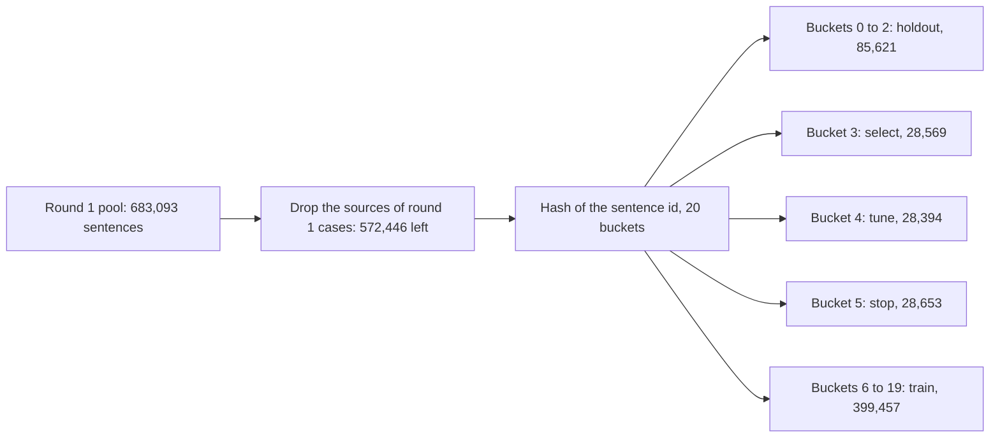

# Design of round 2 of the re-ranker fine-tune, with a fresh held-out set

## Summary

Round 2 asks one question. Can a SmolLM2-135M fine-tune change fewer correct words than the
shipped candidate `ship`, and keep its repairs? `ship` is `smollm2-lora-seed1` at its round 1 setting.

1. Build a held-out set that no model and no person has scored. It holds fresh generated cases,
   clean running text, and real typos from two public sources. This step is done, and
   `check_leakage2.py` passes.
2. Choose every setting with a clean-text rule on the tuning sets. Train the arms of Table 2.
3. Pick one candidate on the selection sets with the rule in "Pick of one candidate".
4. Commit `holdout-plan.json`, then read the held-out set once with `read_holdout.py`.
5. Replace `ship` only when the candidate passes the six conditions in "Replacement rule on the held-out set".

This design does not settle the share of typed words that carry a slip. It does not measure the
phone time of any new file.

## Glossary

| Term | Meaning |
| --- | --- |
| reading | One way to read the typed span as words, from `duo_english_readings`. The text as typed is one reading. |
| list | The readings at one correction, with the text before the span, the typed span and the target. |
| setting | The weight, the three margins and the space-after switch of `scripts/lm-rerank/rerank.py`. |
| `ship` | The file `smollm2-lora-seed1.Q4_K_M.gguf` at weight 1.0, margins 0 from typed, 4 to typed, 2 other, space-after on. |
| generated case | A case from the project's slip generator: a context, one typed span with a slip, and the intended text. |
| clean running text | A whole sentence typed word by word without a slip. Every space press is a correction. |
| changed word | A word of clean running text that the field does not hold as typed. The count is the word edit distance between the field and the sentence. |
| non-word slip | A generated slip case outside `real_word_slip`: the letter, space and symbol groups and `apostrophe_missing`. |
| real misspelling | A wrong form that a person wrote, from a public list or corpus. |
| candidate | The one arm that the pick on the selection sets sends against `ship`. |

## Five sets and the role of each

Table 1. Each set, its source and its one role. A model reads the held-out set once, at the end.

| Set | Role | Content | Size |
| --- | --- | --- | --- |
| train | The loss | Round 1 training lists. The `mix` arms add clean running text and Wikipedia misspellings. | 118,169 lists, plus 57,662 new lists |
| stop | The checkpoint of each fine-tune | Round 1 stopping lists. The `mix` arms add new stopping lists. | 7,556 lists, plus 3,520 new lists |
| tune | The setting of each arm | Round 1 tuning cases, and clean running text of the tune bucket | 6,748 cases, and 1,300 sentences (8,487 words) |
| select | The pick of one candidate | Generated dev half, published dev misspellings, clean running text of the select bucket, GitHub typos of the select half | 6,799 and 751 cases, 1,300 sentences (8,439 words), 2,500 cases |
| holdout | The replacement decision | Fresh generated cases, clean running text, GitHub typos of the holdout half, fresh Birkbeck and Holbrook pairs | 6,745 cases, 4,000 sentences (26,060 words), 2,500 and 721 cases |

The test half and the published test misspellings of round 1 stay closed. Round 2 does not read them.

Figure 1. The split of the fresh Tatoeba sentences. A sentence with the words of an earlier bucket
group leaves the later group.

## Fresh held-out set

The held-out set has four parts. Each part answers a different question about an arm.

Table 2a. The four parts of the held-out set.

| Part | File | Cases | Source | Question |
| --- | --- | --- | --- | --- |
| generated | `cases.generated.holdout.jsonl` | 6,745 in the 24 categories of dev | Fresh Tatoeba sentences, the generators of dev | Does the arm repair generated slips, per category? |
| stream | `cases.stream.holdout.jsonl` | 3,000 closed sentences (19,482 words) and 1,000 open sentences (6,578 words) | Fresh Tatoeba sentences | How many correct words does the arm change in running text? |
| github | `cases.github.holdout.jsonl` | 1,500 `github_misspelling` and 1,000 `github_real_word` | GitHub Typo Corpus v1.0.0 | Does the arm repair real typos that have a context? |
| mitton | `cases.mitton-remainder.holdout.jsonl` | 600 Birkbeck and 121 Holbrook pairs | Roger Mitton's lists, pairs that are in no round 1 dev or test case | Does the arm repair real misspellings without a context? |

- A closed sentence holds only words of the 60,000 most frequent. It comes from the pool.
- An open sentence holds one or two real words outside that vocabulary, such as "sloppily". Each such
  word has Zipf 1.5 or more, and has no word 100 times as frequent one edit away.
- The three list-based clean categories take words that are the intended text of no round 1 case, and
  that are in no dev or test list. A round 1 list can still show such a word in its context or among its readings.
- A GitHub case is an English typo edit that changes one word. The right word has Zipf 3.5 or more,
  and the wrong form lies at most two edits away. The context is the run of plain words before the typo.
- `github_misspelling` holds wrong forms with Zipf under 3.0. Of the 1,500 held-out cases, 1,160 have a context.
- `github_real_word` holds wrong forms with Zipf 4.0 or more, one edit away. Many of these edits fix
  grammar, such as "notes" to "note". The report shows this category, and no rule uses it.
- A right word of the GitHub corpus goes to select or to holdout by a hash of the word.
- Round 1 took every usable Aspell pair, so the mitton part holds two sources.

## Leakage rules of round 2

`check_leakage2.py` checks these rules apart from the build code. It passes on the built files, and
its self-test finds six planted faults. It reads the training lists as well as the cases.

1. A new Tatoeba sentence passes the four dev and test rules of round 1.
2. A new Tatoeba sentence is not the source of a round 1 case, by id or by its words.
3. Two of the new sets do not share a sentence, by id or by its words.
4. A new training case never has the typed text of an evaluation misspelling.
5. A new training sentence never holds a list-based clean word of the held-out set, or an open word
   of a tune, select or holdout stream sentence.
6. The select half and the holdout half of the GitHub typos do not share a right word.
7. A mitton pair is not a round 1 dev or test case of any list, and does not stand twice.

Round 2 does not drop a held-out case because training holds its phrase. Round 1 dropped 57 percent
of the training sentences that way, and its training text lost common phrases. Running text needs
those phrases. The report gives two controls in place of the rule.

- Of 5,746 generated held-out cases with a context, 1,284 have their context and intended text in a
  training sentence. The report splits the held-out counts by this flag.
- A pair counts as seen when a training or stopping list holds it as typed span and target. Of
  5,344 generated held-out slip cases, 2,340 have a seen pair. The report splits the counts by this flag too.
- Of the real typos, 244 of 2,500 GitHub held-out pairs and 38 of 721 mitton pairs are seen pairs.
  The generator made those training pairs. The report splits these counts as well.
- Of the 501 list-based clean words of the held-out set, 30 stand in the context of a training list
  and 161 stand among its readings. None is the target of a list.

## Arms of round 2

Table 2. Every arm, named by how it is fit. All SmolLM2 arms read the typed format and ship as Q4_K_M.

| Label | Model and fit | Training lists | Setting from | Reason |
| --- | --- | --- | --- | --- |
| `control` | The engine's own choice | none | none | Baseline of every count |
| `stock-dev` | Shipped distilgpt2 Q3_K_M, not trained, stock format | none | round 1 | The stock re-ranker of round 1 |
| `linear-features` | Linear listwise chooser on 8 engine features, trained by Adam | round 1 | round 1 | A re-ranker without a language model |
| `lora-seed1`, `full-seed1` | distilgpt2 LoRA and full fine-tunes of round 1, Q3_K_M | round 1 | round 1 | Round 1 arms on the new set |
| `smollm2-stock` | Shipped SmolLM2-135M Q4_K_M, not trained, stock format | none | round 1 | The untrained lead model |
| `ship` | SmolLM2-135M, LoRA fine-tune (rank 16, AdamW, listwise cross-entropy), seed 1 of round 1 | round 1 | round 1 | The reference of the replacement rule |
| `smollm2-lora-seed1-calibrated` | The file of `ship` | round 1 | tune, clean-text rule | The effect of the clean-text rule alone |
| `smollm2-lora-seed2`, `-seed3` | The recipe of `ship` with seeds 2 and 3 | round 1 | tune, clean-text rule; also the `ship` setting | The spread of the round 1 recipe |
| `smollm2-lora-mix-seed1`, `-seed2`, `-seed3` | SmolLM2-135M, LoRA fine-tune (rank 16, AdamW, listwise cross-entropy) | round 1 and new | tune, clean-text rule; also the `ship` setting | The effect of the new training lists, with three seeds |
| `smollm2-lora-mix-hinge-seed1` | The `mix` fit with a keep-typed hinge term in the loss | round 1 and new | tune, clean-text rule | The effect of a loss term that keeps a correct typed word |
| `smollm2-full-mix-seed1` | SmolLM2-135M, full fine-tune (AdamW, listwise cross-entropy) | round 1 and new | tune, clean-text rule | The full fine-tune arm, if it fits 3.5 GB of GPU memory |
| `smollm2-lora-clean-seed1` | The `mix` fit without the Wikipedia misspellings | round 1 and clean running text | tune, clean-text rule | Separates the two kinds of new list |

Every fine-tune keeps the round 1 recipe: learning rate 2e-4 for LoRA and 3e-5 for the full
fine-tune, weight decay 0.01, 300 warm-up steps, cosine decay over 4 epochs, 32 lists per step.
Each run stops early on the stopping loss, checked every 500 steps with patience 5.

## New training lists of the `mix` arms

The `mix` arms add two kinds of list to the 118,169 round 1 lists.

- Clean running text: 7,000 closed and 1,500 open sentences of the train bucket, typed word by word.
  Each correction gives one list, and its target is the reading as typed. Common words such as "has"
  appear at their real rate.
- Wikipedia misspellings: 1,600 usable pairs of Mitton's Wikipedia list. A pair goes into at most 3
  sentences that hold the right word: 3,099 training cases and 212 stopping cases.

The new cases give 57,662 training lists and 3,520 stopping lists. In 54,559 of the new training
lists the target is the reading as typed. The Wikipedia list is the only source of real
misspellings in training. The GitHub corpus, Birkbeck, Holbrook and Aspell stay evaluation sets.

## Keep-typed hinge term

The `mix-hinge` arm adds one term to the listwise loss. The term applies to a list whose target is
the reading as typed. With z the training logits of the list:

    hinge = max(0, 4 - (z of the target - highest other z))

The loss of a step is the mean cross-entropy plus 1.0 times the mean hinge. Both means run over
every list of the step, and a list with another target adds 0 to the hinge. The stopping loss uses
the same sum. The term asks a correct typed word to lead by 4 nats. A from-typed margin of the
setting then has room to work.

## Clean-text rule for the setting of each arm

The grid is the grid of `rerank.py`: 2,160 settings. A setting is allowed when both rules hold on
the tuning sets.

1. It keeps as many right cases as the control in the groups clean and clean symbols (round 1 rule).
2. It changes at most as many words of the tune running text as the control (new rule).

The allowed setting with the most right generated tuning cases is the arm's setting. `evaluate2.py`
also records the setting of rule 1 alone, with its count of changed words.

## Counts that the report gives for every arm

Table 3. The counts on the held-out set. The report never adds them into one total.

| Count | Set | Direction |
| --- | --- | --- |
| Changed words per 10,000, closed and open apart | stream | lower is better |
| Right cases in clean and clean symbols | generated | higher is better |
| Right cases per slip group: letter, space, symbol, apostrophe missing | generated | higher is better |
| Right `real_word_slip` cases | generated | higher is better |
| Right `github_misspelling` cases, with and without a context | github | higher is better |
| Right `github_real_word` cases | github | shown only |
| Right Birkbeck and Holbrook pairs | mitton | higher is better |
| GGUF bytes, tokens per request on the stream, model time per request in WSL | all | lower is better |

The report also gives one weighted estimate. No rule uses it.

    wrong words per 1,000 typed = 1000 * [(1 - s) * c + s * ((1 - r) * (1 - a) + r * (1 - b))]

- c is the share of changed words on the stream. a is the share of right non-word slips. b is the
  share of right `real_word_slip` cases. A slip case counts as one wrong word.
- s is the share of typed words that carry a slip. This design does not have a measured value. The
  report shows 0.02, 0.05 and 0.10.
- r is the share of slips that give a real word. This design does not have a measured value either.
  The report shows 0.05, 0.12 and 0.30. The middle value is the share of real-word edits among the
  usable one-word edits of the GitHub corpus, after the filters of this design: 3,944 of 32,246.

## Pick of one candidate

The pick uses the selection sets only. Every SmolLM2 fine-tune file at its clean-text setting can be
the candidate, the file of `ship` included. An arm qualifies when all five hold against `ship` on
the selection sets.

1. Its changed words on the select stream are fewer than those of `ship`.
2. Its right cases in the dev groups clean and clean symbols are each at least those of `ship`.
3. Its right real misspellings are at least those of `ship`. The count pools the 751 published dev
   misspellings and the 1,500 `github_misspelling` cases of the select half.
4. Its right non-word slips of the dev half are at least those of `ship` less 25 (0.5 percent of 5,097).
5. Its right `real_word_slip` cases of the dev half keep at least half of the gain of `ship` over the control.

The candidate is the qualified arm with the fewest changed words on the select stream. A tie goes
to the arm with more right real misspellings, then more right non-word slips, then the first label
in Table 2. When no arm qualifies, there is no candidate, and `ship` stays. The held-out set is
then read for the report only.

## Replacement rule on the held-out set

`holdout-plan.json` names every arm, file, setting and SHA-256, and the candidate. It is committed
before the read. The candidate replaces `ship` when all six conditions hold on the held-out set.

1. It changes fewer stream sentences than `ship`, at p < 0.05. The test is the exact one-sided
   McNemar test on the sentences that only one of the two arms changes. The 4,000 sentences differ in their words.
2. Its changed words on the closed stream and on the open stream are each at most those of `ship`.
3. Its right cases in the generated groups clean and clean symbols are each at least those of `ship`.
4. Its right non-word slips are at least those of `ship` less 25 (0.5 percent of 5,044). The lower
   end of the 95 percent interval of the difference is at least -50. The interval resamples groups
   of cases with one context and one intended text.
5. Its right real misspellings, pooled, are at least those of `ship`. Each source alone is at least
   that of `ship` less 1 percent of its cases: `github_misspelling` and the mitton pairs.
6. Its right `real_word_slip` cases keep at least half of the gain of `ship` over the control.

Condition 1 asks for the improvement that round 2 exists for. Conditions 2 to 6 bound each loss.
Every SmolLM2 file has the same size and reads the same format, so the phone cost does not enter
the rule. The report gives size and tokens per request for each arm.

The rule decides the file and setting that ship. It does not show that new training helped. For
that claim the report repeats the six conditions for the candidate against
`smollm2-lora-seed1-calibrated`, and gives the spread of the seeds.

## Controls

Table 4. The controls and the question each one answers.

| Control | Question |
| --- | --- |
| `smollm2-lora-seed1-calibrated` | Does the clean-text rule alone fix the changed words, without training? |
| Seeds 2 and 3 of the round 1 recipe | Is the difference between `ship` and the candidate larger than the seed spread? |
| New arms at the `ship` setting | Is a difference due to the weights or to the setting? |
| `smollm2-lora-clean-seed1` | Do the Wikipedia misspellings add to the clean running text? |
| Best step and stopping loss of every run, on the round 1 stopping lists alone | Does a `mix` arm differ by its training length or checkpoint, apart from its lists? |
| Candidate against `smollm2-lora-seed1-calibrated` | Does the candidate improve on the shipped file under the same clean-text rule? |
| `linear-features`, `smollm2-stock` | Does a result need the fine-tuned language model? |
| Held-out counts by phrase seen in training | Is a gain larger where training holds the phrase? |
| Held-out counts by pair seen in training | Is a gain larger where training holds the typed and intended pair? |
| `github_misspelling` with and without a context | Does a gain on real typos need the context? |
| Open stream apart from closed stream | Does an arm change rare real words more than common words? |
| One read of the held-out set | Is the pick an over-fit to the selection sets? |

## Compute plan

- Cases: Python on this machine. Lists: the engine in WSL, 7 processes.
- Training: the local RTX 4090, under the lock file `build/gpu.lock`. The PyTorch cap is 2.3 GB for
  LoRA and 3.5 GB for the full fine-tune. Each run has below-normal priority.
- A step adds the gradients of micro-batches of at most 800 padded tokens. Round 1 used 1,500 under
  a cap of 3.0 GB. The gradient of a step is the same sum over its 32 lists.
- `run_queue.py` trains two arms at the same time when the GPU memory in use, the two caps and 0.8 GB
  for the CUDA contexts stay under 22.3 GB. Otherwise the two arms run back to back.
- Conversion: `convert_hf_to_gguf.py` and `llama-quantize` of llama.cpp b4846, then the token and
  score checks of `check_parity.py`.
- Scoring: `lm_score` of round 1 in WSL, 2 threads per arm, low priority.

Run order, in pairs (`train-queue.json`): `smollm2-lora-mix-seed1` with `smollm2-lora-seed2`,
`smollm2-lora-clean-seed1` with `smollm2-lora-mix-hinge-seed1`, `smollm2-lora-seed3` with
`smollm2-lora-mix-seed2`, `smollm2-lora-mix-seed3` with `smollm2-full-mix-seed1`.

## Limits of this design

- The generator made the generated cases of every set. The real typos come from desktop text: commits
  on GitHub and handwriting lists. This design does not have phone slips.
- The clean running text is Tatoeba sentences of 4 to 12 words in lower case. It does not hold
  punctuation inside a sentence, capitals, or chat text.
- The dev half and the published dev misspellings chose settings in round 1. Here they only pick the
  candidate. The held-out set makes the decision.
- A `mix` arm also stops on more lists and has more steps per epoch than the round 1 recipe. The
  report shows the best step of each run. It does not hold a run with the round 1 step count on the new lists.
- The weighted estimate counts a slip case as one wrong word, and its two shares are not measured.
- One seed can pass or miss the replacement rule by chance. The seeds of each recipe show that spread.
