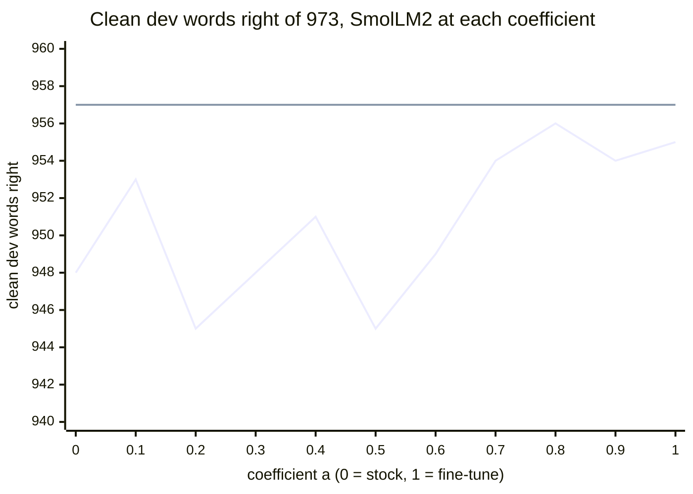

# Interpolation between the stock and the fine-tuned re-ranker weights, measured on clean words

## Summary

At its own tuned setting, an interpolation coefficient does not meet the clean-word rule on dev,
on any of three fine-tunes. On fresh held-out cases the SmolLM2 fine-tune meets that rule at its
tuned setting, and the chosen coefficient does not add clean words to it.

What to do:

1. Do not ship an interpolated model. At the chosen coefficient, a = 0.9, the paired tests do not
   separate it from the fine-tune on generated cases. On SmolLM2 it changes more clean held-out
   sentences.
2. Do not reject the SmolLM2 fine-tune over its 2 clean dev words (955 against 957). On the
   held-out set the same file keeps 952 clean cases against 945 for the engine alone. The two
   sets differ in their clean categories, and neither paired test separates the arm from the control.
3. Keep the distilgpt2 fine-tune out. It keeps fewer clean cases than the engine alone on dev (945
   against 957) and on the held-out set (935 against 945), and interpolation does not repair that.
4. If real typos matter more than real-word slips, test a lower re-ranker weight in the
   fine-tuning round. Weight 0.5 with margins 1, 0, 0 on the unchanged SmolLM2 fine-tune repairs
   1,310 of 1,500 held-out GitHub misspellings against 1,247. It costs 47 generated real-word slips,
   129 GitHub real-word typos (250 against 379) and 62 clean sentences.

This report does not settle phone time or memory, a second SmolLM2 seed, or Q4_K_M files. Every
file here is Q3_K_M.

Figure 1. Clean dev words that SmolLM2 keeps right at each coefficient, each at its own tuned
setting. The flat line is the engine alone at 957. Every coefficient lies below that line, and
the count does not rise or fall steadily with the coefficient.

## Terms and arm labels

| Term | Meaning |
| --- | --- |
| coefficient a | The weights are (1 - a) stock + a fine-tune. This is WiSE-FT interpolation (Wortsman et al. 2022). With one fine-tune it equals task vector scaling at lam = a (Ilharco et al. 2023), so one arm covers both methods. |
| control | The engine's own choice, without a model. |
| setting | The re-ranker weight, its three margins and the space-after switch of `rerank.py`. The tuning split (6,748 cases) picks it for each arm. |
| clean rule | An arm keeps at least as many right cases as the control in the groups clean and clean symbols. |
| stopping cases | 6,740 cases outside dev. They choose the coefficient. |
| dev | 6,799 generated cases, and 751 published misspellings apart. |
| held-out set | The set of the second fine-tuning round, final since 2026-11-11: 6,745 generated cases, 4,000 clean sentences, 2,500 GitHub typos and 721 Mitton pairs. |
| share of the gain kept | Right cases at a, less those at a = 0, divided by the same difference at a = 1. |

Table 1. The arm labels. Every arm is a Q3_K_M file in the typed format.

| Label | Arm | Why it exists |
| --- | --- | --- |
| `s-wise-a` | SmolLM2-135M at coefficient a, from its LoRA fine-tune | The test on SmolLM2 |
| `d-wise-a` | distilgpt2 at coefficient a, from its LoRA fine-tune of seed 1 | The test on distilgpt2 |
| `d2-wise-a` | The same from the LoRA fine-tune of seed 2 | The spread between fine-tuning seeds |
| `s-stock`, `d-stock` | a = 0 | The lower end of each curve |
| `s-lora`, `d-lora` | a = 1, the fine-tune | The upper end of each curve |
| `-weight-w` | The fine-tune, unchanged, at re-ranker weight w | The calibration-only control: a lower weight in place of an interpolation |
| `s-wise-0.7-common` | SmolLM2 at a = 0.7 at the setting of `s-lora` | A row found on dev after the fact |

## Dev result of the chosen coefficient on three fine-tunes

The grid (a from 0.1 to 0.9), the selection rule and the dev criteria were committed in `7783c50`,
before any interpolated arm met dev. The rule chose a = 0.9 for every fine-tune, and no chosen
coefficient meets the clean rule.

Table 2. The chosen coefficient of each fine-tune on dev, at its tuned setting, beside the control
and the fine-tune. The chosen coefficient differs from its fine-tune by 1 clean word, and
it does not reach the control's 957.

| Arm | Clean of 973 | Clean symbols of 429 | Real-word slips of 300 | Dev right of 6,799 | Share of the gain kept | Published misspellings of 751 |
| --- | --- | --- | --- | --- | --- | --- |
| control | 957 | 427 | 62 | 6,069 | | 381 |
| `s-lora` | 955 | 427 | 257 | 6,537 | 1.00 | 372 |
| `s-wise-0.9`, chosen | 954 | 427 | 261 | 6,537 | 1.00 | 384 |
| `d-lora` | 945 | 427 | 250 | 6,491 | 1.00 | 367 |
| `d-wise-0.9`, chosen | 946 | 427 | 251 | 6,494 | 1.01 | 371 |
| `d-lora` seed 2 | 950 | 429 | 241 | 6,486 | 1.00 | 328 |
| `d2-wise-0.9`, chosen | 949 | 429 | 244 | 6,478 | 0.98 | 351 |
| `s-lora-weight-1.0`, chosen calibration-only candidate | 952 | 426 | 258 | 6,537 | 1.00 | 389 |

The design's main comparison is the chosen calibration-only candidate: the fine-tune with the same
extra selection on the stopping cases. That rule chose weight 1.0 for SmolLM2, the tuned setting
itself for distilgpt2 seed 1 (weight 1.5) and for seed 2 (weight 1.0). Not one of the three meets
the clean rule on dev. So neither pre-set selection, of a coefficient or of a weight, gives a
model that meets it.

Across each whole grid, the clean count lies between 944 and 956. Not one of the 27 grid arms
meets the clean rule and keeps more than half the gain. The count of grid values is a description
of dev, read nine times per fine-tune.

The paired tests do not separate these arms from the control on clean cases, and they do not
show that the arms are equal to it either. At a = 0.9, SmolLM2 turns 14 clean dev cases
wrong and 11 right against the control (exact McNemar p = 0.69). distilgpt2 seed 1 turns 19 wrong
and 8 right (p = 0.052). The stock models in the typed format also sit below the control, at 948
and 954. So a return toward the stock weights cannot restore the control's count.

## Re-ranker weight as a simpler explanation of the clean count

The re-ranker adds weight times the model score to the engine score. A lower weight on the
unchanged fine-tune meets the clean rule on dev where the interpolation does not.

Table 3. The fine-tune at re-ranker weight 0.5 on dev. Each row is the best tuning-split setting
of that weight under the clean rule, so its margins differ from the tuned setting too (1, 0, 0 or
2, 0, 0 against 2, 4, 2 or 1, 4, 2). The table does not separate the weight from the margins. The selection rule on the stopping cases did not choose these
rows, so they are readings of dev after the fact. The lower the weight, the more clean words kept
and the fewer real-word slips repaired.

| Arm | Clean of 973 | Clean symbols of 429 | Real-word slips of 300 | Dev right of 6,799 | Published misspellings of 751 |
| --- | --- | --- | --- | --- | --- |
| control | 957 | 427 | 62 | 6,069 | 381 |
| `s-lora-weight-0.5` | 959 | 427 | 213 | 6,485 | 400 |
| `d-lora-weight-0.5` | 957 | 428 | 197 | 6,423 | 378 |
| `d-lora` seed 2 at weight 0.5 | 959 | 429 | 186 | 6,405 | 361 |

The second control scores every coefficient at the setting of its fine-tune. There SmolLM2 meets
the clean rule at a = 0.2 to 0.7, with 957 to 961 clean words. distilgpt2 does not meet it at any
coefficient of 0.2 or more. The tables at the end give every row.

## Held-out comparison on the set of the second fine-tuning round

`read_holdout.py` of the second fine-tuning round read its held-out set once for the eleven arms of
`scripts/lm-weight-edit/holdout-plan.json`. Commit `85fd374` fixed that plan and the criteria
before the read. The three rows found on dev after the fact got their first untouched test here.

Table 4. Counts per arm on the held-out set. The SmolLM2 fine-tune keeps more clean cases than the
control and changes the fewest words of clean running text. The other SmolLM2 arms change more
words than that fine-tune does.

| Arm | clean of 972 | clean symbols of 429 | letter slips of 2,074 | space slips of 1,476 | symbol slips of 1,196 | apostrophe missing of 298 | real-word slips of 300 | generated, all of 6,745 | changed words of 26,060 (closed, open) | changed sentences of 4,000 | `github_misspelling` of 1,500 | `github_real_word` of 1,000 | Birkbeck of 600 | Holbrook of 121 |
| --- | --- | --- | --- | --- | --- | --- | --- | --- | --- | --- | --- | --- | --- | --- |
| `control` | 945 | 421 | 1941 | 1302 | 1134 | 250 | 63 | 6056 | 332 (253, 79) | 257 | 1274 | 14 | 324 | 44 |
| `s-stock` | 945 | 419 | 1939 | 1306 | 1117 | 260 | 97 | 6083 | 395 (311, 84) | 314 | 1279 | 66 | 327 | 48 |
| `s-lora` | 952 | 427 | 2028 | 1371 | 1163 | 296 | 247 | 6484 | 116 (69, 47) | 95 | 1247 | 379 | 303 | 51 |
| `s-lora-weight-1.0` | 947 | 425 | 2028 | 1371 | 1166 | 295 | 246 | 6478 | 155 (98, 57) | 132 | 1287 | 384 | 306 | 50 |
| `s-lora-weight-0.5` | 951 | 422 | 2027 | 1361 | 1162 | 292 | 200 | 6415 | 182 (121, 61) | 157 | 1310 | 250 | 311 | 48 |
| `s-wise-0.9` | 948 | 427 | 2031 | 1372 | 1164 | 296 | 251 | 6489 | 140 (87, 53) | 115 | 1265 | 398 | 303 | 51 |
| `s-wise-0.7-common` | 953 | 425 | 2029 | 1367 | 1164 | 297 | 243 | 6478 | 130 (84, 46) | 113 | 1282 | 340 | 307 | 48 |
| `d-stock` | 948 | 419 | 1935 | 1299 | 1125 | 259 | 92 | 6077 | 365 (279, 86) | 284 | 1291 | 40 | 323 | 47 |
| `d-lora` | 935 | 424 | 2026 | 1360 | 1163 | 294 | 245 | 6447 | 203 (127, 76) | 151 | 1273 | 410 | 310 | 45 |
| `d-lora-weight-0.5` | 947 | 418 | 2014 | 1351 | 1163 | 288 | 192 | 6373 | 234 (143, 91) | 196 | 1306 | 243 | 318 | 46 |
| `d-wise-0.9` | 939 | 424 | 2022 | 1362 | 1161 | 293 | 251 | 6452 | 173 (97, 76) | 146 | 1288 | 393 | 315 | 48 |

Table 5. The criteria on the held-out set, against the control. Every SmolLM2 arm built from the
fine-tune meets the clean rule, the fine-tune included. Not one distilgpt2 arm meets it.

| Arm | clean rule | share of the generated gain kept | clean: wrong only by the arm / only by the control (p) | clean symbols: the same (p) | sentences changed only by the arm / only by the control (p) |
| --- | --- | --- | --- | --- | --- |
| `s-stock` | not met | 0.00 | 4 / 4 (1) | 2 / 0 (0.5) | 70 / 13 (1.3e-10) |
| `s-lora` | met | 1.00 | 9 / 16 (0.23) | 0 / 6 (0.031) | 31 / 193 (8.8e-30) |
| `s-lora-weight-1.0` | met | 0.99 | 11 / 13 (0.84) | 1 / 5 (0.22) | 58 / 183 (2.8e-16) |
| `s-lora-weight-0.5` | met | 0.83 | 9 / 15 (0.31) | 1 / 2 (1) | 60 / 160 (1.1e-11) |
| `s-wise-0.9` | met | 1.01 | 12 / 15 (0.7) | 0 / 6 (0.031) | 48 / 190 (3.6e-21) |
| `s-wise-0.7-common` | met | 0.99 | 6 / 14 (0.12) | 0 / 4 (0.12) | 33 / 177 (5.2e-25) |
| `d-stock` | not met | 0.00 | 3 / 6 (0.51) | 2 / 0 (0.5) | 46 / 19 (0.0011) |
| `d-lora` | not met | 1.00 | 23 / 13 (0.13) | 2 / 5 (0.45) | 68 / 174 (6.8e-12) |
| `d-lora-weight-0.5` | not met | 0.80 | 11 / 13 (0.84) | 4 / 1 (0.38) | 80 / 141 (4.9e-05) |
| `d-wise-0.9` | not met | 1.01 | 21 / 15 (0.41) | 1 / 4 (0.38) | 64 / 175 (4.2e-13) |

Table 6. Paired counts on the held-out set. Against the SmolLM2 fine-tune, a lower weight or a
lower coefficient repairs more GitHub misspellings and changes more clean sentences.

| Arm | `github_misspelling` against the control | `github_misspelling` against the fine-tune | Mitton pairs against the control | Mitton pairs against the fine-tune | clean sentences unchanged, against the fine-tune | generated cases against the fine-tune |
| --- | --- | --- | --- | --- | --- | --- |
| `s-stock` | 11 / 6 (0.33) | 93 / 61 (0.012) | 8 / 1 (0.039) | 38 / 17 (0.0065) | 24 / 243 (8.9e-47) | 37 / 438 (4.2e-88) |
| `s-lora` | 64 / 91 (0.036) | 0 / 0 (1) | 22 / 36 (0.087) | 0 / 0 (1) | 0 / 0 (1) | 0 / 0 (1) |
| `s-lora-weight-1.0` | 63 / 50 (0.26) | 49 / 9 (9e-08) | 17 / 29 (0.1) | 9 / 7 (0.8) | 3 / 40 (3e-09) | 26 / 32 (0.51) |
| `s-lora-weight-0.5` | 69 / 33 (0.00047) | 75 / 12 (2.7e-12) | 25 / 34 (0.3) | 18 / 13 (0.47) | 17 / 79 (9.9e-11) | 34 / 103 (2.9e-09) |
| `s-wise-0.9` | 66 / 75 (0.5) | 28 / 10 (0.0051) | 20 / 34 (0.076) | 4 / 4 (1) | 2 / 22 (3.6e-05) | 18 / 13 (0.47) |
| `s-wise-0.7-common` | 67 / 59 (0.53) | 52 / 17 (2.9e-05) | 15 / 28 (0.066) | 16 / 15 (1) | 8 / 26 (0.0029) | 33 / 39 (0.56) |
| `d-stock` | 21 / 4 (0.00091) | 74 / 56 (0.14) | 10 / 8 (0.81) | 37 / 22 (0.067) | 61 / 194 (2.5e-17) | 56 / 426 (1.7e-71) |
| `d-lora` | 64 / 65 (1) | 0 / 0 (1) | 20 / 33 (0.098) | 0 / 0 (1) | 0 / 0 (1) | 0 / 0 (1) |
| `d-lora-weight-0.5` | 57 / 25 (0.00053) | 45 / 12 (1.3e-05) | 22 / 26 (0.67) | 19 / 10 (0.14) | 25 / 70 (4.3e-06) | 48 / 122 (1.3e-08) |
| `d-wise-0.9` | 65 / 51 (0.23) | 22 / 7 (0.0081) | 21 / 26 (0.56) | 9 / 1 (0.021) | 20 / 15 (0.5) | 26 / 21 (0.56) |

Five readings of these tables:

- Clean words: `s-lora` keeps 952 of 972 clean cases and 427 of 429 clean symbols, against 945
  and 421 for the control. `s-wise-0.9` keeps 948 and 427. So interpolation is not needed for the
  clean rule on this set, and a = 0.9 does not add clean words.
- Clean categories: against the control, `s-lora` keeps 5 fewer common words (295 against 300) on
  the held-out set, as on dev. It keeps 7 more names and terms (67 against 60), 2 more rare words
  and 3 more two-word cases. So the held-out count rises through other categories, and the loss
  of common words stays.
- Clean running text: the control changes 332 of 26,060 words, `s-lora` 116, `s-wise-0.9` 140 and
  `s-lora-weight-0.5` 182. Against `s-lora`, `s-wise-0.9` leaves 2 more sentences unchanged and
  changes 22 more (p = 0.00004).
- GitHub misspellings: `s-lora` repairs 1,247 of 1,500, below the control's 1,274 (p = 0.036).
  `s-wise-0.9` repairs 1,265, `s-wise-0.7-common` 1,282 and `s-lora-weight-0.5` 1,310. On the
  1,000 `github_real_word` cases the order reverses: 379 for `s-lora`, 398, 340 and 250.
  On the 721 Mitton pairs the SmolLM2 arms from the fine-tune get 354 to 359, against 368 for the
  control, and none differs from the control at p under 0.05.
- distilgpt2: `d-lora` keeps 935 clean cases and `d-wise-0.9` keeps 939, both below the control's
  945. `d-lora-weight-0.5` keeps 947 clean cases and 418 clean symbols, below the control's 421.

## Limits of this measurement

- One SmolLM2 fine-tune exists. The seed spread of the clean count is known for distilgpt2 only:
  945 and 950 on dev.
- Three arms exceed the 0.05-nat limit of the PyTorch against `lm_score` check on their largest
  gap: `s-wise-0.5` (0.051), `s-wise-0.8` (0.072) and `d2-wise-0.5` (0.081). Their tokens match on
  all 2,000 lists, and their mean gaps are 0.004 to 0.008 nats. The check was left unchanged.
- The stopping cases chose each coefficient, and each fine-tune read the stopping lists for its
  checkpoint. So a count on the stopping cases is optimistic.
- The rows "found on dev after the fact" were picked by reading dev. Only their held-out numbers
  are free of that pick.
- The held-out plan does not hold a = 0.9 at the setting of `s-lora`. `s-wise-0.9` differs from
  `s-lora` in its weights and in one margin (1 against 2), so its 20 extra changed sentences
  cannot be assigned to the weights alone.
- The held-out clean rule compares counts of a few cases. `s-lora` turns 9 clean cases wrong and
  16 right against the control (p = 0.23).
- The fine-tune's own held-out candidate is its Q4_K_M file at another setting. This report used
  Q3_K_M files, so its `s-lora` row is not that candidate.
- The phone time and memory of an interpolated file were not measured. The file has the size and
  the architecture of the fine-tune.

## Full dev tables of the three fine-tunes

Each block gives four things per coefficient: the selection on the stopping cases, dev per group
and per generated category, the paired clean and published counts, and the two controls. The
"half-gain interval" is the 95 percent bootstrap interval of dev right at a, less the mean of
a = 0 and a = 1. It resamples the 6,225 groups of one context and one intended text.

### Tables of SmolLM2-135M with its LoRA fine-tune (`s-wise`)

Stopping cases: the control gets 931 clean and 426 clean-symbol cases right, and 6018 of 6740 in all.
Dev: the control gets 957 clean and 427 clean-symbol cases right, 6069 of 6799 in all, and 381 of 751 published misspellings.

Selection on the stopping cases, at each coefficient's tuning-split setting.

| a | setting: weight; margins from typed, to typed, other; space after | tuning split right | stopping clean | stopping clean symbols | stopping right | eligible |
| --- | --- | --- | --- | --- | --- | --- |
| 0.0 | 0.75; 3, 4, 2; on | 6067 | 929 | 425 | 6069 | no |
| 0.1 | 0.75; 3, 4, 2; on | 6101 | 930 | 425 | 6103 | no |
| 0.2 | 1.5; 1, 8, 2; on | 6207 | 922 | 425 | 6183 | no |
| 0.3 | 1.5; 1, 8, 2; on | 6295 | 926 | 426 | 6267 | no |
| 0.4 | 2.0; 0, 4, 0; on | 6378 | 938 | 428 | 6338 | yes |
| 0.5 | 2.0; 0, 4, 2; on | 6458 | 940 | 428 | 6426 | yes |
| 0.6 | 2.0; 0, 4, 2; on | 6481 | 944 | 428 | 6458 | yes |
| 0.7 | 1.5; 1, 4, 2; on | 6491 | 946 | 428 | 6477 | yes |
| 0.8 | 1.5; 2, 4, 2; on | 6499 | 947 | 428 | 6476 | yes |
| 0.9 | 1.5; 1, 4, 2; on | 6508 | 946 | 428 | 6485 | yes |
| 1.0 | 1.5; 2, 4, 2; on | 6502 | 950 | 428 | 6491 | yes |

Chosen coefficient: 0.9

Dev at each coefficient's tuning-split setting.

| a | clean of 973 | clean symbols of 429 | letter slips of 2,100 | space slips of 1,500 | symbol slips of 1,197 | apostrophe missing of 300 | real-word slips of 300 | all of 6,799 | share of the gain kept | clean rule | published of 751 |
| --- | --- | --- | --- | --- | --- | --- | --- | --- | --- | --- | --- |
| control | 957 | 427 | 1943 | 1299 | 1131 | 250 | 62 | 6069 | | | 381 |
| 0.0 | 948 | 426 | 1941 | 1310 | 1117 | 253 | 89 | 6084 | 0.00 | not met | 394 |
| 0.1 | 953 | 427 | 1951 | 1315 | 1125 | 254 | 94 | 6119 | 0.08 | not met | 392 |
| 0.2 | 945 | 426 | 1978 | 1338 | 1133 | 256 | 144 | 6220 | 0.30 | not met | 402 |
| 0.3 | 948 | 426 | 2009 | 1352 | 1139 | 274 | 168 | 6316 | 0.51 | not met | 407 |
| 0.4 | 951 | 426 | 2025 | 1352 | 1144 | 286 | 229 | 6413 | 0.73 | not met | 382 |
| 0.5 | 945 | 427 | 2034 | 1372 | 1157 | 291 | 257 | 6483 | 0.88 | not met | 385 |
| 0.6 | 949 | 427 | 2043 | 1383 | 1159 | 297 | 260 | 6518 | 0.96 | not met | 376 |
| 0.7 | 954 | 428 | 2044 | 1383 | 1159 | 298 | 258 | 6524 | 0.97 | not met | 402 |
| 0.8 | 956 | 428 | 2047 | 1385 | 1162 | 299 | 255 | 6532 | 0.99 | not met | 391 |
| 0.9 | 954 | 427 | 2044 | 1385 | 1166 | 300 | 261 | 6537 | 1.00 | not met | 384 |
| 1.0 | 955 | 427 | 2047 | 1386 | 1165 | 300 | 257 | 6537 | 1.00 | not met | 372 |

Grid values that meet the clean rule and keep more than half the gain on dev: none

Right dev cases per generated category.

| category (cases) | control | a = 0.0 | a = 0.1 | a = 0.2 | a = 0.3 | a = 0.4 | a = 0.5 | a = 0.6 | a = 0.7 | a = 0.8 | a = 0.9 | a = 1.0 |
| --- | --- | --- | --- | --- | --- | --- | --- | --- | --- | --- | --- | --- |
| clean_common (300) | 300 | 297 | 298 | 296 | 296 | 295 | 291 | 293 | 295 | 295 | 294 | 295 |
| clean_rare (300) | 290 | 289 | 289 | 283 | 286 | 287 | 284 | 286 | 289 | 290 | 289 | 290 |
| clean_names_and_terms (73) | 67 | 69 | 69 | 68 | 68 | 70 | 71 | 71 | 71 | 71 | 71 | 70 |
| clean_two_words (300) | 300 | 293 | 297 | 298 | 298 | 299 | 299 | 299 | 299 | 300 | 300 | 300 |
| substitution_adjacent (300) | 284 | 282 | 284 | 286 | 288 | 290 | 291 | 292 | 293 | 293 | 293 | 293 |
| deletion (300) | 240 | 240 | 243 | 253 | 265 | 278 | 274 | 279 | 279 | 281 | 281 | 282 |
| double_letter (300) | 297 | 297 | 297 | 297 | 298 | 298 | 299 | 298 | 298 | 298 | 297 | 297 |
| extra_adjacent (300) | 292 | 291 | 291 | 292 | 296 | 297 | 298 | 298 | 298 | 298 | 297 | 297 |
| transposition (300) | 281 | 281 | 284 | 288 | 289 | 282 | 287 | 289 | 289 | 290 | 289 | 290 |
| two_errors (300) | 259 | 259 | 261 | 268 | 277 | 284 | 287 | 290 | 290 | 290 | 290 | 291 |
| short_word_slip (300) | 290 | 291 | 291 | 294 | 296 | 296 | 298 | 297 | 297 | 297 | 297 | 297 |
| space_missing (300) | 241 | 242 | 243 | 245 | 248 | 244 | 250 | 252 | 253 | 253 | 253 | 252 |
| space_to_letter (300) | 271 | 272 | 272 | 272 | 275 | 274 | 278 | 280 | 280 | 279 | 281 | 281 |
| space_transposed (300) | 242 | 244 | 247 | 251 | 255 | 256 | 262 | 267 | 267 | 269 | 269 | 270 |
| space_extra (300) | 274 | 275 | 275 | 285 | 289 | 293 | 294 | 297 | 295 | 297 | 295 | 296 |
| letter_to_space (300) | 271 | 277 | 278 | 285 | 285 | 285 | 288 | 287 | 288 | 287 | 287 | 287 |
| apostrophe_missing (300) | 250 | 253 | 254 | 256 | 274 | 286 | 291 | 297 | 298 | 299 | 300 | 300 |
| real_word_slip (300) | 62 | 89 | 94 | 144 | 168 | 229 | 257 | 260 | 258 | 255 | 261 | 257 |
| symbol_first_letter (300) | 295 | 295 | 295 | 294 | 295 | 296 | 296 | 296 | 297 | 297 | 297 | 297 |
| symbol_inner_letter (297) | 295 | 294 | 295 | 296 | 296 | 295 | 297 | 295 | 296 | 296 | 296 | 296 |
| symbol_first_letter_two_words (300) | 272 | 271 | 271 | 272 | 272 | 273 | 274 | 278 | 276 | 278 | 278 | 278 |
| symbol_plus_letter_slip (300) | 269 | 257 | 264 | 271 | 276 | 280 | 290 | 290 | 290 | 291 | 295 | 294 |
| clean_symbol_token (129) | 127 | 127 | 127 | 127 | 127 | 128 | 128 | 128 | 128 | 128 | 127 | 127 |
| clean_bracket_or_dot_word (300) | 300 | 299 | 300 | 299 | 299 | 298 | 299 | 299 | 300 | 300 | 300 | 300 |

Clean dev cases against the control, published misspellings, and the half-gain interval.

| a | clean: wrong only by the arm / wrong only by the control (p) | clean symbols: the same (p) | half-gain interval | published: Birkbeck, Holbrook, Aspell | published against control: only arm / only control (p) | published against a = 1: only arm / only a = 1 (p) |
| --- | --- | --- | --- | --- | --- | --- |
| 0.0 | 11 / 2 (0.022) | 1 / 0 (1) | -259 to -198 | 162, 147, 85 | 15 / 2 (0.0023) | 56 / 34 (0.026) |
| 0.1 | 6 / 2 (0.29) | 0 / 0 (1) | -224 to -163 | 161, 147, 84 | 11 / 0 (0.00098) | 51 / 31 (0.035) |
| 0.2 | 14 / 2 (0.0042) | 2 / 1 (1) | -124 to -60 | 162, 155, 85 | 29 / 8 (0.00075) | 59 / 29 (0.0018) |
| 0.3 | 13 / 4 (0.049) | 2 / 1 (1) | -28 to +36 | 163, 157, 87 | 35 / 9 (0.00011) | 61 / 26 (0.00022) |
| 0.4 | 17 / 11 (0.34) | 3 / 2 (1) | +69 to +138 | 153, 143, 86 | 46 / 45 (1) | 50 / 40 (0.34) |
| 0.5 | 22 / 10 (0.05) | 2 / 2 (1) | +141 to +207 | 156, 146, 83 | 45 / 41 (0.75) | 43 / 30 (0.16) |
| 0.6 | 19 / 11 (0.2) | 2 / 2 (1) | +177 to +241 | 149, 142, 85 | 46 / 51 (0.68) | 32 / 28 (0.7) |
| 0.7 | 14 / 11 (0.69) | 1 / 2 (1) | +184 to +246 | 160, 153, 89 | 46 / 25 (0.017) | 40 / 10 (2.4e-05) |
| 0.8 | 12 / 11 (1) | 1 / 2 (1) | +192 to +254 | 156, 148, 87 | 42 / 32 (0.3) | 31 / 12 (0.0054) |
| 0.9 | 14 / 11 (0.69) | 2 / 2 (1) | +198 to +259 | 154, 144, 86 | 40 / 37 (0.82) | 17 / 5 (0.017) |
| 1.0 | 13 / 11 (0.84) | 2 / 2 (1) | +198 to +259 | 151, 139, 82 | 36 / 45 (0.37) | 0 / 0 (1) |

Dev at the common setting of the family, 1.5; 2, 4, 2; on.

| a | clean | clean symbols | real-word slips | all of 6,799 | published of 751 |
| --- | --- | --- | --- | --- | --- |
| 0.0 | 945 | 426 | 101 | 5883 | 378 |
| 0.1 | 954 | 427 | 109 | 6047 | 391 |
| 0.2 | 957 | 427 | 129 | 6177 | 389 |
| 0.3 | 960 | 428 | 154 | 6295 | 394 |
| 0.4 | 961 | 429 | 175 | 6376 | 392 |
| 0.5 | 959 | 428 | 225 | 6466 | 398 |
| 0.6 | 957 | 427 | 251 | 6508 | 399 |
| 0.7 | 959 | 428 | 255 | 6524 | 399 |
| 0.8 | 956 | 428 | 255 | 6532 | 391 |
| 0.9 | 956 | 428 | 258 | 6533 | 381 |
| 1.0 | 955 | 427 | 257 | 6537 | 372 |

Calibration-only candidates: the fine-tune (a = 1) at the best tuning-split setting of each re-ranker weight.

| weight | setting | tuning split right | stopping clean | stopping clean symbols | stopping right | eligible | dev clean | dev clean symbols | dev all | clean rule | published |
| --- | --- | --- | --- | --- | --- | --- | --- | --- | --- | --- | --- |
| 0.1 | 0.1; 4, 0, 0; on | 6161 | 935 | 426 | 6148 | yes | 960 | 427 | 6197 | met | 388 |
| 0.2 | 0.2; 2, 0, 0; on | 6267 | 936 | 423 | 6264 | no | 957 | 426 | 6310 | not met | 394 |
| 0.3 | 0.3; 1, 0, 0; on | 6355 | 936 | 423 | 6341 | no | 952 | 427 | 6395 | not met | 398 |
| 0.5 | 0.5; 1, 0, 0; on | 6432 | 948 | 426 | 6439 | yes | 959 | 427 | 6485 | met | 400 |
| 0.75 | 0.75; 0, 0, 0; on | 6482 | 949 | 427 | 6490 | yes | 954 | 426 | 6535 | not met | 395 |
| 1.0 | 1.0; 0, 2, 2; on | 6495 | 949 | 428 | 6498 | yes | 952 | 426 | 6537 | not met | 389 |
| 1.5 | 1.5; 2, 4, 2; on | 6502 | 950 | 428 | 6491 | yes | 955 | 427 | 6537 | not met | 372 |
| 2.0 | 2.0; 3, 8, 2; on | 6487 | 943 | 428 | 6465 | yes | 951 | 427 | 6511 | not met | 369 |
| 3.0 | 3.0; 6, 8, 2; on | 6438 | 946 | 428 | 6428 | yes | 951 | 427 | 6477 | not met | 338 |

Chosen calibration-only candidate: weight 1.0

### Tables of distilgpt2 with its LoRA fine-tune of seed 1 (`d-wise`)

Stopping cases: the control gets 931 clean and 426 clean-symbol cases right, and 6018 of 6740 in all.
Dev: the control gets 957 clean and 427 clean-symbol cases right, 6069 of 6799 in all, and 381 of 751 published misspellings.

Selection on the stopping cases, at each coefficient's tuning-split setting.

| a | setting: weight; margins from typed, to typed, other; space after | tuning split right | stopping clean | stopping clean symbols | stopping right | eligible |
| --- | --- | --- | --- | --- | --- | --- |
| 0.0 | 0.3; 3, 2, 0; on | 6057 | 931 | 425 | 6047 | no |
| 0.1 | 0.75; 3, 8, 0; on | 6083 | 930 | 426 | 6080 | no |
| 0.2 | 1.0; 0, 4, 0; on | 6159 | 937 | 426 | 6143 | yes |
| 0.3 | 1.5; 0, 8, 0; on | 6253 | 935 | 426 | 6243 | yes |
| 0.4 | 1.5; 0, 8, 0; on | 6336 | 934 | 426 | 6300 | yes |
| 0.5 | 1.5; 0, 4, 0; on | 6393 | 942 | 427 | 6348 | yes |
| 0.6 | 2.0; 1, 4, 2; on | 6436 | 938 | 428 | 6376 | yes |
| 0.7 | 2.0; 2, 8, 2; on | 6459 | 939 | 428 | 6427 | yes |
| 0.8 | 1.5; 1, 4, 2; on | 6476 | 943 | 428 | 6433 | yes |
| 0.9 | 1.5; 1, 4, 2; on | 6497 | 941 | 428 | 6434 | yes |
| 1.0 | 1.5; 1, 4, 2; on | 6487 | 935 | 427 | 6436 | yes |

Chosen coefficient: 0.9

Dev at each coefficient's tuning-split setting.

| a | clean of 973 | clean symbols of 429 | letter slips of 2,100 | space slips of 1,500 | symbol slips of 1,197 | apostrophe missing of 300 | real-word slips of 300 | all of 6,799 | share of the gain kept | clean rule | published of 751 |
| --- | --- | --- | --- | --- | --- | --- | --- | --- | --- | --- | --- |
| control | 957 | 427 | 1943 | 1299 | 1131 | 250 | 62 | 6069 | | | 381 |
| 0.0 | 954 | 427 | 1942 | 1302 | 1126 | 249 | 87 | 6087 | 0.00 | not met | 386 |
| 0.1 | 956 | 427 | 1957 | 1302 | 1131 | 246 | 82 | 6101 | 0.03 | not met | 386 |
| 0.2 | 948 | 427 | 1973 | 1319 | 1115 | 253 | 140 | 6175 | 0.22 | not met | 380 |
| 0.3 | 947 | 428 | 1999 | 1328 | 1139 | 273 | 161 | 6275 | 0.47 | not met | 378 |
| 0.4 | 946 | 428 | 2019 | 1335 | 1150 | 279 | 200 | 6357 | 0.67 | not met | 386 |
| 0.5 | 946 | 429 | 2030 | 1339 | 1149 | 286 | 218 | 6397 | 0.77 | not met | 374 |
| 0.6 | 946 | 426 | 2028 | 1353 | 1147 | 292 | 240 | 6432 | 0.85 | not met | 352 |
| 0.7 | 947 | 428 | 2036 | 1360 | 1156 | 293 | 243 | 6463 | 0.93 | not met | 371 |
| 0.8 | 948 | 427 | 2040 | 1366 | 1159 | 293 | 247 | 6480 | 0.97 | not met | 373 |
| 0.9 | 946 | 427 | 2043 | 1372 | 1160 | 295 | 251 | 6494 | 1.01 | not met | 371 |
| 1.0 | 945 | 427 | 2041 | 1370 | 1158 | 300 | 250 | 6491 | 1.00 | not met | 367 |

Grid values that meet the clean rule and keep more than half the gain on dev: none

Right dev cases per generated category.

| category (cases) | control | a = 0.0 | a = 0.1 | a = 0.2 | a = 0.3 | a = 0.4 | a = 0.5 | a = 0.6 | a = 0.7 | a = 0.8 | a = 0.9 | a = 1.0 |
| --- | --- | --- | --- | --- | --- | --- | --- | --- | --- | --- | --- | --- |
| clean_common (300) | 300 | 299 | 299 | 298 | 298 | 298 | 298 | 296 | 296 | 294 | 293 | 293 |
| clean_rare (300) | 290 | 290 | 289 | 284 | 281 | 280 | 279 | 281 | 282 | 283 | 282 | 282 |
| clean_names_and_terms (73) | 67 | 68 | 68 | 69 | 68 | 69 | 69 | 69 | 69 | 71 | 71 | 70 |
| clean_two_words (300) | 300 | 297 | 300 | 297 | 300 | 299 | 300 | 300 | 300 | 300 | 300 | 300 |
| substitution_adjacent (300) | 284 | 284 | 286 | 285 | 289 | 290 | 293 | 292 | 295 | 293 | 293 | 293 |
| deletion (300) | 240 | 240 | 243 | 256 | 265 | 269 | 276 | 275 | 277 | 279 | 281 | 278 |
| double_letter (300) | 297 | 297 | 297 | 298 | 297 | 297 | 296 | 297 | 296 | 296 | 296 | 297 |
| extra_adjacent (300) | 292 | 294 | 294 | 295 | 295 | 296 | 295 | 294 | 296 | 297 | 296 | 296 |
| transposition (300) | 281 | 280 | 285 | 285 | 285 | 287 | 286 | 287 | 288 | 291 | 292 | 293 |
| two_errors (300) | 259 | 257 | 260 | 259 | 271 | 282 | 286 | 288 | 289 | 289 | 290 | 290 |
| short_word_slip (300) | 290 | 290 | 292 | 295 | 297 | 298 | 298 | 295 | 295 | 295 | 295 | 294 |
| space_missing (300) | 241 | 240 | 240 | 239 | 243 | 245 | 244 | 248 | 249 | 249 | 250 | 249 |
| space_to_letter (300) | 271 | 267 | 268 | 260 | 264 | 264 | 265 | 267 | 271 | 272 | 274 | 275 |
| space_transposed (300) | 242 | 247 | 244 | 249 | 250 | 251 | 252 | 260 | 265 | 268 | 269 | 268 |
| space_extra (300) | 274 | 276 | 277 | 288 | 289 | 290 | 293 | 293 | 291 | 293 | 293 | 293 |
| letter_to_space (300) | 271 | 272 | 273 | 283 | 282 | 285 | 285 | 285 | 284 | 284 | 286 | 285 |
| apostrophe_missing (300) | 250 | 249 | 246 | 253 | 273 | 279 | 286 | 292 | 293 | 293 | 295 | 300 |
| real_word_slip (300) | 62 | 87 | 82 | 140 | 161 | 200 | 218 | 240 | 243 | 247 | 251 | 250 |
| symbol_first_letter (300) | 295 | 295 | 296 | 297 | 298 | 299 | 299 | 297 | 298 | 297 | 297 | 297 |
| symbol_inner_letter (297) | 295 | 294 | 296 | 288 | 293 | 295 | 292 | 289 | 294 | 295 | 296 | 295 |
| symbol_first_letter_two_words (300) | 272 | 272 | 271 | 270 | 272 | 273 | 274 | 274 | 274 | 275 | 275 | 275 |
| symbol_plus_letter_slip (300) | 269 | 265 | 268 | 260 | 276 | 283 | 284 | 287 | 290 | 292 | 292 | 291 |
| clean_symbol_token (129) | 127 | 127 | 127 | 127 | 128 | 128 | 129 | 128 | 128 | 128 | 128 | 128 |
| clean_bracket_or_dot_word (300) | 300 | 300 | 300 | 300 | 300 | 300 | 300 | 298 | 300 | 299 | 299 | 299 |

Clean dev cases against the control, published misspellings, and the half-gain interval.

| a | clean: wrong only by the arm / wrong only by the control (p) | clean symbols: the same (p) | half-gain interval | published: Birkbeck, Holbrook, Aspell | published against control: only arm / only control (p) | published against a = 1: only arm / only a = 1 (p) |
| --- | --- | --- | --- | --- | --- | --- |
| 0.0 | 5 / 2 (0.45) | 0 / 0 (1) | -234 to -174 | 157, 145, 84 | 11 / 6 (0.33) | 40 / 21 (0.02) |
| 0.1 | 2 / 1 (1) | 0 / 0 (1) | -222 to -156 | 157, 146, 83 | 19 / 14 (0.49) | 40 / 21 (0.02) |
| 0.2 | 14 / 5 (0.064) | 1 / 1 (1) | -149 to -83 | 156, 141, 83 | 21 / 22 (1) | 40 / 27 (0.14) |
| 0.3 | 14 / 4 (0.031) | 0 / 1 (1) | -48 to +17 | 155, 140, 83 | 23 / 26 (0.78) | 35 / 24 (0.19) |
| 0.4 | 15 / 4 (0.019) | 0 / 1 (1) | +41 to +94 | 157, 141, 88 | 28 / 23 (0.58) | 38 / 19 (0.016) |
| 0.5 | 18 / 7 (0.043) | 0 / 2 (0.5) | +80 to +137 | 154, 135, 85 | 32 / 39 (0.48) | 32 / 25 (0.43) |
| 0.6 | 19 / 8 (0.052) | 3 / 2 (1) | +112 to +177 | 148, 124, 80 | 16 / 45 (0.00026) | 15 / 30 (0.036) |
| 0.7 | 16 / 6 (0.052) | 1 / 2 (1) | +144 to +207 | 154, 131, 86 | 18 / 28 (0.18) | 16 / 12 (0.57) |
| 0.8 | 18 / 9 (0.12) | 2 / 2 (1) | +162 to +223 | 154, 136, 83 | 22 / 30 (0.33) | 14 / 8 (0.29) |
| 0.9 | 19 / 8 (0.052) | 2 / 2 (1) | +176 to +237 | 153, 133, 85 | 18 / 28 (0.18) | 8 / 4 (0.39) |
| 1.0 | 21 / 9 (0.043) | 2 / 2 (1) | +174 to +234 | 153, 131, 83 | 19 / 33 (0.07) | 0 / 0 (1) |

Dev at the common setting of the family, 1.5; 1, 4, 2; on.

| a | clean | clean symbols | real-word slips | all of 6,799 | published of 751 |
| --- | --- | --- | --- | --- | --- |
| 0.0 | 958 | 428 | 88 | 5548 | 338 |
| 0.1 | 959 | 428 | 96 | 5839 | 352 |
| 0.2 | 955 | 429 | 118 | 6072 | 364 |
| 0.3 | 954 | 429 | 152 | 6216 | 371 |
| 0.4 | 951 | 429 | 179 | 6318 | 380 |
| 0.5 | 951 | 429 | 211 | 6382 | 384 |
| 0.6 | 951 | 426 | 233 | 6439 | 380 |
| 0.7 | 953 | 428 | 241 | 6477 | 376 |
| 0.8 | 948 | 427 | 247 | 6480 | 373 |
| 0.9 | 946 | 427 | 251 | 6494 | 371 |
| 1.0 | 945 | 427 | 250 | 6491 | 367 |

Calibration-only candidates: the fine-tune (a = 1) at the best tuning-split setting of each re-ranker weight.

| weight | setting | tuning split right | stopping clean | stopping clean symbols | stopping right | eligible | dev clean | dev clean symbols | dev all | clean rule | published |
| --- | --- | --- | --- | --- | --- | --- | --- | --- | --- | --- | --- |
| 0.1 | 0.1; 4, 0, 0; on | 6151 | 933 | 425 | 6134 | no | 959 | 427 | 6174 | met | 384 |
| 0.2 | 0.2; 3, 0, 0; on | 6215 | 941 | 424 | 6217 | no | 959 | 427 | 6239 | met | 385 |
| 0.3 | 0.3; 3, 0, 0; on | 6274 | 943 | 425 | 6268 | no | 960 | 427 | 6298 | met | 380 |
| 0.5 | 0.5; 1, 0, 0; on | 6385 | 942 | 424 | 6367 | no | 957 | 428 | 6423 | met | 378 |
| 0.75 | 0.75; 0, 0, 0; on | 6457 | 941 | 425 | 6420 | no | 955 | 427 | 6484 | not met | 373 |
| 1.0 | 1.0; 0, 0, 0; on | 6470 | 939 | 425 | 6421 | no | 951 | 427 | 6489 | not met | 353 |
| 1.5 | 1.5; 1, 4, 2; on | 6487 | 935 | 427 | 6436 | yes | 945 | 427 | 6491 | not met | 367 |
| 2.0 | 2.0; 3, 4, 2; on | 6448 | 935 | 428 | 6398 | yes | 938 | 428 | 6462 | not met | 343 |
| 3.0 | 3.0; 8, 8, 2; on | 6383 | 934 | 428 | 6327 | yes | 941 | 428 | 6394 | not met | 328 |

Chosen calibration-only candidate: weight 1.5

### Tables of distilgpt2 with its LoRA fine-tune of seed 2 (`d2-wise`)

Stopping cases: the control gets 931 clean and 426 clean-symbol cases right, and 6018 of 6740 in all.
Dev: the control gets 957 clean and 427 clean-symbol cases right, 6069 of 6799 in all, and 381 of 751 published misspellings.

Selection on the stopping cases, at each coefficient's tuning-split setting.

| a | setting: weight; margins from typed, to typed, other; space after | tuning split right | stopping clean | stopping clean symbols | stopping right | eligible |
| --- | --- | --- | --- | --- | --- | --- |
| 0.0 | 0.3; 3, 2, 0; on | 6057 | 931 | 425 | 6047 | no |
| 0.1 | 0.75; 3, 8, 0; on | 6090 | 930 | 426 | 6080 | no |
| 0.2 | 0.75; 2, 4, 0; on | 6157 | 932 | 425 | 6146 | no |
| 0.3 | 1.5; 1, 8, 0; on | 6248 | 932 | 426 | 6230 | yes |
| 0.4 | 1.5; 0, 4, 0; on | 6307 | 932 | 426 | 6284 | yes |
| 0.5 | 2.0; 2, 8, 2; on | 6361 | 938 | 426 | 6331 | yes |
| 0.6 | 1.5; 1, 4, 0; on | 6393 | 940 | 426 | 6355 | yes |
| 0.7 | 2.0; 2, 4, 2; on | 6418 | 934 | 428 | 6373 | yes |
| 0.8 | 1.5; 2, 4, 2; on | 6440 | 937 | 427 | 6410 | yes |
| 0.9 | 1.5; 2, 4, 2; on | 6449 | 934 | 427 | 6419 | yes |
| 1.0 | 1.0; 1, 0, 0; on | 6444 | 941 | 427 | 6429 | yes |

Chosen coefficient: 0.9

Dev at each coefficient's tuning-split setting.

| a | clean of 973 | clean symbols of 429 | letter slips of 2,100 | space slips of 1,500 | symbol slips of 1,197 | apostrophe missing of 300 | real-word slips of 300 | all of 6,799 | share of the gain kept | clean rule | published of 751 |
| --- | --- | --- | --- | --- | --- | --- | --- | --- | --- | --- | --- |
| control | 957 | 427 | 1943 | 1299 | 1131 | 250 | 62 | 6069 | | | 381 |
| 0.0 | 954 | 427 | 1942 | 1302 | 1126 | 249 | 87 | 6087 | 0.00 | not met | 386 |
| 0.1 | 955 | 427 | 1965 | 1305 | 1131 | 247 | 90 | 6120 | 0.08 | not met | 390 |
| 0.2 | 954 | 426 | 1975 | 1317 | 1132 | 256 | 116 | 6176 | 0.22 | not met | 388 |
| 0.3 | 948 | 427 | 2001 | 1322 | 1139 | 272 | 170 | 6279 | 0.48 | not met | 388 |
| 0.4 | 944 | 426 | 2011 | 1321 | 1137 | 277 | 198 | 6314 | 0.57 | not met | 370 |
| 0.5 | 949 | 427 | 2021 | 1343 | 1145 | 282 | 223 | 6390 | 0.76 | not met | 384 |
| 0.6 | 949 | 428 | 2037 | 1344 | 1145 | 286 | 229 | 6418 | 0.83 | not met | 363 |
| 0.7 | 945 | 428 | 2032 | 1354 | 1143 | 287 | 244 | 6433 | 0.87 | not met | 334 |
| 0.8 | 949 | 429 | 2036 | 1363 | 1156 | 291 | 236 | 6460 | 0.93 | not met | 360 |
| 0.9 | 949 | 429 | 2040 | 1369 | 1157 | 290 | 244 | 6478 | 0.98 | not met | 351 |
| 1.0 | 950 | 429 | 2050 | 1367 | 1157 | 292 | 241 | 6486 | 1.00 | not met | 328 |

Grid values that meet the clean rule and keep more than half the gain on dev: none

Right dev cases per generated category.

| category (cases) | control | a = 0.0 | a = 0.1 | a = 0.2 | a = 0.3 | a = 0.4 | a = 0.5 | a = 0.6 | a = 0.7 | a = 0.8 | a = 0.9 | a = 1.0 |
| --- | --- | --- | --- | --- | --- | --- | --- | --- | --- | --- | --- | --- |
| clean_common (300) | 300 | 299 | 299 | 298 | 298 | 298 | 298 | 297 | 296 | 296 | 296 | 296 |
| clean_rare (300) | 290 | 290 | 288 | 289 | 282 | 280 | 283 | 283 | 280 | 282 | 283 | 284 |
| clean_names_and_terms (73) | 67 | 68 | 68 | 69 | 69 | 69 | 70 | 70 | 71 | 71 | 70 | 70 |
| clean_two_words (300) | 300 | 297 | 300 | 298 | 299 | 297 | 298 | 299 | 298 | 300 | 300 | 300 |
| substitution_adjacent (300) | 284 | 284 | 286 | 287 | 290 | 290 | 291 | 294 | 292 | 292 | 291 | 295 |
| deletion (300) | 240 | 240 | 248 | 255 | 263 | 267 | 270 | 277 | 275 | 278 | 280 | 282 |
| double_letter (300) | 297 | 297 | 297 | 297 | 298 | 298 | 298 | 298 | 298 | 297 | 298 | 298 |
| extra_adjacent (300) | 292 | 294 | 294 | 294 | 295 | 295 | 297 | 295 | 296 | 297 | 296 | 296 |
| transposition (300) | 281 | 280 | 286 | 286 | 288 | 287 | 289 | 290 | 291 | 292 | 292 | 292 |
| two_errors (300) | 259 | 257 | 261 | 261 | 272 | 278 | 280 | 285 | 284 | 284 | 288 | 289 |
| short_word_slip (300) | 290 | 290 | 293 | 295 | 295 | 296 | 296 | 298 | 296 | 296 | 295 | 298 |
| space_missing (300) | 241 | 240 | 241 | 240 | 241 | 239 | 246 | 243 | 244 | 246 | 247 | 244 |
| space_to_letter (300) | 271 | 267 | 269 | 264 | 263 | 260 | 267 | 268 | 272 | 273 | 274 | 276 |
| space_transposed (300) | 242 | 247 | 243 | 246 | 247 | 251 | 254 | 256 | 261 | 263 | 266 | 266 |
| space_extra (300) | 274 | 276 | 278 | 284 | 288 | 289 | 291 | 291 | 292 | 293 | 294 | 294 |
| letter_to_space (300) | 271 | 272 | 274 | 283 | 283 | 282 | 285 | 286 | 285 | 288 | 288 | 287 |
| apostrophe_missing (300) | 250 | 249 | 247 | 256 | 272 | 277 | 282 | 286 | 287 | 291 | 290 | 292 |
| real_word_slip (300) | 62 | 87 | 90 | 116 | 170 | 198 | 223 | 229 | 244 | 236 | 244 | 241 |
| symbol_first_letter (300) | 295 | 295 | 296 | 296 | 298 | 298 | 298 | 298 | 298 | 298 | 298 | 298 |
| symbol_inner_letter (297) | 295 | 294 | 296 | 295 | 295 | 292 | 293 | 293 | 290 | 295 | 294 | 296 |
| symbol_first_letter_two_words (300) | 272 | 272 | 271 | 272 | 272 | 272 | 272 | 273 | 272 | 274 | 275 | 274 |
| symbol_plus_letter_slip (300) | 269 | 265 | 268 | 269 | 274 | 275 | 282 | 281 | 283 | 289 | 290 | 289 |
| clean_symbol_token (129) | 127 | 127 | 127 | 126 | 127 | 127 | 128 | 129 | 129 | 129 | 129 | 129 |
| clean_bracket_or_dot_word (300) | 300 | 300 | 300 | 300 | 300 | 299 | 299 | 299 | 299 | 300 | 300 | 300 |

Clean dev cases against the control, published misspellings, and the half-gain interval.

| a | clean: wrong only by the arm / wrong only by the control (p) | clean symbols: the same (p) | half-gain interval | published: Birkbeck, Holbrook, Aspell | published against control: only arm / only control (p) | published against a = 1: only arm / only a = 1 (p) |
| --- | --- | --- | --- | --- | --- | --- |
| 0.0 | 5 / 2 (0.45) | 0 / 0 (1) | -232 to -171 | 157, 145, 84 | 11 / 6 (0.33) | 87 / 29 (6.5e-08) |
| 0.1 | 3 / 1 (0.62) | 0 / 0 (1) | -200 to -136 | 158, 147, 85 | 18 / 9 (0.12) | 88 / 26 (4.6e-09) |
| 0.2 | 7 / 4 (0.55) | 1 / 0 (1) | -142 to -81 | 160, 146, 82 | 18 / 11 (0.26) | 83 / 23 (3.8e-09) |
| 0.3 | 14 / 5 (0.064) | 1 / 1 (1) | -42 to +24 | 157, 144, 87 | 27 / 20 (0.38) | 80 / 20 (1.1e-09) |
| 0.4 | 20 / 7 (0.019) | 2 / 1 (1) | -6 to +60 | 149, 137, 84 | 29 / 40 (0.23) | 62 / 20 (3.7e-06) |
| 0.5 | 16 / 8 (0.15) | 1 / 1 (1) | +74 to +136 | 156, 140, 88 | 23 / 20 (0.76) | 73 / 17 (1.9e-09) |
| 0.6 | 16 / 8 (0.15) | 1 / 2 (1) | +102 to +163 | 150, 131, 82 | 32 / 50 (0.06) | 50 / 15 (1.6e-05) |
| 0.7 | 21 / 9 (0.043) | 1 / 2 (1) | +114 to +182 | 137, 123, 74 | 21 / 68 (6e-07) | 29 / 23 (0.49) |
| 0.8 | 16 / 8 (0.15) | 0 / 2 (0.5) | +144 to +207 | 145, 133, 82 | 19 / 40 (0.0086) | 43 / 11 (1.4e-05) |
| 0.9 | 15 / 7 (0.13) | 0 / 2 (0.5) | +160 to +226 | 146, 127, 78 | 22 / 52 (0.00064) | 33 / 10 (0.00061) |
| 1.0 | 15 / 8 (0.21) | 0 / 2 (0.5) | +171 to +232 | 132, 124, 72 | 30 / 83 (6.3e-07) | 0 / 0 (1) |

Dev at the common setting of the family, 1.0; 1, 0, 0; on.

| a | clean | clean symbols | real-word slips | all of 6,799 | published of 751 |
| --- | --- | --- | --- | --- | --- |
| 0.0 | 959 | 428 | 92 | 5431 | 301 |
| 0.1 | 958 | 428 | 112 | 5765 | 334 |
| 0.2 | 952 | 427 | 136 | 6006 | 353 |
| 0.3 | 953 | 427 | 157 | 6191 | 353 |
| 0.4 | 952 | 427 | 170 | 6277 | 357 |
| 0.5 | 956 | 427 | 189 | 6335 | 350 |
| 0.6 | 955 | 428 | 212 | 6391 | 342 |
| 0.7 | 955 | 428 | 219 | 6423 | 335 |
| 0.8 | 956 | 429 | 233 | 6456 | 334 |
| 0.9 | 952 | 429 | 240 | 6476 | 331 |
| 1.0 | 950 | 429 | 241 | 6486 | 328 |

Calibration-only candidates: the fine-tune (a = 1) at the best tuning-split setting of each re-ranker weight.

| weight | setting | tuning split right | stopping clean | stopping clean symbols | stopping right | eligible | dev clean | dev clean symbols | dev all | clean rule | published |
| --- | --- | --- | --- | --- | --- | --- | --- | --- | --- | --- | --- |
| 0.1 | 0.1; 4, 0, 0; on | 6146 | 935 | 425 | 6136 | no | 960 | 427 | 6174 | met | 382 |
| 0.2 | 0.2; 3, 0, 0; on | 6213 | 938 | 425 | 6211 | no | 959 | 427 | 6257 | met | 377 |
| 0.3 | 0.3; 3, 0, 0; on | 6266 | 942 | 426 | 6260 | yes | 960 | 427 | 6302 | met | 375 |
| 0.5 | 0.5; 2, 0, 0; on | 6364 | 949 | 426 | 6352 | yes | 959 | 429 | 6405 | met | 361 |
| 0.75 | 0.75; 1, 0, 0; on | 6417 | 945 | 426 | 6405 | yes | 955 | 429 | 6467 | not met | 348 |
| 1.0 | 1.0; 1, 0, 0; on | 6444 | 941 | 427 | 6429 | yes | 950 | 429 | 6486 | not met | 328 |
| 1.5 | 1.5; 3, 4, 2; on | 6443 | 941 | 427 | 6422 | yes | 949 | 429 | 6477 | not met | 351 |
| 2.0 | 2.0; 6, 8, 2; on | 6425 | 943 | 427 | 6405 | yes | 950 | 429 | 6457 | not met | 352 |
| 3.0 | 3.0; 8, 8, 2; on | 6360 | 929 | 428 | 6308 | no | 938 | 428 | 6397 | not met | 299 |

Chosen calibration-only candidate: weight 1.0

