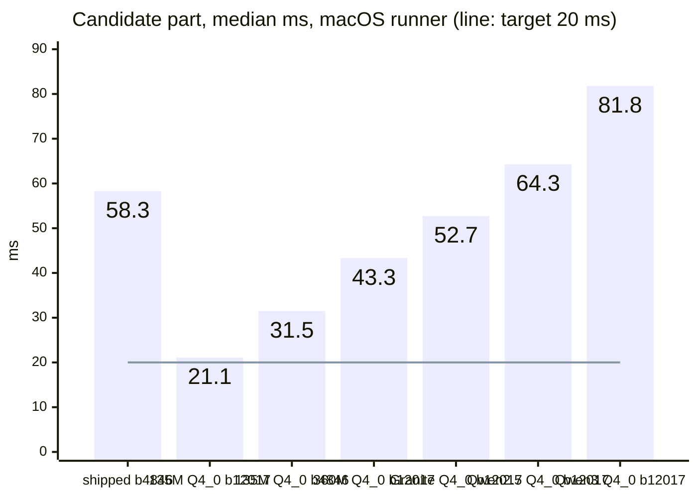

# Results of the speed test of larger language models

`docs/model-speed-design.md` defines the terms, the delay target, the shortlist and the method.
Every number on this page comes from the desktop or from the macOS runner. Each table names its
machine.

## Parts with no result

- **The phone.** No phone run exists yet. The branch is ready for a TestFlight build. So no number
  below is the felt delay on the phone, and no number shows the memory limit of the keyboard.
- **The Neural Engine.** The runner has none, so no number below comes from it. Only the phone
  shows whether Core ML puts the fixed form on the Neural Engine. The compute plan line of each
  Core ML pair answers that.
- **Metal and Core ML on a real GPU.** The runner's GPU is a paravirtual device, so its GPU times
  rank nothing. Core ML's compute plan on the runner puts every operation on the processor, also
  with the GPU or every unit allowed.
- **llama.cpp b12017 on the phone.** The workflow built its xcframework. No phone build links it
  yet. So the phone run cannot show whether a larger model meets the target with b12017, and it
  has no Qwen3 pair on llama.cpp.
- **Time between the last letter and the space.** No typing log of real use exists.
- **The 10-minute run for heat.**

## Summary

1. On the processor, no larger model meets the delay target on either machine. On the macOS
   runner (a virtual Apple M1) the best larger pair is SmolLM2-360M at Q4_0 with llama.cpp
   b12017: its candidate part takes 43.3 ms in the median and 61.7 ms at the 95th percentile.
   The target is 20 ms and 50 ms.
2. The candidate part of the 135M model meets the median target on the runner only with Q4_0 and
   llama.cpp b12017: 21.1 ms in the median and 29.3 ms at the 95th percentile. Today's way, the
   keyboard's file with b4846, takes 58.3 ms and 85.9 ms there.
3. The gain of b12017 comes from the repacking of the weights, and that repacking costs memory
   that the keyboard does not have. On the runner the footprint after the load rises from
   36.5 MB (b4846) to 147.6 MB (b12017, Q4_0, 135M). Without the repacking b12017 takes 61.3 MB
   and is no faster than b4846. The keyboard of build 44 had about 170 MB in all.
4. Every Core ML conversion is correct: with 16-bit weights its top candidate equals llama.cpp's
   at Q8_0 in 97.7% to 99.4% of the requests. Its 4-bit weights agree in 84.6% to 91.8%, about as
   often as llama.cpp's own 4-bit files (84.0% to 97.7%). The fixed form, for the Neural Engine,
   gives the same agreement as the flexible form for four models and 0.4 points more for Qwen3.
5. On the iPhone Duo, only llama.cpp b4846 on the GPU (Metal) meets the delay target. The
   keyboard's own 135M file takes 18.9 ms in the median and 22.9 ms at the 95th percentile for
   the candidate part, against 57.9 ms on the processor. Its highest footprint is 70.7 MB, with
   106 MB still allowed. Its top candidate equals the desktop's in 99.2% of the requests. The
   first load takes 8.2 s, while Metal builds its library. The larger models on Metal take 31 to
   50 ms. The keyboard therefore runs its model on the GPU.
6. Core ML does not fit the keyboard. On the GPU, the 135M model takes 39.2 ms and grows the
   footprint to 1249 MB, so it ran only in the app. On the Neural Engine it takes 204.2 ms, and
   the compute plan puts 70.4% of the cost on the processor. Its footprint reaches 253 MB during
   the requests and 354 MB during the loads, above the keyboard's limit of about 177 MB.

Figure 1. Median of the candidate part of each request on the macOS runner, at 2 threads, with the
reuse of the cache. The larger the model, the longer its candidate part. Only the 135M model at
Q4_0 with b12017 comes near the line, and that pair needs about 110 MB more memory (Table 4).

## Desktop: Intel i9-13900K in WSL, 2 threads

`scripts/model-speed/desktop/jobs/speed.sh` ran each pair alone on the machine, on the 486
requests, in order, with the reuse of the cache. The times are over the 485 requests after the
first. "shipped" is the keyboard's own file. The agreement is with llama.cpp b12017 at Q8_0 on the
same model, and for "shipped" with b4846 on the same file.

Table 1. Desktop, ms.

| run | request mean | request median | request p95 | candidates median | candidates p95 | window mean | first request | agreement |
| --- | --- | --- | --- | --- | --- | --- | --- | --- |
| shipped.Q4_K_M.b4846 | 60.4 | 58.5 | 83.9 | 43.5 | 63.9 | 16.2 | 56.2 | 100.0% |
| shipped.Q4_K_M.b12017 | 56.9 | 55.4 | 77.7 | 41.6 | 57.2 | 15.2 | 44.0 | 95.7% |
| smollm2-135m.Q4_K_M.b4846 | 58.9 | 57.8 | 81.7 | 42.7 | 61.7 | 15.9 | 73.8 | 91.8% |
| smollm2-135m.Q4_0.b4846 | 46.8 | 45.4 | 64.8 | 34.0 | 48.6 | 12.2 | 36.7 | 86.8% |
| smollm2-135m.Q4_0.b12017 | 39.9 | 38.6 | 53.2 | 28.3 | 39.8 | 10.4 | 34.7 | 89.1% |
| smollm2-135m.Q4_0.b12017-norepack | 54.3 | 53.3 | 74.1 | 40.3 | 54.6 | 14.2 | 40.7 | 89.1% |
| smollm2-360m.Q4_K_M.b4846 | 155.7 | 151.9 | 216.4 | 109.5 | 153.0 | 46.0 | 139.1 | 91.1% |
| smollm2-360m.Q4_0.b4846 | 110.8 | 106.3 | 157.0 | 77.7 | 109.5 | 32.3 | 89.4 | 91.1% |
| smollm2-360m.Q4_0.b12017 | 88.1 | 85.3 | 120.9 | 60.2 | 87.5 | 26.0 | 77.6 | 94.9% |
| granite-4.0-350m-base.Q4_K_M.b4846 | 132.8 | 130.5 | 187.6 | 101.7 | 144.2 | 31.5 | 145.5 | 83.7% |
| granite-4.0-350m-base.Q4_0.b4846 | 109.3 | 108.0 | 149.3 | 83.9 | 118.6 | 24.9 | 95.8 | 83.5% |
| granite-4.0-350m-base.Q4_0.b12017 | 88.1 | 87.8 | 115.7 | 67.1 | 89.9 | 21.7 | 72.0 | 85.8% |
| qwen2.5-0.5b.Q4_K_M.b4846 | 200.2 | 196.7 | 273.7 | 147.0 | 204.5 | 53.4 | 221.5 | 90.1% |
| qwen2.5-0.5b.Q4_0.b4846 | 137.8 | 134.0 | 184.7 | 101.7 | 142.6 | 35.1 | 121.2 | 89.1% |
| qwen2.5-0.5b.Q4_0.b12017 | 118.8 | 115.4 | 164.8 | 87.7 | 122.6 | 30.3 | 108.0 | 92.6% |
| qwen3-0.6b-base.Q4_K_M.b12017 | 156.4 | 154.7 | 203.2 | 113.5 | 155.5 | 41.5 | 168.8 | 96.3% |
| qwen3-0.6b-base.Q4_0.b12017 | 140.2 | 138.0 | 192.1 | 104.0 | 140.9 | 35.6 | 122.9 | 94.9% |

On the desktop the larger models take 1.5 to 3.4 times the time of the keyboard's file. The more
parameters a model has, the longer its request. Q4_0 is faster than Q4_K_M in every pair, by 13% to
31%. llama.cpp b4846 cannot load Qwen3: b4846 has no architecture "qwen3", and both Qwen3 runs
ended with "the model did not load". `scripts/model-speed/results/all-runs.md` holds every run,
the Q4_K_M runs of b12017 and the runs without repacking included.

The reuse share is 81.0% to 81.1% in every run. The window part takes about a quarter of the
request time in every pair.

## macOS runner: a virtual Apple M1 with 3 cores, 2 threads

The job `llama-mac` of the workflow "Model speed" (run 43657493075) ran the same requests with
the macOS part of the app's framework (b4846) and with b12017 built on the runner. The runner
shares its machine, so its times move from run to run. Its processor is an ARM processor with the
dot-product instructions, as the phone's, so it ranks the pairs closer to the phone than the
desktop does.

Table 2. macOS runner, ms.

| run | request median | request p95 | candidates median | candidates p95 | window mean | agreement |
| --- | --- | --- | --- | --- | --- | --- |
| shipped.Q4_K_M.b4846 | 77.4 | 120.7 | 58.3 | 85.9 | 21.9 | 99.6% |
| shipped.Q4_K_M.b12017 | 70.1 | 105.4 | 52.7 | 80.0 | 19.8 | 95.3% |
| smollm2-135m.Q4_0.b4846 | 40.8 | 62.9 | 31.5 | 46.5 | 10.5 | 86.6% |
| smollm2-135m.Q4_0.b12017 | 27.9 | 37.7 | 21.1 | 29.3 | 7.1 | 88.7% |
| smollm2-135m.Q4_0.b12017-norepack | 43.1 | 60.5 | 33.5 | 47.2 | 10.7 | 88.9% |
| smollm2-360m.Q4_0.b4846 | 95.5 | 149.6 | 72.9 | 106.7 | 27.4 | 90.5% |
| smollm2-360m.Q4_0.b12017 | 58.7 | 84.7 | 43.3 | 61.7 | 16.9 | 94.4% |
| granite-4.0-350m-base.Q4_0.b4846 | 121.3 | 173.8 | 99.9 | 142.1 | 23.6 | 84.0% |
| granite-4.0-350m-base.Q4_0.b12017 | 67.0 | 93.4 | 52.7 | 75.4 | 15.1 | 85.0% |
| qwen2.5-0.5b.Q4_0.b4846 | 127.6 | 185.8 | 100.3 | 139.4 | 31.6 | 89.1% |
| qwen2.5-0.5b.Q4_0.b12017 | 82.8 | 123.1 | 64.3 | 97.0 | 19.6 | 92.6% |
| qwen3-0.6b-base.Q4_0.b12017 | 104.8 | 150.0 | 81.8 | 118.8 | 24.7 | 94.0% |
| qwen3-0.6b-base.Q4_K_M.b12017 | 132.7 | 186.8 | 100.9 | 146.7 | 33.0 | 96.1% |

On the ARM runner b12017 at Q4_0 takes 31% to 46% less time than b4846 at Q4_0. Without its
repacking b12017 takes about as long as b4846. The GPU runs of the keyboard's file took 211 to
216 ms in the median on the paravirtual GPU, about three times the processor, and they say
nothing about the phone's GPU.

Table 3. Footprint of the process on the macOS runner, MB, right after the load and the highest
during the requests.

| model and type | b4846 | b12017 | b12017 without repacking |
| --- | --- | --- | --- |
| shipped, Q4_K_M | 36.5, 55.8 | 122.3, 142.1 | not run |
| SmolLM2-135M, Q4_0 | 36.5, 54.7 | 147.6, 169.5 | 61.3, 83.1 |
| SmolLM2-360M, Q4_0 | 45.3, 69.3 | 287.1, 312.1 | 70.3, 95.3 |
| Granite-4.0-350M, Q4_0 | 55.8, 85.9 | 294.2, 327.2 | 80.3, 113.5 |
| Qwen2.5-0.5B, Q4_0 | 61.1, 96.4 | 418.4, 455.0 | 88.4, 125.0 |
| Qwen3-0.6B, Q4_0 | does not load | 497.3, 547.7 | 138.6, 189.2 |

The repacking copies the weights into memory of the process, so the footprint grows with the
model. b4846 reads the weights from the mapped file, so its footprint stays near the cache and the
buffers of the scores. The more parameters, the larger the gap. On the phone the keyboard had
about 114 MB to spare after its load on build 44, so every repacked b12017 pair would pass the
limit unless the phone counts this memory in another way.

### The phone part of the app's framework

The job `archive` of run 43713341198 counted the instructions of the phone part (ios-arm64) of
the app's llama.cpp framework: 160 dot-product instructions (sdot) and no i8mm instructions
(smmla). llama.cpp b4846 repacks Q4_0 weights when its processor code has the dot-product
kernels. So the Q4_0 pairs on the phone can repack, and each such pair can add about the size of
its file to the footprint, as b12017 does on the runner (Table 3). The phone run gives the
answer in two lines: llama.cpp's build line names AARCH64_REPACK, and the memory line of each
Q4_0 pair gives its footprint. A pair that passes the memory limit stops the keyboard, and the
next `duo:speed` skips it.

### Core ML on the macOS runner

The `coreml` jobs of run 43708432424 converted each model with coremltools 9.0, in the flexible
and the fixed form, and ran it with `coremltools` from Python, through the window rules of the
keyboard. The runner has no Neural Engine and a paravirtual GPU. The times hold the cost of the
Python calls, so they rank the models and do not show the speed of Core ML on the phone.

Table 4. Core ML on the macOS runner, processor only: agreement with llama.cpp at Q8_0, candidate
part median in ms, and the size of the compiled 4-bit model.

| model | 16-bit flexible | 4-bit flexible | 4-bit fixed | 4-bit flexible, candidates median | 4-bit fixed, candidates median | compiled size, flexible and fixed |
| --- | --- | --- | --- | --- | --- | --- |
| SmolLM2-135M | 98.2% | 91.8% | 91.8% | 60.3 | 38.9 | 77 MB, 93 MB |
| SmolLM2-360M | 98.2% | 89.3% | 89.3% | 117.3 | 91.4 | 205 MB, 231 MB |
| Granite-4.0-350M | 98.8% | 84.6% | 84.6% | 160.9 | 149.9 | 200 MB, 257 MB |
| Qwen2.5-0.5B | 97.7% | 91.0% | 91.0% | 103.0 | 136.2 | 279 MB, 356 MB |
| Qwen3-0.6B | 99.4% | 91.4% | 91.8% | 383.0 | 233.5 | 337 MB, 424 MB |

The 16-bit models agree with llama.cpp in 97.7% or more, so each conversion is correct. The 4-bit
models lose about as much agreement as the 4-bit files of llama.cpp. The fixed form gives the
same top candidates as the flexible form, so its padding and its cell input are correct. On the
runner's processor the fixed form takes less time than the flexible form for four models. For
Qwen2.5 it takes more, as its 151,936 tokens of vocabulary go in 10 parts of 16,384.

Core ML's compute plan on the runner (`check_coreml.py`) puts every operation on the processor
for the processor setting, the "CPU and GPU" setting and the "all units" setting. So the GPU
rows of `scripts/model-speed/results/all-runs.md` are processor times too.

Python crashed inside Core ML in two earlier checks of the 4-bit flexible Qwen2.5 model on the
runner ("Bus error: 10" and "Segmentation fault: 11"). Every check of run 43708432424 passed.
The phone run puts the Qwen2.5 pairs last within each way to run it.

The PyTorch model behind each conversion (`scripts/model-speed/coreml/check_torch.py`, 32-bit,
on the desktop) agrees with llama.cpp at Q8_0 in 97.9% to 99.6% of the requests, with a median
difference of 0.024 to 0.048 in the two numbers. The fixed form of the PyTorch model gives the
same agreement for each model.

## Tokens per request

Table 5. Tokens of the speed requests and of the Chinese texts of `pinyin.dev.jsonl`, from the
tokenizer of llama.cpp on the desktop.

| model | context tokens per request | tokens per candidate | English characters per token | Chinese characters per token |
| --- | --- | --- | --- | --- |
| SmolLM2-135M and 360M | 45.2 | 2.17 | 4.36 | 0.53 |
| Granite-4.0-350M | 43.0 | 2.11 | 4.58 | 0.76 |
| Qwen2.5-0.5B and Qwen3-0.6B | 43.0 | 2.11 | 4.57 | 1.56 |

The English requests take about the same tokens under every tokenizer. Chinese text takes about
three times fewer tokens under the Qwen tokenizer than under SmolLM2's.

## The simulator

The unit test `testTheSpeedTestRunsEveryPairAndPrintsEveryLine` ran the `duo:speed` test in the
simulator of run 43724638219 (commit b16d2db), with both Core ML forms of SmolLM2-135M in place.
The simulator shares the processor of the runner and has no memory limit, so its times say
nothing about the phone.

Table 6. The pairs that ran in the simulator.

| pair | first load, second load | candidates median | request median | processor time per request | agreement |
| --- | --- | --- | --- | --- | --- |
| shipped, llama.cpp b4846, processor | 101.1 ms, 73.4 ms | 71.5 ms | 94.6 ms | 191.8 ms, 1.79 times the request | 484 of 486 |
| SmolLM2-135M Core ML 4-bit, flexible form, CPU and GPU | 7,609.0 ms, 10.2 ms | 138.2 ms | 220.8 ms | 265.9 ms, 1.03 times | 446 of 486 |
| SmolLM2-135M Core ML 4-bit, fixed form, CPU and Neural Engine | 3,306.6 ms, 121.9 ms | 95.9 ms | 148.0 ms | 159.4 ms, 1.03 times | 448 of 486 |
| shipped, llama.cpp b4846, processor, the control pair at the end | 316.6 ms, 112.5 ms | 75.0 ms | 99.6 ms | 205.4 ms, 1.83 times | 484 of 486 |

Every pair keeps 14,918 of 18,403 context tokens from the cache, the same as the C scorer, and
the new unit test checks the same count in every request. The Core ML pairs agree with llama.cpp
at Q8_0 in 91.8% and 92.2% of the requests, close to the 91.8% of the Python check. The first
load of each Core ML model includes the compile of Core ML for this machine, and the second load
reads that compiled form. llama.cpp's tokenizer takes 0.3 ms per request in the median. The two
Metal pairs did not load in the simulator: "llama_model_load_from_file_impl: failed to load
model". Only the phone shows whether Metal loads there.

The simulator has no Neural Engine, so Core ML ran the fixed form on the processor. The simulator
also refused the compute plan of both forms ("Failed to build the model execution plan ... error
code: -14"). The units line names the error in that case. On the phone, the processor time line
gives a second sign: a pair that runs on the Neural Engine or the GPU uses far less processor
time than its request time. Practitioners report the same error code when a stateful model loads
with the Neural Engine allowed ([coremltools issue 2325](https://github.com/apple/coremltools/issues/2325 "Users report error -14 for stateful models with the Neural Engine allowed, and no confirmed fix.")).
If the phone gives it at the load of a fixed form, that pair gives a "failed" line, and the result
is that Core ML does not run this stateful model on the Neural Engine.

## The keyboard's normal autocorrection

`scripts/model-speed/compare_keyboard_runs.py` compared the artifact "keyboard" of run
43724638219 (commit b16d2db) with that of run 43625399707 on `engine/kv-reuse`, case by case. All
14 case files hold the same cases with the same outputs: 54,744 cases, 0 differ. This covers the
outputs with the model and with the engine alone, the traces with every model number, and the
Pinyin cases. Every unit test of run 43724638219 passed.

## What the phone run must show

For each pair, from the lines of `duo:speed`:

1. The felt delay: the candidate part's median of 20 ms or less and 95th percentile of 50 ms or
   less. This decides whether the context part may run before the space press.
2. The request time, for the case that the whole request runs at the space.
3. The footprint after the load and the least memory still allowed. A pair that leaves less than
   about 20 MB is not usable in the keyboard.
4. The agreement: about 85% or more for a 4-bit pair, and 100% for the keyboard's file on the
   processor. A much lower number means a broken conversion or a broken runtime.
5. For Metal, whether the pair loads in the keyboard at all, its first request (the Metal library
   compiles at the first load), the residency line of llama.cpp, and the footprint with and
   without the residency set.
6. For Core ML on the Neural Engine, the share of the estimated cost that the compute plan puts
   on the Neural Engine. A pair with a small share ran on the processor, and its times say
   nothing about the Neural Engine.
7. The highest footprint during the requests and the process peak, against the memory still
   allowed. A pair whose peak comes near the limit is not usable, even when its footprint after
   the load is low.
8. The control pair against the first pair, and the heat line of each pair. When the control pair
   is much slower than the first pair, the phone slowed down during the run, and the later pairs
   are slower than they would be on a cool phone.
9. llama.cpp's build line: whether the app's framework has DOTPROD and AARCH64_REPACK, and so
   whether the Q4_0 pairs repack their weights into memory.

## Steps on the phone

1. Before the first TestFlight build of this branch, on developer.apple.com, open Identifiers,
   create the App Group `group.com.yilongju.duokeyboard`, and select it under App Groups for both
   App IDs, `com.yilongju.duokeyboard` and `com.yilongju.duokeyboard.keyboard`.
2. Start the TestFlight workflow on `engine/model-speed` and install the build.
3. Open the Duo Keyboard app. Under "Speed test models", tap each download button. Each line of
   the status says when a file is in place. Keep the app open until the last line says "every
   file is in place".
4. Open Notes, choose Duo Keyboard, type `duo:speed` and a space. Keep the keyboard on screen
   until the line that starts with "done" appears. Every pair runs 486 requests and pauses for at
   least 20 seconds before it, and waits up to 3 minutes more for the phone to cool, so the run
   of 23 pairs takes 1.5 to 2 hours.
5. When the keyboard goes away before the "done" line, type `duo:speed` and a space again. The
   keyboard types the kept lines of the pairs that ended, then runs the pair that stopped again
   and goes on. To start at a given pair, type the number after the trigger, as in
   `duo:speed16` and a space. To start over at the first pair, type `duo:speedreset` and a
   space first.
6. Copy the lines from the note and send them back.
