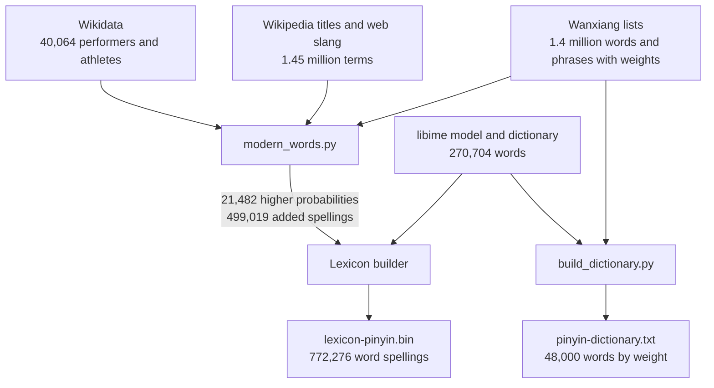

# Names and terms of the last years in the Chinese dictionary

## Summary

The Pinyin lexicon holds 499,019 more word spellings, and 21,482 of its words have a higher
probability. Of 500 names and terms from 2015 to 2025, the engine now offers 471 for their
Pinyin, where it offered 376. The lexicon file grew from 50 MB to 92 MB.

## Terms

| Term | Meaning |
| --- | --- |
| lexicon | `Shared/lexicon-pinyin.bin`: the words, word pairs and word triples that the typing engine reads for Chinese. |
| word list | `Shared/pinyin-dictionary.txt`: 48,000 frequent words that the keyboard keeps in memory for first letters and for a syllable typed in part. |
| libime | The input method library of fcitx5. Its language model and dictionary are the base of the lexicon. |
| floor | The lowest probability that the libime model gives a word. |
| Wanxiang | The word lists of [rime-wanxiang](https://github.com/amzxyz/rime-wanxiang), under CC BY 4.0, with a weight per word. |
| weight | Wanxiang's number for a word. The more often people write the word, the higher the weight. |
| first reading | The text that the engine gives first for typed Pinyin. The space bar types it. |

## What was wrong

1. The libime model puts 217,699 of its 270,704 words within 0.3 of its floor. The model
   cannot order those words: the vogue word 躺平 counted as much as the rare word 烫平.
2. The model lacks many names and terms, such as 显眼包, 松弛感, 黑神话 and 董宇辉.
3. The word list came from the Android Open Source Project's dictionary of 2009, so first
   letters such as "tlp" gave no new word.

## The change



- **Higher probabilities.** A line fits Wanxiang's weights to the model's probabilities. A
  word near the floor gets the fitted probability when that one is higher.
- **Added words.** `modern_words.py` types the Pinyin of every Wanxiang word into the engine.
  A word joins the lexicon in two cases:
  1. The engine has no good reading of the letters, and the word's own probability beats the
     engine's reading. The word becomes the first reading, as 显眼包 for "xianyanbao".
  2. The engine reads the letters as another text, and the word is a name of Wanxiang's lists
     of people and places or a Wikipedia title. The word then follows that reading as a later
     candidate, as a name behind a frequent phrase.
- **Performers and athletes.** Wanxiang's lists of people hold about 36,000 names. Wikidata
  lists 40,064 more singers, actors, athletes and other performers who have an article in the
  Chinese Wikipedia and a name of 2 to 4 Chinese characters. 29,617 spellings of those names
  joined the lexicon, by the same two cases. "yaoxiaotang" gives 姚晓棠, and "gaorui" gives
  高睿 as the second candidate, after the word 高锐.
- **Requested words.** `scripts/pinyin-dictionary/requested-words.tsv` holds the words that
  the keyboard's user asked for. Each one joins the lexicon.
- **Phrases stay out.** Wanxiang also lists pieces of sentences. A word of its everyday list
  with a pronoun, a particle or two numerals stays out, and so does a word that would take
  the first place from a phrase that Wanxiang weighs higher. "huobishi" still gives 货币是.
- **Word list.** The list holds the 48,000 lexicon words with the highest weight, and the
  characters in common use. "tlp" now gives 特朗普. The count of words is the same as before,
  because the keyboard keeps the list in memory.

## Results

Table 1. The 500 terms of `scripts/pinyin-dictionary/new-words-check/terms.tsv`, typed as
Pinyin into the engine (`check_terms.py`, files `results-before.tsv` and `results.tsv`).

| Lexicon | First reading | Among the first 5 | Offered at all |
| --- | --- | --- | --- |
| Before | 330 | 374 | 376 |
| Now | 410 | 465 | 471 |

The new lexicon offers 95 more of the 500 terms, and 80 more as the first reading.

Table 2. The same counts for three groups of the terms.

| Group | Terms | Offered before | Offered now |
| --- | --- | --- | --- |
| Vogue words of 2023 to 2025 | 27 | 11 | 19 |
| People | 79 | 54 | 77 |
| Companies and products | 77 | 55 | 75 |

The names of people gained most. The newest vogue words gained least: 8 of 27 are still not
offered.

Table 3. Right first readings of the Pinyin cases of `scripts/typing-evaluation` (sentences of
Tatoeba), engine alone.

| Half | Lexicon | Typed right, of 750 | Typed with a slip |
| --- | --- | --- | --- |
| dev | before | 501 | 2,403 of 4,299 |
| dev | now | 508 | 2,412 of 4,299 |
| test | before | 504 | 2,392 of 4,317 |
| test | now | 510 | 2,431 of 4,317 |

The new lexicon reads a few more everyday sentences right on both halves. The choices of
`modern_words.py` used the dev half, and the test half was read once.

## Costs and limits

- The lexicon file is 91.7 MB, where it was 49.9 MB. GitHub refuses a file of 100 MB, so the
  room for more words is small. The keyboard maps the file and does not
  load it whole.
- The engine takes 22 ms per case on the PC, where it took 18 ms. No phone has timed it.
- 29 of the 500 terms are still not offered, such as 班味, 嘴替, 三胎 and 国补. Each one sounds
  like a more frequent phrase, and no list marks it as a known term.
- The terms of the check come from memory, among them the yearly lists of ten vogue words of
  the magazine Yaowen Jiaozi. No term was checked against a source.
- Many added words are rare technical terms, place names and idioms. Some are short phrases
  that the rules did not catch.
- A new word has no word pair in the model. In a sentence the engine rates it by its own
  probability alone.
- The update file `scripts/pinyin-dictionary/pinyin-updates.tsv.gz` is made by hand, because
  the step types 1.4 million words into the engine. That took 30 minutes on 30 processor
  threads.

## Sources and licenses

| Source | Version | License | Use |
| --- | --- | --- | --- |
| libime language model and dictionary | `lm_sc.arpa-20260629`, `dict-20260907` | LGPL-2.1-or-later | Base of the lexicon |
| [rime-wanxiang](https://github.com/amzxyz/rime-wanxiang) lists jichu, mingren, yiren, diming | commit `e52c295` | CC BY 4.0 | Weights and added words |
| [fcitx5-pinyin-zhwiki](https://github.com/felixonmars/fcitx5-pinyin-zhwiki) lists zhwiki and web-slang | release 0.3.1, 2026-10-18 | Text of Wikipedia, CC BY-SA 4.0 | Marks a word as a known term, and gives the Pinyin of a person's name |
| [Wikidata](https://www.wikidata.org), people by occupation (`fetch_wikidata_people.py`) | asked on 2026-11-20 | CC0 1.0 | Names of performers and athletes |

`Shared/lexicon-NOTICE.txt` and `Shared/pinyin-dictionary-NOTICE.txt` hold the notices.

## How to rebuild

On Linux, from the repository root, with the libime files in `build/libime-data` and the
engine tool in `build/engine/duo_cli` (the first steps of `.github/workflows/pinyin-lexicon.yml`):

```
uv run --with opencc-python-reimplemented python scripts/pinyin-dictionary/fetch_wikidata_people.py
python3 scripts/pinyin-dictionary/modern_words.py prepare
python3 scripts/typing-engine/build_pinyin_lexicon_from_libime.py build/libime-data 1250000 3000000 \
    --updates build/pinyin-modern/values.tsv --output build/pinyin-modern/lexicon-values.bin
python3 scripts/pinyin-dictionary/modern_words.py select
python3 scripts/typing-engine/build_pinyin_lexicon_from_libime.py build/libime-data 1250000 3000000 \
    --updates scripts/pinyin-dictionary/pinyin-updates.tsv.gz
python3 scripts/pinyin-dictionary/build_dictionary.py
python3 scripts/pinyin-dictionary/new-words-check/check_terms.py --out build/new-words-check/results.tsv
```
