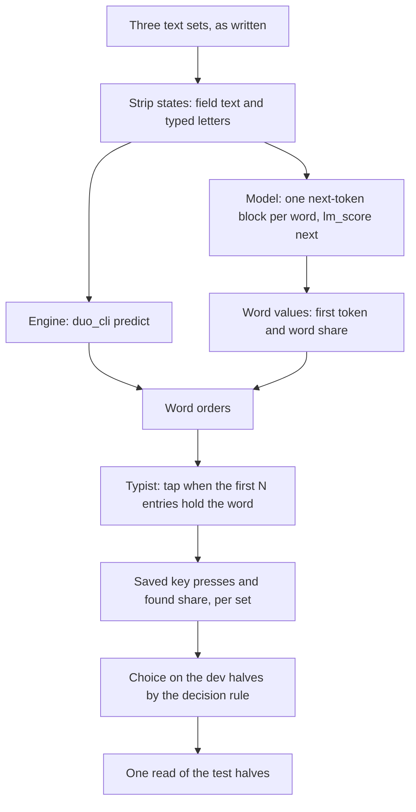

# Benchmark of the predicted words: design

The prediction strip shows up to 20 predicted words. This benchmark chooses the order of those
words. A simulated typist types text as people write it, taps a predicted word when the strip
shows the right one, and the benchmark counts the key presses that the taps save.

`docs/prediction-strip-benchmark-results.md` holds the results. `docs/prediction-strip.md`
describes the strip.

## Terms

| Term | Meaning |
| --- | --- |
| field | One text field. Each sentence of a text set opens an empty field, as a chat message does. |
| chunk | A part of a sentence between two spaces. |
| word | The letters and apostrophes of a chunk, without the marks around them. |
| typed letters | The letters of the word that the typist typed so far, from 0 to all but one. |
| strip state | The field text and the typed letters at one moment before a key press. |
| entry | One place of the strip: an emoji or a predicted word. |
| form | A way to write a word: lower case, first letter capital, or the preferred capitals of the work area. |
| word order | A rule that gives the predicted words of a strip state, the first word first. |
| tap | A touch on an entry. A tap types the word and one space, and counts as one key press. |
| saved key presses | 1 minus the key presses with the strip over the key presses without the strip. |
| found share | The share of strip states whose first N entries hold the word. |

## Task

| Row | Content | Range |
| --- | --- | --- |
| Input | The field text before the word as written, and the typed letters. | The last 96 tokens for a model. From 0 typed letters to the length of the word less 1. |
| Model | One word order of the table "Word orders". | The engine alone, or a language model file with the lexicon. |
| Output | The entries of the strip. | Up to 20 words, each in one form. Emoji come before them. |
| Target | The word of the sentence at that place, in its written form. | One word per place. A match needs the same letters and the same capitals. |
| Training signal | None for the weights. The dev halves choose the word order and its settings. | Settings: the mix weight, the form rule, the rule for the first word. |
| Negatives | Strip states whose first N entries do not hold the word. | N is 3, 6 or 10: the compact, wide and split layouts. |
| Split | Dev and test half of each text set, from different documents or sentence ids. | Three sets. The test halves are read once, with the chosen word order. |
| Eval | Saved key presses for N of 3, 6 and 10. Found share per count of typed letters. | Each from 0 to 1, per text set, with a 95% interval. |

## Flow

## Text sets

Each set keeps the capitals and the marks of its source. A sentence with a character outside
ASCII, or with fewer than 3 chunks or more than 40, is left out.

| Set | Source | Halves | Relation to the shipped model |
| --- | --- | --- | --- |
| technical | The domain corpus of `scripts/domain-pack/collect_corpus.py`: arXiv, GitHub and Stack Exchange. | 1,000 sentences each, from the dev and the test bucket of documents. | Same sources as the fine-tune, other documents. |
| everyday | Tatoeba English. The sentence ids of the everyday cases of `english-domain-stream`, in their written form. | 1,000 sentences each. | Same source as the fine-tune, other sentence ids. |
| mobile | Enron Mobile: sentences that people wrote on phones ([Vertanen and Kristensson, 2011](https://keithv.com/software/enronmobile/)). | Every sentence, split by the SHA-256 of its text. | Outside the sources of the fine-tune. |

The technical sentences are the 1,000 with the lowest SHA-256 of source, document and text in
each bucket. The texts stay in `build/prediction-strip/texts/`, and a script builds them again.
The Enron Mobile archive has no stated license, so the repository holds no sentence of it.

## Typist and key presses

The typist types each sentence from an empty field, key by key.

1. Without the strip, each character of the sentence is one key press, the spaces included.
   Shift presses and layer presses do not count.
2. The strip shows entries exactly when the keyboard does: by `KeyboardTextLogic.predictionContext`
   for the predicted words, and by `KeyboardTextLogic.wordForEmoji` for the emoji. The emoji of
   `Shared/emoji-suggestions.tsv` take the first places.
3. Before each letter of a word, the typist reads the first N entries. When one of them is the
   word in its written form, and the tap saves 1 key press or more, the typist taps.
4. A tap types the rest of the word and one space, for one key press.
5. A mark right after a tapped word takes the place of that space, as in the keyboard
   (`KeyboardTextLogic.spaceRemoval`). The typist then types the next space.
6. A chunk that is no plain word, such as "fine-tuning", "e.g." or a number, is typed key by key.

A second typist taps only when the tap saves 2 key presses or more. Its numbers show how much a
result depends on rule 3.

## Word orders

| Name | Order of the words | Model reads per word |
| --- | --- | --- |
| E | The engine's order of build 62: `duo_predict_english` and the form rules of the keyboard. | 0 |
| M | The model's value of a word: the log probability of the first token of its form, plus the log of the word share. | 1 |
| M+E | A mix: (1 - w) times the value of M plus w times the engine's log value, for w of 0.1, 0.2, 0.3 and 0.5. | 1 |
| M+R | M, and one more request at each strip state. The request gives the 8 first words their full log probability, with the probability that the word ends. | 1 and 1 per typed letter |

The word share is the word's probability over the summed probability of the forms that share
its first token (`scripts/prediction-strip/build_tables.py`).

Each model order runs with these settings:

| Setting | Values |
| --- | --- |
| Form rule | "typed": the typed capitals give the form, as in build 62. "model": the form with the highest value among the allowed forms. |
| First word of a field | "none": no words before a typed letter, then the engine's order. "engine": the engine's order with a capital. "model": the model's order from the start token. |
| Model file | The shipped fine-tune. SmolLM2-135M without the fine-tune. SmolLM2-360M and Qwen2.5-0.5B, as a look at larger models. |

With a capital as the first typed letter, a form must start with a capital. With typed letters
in lower case, the form rule "model" allows every form of a word.

## Decision rule

The rule is fixed before any run of the benchmark.

1. The deciding number is the saved key presses for N of 3, as the mean over the three dev halves.
2. A word order with more model reads, or a larger model file, takes the place of a cheaper
   one only with 1.0 point more. The 95% interval of the difference must lie above 0.
3. The chosen word order must not save fewer key presses than E on any dev half.
4. Settings of equal cost follow the deciding number alone.
5. The test halves are read once, with the chosen word order and with E.

The intervals come from 1,000 bootstrap samples of the sentences of each half. A difference is
paired: both word orders read the same sample.

## Cost

The results give these numbers beside each word order: the model reads per word, the time of
one read on the PC, and the size of the model file. `docs/model-speed-results.md` gives the
time of one read on the phone for each model file.

## Checks

| Check | Passes when |
| --- | --- |
| Rules of the keyboard in Python | The Python copies of `predictionContext`, `predictedWord` and the emoji rule give the results of the cases in `Tests/PredictionStripTests.swift` and `Tests/EmojiSuggestionTests.swift`. |
| Same pipeline as the first measurement | On the lower-case text of the first measurement, with a match that ignores capitals, the benchmark gives its found shares: 54.2 for E and 67.8 for M (2 typed letters, 4 words). |
| Key press count | For 5 sentences, a printed list of every key press and tap adds up to the reported numbers. |
| No test half before the choice | The scripts refuse the test halves without the file of the chosen word order. |

## Limits

- No log of real typing exists, so the text sets stand in for real use.
- The typist never types a wrong letter, and never fails to see a word in the strip.
- Each sentence opens an empty field. Text that follows earlier sentences gives a model more to read.
- A language model can know Tatoeba and Enron text from its first training. The arXiv text of the technical set is from 2026, so it is newer than that training.
