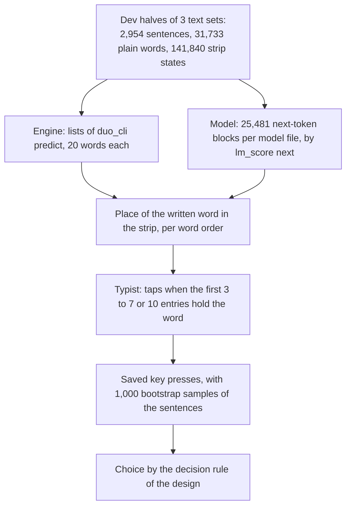
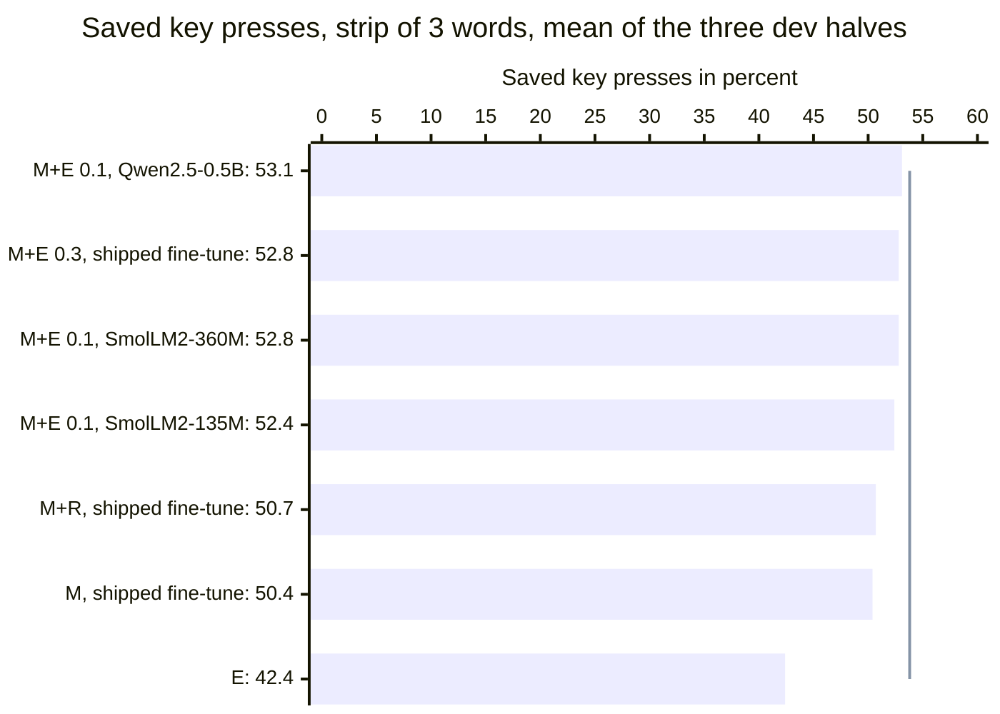

# Benchmark of the predicted words: results

This document gives the results of the benchmark that chooses the order of the predicted words.
[prediction-strip-benchmark-design.md](prediction-strip-benchmark-design.md) holds the design.
Its [task table](prediction-strip-benchmark-design.md#task) defines the task.
The dev halves chose the word order. One read of the test halves then measured that choice and E.

Figure 1. The steps of the benchmark, with the counts of the dev halves.
Each model file reads 25,481 texts: one for each different text before a plain word.

## On the test halves the choice saves 57.0% of the key presses on the open phone, against 47.6% for E

The strip shows 3 to 5 words on the closed phone and 4 to 7 words on the open phone. The open
phone comes first. The number to judge by is the mean over 4, 5, 6 and 7 shown words.

| Shown words | E, dev | Choice, dev | E, test | Choice, test |
| --- | --- | --- | --- | --- |
| 3 | 42.4 | 52.8 | 42.5 | 52.8 |
| 4 | 45.0 | 54.9 | 45.1 | 55.0 |
| 5 | 46.8 | 56.5 | 47.0 | 56.5 |
| 6 | 48.3 | 57.7 | 48.5 | 57.6 |
| 7 | 49.5 | 58.9 | 49.6 | 58.8 |
| 10 | 52.1 | 60.7 | 52.1 | 60.6 |
| Open phone: mean of 4 to 7 | 47.4 | 57.0 | 47.6 | 57.0 |
| Closed phone: mean of 3 to 5 | 44.7 | 54.7 | 44.9 | 54.8 |

Table 0. Saved key presses in percent, as the mean of the three text sets, first typist. The
more words the strip shows, the more key presses the typist saves. The choice stays about
10 points above E at every count. The test halves give the numbers of the dev halves within
0.2 points.

For the open phone, the choice is 9.43 points above E on the test halves. The paired 95%
interval is 9.25 to 9.62. On the dev halves the difference is 9.58 points (9.39 to 9.77).

The choice was made with 3 shown words. The same word order holds for the open phone. Among the
242 word orders of the dev halves, two are above the choice at 4 to 7 shown words. Both use the
Qwen2.5-0.5B file of 397.8 MB, and the larger one adds 0.13 points (0.01 to 0.25). The decision
rule asks for 1.0 point.

The keyboard runs the choice with two differences, because the exact choice needs changes of
the engine. A word takes the highest value of its allowed forms. The first word of a field
gets no words before a typed letter. On the dev halves that word order is 0.25 points below
the choice for the open phone (0.23 to 0.27).

`scripts/prediction-strip/benchmark/open_phone.py` computes this section from `results/dev.json`,
`results/test.json` and the bootstrap samples.

## Terms

The [terms of the design](prediction-strip-benchmark-design.md#terms) hold here. This document adds these terms.

| Term | Meaning |
| --- | --- |
| plain word | A chunk that holds one word, with no letter or digit beside the word. Only a plain word can come from a tap. |
| point | One percent of the key presses without the strip. A difference of saved key presses is in points. |
| deciding number | Saved key presses for a strip of 3 words, as the mean of the three dev halves. |
| model read | One run of the model over the text before a word. It gives one next-token block. |
| form rule | The setting that gives the form of each predicted word: "typed", "model", "typed_built" or "model_built". |
| rule for the first word | The setting for the first word of a field: "none", "engine" or "model", as the design defines them. |
| mix weight | The share of the engine's value in the value of a word in M+E: 0.1, 0.2, 0.3 or 0.5. |

Every table names a word order by four parts.
The parts are the order, the model file, the form rule and the rule for the first word.
"M+E 0.3, shipped fine-tune, typed, engine" is M+E with the mix weight 0.3 and the shipped model file.

## M+E with the shipped model file saves 52.8% of the key presses, against 42.4% for E

The decision rule gives this word order: M+E 0.3, shipped fine-tune, typed, engine.
The difference to E is +10.45 (+10.23 to +10.67) points.
No word order with a larger model file, or with more model reads, adds 1.0 point to it.

- **Mix.** The mix adds +2.43 (+2.31 to +2.54) points to M with the same model file, with no more model reads.
- **M+R.** One more request at each strip state adds +0.27 (+0.20 to +0.34) points to that M.
- **Keyboard of commit 504121c.** With the mix weight 0.3, that keyboard computes "M+E 0.3, shipped fine-tune, typed_built, none".
  Its difference to the choice is -0.16 (-0.18 to -0.14) points.

Figure 2. Saved key presses of seven word orders.
Each has the form rule "typed" and the rule "engine" for the first word.
The line at 53.8% is the choice plus 1.0 point, which a costlier word order needs. No bar reaches the line.

Table 1. Saved key presses in percent, with the 95% interval, for a strip of 3, 6 and 10 words.
The four model files with a mix lie within 0.7 points of each other. E lies about 10 points lower.

| Word order | Strip of 3, mean | technical | everyday | mobile | Strip of 6, mean | Strip of 10, mean |
| --- | --- | --- | --- | --- | --- | --- |
| M+E 0.1, Qwen2.5-0.5B, typed, engine | 53.1 (52.7 to 53.4) | 55.3 (54.7 to 55.8) | 53.0 (52.5 to 53.4) | 51.0 (50.3 to 51.5) | 57.8 (57.5 to 58.0) | 60.7 (60.4 to 61.0) |
| M, Qwen2.5-0.5B, typed, engine | 52.9 (52.6 to 53.2) | 55.2 (54.7 to 55.8) | 52.8 (52.3 to 53.3) | 50.7 (50.0 to 51.3) | 57.5 (57.3 to 57.8) | 60.4 (60.2 to 60.7) |
| M+E 0.3, shipped fine-tune, typed, engine | 52.8 (52.5 to 53.1) | 52.8 (52.2 to 53.3) | 55.1 (54.6 to 55.6) | 50.7 (50.0 to 51.2) | 57.7 (57.4 to 58.0) | 60.7 (60.4 to 60.9) |
| M+E 0.1, SmolLM2-360M, typed, engine | 52.8 (52.5 to 53.1) | 55.3 (54.8 to 55.9) | 52.1 (51.6 to 52.7) | 51.0 (50.4 to 51.6) | 57.5 (57.2 to 57.8) | 60.5 (60.2 to 60.8) |
| M, SmolLM2-360M, typed, engine | 52.7 (52.4 to 53.0) | 55.4 (54.8 to 55.9) | 52.1 (51.5 to 52.6) | 50.7 (50.1 to 51.3) | 57.4 (57.0 to 57.7) | 60.3 (60.0 to 60.6) |
| M+E 0.1, SmolLM2-135M, typed, engine | 52.4 (52.1 to 52.7) | 52.8 (52.2 to 53.3) | 53.8 (53.3 to 54.3) | 50.6 (50.0 to 51.3) | 57.2 (56.9 to 57.5) | 60.2 (59.9 to 60.6) |
| M, SmolLM2-135M, typed, engine | 52.3 (52.0 to 52.7) | 52.7 (52.1 to 53.2) | 53.9 (53.4 to 54.4) | 50.4 (49.8 to 51.0) | 57.1 (56.8 to 57.4) | 60.1 (59.8 to 60.4) |
| M+R, shipped fine-tune, typed, engine | 50.7 (50.4 to 51.0) | 50.7 (50.2 to 51.3) | 53.7 (53.1 to 54.2) | 47.6 (47.0 to 48.2) | 55.7 (55.4 to 56.0) | 58.7 (58.4 to 59.0) |
| M, shipped fine-tune, typed, engine | 50.4 (50.1 to 50.7) | 50.4 (49.8 to 51.0) | 53.4 (52.8 to 53.9) | 47.5 (46.8 to 48.1) | 55.4 (55.1 to 55.7) | 58.7 (58.4 to 59.0) |
| E | 42.4 (42.1 to 42.7) | 42.3 (41.8 to 42.7) | 41.6 (41.1 to 42.1) | 43.3 (42.7 to 43.8) | 48.3 (48.0 to 48.6) | 52.1 (51.8 to 52.4) |

Table 2. Paired differences to E in points, for a strip of 3 words, with the 95% interval.
Each word order saves more key presses than E on every dev half. The mobile half shows the lowest difference.

| Word order | Mean of the sets | technical | everyday | mobile |
| --- | --- | --- | --- | --- |
| M+E 0.1, Qwen2.5-0.5B, typed, engine | +10.67 (+10.45 to +10.89) | +12.99 (+12.65 to +13.36) | +11.35 (+10.93 to +11.80) | +7.68 (+7.32 to +8.00) |
| M, Qwen2.5-0.5B, typed, engine | +10.53 (+10.30 to +10.75) | +12.97 (+12.61 to +13.35) | +11.23 (+10.79 to +11.73) | +7.39 (+7.02 to +7.74) |
| M+E 0.3, shipped fine-tune, typed, engine | +10.45 (+10.23 to +10.67) | +10.51 (+10.15 to +10.90) | +13.45 (+12.99 to +13.88) | +7.38 (+7.02 to +7.76) |
| M+E 0.1, SmolLM2-360M, typed, engine | +10.45 (+10.21 to +10.67) | +13.07 (+12.72 to +13.43) | +10.52 (+10.09 to +10.95) | +7.75 (+7.39 to +8.09) |
| M, SmolLM2-360M, typed, engine | +10.33 (+10.09 to +10.58) | +13.09 (+12.74 to +13.48) | +10.48 (+10.02 to +10.92) | +7.43 (+7.06 to +7.79) |
| M+E 0.1, SmolLM2-135M, typed, engine | +10.04 (+9.82 to +10.25) | +10.52 (+10.17 to +10.89) | +12.22 (+11.80 to +12.62) | +7.37 (+7.06 to +7.71) |
| M, SmolLM2-135M, typed, engine | +9.94 (+9.71 to +10.17) | +10.40 (+10.03 to +10.79) | +12.29 (+11.84 to +12.70) | +7.15 (+6.82 to +7.49) |
| M+R, shipped fine-tune, typed, engine | +8.29 (+8.00 to +8.56) | +8.47 (+8.04 to +8.93) | +12.05 (+11.52 to +12.56) | +4.36 (+3.92 to +4.81) |
| M, shipped fine-tune, typed, engine | +8.02 (+7.75 to +8.29) | +8.13 (+7.69 to +8.58) | +11.75 (+11.22 to +12.27) | +4.18 (+3.76 to +4.64) |

### Steps of the decision rule

Table 3. The cost classes from the cheapest to the costliest.
Each row holds the word order of its class with the highest deciding number.
Only the first step reaches 1.0 point with an interval above 0.

| Step | File size, MB | Model reads | Word order of the cost class with the most saved key presses | Saved key presses | Difference to the choice so far | Takes the place |
| --- | --- | --- | --- | --- | --- | --- |
| 1 | 105.5 | 1 per word | M+E 0.3, shipped fine-tune, typed, engine | 52.83 | +10.45 (+10.23 to +10.67) against E | yes |
| 2 | 105.5 | 1 per word and 1 per strip state | M+R, shipped fine-tune, typed, engine | 50.68 | -2.16 (-2.29 to -2.04) against M+E 0.3, shipped fine-tune, typed, engine | no |
| 3 | 270.6 | 1 per word | M+E 0.1, SmolLM2-360M, typed, engine | 52.83 | -0.00 (-0.18 to +0.15) against M+E 0.3, shipped fine-tune, typed, engine | no |
| 4 | 397.8 | 1 per word | M+E 0.1, Qwen2.5-0.5B, typed, engine | 53.06 | +0.22 (+0.08 to +0.38) against M+E 0.3, shipped fine-tune, typed, engine | no |

Rule 3 of the decision rule holds.
On the mobile half, the choice shows its lowest difference to E: +7.38 (+7.02 to +7.76) points.

### Settings of equal cost around the choice

The form rules have these meanings.

| Form rule | Form of a predicted word | Value of a word in M |
| --- | --- | --- |
| typed | The form that the typed capitals give, as in build 62. | The value of that form. |
| model | The allowed form with the highest value. | The value of that form. |
| typed_built | As "typed". After 2 or more typed capitals, every word stands in capitals. | The highest value of the allowed forms. |
| model_built | As "model". After 2 or more typed capitals, every word stands in capitals. | The highest value of the allowed forms. |

"typed" and "model" are the form rules of the design.
"typed_built" and "model_built" are the form rules that the keyboard of commit 504121c computes.

Table 4. The choice with one setting changed, and the paired difference to the choice in points.
The mix weight changes the deciding number the most, and the form rule "typed_built" changes it by 0.06 points.

| Changed setting | Word order | Saved key presses | Difference to the choice |
| --- | --- | --- | --- |
| form rule | M+E 0.3, shipped fine-tune, model, engine | 52.57 | -0.26 (-0.31 to -0.22) |
| form rule | M+E 0.3, shipped fine-tune, typed_built, engine | 52.77 | -0.06 (-0.08 to -0.05) |
| form rule | M+E 0.3, shipped fine-tune, model_built, engine | 52.58 | -0.25 (-0.30 to -0.21) |
| first word | M+E 0.3, shipped fine-tune, typed, none | 52.73 | -0.10 (-0.12 to -0.08) |
| first word | M+E 0.3, shipped fine-tune, typed, model | 51.53 | -1.30 (-1.37 to -1.22) |
| mix weight | M, shipped fine-tune, typed, engine | 50.41 | -2.43 (-2.54 to -2.31) |
| mix weight | M+E 0.1, shipped fine-tune, typed, engine | 51.68 | -1.15 (-1.24 to -1.06) |
| mix weight | M+E 0.2, shipped fine-tune, typed, engine | 52.45 | -0.38 (-0.44 to -0.32) |
| mix weight | M+E 0.5, shipped fine-tune, typed, engine | 52.25 | -0.58 (-0.67 to -0.49) |
| model file | M+E 0.1, SmolLM2-135M, typed, engine | 52.42 | -0.41 (-0.54 to -0.28) |

Table 5. Saved key presses of M in percent, for each model file, form rule and rule for the first word.
For every model file, the form rule "typed" and the rule "engine" give the highest number.

| Model file | Form rule | First word none | First word engine | First word model |
| --- | --- | --- | --- | --- |
| shipped fine-tune | typed | 50.3 (50.0 to 50.6) | 50.4 (50.1 to 50.7) | 49.1 (48.8 to 49.4) |
| shipped fine-tune | model | 50.0 (49.7 to 50.3) | 50.1 (49.8 to 50.4) | 48.7 (48.4 to 49.1) |
| shipped fine-tune | typed_built | 50.1 (49.8 to 50.4) | 50.2 (49.9 to 50.5) | 48.9 (48.6 to 49.2) |
| shipped fine-tune | model_built | 50.0 (49.7 to 50.3) | 50.1 (49.8 to 50.4) | 48.8 (48.4 to 49.1) |
| SmolLM2-135M | typed | 52.2 (51.9 to 52.6) | 52.3 (52.0 to 52.7) | 51.1 (50.8 to 51.5) |
| SmolLM2-135M | model | 51.7 (51.4 to 52.0) | 51.8 (51.5 to 52.1) | 50.6 (50.2 to 50.9) |
| SmolLM2-135M | typed_built | 52.1 (51.8 to 52.4) | 52.2 (51.9 to 52.5) | 50.9 (50.6 to 51.3) |
| SmolLM2-135M | model_built | 51.7 (51.4 to 52.0) | 51.8 (51.5 to 52.1) | 50.6 (50.3 to 50.9) |
| SmolLM2-360M | typed | 52.6 (52.3 to 52.9) | 52.7 (52.4 to 53.0) | 52.2 (51.9 to 52.6) |
| SmolLM2-360M | model | 52.3 (51.9 to 52.6) | 52.4 (52.0 to 52.7) | 51.9 (51.5 to 52.2) |
| SmolLM2-360M | typed_built | 52.6 (52.2 to 52.9) | 52.7 (52.3 to 53.0) | 52.2 (51.8 to 52.5) |
| SmolLM2-360M | model_built | 52.3 (52.0 to 52.6) | 52.4 (52.1 to 52.7) | 51.9 (51.5 to 52.2) |
| Qwen2.5-0.5B | typed | 52.8 (52.5 to 53.1) | 52.9 (52.6 to 53.2) | 52.3 (52.0 to 52.7) |
| Qwen2.5-0.5B | model | 52.0 (51.7 to 52.4) | 52.1 (51.8 to 52.5) | 51.5 (51.2 to 51.9) |
| Qwen2.5-0.5B | typed_built | 52.5 (52.2 to 52.9) | 52.6 (52.3 to 53.0) | 52.1 (51.8 to 52.4) |
| Qwen2.5-0.5B | model_built | 52.0 (51.7 to 52.4) | 52.1 (51.8 to 52.5) | 51.5 (51.2 to 51.9) |

Table 6. Saved key presses in percent for each mix weight, with the rule "engine" for the first word.
The shipped model file gains 2.4 points from the weight 0.3. The three other files gain 0.2 points or less.

| Model file | Form rule | Weight 0.0 | Weight 0.1 | Weight 0.2 | Weight 0.3 | Weight 0.5 |
| --- | --- | --- | --- | --- | --- | --- |
| shipped fine-tune | typed | 50.4 (50.1 to 50.7) | 51.7 (51.4 to 52.0) | 52.5 (52.2 to 52.8) | 52.8 (52.5 to 53.1) | 52.3 (52.0 to 52.5) |
| shipped fine-tune | model | 50.1 (49.8 to 50.4) | 51.4 (51.1 to 51.7) | 52.2 (51.9 to 52.5) | 52.6 (52.3 to 52.9) | 52.0 (51.7 to 52.3) |
| shipped fine-tune | typed_built | 50.2 (49.9 to 50.5) | 51.5 (51.2 to 51.9) | 52.4 (52.1 to 52.7) | 52.8 (52.5 to 53.1) | 52.2 (51.9 to 52.5) |
| shipped fine-tune | model_built | 50.1 (49.8 to 50.4) | 51.4 (51.1 to 51.7) | 52.2 (51.9 to 52.5) | 52.6 (52.3 to 52.9) | 52.0 (51.7 to 52.3) |
| SmolLM2-135M | typed | 52.3 (52.0 to 52.7) | 52.4 (52.1 to 52.7) | 52.2 (51.9 to 52.5) | 51.9 (51.6 to 52.2) | 50.7 (50.4 to 51.0) |
| SmolLM2-135M | model | 51.8 (51.5 to 52.1) | 51.9 (51.6 to 52.2) | 51.7 (51.4 to 52.0) | 51.4 (51.1 to 51.7) | 50.2 (49.9 to 50.5) |
| SmolLM2-135M | typed_built | 52.2 (51.9 to 52.5) | 52.3 (52.0 to 52.6) | 52.1 (51.8 to 52.4) | 51.8 (51.5 to 52.1) | 50.7 (50.4 to 51.0) |
| SmolLM2-135M | model_built | 51.8 (51.5 to 52.1) | 51.9 (51.6 to 52.2) | 51.7 (51.4 to 52.0) | 51.4 (51.1 to 51.7) | 50.2 (49.9 to 50.6) |
| SmolLM2-360M | typed | 52.7 (52.4 to 53.0) | 52.8 (52.5 to 53.1) | 52.7 (52.4 to 53.0) | 52.3 (52.0 to 52.6) | 51.1 (50.8 to 51.4) |
| SmolLM2-360M | model | 52.4 (52.0 to 52.7) | 52.5 (52.2 to 52.8) | 52.4 (52.0 to 52.7) | 52.0 (51.7 to 52.3) | 50.8 (50.4 to 51.1) |
| SmolLM2-360M | typed_built | 52.7 (52.3 to 53.0) | 52.8 (52.5 to 53.1) | 52.7 (52.3 to 53.0) | 52.3 (52.0 to 52.6) | 51.1 (50.8 to 51.4) |
| SmolLM2-360M | model_built | 52.4 (52.1 to 52.7) | 52.5 (52.2 to 52.8) | 52.4 (52.1 to 52.7) | 52.0 (51.7 to 52.3) | 50.8 (50.5 to 51.1) |
| Qwen2.5-0.5B | typed | 52.9 (52.6 to 53.2) | 53.1 (52.7 to 53.4) | 53.0 (52.7 to 53.3) | 52.7 (52.3 to 52.9) | 51.4 (51.1 to 51.7) |
| Qwen2.5-0.5B | model | 52.1 (51.8 to 52.5) | 52.3 (51.9 to 52.6) | 52.2 (51.9 to 52.5) | 51.9 (51.6 to 52.2) | 50.7 (50.3 to 51.0) |
| Qwen2.5-0.5B | typed_built | 52.6 (52.3 to 53.0) | 52.8 (52.5 to 53.1) | 52.8 (52.5 to 53.1) | 52.5 (52.2 to 52.8) | 51.3 (51.0 to 51.6) |
| Qwen2.5-0.5B | model_built | 52.1 (51.8 to 52.5) | 52.3 (51.9 to 52.6) | 52.2 (51.9 to 52.6) | 51.9 (51.6 to 52.2) | 50.7 (50.4 to 51.0) |

## No word order adds 1.0 point to the choice for the second typist or for a wider strip

The second typist taps only when the tap saves 2 key presses or more.
Table 1 holds the strips of 6 and 10 words for the first typist.
The highest difference to the choice is +0.32 (+0.13 to +0.50) points.
Qwen2.5-0.5B with a mix shows it, for the second typist and a strip of 3 words.

Table 7. Saved key presses in percent for the second typist, as the mean of the three dev halves.
Every word order loses 2 to 4 points against the first typist. The choice stays within 0.4 points of the highest number.

| Word order | Strip of 3 | Strip of 6 | Strip of 10 |
| --- | --- | --- | --- |
| M+E 0.1, Qwen2.5-0.5B, typed, engine | 50.5 (50.1 to 50.8) | 55.7 (55.4 to 56.0) | 58.6 (58.3 to 59.0) |
| M, Qwen2.5-0.5B, typed, engine | 50.3 (50.0 to 50.7) | 55.4 (55.1 to 55.8) | 58.3 (58.0 to 58.7) |
| M+E 0.3, shipped fine-tune, typed, engine | 50.2 (49.8 to 50.5) | 55.5 (55.2 to 55.9) | 58.5 (58.1 to 58.8) |
| M+E 0.1, SmolLM2-360M, typed, engine | 50.2 (49.9 to 50.6) | 55.4 (55.0 to 55.7) | 58.4 (58.1 to 58.7) |
| M, SmolLM2-360M, typed, engine | 50.1 (49.7 to 50.5) | 55.2 (54.9 to 55.6) | 58.2 (57.9 to 58.5) |
| M+E 0.1, SmolLM2-135M, typed, engine | 49.8 (49.5 to 50.2) | 55.2 (54.8 to 55.5) | 58.2 (57.9 to 58.5) |
| M, SmolLM2-135M, typed, engine | 49.7 (49.4 to 50.1) | 55.1 (54.7 to 55.4) | 58.1 (57.7 to 58.4) |
| M+R, shipped fine-tune, typed, engine | 47.8 (47.5 to 48.2) | 53.2 (52.9 to 53.6) | 56.1 (55.8 to 56.5) |
| M, shipped fine-tune, typed, engine | 47.4 (47.1 to 47.8) | 52.9 (52.6 to 53.3) | 56.1 (55.8 to 56.5) |
| E | 38.8 (38.5 to 39.1) | 45.5 (45.2 to 45.8) | 49.7 (49.4 to 50.0) |

### Found share by the count of typed letters

Table 8. Found share in percent: the strip states whose first 3 entries hold the word, by the count of typed letters.
The more letters the typist typed, the higher the found share.

| Word order | Set | 0 typed letters | 1 typed letters | 2 typed letters | 3 typed letters |
| --- | --- | --- | --- | --- | --- |
| E | technical | 17.4 | 45.2 | 55.3 | 69.5 |
| E | everyday | 15.2 | 48.8 | 60.8 | 79.8 |
| E | mobile | 17.3 | 53.1 | 65.2 | 79.6 |
| M+E 0.3, shipped fine-tune, typed, engine | technical | 30.5 | 63.1 | 74.8 | 84.2 |
| M+E 0.3, shipped fine-tune, typed, engine | everyday | 34.9 | 71.6 | 82.6 | 93.0 |
| M+E 0.3, shipped fine-tune, typed, engine | mobile | 29.7 | 64.6 | 77.1 | 86.4 |
| M, shipped fine-tune, typed, engine | technical | 25.4 | 57.8 | 71.5 | 82.4 |
| M, shipped fine-tune, typed, engine | everyday | 30.4 | 68.4 | 81.4 | 92.5 |
| M, shipped fine-tune, typed, engine | mobile | 24.1 | 58.4 | 73.0 | 84.2 |
| M, SmolLM2-135M, typed, engine | technical | 32.0 | 63.1 | 73.6 | 83.3 |
| M, SmolLM2-135M, typed, engine | everyday | 34.6 | 68.5 | 80.4 | 91.4 |
| M, SmolLM2-135M, typed, engine | mobile | 30.2 | 64.5 | 75.7 | 85.5 |
| M, SmolLM2-360M, typed, engine | technical | 35.7 | 68.0 | 79.0 | 87.1 |
| M, SmolLM2-360M, typed, engine | everyday | 33.4 | 65.4 | 76.8 | 88.6 |
| M, SmolLM2-360M, typed, engine | mobile | 31.1 | 65.2 | 75.6 | 85.6 |
| M, Qwen2.5-0.5B, typed, engine | technical | 35.3 | 68.0 | 78.9 | 87.1 |
| M, Qwen2.5-0.5B, typed, engine | everyday | 33.7 | 66.7 | 77.9 | 90.7 |
| M, Qwen2.5-0.5B, typed, engine | mobile | 30.8 | 64.3 | 75.8 | 86.5 |
| M+R, shipped fine-tune, typed, engine | technical | 26.0 | 58.4 | 71.9 | 82.6 |
| M+R, shipped fine-tune, typed, engine | everyday | 30.8 | 68.9 | 81.9 | 93.0 |
| M+R, shipped fine-tune, typed, engine | mobile | 24.6 | 58.3 | 73.0 | 84.6 |

## M+E costs one model read per word, as M does

Table 9. The size of each model file and the time of one model read on the PC.
The larger the model file, the longer one model read takes.

| Model file | Size, MB | PC time of one read, ms: median, 95th percentile | PC time of one request of M+R, ms: median, 95th percentile |
| --- | --- | --- | --- |
| shipped fine-tune | 105.5 | 26.5, 58.3 | 52.9, 81.8 |
| SmolLM2-135M | 105.5 | 25.6, 52.8 | not run |
| SmolLM2-360M | 270.6 | 58.8, 133.6 | not run |
| Qwen2.5-0.5B | 397.8 | 63.2, 142.3 | not run |

- **Model reads.** E needs no model read. M and M+E need one model read per word.
- **Requests of M+R.** M+R sends one more request at each strip state with 0 to 3 typed letters.
  The dev halves hold 3.1 to 3.2 such strip states for each plain word.
- **PC.** One scorer process with 2 threads read 200 texts of the mobile dev half, on an Intel i9-13900K in WSL.
- **Phone.** [model-speed-results.md](model-speed-results.md) holds no time of a next-token read on the phone.
  Its nearest number is the candidate part of a correction on the phone's GPU.
  That part takes 18.9 ms in the median for the shipped model file. The larger files take 31 to 50 ms.

## The four checks of the design pass

| Check | Result |
| --- | --- |
| Rules of the keyboard in Python | `check_rules.py`: 86 cases, 0 with another result. |
| Same pipeline as the first measurement | `check_pipeline.py`: 54.22 for E (11,784 of 21,735 words) and 67.77 for M (14,729 words). The first measurement gave 54.2 and 67.8. |
| Key press count | `trace.py` counts every key press and tap of all 2,954 sentences. It does so for the choice with a strip of 3 words, and for E with a strip of 6 words and the second typist. Each sentence gives the count of `simulate.py`. |
| No test half before the choice | `blocks.py`, `places.py`, `rescore.py`, `simulate.py` and `trace.py` each stop for the test half while `chosen.json` does not exist. The file was written after the choice. |

Two more checks compare the benchmark with the engine.

| Check | Result |
| --- | --- |
| Engine values of the mix | `check_engine_values.py`: for 4,000 requests, the 20 highest values equal the values of the words of `duo_cli predict`. |
| Model order of the engine | `check_engine_order.py`: `duo_predict_english_with_model` gives the place of the benchmark in 2,552 of 2,563 strip states (mix weight 0) and in 2,648 of 2,652 (mix weight 0.3). The other places lie 1 apart. The first 3 entries hold the word in the same strip states. |

The pipeline check finds 519 of 21,735 places that differ from the first measurement.
The 16-bit blocks explain the later words: 150 of 150 sampled places agree when the block holds 32-bit floats.
150 of the 519 places belong to the first word of a field. 108 of them agree with 32-bit floats.
The other 42 words all start with "m". None of them lies among the first 4 words in either run.
At the start of a field, the first measurement writes "macOS" and "mIoU" with a first capital.
The benchmark keeps their preferred forms, so the word shares of that group differ.

## Method

### Text sets

Table 10. The counts of the dev halves. In the everyday half, every chunk is a plain word.

| Set | Sentences | Chunks | Plain words | Strip states | Key presses without the strip |
| --- | --- | --- | --- | --- | --- |
| technical | 1,000 | 16,166 | 15,567 | 76,078 | 97,855 |
| everyday | 1,000 | 7,040 | 7,040 | 28,606 | 35,758 |
| mobile | 954 | 9,286 | 9,126 | 37,156 | 47,255 |

- **technical.** The 1,000 sentences with the lowest SHA-256 in the dev bucket of the domain corpus.
  1,202 sentences with a character outside ASCII and 34 with more than 40 chunks are left out before that.
- **everyday.** The Tatoeba sentences of the 1,000 everyday dev cases of `english-domain-stream`, as written.
- **mobile.** The file `enronmobile/mobile_orig.txt` of the Enron Mobile archive: 2,239 lines with 2,225 different sentences.
  The dev half holds the sentences whose SHA-256 is an even number.
  The dev half leaves out 8 second copies, 136 sentences under 3 chunks and 5 over 40 chunks.
- **Archive.** The SHA-256 of `enronmobile.zip` is `bedd81e7002ee2d9b033ce1d31bbce79a6e3258a6a1c2557a8f7e0910922d72e`.
  The scripts read the archive in place and never unpack it.
- **Test halves.** The test halves hold 1,000, 1,000 and 979 sentences. One read used them, with the choice and E only.

### Definitions that the benchmark adds to the design

1. A plain word is one run of letters and apostrophes. Only opening brackets or quotes stand before it, and no letter or digit stands after it.
2. A sentence with a tab, a line break or two spaces in a row is left out.
3. The typist taps only when the tap gives the written text. A mark after the word must take the place of the space, as `spaceRemoval` does.
4. A tap saves the rest of the letters less 1. It also saves the space, when no mark follows and the word is not the last chunk.
5. The field types the first letter of a sentence as a capital by itself, as `shouldAutoCapitalize` does.
6. At the start of a field, E shows no words, as build 62 does.
7. The rule "engine" for the first word shows the engine's words after no word, each with a first capital.
8. A model reads the field text before the word, without the space at its end.
9. After an opening bracket or quote, and at the start of a field, a form has no space before it. Such forms have their own first tokens and word shares.
10. A word share counts the forms with a capital and the other forms as two groups.
11. A word in capitals can be none of its three forms, as "NASA". With the form rule "typed", it takes the highest value of its forms with a capital.
12. The engine's value of the mix comes from the lexicon files, by the rules of `word_after` in `Engine/duo_engine.c`.
13. Of two words with one value, the more frequent word of the lexicon comes first.
14. The found share counts every strip state of a plain word, and an emoji takes one of the first entries.
15. The blocks hold 16-bit floats.
16. M+R runs with the form rule "typed" and the rule "engine" for the first word. Its request puts the 8 first words of M in the order of their full values.
17. M+R sends no request after an opening bracket or quote, and none past 3 typed letters.
18. `lm_score` starts each text with the start token of the model file. For Qwen2.5-0.5B it reports token 2, which is "#".
19. Two model files of one size in MB, to one decimal, cost the same. M+R costs more than M+E with the same file.
20. The bootstrap uses the seed 20261118 plus the number of the text set. Every word order reads the same samples.

### Limits

- The dev halves chose the mix weight, the form rule and the rule for the first word. The test halves give the number without that choice.
- The fine-tune of the shipped model file read Tatoeba text and technical text from the sources of two text sets.
  The mobile half lies outside those sources.
  There, SmolLM2-135M with a mix differs from the choice by -0.01 (-0.27 to +0.23) points.
- The keyboard of commit 504121c shows the engine's order after an opening bracket or quote. The benchmark shows a model order there.
  The dev halves hold 161 such plain words of 31,733.
- The form rule "typed" needs the value of one form of each word. `duo_predict_english_with_model` gives the highest value of the allowed forms, which is the form rule "typed_built".
- The typist sees the model's order at once. The keyboard shows the engine's order until the model answers.
- The times of Table 9 come from the PC, and no phone run has timed a next-token read.
- The limits of the [design](prediction-strip-benchmark-design.md#limits) hold as well.

### Commands

[scripts/prediction-strip/benchmark/README.md](../scripts/prediction-strip/benchmark/README.md) lists the scripts and the commands of every step.
`scripts/prediction-strip/benchmark/build_doc.py` builds this document from the numbers and checks its writing rules.
