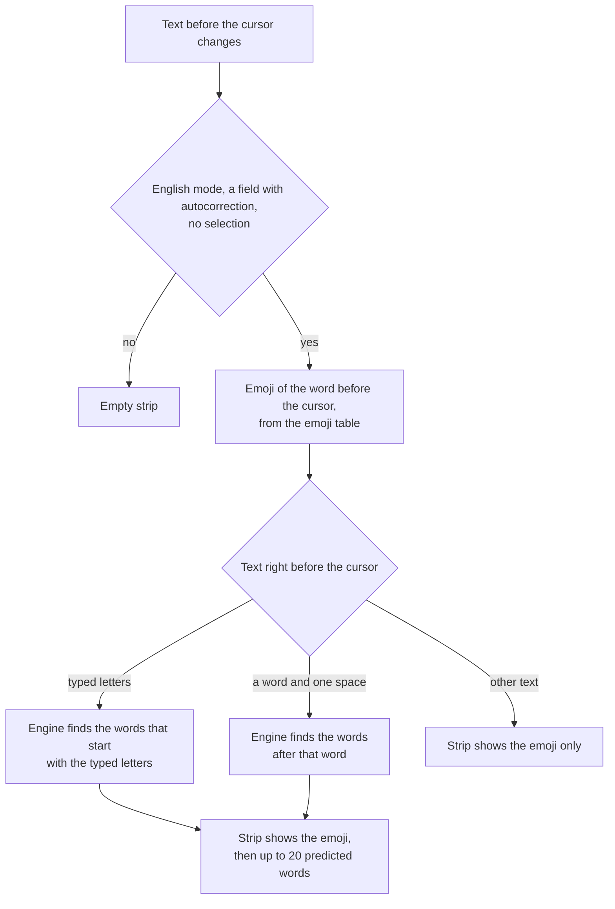
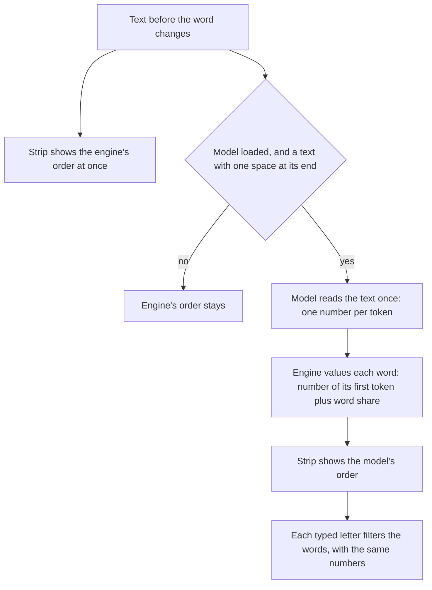

# Prediction strip

The prediction strip is the part of the top row of keys between the Backward key and Cut. It shows
the emoji of the word before the cursor, and then the predicted words. A predicted word is a
word that starts with the letters the person is typing, or a word that often follows the word
before the cursor. A tap on a predicted word types the word and a space.

## The top row

The top row holds, from left to right: Select All, the typing speed, the Backward key, the Redo
key, the prediction strip, Cut, Copy and Paste. All three layers hold the same row.
`Shared/keyboard-layout.json` names the two places that are no keys as `typingSpeed` and
`predictionStrip`, and the two keys of the edit history as `undo` and `redo`.
[edit-history.md](edit-history.md) describes the Backward key and the Redo key.

| Layout | Typing speed | Small key, each | Prediction strip, Redo key hidden | Prediction strip, Redo key shown |
| --- | --- | --- | --- | --- |
| Compact, 10 key units | 1 | 0.75 | 5.25 | 4.5 |
| Wide, 13.5 key units | one third of 2.3 | one third of 2.3 | 8.9 | 8.13 |
| Split, 19.5 key units | one third of 2.3 | one third of 2.3 | 14.9 | 14.13 |

The small keys are Select All, the Backward key, the Redo key, Cut, Copy and Paste. They have
one width in each layout. The Redo key shows only while the edit history holds a step to make
again. While the Redo key is hidden, the strip has the width of the Redo key too. One key unit
is the width of one letter key. In the split layout the strip crosses the empty middle, so the
top row has no empty middle of its own.

The row has no Home key and no End key. A held space bar moves the cursor in every layout.

## Select All and the typing speed

Select All shows an icon: three lines of text in a dashed frame. `scripts/select-all-icon`
holds the script that made the candidates with an image model, the chosen candidate, and the
script that turns the candidate into the images `Shared/select-all@2x.png` and
`Shared/select-all@3x.png`. The key tints the icon with the color of its text.

The typing speed is a number of words per minute with "WPM" below it
(`Shared/TypingSpeed.swift`). The typing speed is no key, and a touch on it presses no key.

| Term | Rule |
| --- | --- |
| Word | 5 characters. |
| Change | One action of the person: a key press, a tap on a predicted word or on a candidate, or a tap on the proofreader's fix. |
| Counted characters | The characters that a change puts into the text, less the characters that the change takes out. A tapped predicted word counts with all its characters. The proofreader's fix counts only with the characters that it adds. Pasted text and the lines of a test's report do not count. |
| Delete | A change that takes characters out takes the latest counted characters out of the count. A delete of older text changes nothing. |
| Run | Typing without a pause of more than 3 seconds. The first change of a run starts its clock. Pinyin letters keep a run going, although they wait outside the text. |
| Speed | The counted characters after the first change, over the time since the first change. A run longer than 10 seconds counts its last 10 seconds only. |
| Shown number | The speed of the current run once the run is 2 seconds long. Before that, and during a pause, the last number stays. A dash shows before the first number. |

The keyboard keeps the times and the counts of the last 10 seconds in memory. The keyboard
keeps no text for the typing speed and writes no file.

## What the strip shows

- **Emoji.** The emoji of the English word before the cursor take the first places.
  [emoji-suggestions.md](emoji-suggestions.md) describes the table and the tap on an emoji.
- **Typed letters.** The typed letters are the ASCII letters and apostrophes right before the
  cursor (`KeyboardTextLogic.typedLetters`). They start the text, or they follow a space, a
  line break or an opening bracket or quote.
- **A word and one space.** Right after a word and one space, no letter is typed, and the strip
  shows the words that the engine expects after that word.
- **Other text.** The strip shows no predicted words in these cases
  (`KeyboardTextLogic.predictionContext`):
  - No word comes before the cursor: the start of the text, a mark, two spaces or a line break.
  - A letter, a digit or an apostrophe follows the cursor, so the cursor sits inside a word.
  - The letters hold a capital after the first letter and are not all capitals, as "iPh".
  - Another character comes right before the letters, as in "@to" and "2to".
- **Predicted words.** The typing engine gives the words of the lexicon and of the work area
  that start with the typed letters and are longer than them (`duo_predict_english` in
  `Engine/duo_engine.c`). Without a typed letter the engine gives the most probable words after
  the word before. The most probable word comes first. The engine reads the probability of a word after the word before
  it from its word and word-pair statistics, as for a correction. The strip holds up to 20
  words, and a slide to the left shows the words past its right edge.
- **Capitals.** A predicted word takes the capitals of the typed letters: "To" gives
  "Tomorrow", and "TO" gives "TOMORROW". The word "i" and its contractions always get their
  capital. A word of the work area gets its form by the rule of the preferred capitals, as
  "PyTorch" for "Py" ([domain-pack-design.md](domain-pack-design.md)).
- **Candidate row.** The Chinese candidates and the proofreader's fix of a sentence show in
  the candidate row. The candidate row lies in the place of the strip, between Select All and
  Cut, and covers the strip while it shows. Select All, Cut, Copy and Paste stay in view and
  react.

## Order of the predicted words

The strip has two orders for its words. The engine's order needs no model. The model's order
takes its place as soon as the language model has read the text before the word.

| Order | Value of a word | Where the code is |
| --- | --- | --- |
| Engine's order | The engine's log probability of the word after the word before. | `duo_predict_english` |
| Model's order | The model's log probability of the first token of the word's form, plus the log of the word share. | `duo_predict_english_with_model` |

- **Numbers of the model.** The model gives the log probability of every token right after the
  text (`duo_lm_scorer_next`). The model reads once per word. `scripts/prediction-strip/check_scorer_next.py`
  shows that the phone's scorer gives the numbers of the Linux scorer.
- **Word table.** `Shared/word-table-smollm2.bin` holds the first token and the word share of
  each form of each word. The word share is the word's probability over the summed probability
  of the forms with the same first token. `scripts/typing-engine/build_word_table.py` builds
  the file from the lexicon, the work area and the model's tokenizer.
- **Forms.** A word has up to three forms: lower case, first letter capital, and the preferred
  capitals of the work area. The model's order writes a word in its form with the highest
  value, as "Python" after "I use". A typed capital allows only forms with a capital.
- **First word of a field.** The model has no text to read there, so the engine's order stays.
- **Settings.** `EngineSpellChecker.PredictionSettings` holds the share of the engine's value
  in the order, and the form rule. The keyboard uses the share 0.3 and the form that the typed
  capitals ask for. The benchmark chose these values
  ([prediction-strip-benchmark-results.md](prediction-strip-benchmark-results.md)). On its test
  halves this order saves 57.0% of the key presses with 4 to 7 shown words, against 47.6% for
  the engine's order.

## A tap on a predicted word

1. The word takes the place of the typed letters, and one space follows the word. A word
   that the strip showed right after a space goes in after that space.
2. One backspace right after the tap brings the text before the tap back, as after a
   correction.
3. No correction reads the word, alone or together with the next word, because the word is
   the person's own choice.
4. The space counts as a typed space. A mark right after the tap takes the place of the
   space, and a second space gives a period.

The space bar never picks a predicted word. The words change with each typed letter, so a
space keeps the typed word and corrects it as before.

## Touches

A finger on an entry of the strip, or on a candidate of the candidate row, starts a ripple at
the finger's place. The ripple is the ripple of a key press, and the drawn row clips it. With
Reduce Motion on, no ripple shows.

The strip takes the full cell of its place in the row and the keyboard's edge above it. A
touch in that cell never reaches a key, so a finger that misses a word cannot press Select All
or Cut. A finger that comes down on the strip first types the letter of a finger that still
rests on a key. When that letter changes the words, the lift of the first finger selects
nothing.

## Limits

- The model's order is weak after a very short text. After the one word "Thank" at the start
  of a field, the model's first words are not "you".
- The strip shows the engine's order for a moment after each space, until the model answers.
  No phone run has measured that time yet.
- The strip predicts no first word of a text or of a sentence, because no word comes before
  the cursor there.
- The strip holds only words that start with the typed letters. A typed word with a wrong
  letter gets its correction at the space.
- The typing speed counts characters, so Chinese text gives a low number: a Chinese word of
  two characters counts as two fifths of a word.
- The strip predicts English words only. Chinese mode shows its candidates in the candidate row.
- The candidate row has the width of the strip: about 60% of the top row on the closed phone.
  A long fix of the proofreader scrolls sideways there.

## Checks

| Check | Command or place |
| --- | --- |
| Layout rules, with the rule for the strip | `python scripts/keyboard-preview/check_layout.py` |
| Predicted words of the engine on the PC | `duo_cli predict` (`Engine/duo_cli.c`) |
| Model's order of the engine against a second computation | `scripts/typing-engine-check/check_model_order.py` |
| Word table against the lexicon and the model | `python3 scripts/typing-engine/build_word_table.py --check` |
| Unit tests | `Tests/PredictionStripTests.swift`, `Tests/ModelPredictedWordsTests.swift`, `Tests/TypingSpeedTests.swift`, `Tests/TopRowEmojiTests.swift`, `Tests/TypingEngineTests.swift` |
