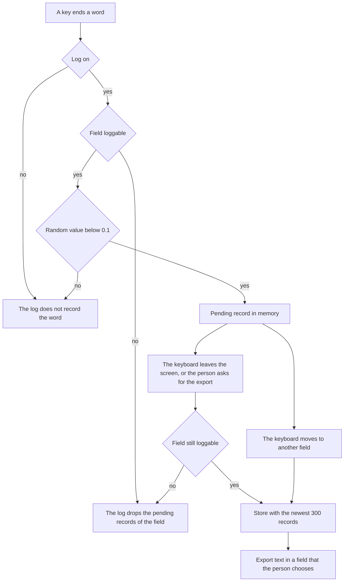

# Design of the typing log of the keyboard

## Summary

The [typing log](#glossary "The opt-in record of sampled words that this page describes.")
keeps a random sample of
[committed words](#glossary "A word that a word terminator ends and that the keyboard may correct.")
on the phone, for a hand count of typing
[slips](#glossary "A typed word that differs from the word that the person meant.").



Figure 1. Path of a committed word to the store. The log samples 1 committed word in 10. A key
press does not write to the disk. A record waits in memory until the keyboard leaves the field
or the screen.

What to do:

1. Install a build of the branch `engine/lm-domain-typing-log` through TestFlight.
2. Type `duo:log` and a space in any field. The space bar shows "Typing log on".
3. Type as usual for some days.
4. Open a note, type `duo:logexport` and a space, and copy the text that appears.
5. Label the records by the steps of "Labels of a sample for the slip rate".
6. Type `duo:logclear` and a space to erase the log.
7. Type `duo:log` and a space again to turn the log off.

The page does not settle the behavior on the phone, because the code is not compiled or run yet.

## Glossary

Table 1. Terms of this page. Each term keeps one meaning on the whole page.

| Term | Meaning |
| --- | --- |
| typing log | The opt-in record of sampled words that this page describes. |
| word terminator | A key that ends a word: space, return, `.`, `,`, `!`, `?`, `;` or `:`. |
| committed word | A word that a word terminator ends and that the keyboard may correct. |
| typed span | The keys that the person pressed for the committed word. The span also holds the word before it when the keyboard read the two words together. |
| engine | The C typing engine. The engine proposes up to 8 readings of a typed span. |
| reading | One way the engine reads the typed span as words, as "the" and "ten" for "teh". |
| model | The small language model that re-orders the readings at each word terminator. |
| slip | A typed word that differs from the word that the person meant. |
| slip rate | The share of committed words that are slips. |
| revert | One backspace right after a correction. The keyboard then brings the typed text back. |
| record | The data of one sampled committed word. |
| pending record | A record that the log holds in memory and has not written to the store. |
| store | The file and the setting that keep the log between two launches of the keyboard. |
| loggable field | A text field in which the log may record. |
| sampling probability | The chance that the log samples one committed word: 0.1. |

## Commands of the typing log

Table 2. Commands of the log. Each command is a text and a space, typed in any field.

| Command | Effect | Text on the space bar |
| --- | --- | --- |
| `duo:log` | Turns the log on, or off when the log is on. | "Typing log on" or "Typing log off" |
| `duo:logexport` | Types the export text into the field at the cursor. | "Typing log: 12 records typed", with the real count |
| `duo:logclear` | Erases every record. | "Typing log erased" |

The log is off in a new install. The keyboard takes the command text out of the field. A command
counts only as a word of its own, so "@duo:log" stays plain text. A capital first letter also
counts. The keyboard reads the commands in English typing only.

The two longer commands do not end in `duo:log`. So the export and the erasure do not switch the
log. Both also work while the log is off. The test field of the host app does not have a log.
The commands are plain text there.

## Loggable fields of the typing log

The keyboard extension reads three traits of the text field from iOS. A field is a
[loggable field](#glossary "A text field in which the log may record.") when the three rules of
Table 3 hold.

Table 3. Rules of a loggable field. A field must pass all three rules.

| Trait | Loggable value | Fields that the rule keeps out |
| --- | --- | --- |
| `isSecureTextEntry` | false | A password field. A field without an answer counts as secure. |
| `textContentType` | not set | A field for a password, a new password, a one-time code or a user name. Also a field for an e-mail address, a phone number, a card number, a name or a street address. |
| `keyboardType` | `default`, `asciiCapable` or `twitter` | A field for a web address, a web search, an e-mail address, a number or a phone number. A field without an answer is also out. |

iOS shows its own keyboard in a secure field, so this keyboard does not appear there.
[Apple's guide for custom keyboards](https://developer.apple.com/library/archive/documentation/General/Conceptual/ExtensibilityPG/CustomKeyboard.html)
states that rule. The log still checks the trait.

The log asks for the traits before each sample and before each mark of a record. The log asks
again at each change of the field and before each write to the store.

A field can turn secure while the keyboard is on the screen. A password field with a "show"
switch is one example. The log then drops the
[pending records](#glossary "A record that the log holds in memory and has not written to the store.")
of that field. The [store](#glossary "The file and the setting that keep the log between two launches of the keyboard.")
does not get them.

Two more rules keep text out of the log. The log does not sample a word in a field that turns
autocorrection off. The log does not sample Pinyin typing.

## Sampling rule of committed words

The log draws one random value from 0 up to 1 for each committed word. The log samples the word
when the value is below 0.1. The constant `TypingLog.samplingProbability` holds the
[sampling probability](#glossary "The chance that the log samples one committed word: 0.1.").
The rule does not read the word, the
[readings](#glossary "One way the engine reads the typed span as words.") or the correction. So
a changed word and an unchanged word have the same chance.

A committed word passes the keyboard's own test for a word that it may correct
(`KeyboardTextLogic.correctableWord`). The log does not sample the following text:

- a word with a capital after its first letter, as "iPhone"
- a word with a digit or a symbol that the keyboard does not read as a slip, as "abc123"
- a word right after a character such as "@", "/" or "."
- a word in a field without autocorrection
- Pinyin letters
- the word "duo" before a colon, because that text starts a command of the keyboard

A kept word is a committed word. The person brought such a word back after an earlier
correction, and the keyboard keeps the word as typed. The record of a kept word has `kept` true
and an empty list of readings. A word of one letter, as "a", also has an empty list of readings.

The keyboard reads two words together when the person typed them one after the other. The
record of the second word then holds both words in `typed`. The first word had its own draw at
its own [word terminator](#glossary "A key that ends a word: space, return or a punctuation key.").

## Content of a record

Table 4. Fields of a record. A record holds what a person needs to judge one word: the context,
the keys, the result and the readings.

| Field | Content |
| --- | --- |
| `hour` | The start of the hour of the key, in UTC. The log does not keep a finer time. |
| `context` | The last 60 characters of the field's text before the typed span, or fewer. |
| `typed` | The [typed span](#glossary "The keys that the person pressed for the committed word, with the word before it when the keyboard read the two together."). |
| `inField` | The text of the span in the field right before the key. The text differs from `typed` when an earlier key changed the first word. |
| `shown` | The text of the span after the correction. |
| `end` | The word terminator. |
| `changed` | True when the keyboard changed the span at this key. |
| `kept` | True for a kept word. |
| `readings` | The readings of the typed span (Table 5). |
| `asTyped` | The index of the reading that is the text as typed. |
| `engineChoice` | The index of the reading that the engine chose. |
| `modelChoice` | The index of the reading that the keyboard chose with the model's scores. The field is missing when the model did not score. |
| `modelNote` | The reason when the keyboard asked the model and the model did not score. |
| `backspaced` | True when the person deleted the last character of the span with backspace, before the next committed word. |
| `reverted` | True when the person used the [revert](#glossary "One backspace right after a correction, which brings the typed text back.") on the correction. |

An index counts from 0. The three index fields are missing in a record without readings.

Table 5. Fields of a reading. The scores are on a natural-logarithm scale, so a score nearer to
0 means a more likely reading. The numbers have three decimals.

| Field | Content |
| --- | --- |
| `text` | The reading in lower case. |
| `engine` | The engine's score of the reading, with the cost of the slips that the reading assumes. |
| `slip` | The cost of those slips alone, as a positive number. |
| `model` | The model's score of the reading after the context. The field is missing when the model did not score. |
| `space` | The model's score of a space after the reading. |
| `stockModel`, `stockSpace` | The same two scores from the second prompt of the apostrophe step, when that step ran (`docs/apostrophe-words-design.md`). |

The log sets `backspaced` and `reverted` while the record is pending and its word is the last
sampled word. A backspace marks the record when the cursor stands right after the span. So the
mark also comes when the person first deletes later letters. The next committed word ends the
marks of the word before it.

## Path of a record to the store

Figure 1 shows the path. A sampled word becomes a pending record. The log writes the pending
records to the store at three moments:

- the keyboard moves to another field
- the keyboard leaves the screen
- the person types the export command

At the first moment the records of the field before go to the store. The log cannot ask about
that field again. At the other two moments the log first asks whether the field is still
loggable.

Each write puts the whole file in place in one step. When the store does not read or write, the
space bar shows "Typing log:" and the reason. The records then stay pending, and the next write
takes them.

## Storage places and limits of the log

Table 6. Places and limits of the storage. The log keeps 300 records at most, in the keyboard
extension's own container.

| Item | Limit | Place |
| --- | --- | --- |
| Switch | off in a new install | The setting `typingLogOn` in the keyboard extension's own settings. |
| Stored records | the newest 300 | The file `typing-log.jsonl` in the Application Support folder of the keyboard extension. |
| Pending records | the newest 300 | The memory of the keyboard process. |
| Context of a record | 60 characters | Inside the record. |
| Export text | the newest records whose lines fit in 150,000 characters | The text field in which the person types the command. |

A new record takes the place of the oldest one when the log holds 300 records. The keyboard
extension does not share its container with the app. The log does not use an app group or
iCloud. The file has the mark that keeps a file out of a backup of the phone. The setting holds
the switch alone.

## Format of the export text

The export is plain text. The first line is a JSON object that names the text and counts the
records (Table 7). Each later line is one record as a JSON object, oldest first. The keys of a
line stand in the order of their names. A line break inside the context is written as `\n`, so a
record stays on one line.

Table 7. Fields of the first line. The line shows whether the export holds every record of the
log.

| Field | Content |
| --- | --- |
| `file` | "Duo Keyboard typing log. Each line after this one holds one sampled word as JSON." |
| `records` | The count of record lines in this export. |
| `samplingProbability` | 0.1 |
| `stored` | The count of records in the log. |

An example of the first line and of one record follows. The text and the numbers are made up.

```
{"file":"Duo Keyboard typing log. Each line after this one holds one sampled word as JSON.","records":1,"samplingProbability":0.1,"stored":1}
{"asTyped":1,"backspaced":false,"changed":true,"context":"we can meet at the cafe after ","end":" ","engineChoice":0,"hour":"2026-11-11T09:00:00Z","inField":"lunhc","kept":false,"modelChoice":0,"readings":[{"engine":-9.412,"model":-3.207,"slip":2.303,"space":-0.105,"text":"lunch"},{"engine":-15.82,"model":-14.611,"slip":0,"space":-2.94,"text":"lunhc"},{"engine":-13.305,"model":-9.874,"slip":4.605,"space":-0.223,"text":"launch"}],"reverted":false,"shown":"lunch","typed":"lunhc"}
```

A mail program can break a long line. Paste the export into a note or a text file first when
the lines must stay whole.

## Privacy limits of the log

- The log is off until the person types `duo:log` and a space.
- The log does not record in a field that is not loggable (Table 3).
- The code of the log does not use the network. The log does not send a record to any place.
- The records stay in the keyboard extension's own container on the phone.
- The keyboard does not write the export to the clipboard. The person copies the text from the
  field.
- The log works without Full Access. The log does not need a new entitlement.
- A record holds up to 60 characters of the text before the word. That text can be private, so
  the person chooses the field for the export with care.
- The command `duo:logclear` erases the pending records and the file. The removal of the app
  from the phone also removes the container.
- The space bar names the state of the log only at the switch. The keyboard does not show a
  lasting sign while the log is on.

## Labels of a sample for the slip rate

The log does not decide whether a word is a slip. A person labels the records:

1. Export the log and paste the text into a file on a computer.
2. Label every record of the export, or a subset that a random draw picks.
3. Read `context`, `typed` and `shown` of a record. The committed word is the last word of
   `typed`.
4. Write the text that the person meant in place of the committed word as the label `meant`.
   Write "unsure" when the context does not show the meant text.
5. Count the records by the rules of Table 8.

The label `meant` can hold two words, as "the quick" for the typed "thequick". For a slip at the
space bar, `meant` is the whole meant word, as "the" for the typed "th e".

Table 8. Rates from the labels. The slip rate needs the unchanged words too. A slip that the
keyboard and the person both left in the text appears only there.

| Rate | Records counted | Out of |
| --- | --- | --- |
| [Slip rate](#glossary "The share of committed words that are slips.") | The last word of `typed` differs from `meant`. | All labeled records. |
| Share of corrected slips | The record is a slip, and `shown` ends in `meant`. | All slips. |
| Share of wrong changes | The record is not a slip, and `shown` does not end in `meant`. | All records that are not slips. |

Capital letters do not count in these comparisons. The fields `reverted` and `backspaced` help
with a label. A revert shows that the person did not want the change. A backspace shows that the
person went back into the word. The two fields do not take the place of the label. The person
can leave a slip in the text.

Give each rate with its range. With 20 slips in 300 labeled records the slip rate is 6.7%. The
95% [Wilson interval](https://en.wikipedia.org/wiki/Binomial_proportion_confidence_interval#Wilson_score_interval "A range for a share that also holds for small counts.")
then runs from 4.4% to 10.1%. Count the records with the label "unsure" two times: once as
slips and once as words without a slip. The two results bound the rate.

The rates hold for committed words in loggable fields. They do not hold for the text that the
log does not sample.

## Limits of this design

- The code of the log is not compiled yet. The unit tests of `Tests/TypingLogTests.swift` have
  not run.
- The phone checks below have not run. The time that the keyboard needs to type a long export
  is not measured.
- The answers of iOS for the three traits of Table 3 were not read on a phone. The log stays
  empty in an app whose fields do not give the traits.
- The log sees committed text only. A slip that the person repairs before the word terminator
  does not reach the log.
- The log does not sample the text of the list in "Sampling rule of committed words". The slip
  rate does not cover that text.
- The log does not record a change of capitals in a word with a capital inside, as "pyTorch" to
  "PyTorch".
- The log does not record a fix of the sentence proofreader.
- The two marks see a backspace into the span before the next committed word, and the revert.
  They do not see a later edit, a cursor move, a cut, or a selection that the person replaces.
- A record keeps the text before the word only. A label can need the text after the word, as for
  a slip that spells another word.
- The pending records are lost when iOS ends the keyboard process before the keyboard leaves
  the screen.
- The log tells two fields apart by the document identifier of iOS. An app can give a field a
  new identifier when the field turns secure. The earlier records of that field then reach the
  store.
- The test field of the host app does not have a log.
- A switch for the log in the app needs an app group, which this design does not use.

## Phone checks of the log

Table 9. Steps to type on the phone. The steps cover the three commands, a loggable field, and
a field that is not loggable.

| Step | Expect |
| --- | --- |
| Type `duo:log` and a space in Notes. | The text goes away, and the space bar shows "Typing log on". |
| Type about 100 words in Notes, some with a slip. | The keyboard types and corrects as before. |
| Close the keyboard, open it again, and type `duo:logexport` and a space. | The first line, then about 10 record lines. The count is from 5 to 16 in about 19 of 20 runs. |
| Type 20 words in the address bar of Safari. Then type `duo:logexport` and a space in Notes. | The value of `stored` does not rise. |
| Type `duo:logclear` and a space, then `duo:logexport` and a space. | The first line alone, with `"records":0`. |
| Type `duo:log` and a space. | The space bar shows "Typing log off". |

## Files of the log

Table 10. Files of the log. The logic of the log is in one new file.

| File | Content |
| --- | --- |
| `Shared/TypingLog.swift` | The log, the record, the rules of a loggable field, and the store |
| `Shared/KeyboardTextController.swift` | The three commands, and the calls of the log from the typing code |
| `Shared/EnglishReranking.swift` | The trace of the last correction, which the log reads for the model's scores |
| `Keyboard/KeyboardViewController.swift` | The log of the keyboard extension, and the three traits of the field |
| `Tests/TypingLogTests.swift` | The unit tests of the log |
