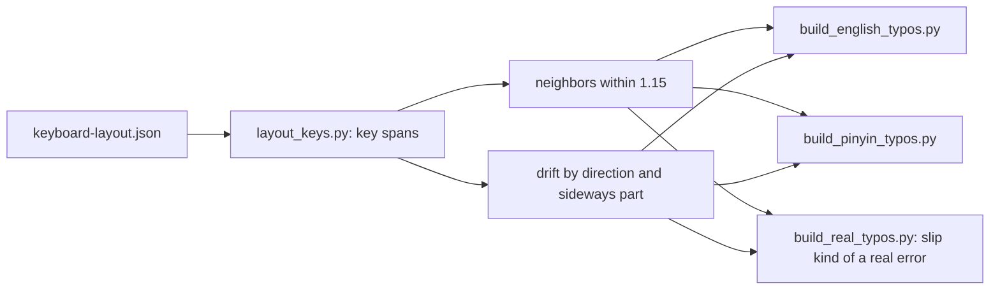

# Typo set: design

## Summary

The typo set is a group of evaluation cases for the English and the Pinyin keyboard. It adds to
the existing cases of `scripts/typing-evaluation/cases/`, and it changes none of them.

The set holds the slips that the user reported. The first is the hand one key off for a whole
word or part of a word, as "yjod [jtsdr" for "this phrase". The second is a slip of a common
short word that stays uncorrected, as "thst" and "dont", also when the next word follows. The
third is Pinyin with a slip. The set also holds real typing errors from two public studies, and
real words that a keyboard must leave as typed.

The test half is for decisions only. No tuning, no choice of a setting and no look at single
cases reads it. The workflows type and score the dev half only.

Table 1. The five case files of the typo set.

| File | Language | Source | In git | Dev cases | Test cases |
| --- | --- | --- | --- | --- | --- |
| `cases/english-typos.{dev,test}.jsonl` | English | Generated from Tatoeba sentences | yes | 3,147 | 3,144 |
| `cases/english-typos-capitals.{dev,test}.jsonl` | English | The short-word and apostrophe cases of the file above, in sentence case | yes | 747 | 744 |
| `english-typos-aalto.{dev,test}.jsonl` | English | Aalto mobile typing study, real errors | no, built by script | 1,462 | 1,458 |
| `cases/pinyin-typos.{dev,test}.jsonl` | Pinyin | Generated from Tatoeba clauses | yes | 2,678 | 2,671 |
| `pinyin-typos-cscd.{dev,test}.jsonl` | Pinyin | CSCD-NS, real errors with inferred keys | no, built by script | 597 | 598 |

The licences of the two real-data sources do not allow redistribution. So
`scripts/typing-evaluation/typo-set/fetch_real_data.sh` downloads the data on each run, and
`build_real_typos.py` builds the files into `build/typo-set/cases/`. No workflow artifact holds
their texts ("Real data in the workflows").

## Terms

| Term | Meaning |
| --- | --- |
| case | One test input: `context` (the text before the cursor), `typed` (the keys typed), `intended` (the text the person meant). |
| expected | `correct` when `typed` holds a slip, `keep` when `typed` is the intended text. |
| drift | The hand moves by one key and types each key from the moved place. Full drift moves every letter of the word. Partial drift starts inside the word and moves two letters or more. |
| neighbor key | A letter key whose center is at most 1.15 key widths from the center of the intended key, on the real layout. |
| follow words | One or two words typed right after the slip word, in the same case. The keyboard reads the word before again when it corrects the next word, so these cases test that second reading. |
| rival word | A word one slip away from a typed slip word, and at least as common as the intended word, as "who" for "hwo" typed for "how". The words around the slip decide between the two. |
| sentence start | The context of a case and its intended slip text, without the follow words. |
| twin | For a Pinyin slip case, the clean case of the same clause. |
| wide layout | The 13.5-unit layout of the open iPhone Duo, in `Shared/keyboard-layout.json`. |
| compact layout | The 10-unit layout of the closed phone, in the same file. |
| model file | A file that trained, stopped, tuned or selected the shipped language model. |
| decision file | A held-out set that decided whether a model replaced the shipped file. |
| Zipf | The wordfreq frequency scale: 3 is once per million words. |

## Key positions

`typo-set/layout_keys.py` reads the letters layer of both layouts from
`Shared/keyboard-layout.json`. Each key has a span on its row, from its left edge to its right
edge. A row narrower than the layout is centered, and rows are one key unit apart. These are
the rules of `symbol_keys.py`, which the workflow "Typing evaluation" already checks against the
engine and the keyboard, and of `keyboard_noise.py`.

A drift has a direction and an offset in key units:

- Left and right: the next key of the same row. In the wide layout the key right of `p` is `[`,
  right of `l` is `;`, and right of `m` is `,`. In the compact layout `p` is the last key of its
  row.
- Up and down: one row up or down, with a sideways part of -0.3 or +0.3 key units. The case
  records the sideways part. In the compact layout the center of a home-row key lies on the edge
  between two top-row keys. So a drift straight up has no single key.
- A drift that lands on a function key (shift, tab, return, the space bar) makes no case.
- A drift that lands on `,`, `.` or `;` makes no case. The keyboard ends the word at these keys
  and corrects it at once.
- A drift case of the group `drift` types letters only. A drift that types a digit or another
  symbol key, as "=pw7e" for "plays", goes to the category `drift_onto_symbols`.

The keyboard reads a word for correction only when the word holds one digit or symbol key at
most (`correctableWord`, `Shared/KeyboardTextLogic.swift:215-264`). That key must be a digit or
"[", or one of "-", ";", "," and "." in front of the word. A word as "=pw7e" never reaches the
engine. Each `drift_onto_symbols` case records in `keyboard_reads_word` whether the keyboard
reads it, by the Python copy of the rule (`rerank.correctable_word`).

The user's example comes out of the wide layout as written: `layout_keys.py` turns "this phrase"
drifted right into "yjod [jtsdr".

Figure 1. The layout file feeds every slip rule of the three builders.

## English cases generated from Tatoeba

`typo-set/build_english_typos.py` writes `cases/english-typos.{dev,test}.jsonl` and
`cases/english-typos-capitals.{dev,test}.jsonl`. The seed is `typo-set-20261114`, and each
category draws its sentences in an order seeded by the seed, the half and the category name.
Each case picks the wide or the compact layout with that order.

A sentence enters the pool when it is ASCII and holds 4 to 14 words. Every word must be among
the 60,000 most common words of wordfreq. Inside the sentence only a comma may stand, and at its
end one mark of `. , ? !`. The context is the lower-case words before the slip word. Half the
cases add one or two follow words, and every case of `short_word_listed_next`.

Table 2. The English categories, dev cases per half.

| Category | Group | Expected | Cases | Rule | Example, typed to intended |
| --- | --- | --- | --- | --- | --- |
| `drift_full_left`, `_right`, `_up`, `_down` | drift | correct | 60 each | Every letter of a word of 3 letters or more, Zipf 3.5 or more, drifted one key | ejrtr to where |
| `drift_partial_left`, `_right`, `_up`, `_down` | drift | correct | 60 each | The letters from place 1 to the end of a word of 4 letters or more drifted, two letters or more | anythimh to anything |
| `drift_end_two` | drift | correct | 60 | The last two letters of a word of 4 letters or more drifted, in any direction | hihj to high |
| `drift_phrase` | drift | correct | 60 | Two words, 6 letters or more together, both drifted in one direction, the space kept | kidy esmyd to just wants |
| `drift_run_on` | drift | correct | 60 | The same, with the drift from a letter inside the first word to the end of the second | adl stpimf to ask around |
| `drift_onto_symbols` | drift_symbols | correct | 60 | A full or partial drift that types a digit or symbol key | 3wj6 to want |
| `short_word_neighbor` | short_words | correct | 150 | One neighbor key in a word of 3 to 5 letters at Zipf 5 or more | znd to and |
| `short_word_transposition` | short_words | correct | 100 | Two letters swapped in such a word | ehr to her |
| `short_word_listed` | short_words | correct | 147 | A hand list of 49 slips of common words: thst, taht, teh, hte, adn, jsut, yuo, wiht, thsi, waht and more | thst to that |
| `short_word_listed_next` | short_words | correct | 147 | The same slips with one word or more before them and one or two words typed after them | i think thst is right |
| `apostrophe_missing` | apostrophe | correct | 200 | One of 28 contractions typed without the apostrophe: dont, cant, im, ive, youre, theyre, doesnt, isnt, didnt and more | dont want to don't want |
| `letter_neighbor` | letter_slips | correct | 120 | One neighbor key in a word of 3 letters or more at Zipf 3.5 or more | hage to have |
| `letter_omitted` | letter_slips | correct | 120 | One letter left out of such a word | clar to clear |
| `letter_added` | letter_slips | correct | 120 | One neighbor key added before or after a letter | hospitasl to hospital |
| `letter_doubled` | letter_slips | correct | 120 | One letter typed twice | thesee to these |
| `letters_swapped` | letter_slips | correct | 120 | Two different letters side by side swapped | toher to other |
| `drift_then_slip` | mixed | correct | 60 | One word drifted in full or from a letter inside it, and a one-letter slip in the next word | vtpem jweels to crown jewels |
| `drift_and_omission` | mixed | correct | 60 | A drift from a letter inside a word of 5 letters or more, and one letter of the word left out | estu to early |
| `space_missing_common` | space_slips | correct | 120 | Two words at Zipf 5.5 or more joined | isalways to is always |
| `space_extra` | space_slips | correct | 120 | A space inside a word of 4 letters or more | wil l to will |
| `punctuation_after_slip` | punctuation | correct | 120 | One letter slip in the word before a mark | sprnig. to spring. |
| `keep_near_common` | keep | keep | 150 | A real word at Zipf 3 or more that one slip of the layout turns into a word at least 1.5 Zipf more common | combing (coming is near) |
| `keep_clean_short` | keep | keep | 120 | A word of 2 to 5 letters at Zipf 5 or more, typed right | who |
| `keep_clean_punctuation` | keep | keep | 80 | A word with its mark, typed right | trees. |
| `ambiguous_apostrophe_keep` | ambiguous | keep | 113 | well, its, were, ill, hell or shell, in a sentence that holds this word | well. |
| `ambiguous_apostrophe_correct` | ambiguous | correct | 140 | we'll, it's, we're, i'll, won't, he'll or she'll typed without the apostrophe | well learn how to we'll learn how |

The test half has the same quotas. Its counts differ only in `ambiguous_apostrophe_keep` (110).

Rules for every slip category:

1. The slip must change the text.
2. A letter or drift slip types a word below Zipf 3.0, and the intended word is at least 2.0 Zipf
   more common. A drift phrase checks each changed word. A slip that gives a common word is a
   real-word slip, which the existing set holds in `real_word_slip`.
3. A listed short-word slip needs only to stay below Zipf 3.2. wordfreq counts common
   misspellings as words ("teh" is at 3.04). "amd" and "fro" stay off the list, because both are
   real words.
4. An apostrophe slip has no Zipf limit. Its form without the apostrophe has no common meaning
   of its own. wordfreq still gives many of these forms a high score, as "dont" at 4.74. The
   reason is that people type them without the apostrophe. "cant" is also a rare English word.
5. One typed word, without the mark after it, appears at most 3 times in a category. The two
   apostrophe groups have few distinct words, so there the limit is 20.
6. Each of the 7 ambiguous pairs gets up to 20 cases per direction and half. "wont" gets no keep
   case: as a word of its own it is rare, and most Tatoeba sentences with "wont" hold a slip of
   "won't". "shell" has fewer than 20 sentences in each half.
7. An ambiguous case has a context or follow words, because both forms are words and only the
   words around them decide.
8. A slip case with a rival word records it in `rival`. When such a case has no context and no
   follow words, nothing decides between the two words, and the case stays out.
9. The ambiguous pairs score in their own group, `ambiguous`. A keyboard that always adds or
   always drops the apostrophe gets about half of the group right.
10. The generator and the engine's word list both read wordfreq. A high score on generated slips
    can partly reflect that shared source. The Aalto cases do not share it.

The generated mix follows the user's reports, and differs from the mix of real errors. Table 3
gives the real errors of the Aalto dev half that pass the rules below. Every real drift is a
drift of the last letters of a word, which `drift_end_two` copies. The full drifts of the generated set have
no real counterpart in the study, and the generated set holds them because the user reported
them.

### Sentence case

A field that capitalizes sentences shows "Dont" at the start and "I dont" inside a sentence.
`english-typos-capitals` holds every case of `short_word_listed`, `short_word_listed_next`,
`apostrophe_missing` and the two ambiguous categories again, in sentence case:

- The context is the text in the field. It starts with a capital, and "i" is "I".
- A typed text that opens the field starts with a capital, as "Thst" and "Dont", because the
  keyboard's automatic shift types it.
- A typed "i" after the first word stays in lower case. The person types it so, and the keyboard
  corrects it.

Each case names its lower-case case in `lower_case_twin`. The keyboard types the file in a field
that capitalizes sentences, and the harness types the capitals as they stand.

## English cases from real typing errors: Aalto mobile study

Table 3. The real errors of the Aalto dev half that pass the rules of this section.

| Kind | Errors |
| --- | --- |
| Neighbor key | 2,742 |
| Real word | 1,890 |
| Two edits or more | 786 |
| Letter left out | 649 |
| Extra letter | 479 |
| Missing apostrophe | 463 |
| Two letters swapped | 322 |
| Doubled letter | 122 |
| Drift | 14 |

Neighbor keys are the most common real slip, and drifts the rarest.

`build_real_typos.py` reads the processed data of the Aalto study (Palin, Feit, Kim, Kristensson
and Oulasvirta, "How do people type on mobile devices? Observations from a study with 37,000
volunteers", MobileHCI 2019). Volunteers copied shown sentences on their own phones. The script
keeps a test section when all of these hold:

1. The volunteer said that they use no autocorrection, prediction or swipe (`USING_FEATURES` is
   `["no"]`), and the section logged none of the three.
2. The device is a phone keyboard (`KEYBOARD_TYPE` "mobile") with the QWERTY layout.
3. The typed text has as many words as the shown sentence.
4. The shown sentence has no cut word, as "that s all". A word of one letter other than "a" and
   "i", or "ll", "re" or "ve", marks a cut word.

105,801 of 564,090 sections pass. In a kept section, the first shown word that the volunteer
typed differently, after every word before it was typed right, gives one case. The shown word
must be a plain word at Zipf 3.0 or more. A rarer shown word can be a typo of the shown sentence
itself. The case keeps the error that the volunteer left in the final text, so the error
had passed the volunteer's own check.

`build_real_typos.py` sorts each error into one category with the real layouts, in this order:

1. A missing apostrophe whose form without it is a word too. These are the 7 ambiguous pairs,
   "let's", and a possessive such as "nation's" whose plain form is at Zipf 3.0 or more.
2. Any other missing apostrophe.
3. An error that is no typing slip stays out. The first kind is a typed word without a letter.
   The second is a short form that people type on purpose, as "u", "ur" and "thx". The third is
   a spelling variant, as "behaviour" for "behavior" and "towards" for "toward".
4. A drift of two letters or more.
5. A real word at Zipf 3.0 or more, one slip from the shown word. A real word further from the
   shown word is a copy or memory error, as "did" for "do", and stays out.
6. One neighbor key, one letter left out, one extra letter, one doubled letter, or two swapped
   letters.
7. Two edits or more, up to 3, with the typed word at least half as long as the shown word. A
   word further away is a copy error or a cut-off word, as "sepa" for "separately", and stays out.

The seed `typo-set-real-20261114` draws up to 200 cases per category and half. One typed and
intended pair gives at most 3 cases, and 15 in the apostrophe categories. Half the cases add the
next one or two words, when the volunteer typed them right. An ambiguous apostrophe case needs a
context or follow words, as in the generated set. A half holds each case once.

The study has 1,525 shown sentences. A sentence with an even id feeds the dev half and one with
an odd id the test half. `real_aalto_drift` has 14 dev cases, which is too few to read alone.

## Pinyin cases generated from Tatoeba

`typo-set/build_pinyin_typos.py` writes `cases/pinyin-typos.{dev,test}.jsonl` with the seed
`typo-set-pinyin-20261114`. It reads the clauses of the Tatoeba Mandarin export with the rules of
`build_pinyin_cases.py`: a run of Chinese characters between two marks, Simplified by OpenCC. A
clause here has 3 to 12 characters and 5 letters or more. Each slip case names its clean twin.

### The reading of a clause

pypinyin alone gives wrong readings in two ways. Its phrase list can cross a word boundary:
"我的哥哥" holds the phrase "的哥" (di ge), so pypinyin reads "wo di ge ge". A character outside a
phrase gets its first reading, as "di" for the adverb ending 地 and "zhang" for 长 in "很长".

So `typo-set/pinyin_reading.py` first cuts the clause into words with jieba, with its hidden
Markov model off. Then each word gets its reading:

1. A word of two characters or more in pypinyin's phrase list gets the phrase reading.
2. pypinyin cuts any other word with its own phrase list, inside the word only.
3. A character outside every phrase gets its one reading. The 67 characters of `UNCERTAIN` have
   two toneless readings that both occur outside phrases, as 地 (de, di) and 长 (chang, zhang). A
   clause with such a character outside a phrase stays out.
4. A clause with a word of `UNCERTAIN_WORDS` stays out. 同行 reads tong xing or tong hang. 目的地
   reads mu di di, or mu di and the ending de. For 犯得上 the phrase list of pypinyin is wrong.

3,954 of 48,799 clauses stay out by this rule. The script stops when a character of `UNCERTAIN`
has one toneless reading only, so the list holds no character by mistake.

A clause that holds a clause of the existing Pinyin cases, or stands inside one, stays out. A
clause that holds a clause of the other half, or stands inside one, stays out of both halves.
The rule reads parts of 3 characters or more. It removes 2,917 and 4,697 clauses.

Table 4. The Pinyin categories, cases per half.

| Category | Group | Cases | Rule | Example, typed to intended |
| --- | --- | --- | --- | --- |
| `pinyin_clean` | clean | 1,318 | The clause typed right, the twin of each slip case | beizilideshuiganjingma to 杯子里的水干净吗 |
| `pinyin_neighbor` | finger_slips | 150 | One neighbor key in one syllable | dianhus to 电话 |
| `pinyin_omitted` | finger_slips | 100 | One letter left out | zaiaozou to 在澳洲 |
| `pinyin_added` | finger_slips | 100 | One neighbor key added | woshenmedoubupaw to 我什么都不怕 |
| `pinyin_swapped` | finger_slips | 100 | Two letters side by side swapped | tajaiohuan to 他叫胡安 |
| `pinyin_drift_word` | drift | 100 | Two neighboring syllables drifted one key, letters only, 25 per direction | rangninoidwule to 让您破费了 |
| `pinyin_drift_partial` | drift | 100 | The same, from a letter after the first one | rangwomenduufwxuerenba to 让我们堆个雪人吧 |
| `pinyin_fuzzy_z_zh`, `_c_ch`, `_s_sh`, `_n_l`, `_f_h`, `_r_l`, `_an_ang`, `_ian_iang`, `_uan_uang`, `_en_eng`, `_in_ing`, `_u_v` | fuzzy | 50 each | One syllable with its sound swapped for the other sound of the pair, in either direction, when the result is a standard syllable | sijieshibenshu to 世界是本书 |
| `pinyin_fuzzy_and_neighbor` | mixed | 50 | One fuzzy swap and one neighbor key in another syllable | zhenxiqngyiqichiwancang to 真想一起吃晚餐 |
| `pinyin_split_apostrophe` | split | 60 | A clause whose letters the longest-first cut reads as other syllables, typed with an apostrophe at the first break where the two cuts part | zheshini'nalinade to 这是你哪里拿的 |

The test half has 1,311 clean cases and the same slip quotas. The pairs follow the fuzzy settings
of common Pinyin input methods. The pairs ian and iang, and uan and uang, take their
syllables first. So `pinyin_fuzzy_an_ang` holds the other syllables with an or ang.
The pair u and v swaps "lu" and "lv", and "nu" and "nv", where "v" types "ü".

A drift that types a key other than a letter makes no case. A drift up from a top-row letter
lands on the number row, so a drift up rarely makes a case. Each drift direction therefore gets
its own quota of 25.

The longest-first cut is the cut of `PinyinEngine.longestWholeSyllables`. At each place it takes
the longest syllable that still lets the rest cut into syllables. So "xian" is one syllable. A
clean case records in `longest_first_cut_differs` whether that cut gives other syllables than the
intended ones (93 dev cases). The scorer reports these cases as a stratum, so the clean group
holds the clauses that need a syllable break once only.

A slip case records in `typed_parses_exactly` whether its typed letters cut into standard
syllables with nothing left over (807 dev cases). Such a slip is the Pinyin form of a real-word
slip, and the scorer reports it as a stratum. Two slips that give the same letters for one
clause give one case.

## Pinyin cases from real errors: CSCD-NS

`build_real_typos.py` reads the three splits of CSCD-NS (Hu, Meng and Zhou, "CSCD-NS: a Chinese
Spelling Check Dataset for Native Speakers", ACL 2024). Each row holds a Weibo sentence with
errors and the corrected sentence. A row gives a case when all of these hold:

1. The sentence has exactly one wrong character.
2. The corrected clause around the error has a certain reading by `pinyin_reading.py`. 2,407
   rows fail this rule.
3. No reading of the wrong character is the syllable of the right character. Otherwise a wrong
   pick among the candidates of the right keys explains the error. 12,047 rows fail this rule,
   as 薄 for 博, which both read "bo".
4. The first reading of the wrong character and the syllable of the right character differ by
   one slip. The slip is a fuzzy pair of Table 4, a neighbor key, a left-out letter, an extra
   letter or two swapped letters.

The case types the Pinyin of the clause around the error, at most 12 characters, with the
slipped syllable. The intended text is the corrected clause. The keys are an inference: the data
hold the characters, never the keys. A row goes to the dev half when the first byte of the
SHA-256 value of the corrected sentence is even. The seed draws 300 slip cases per half. Each
slip case names a clean twin, and two slip cases of one clause share it, so the dev half has 297
clean cases. `pinyin_cscd_swapped` has 2 dev cases, which is too few to read alone.

## Splits and the use of the test half

Table 5. The split rule of each file.

| File | Split rule |
| --- | --- |
| `english-typos`, `english-typos-capitals` | Tatoeba sentence id: even to dev, odd to test |
| `english-typos-aalto` | Aalto shown-sentence id: even to dev, odd to test |
| `pinyin-typos` | Tatoeba sentence id: even to dev, odd to test |
| `pinyin-typos-cscd` | SHA-256 of the corrected sentence: even first byte to dev |

Two sentences can give the same case, as "dont" with an empty context, and two sentences of
other halves can start alike. So each half draws the same way, and these rules keep the halves
apart:

1. A half holds each (context, typed, intended) case once.
2. Both halves of `english-typos` can draw cases with one sentence start. Then the SHA-256 value
   of the start names the half that keeps it, and the other half draws again. The builder repeats
   this until no start is in both halves. 425 dev and 384 test draws gave their start to the
   other half.
3. In the Aalto cases, a sentence start that both halves found goes to the half that its SHA-256
   value names. An Aalto case that equals a generated case of the other half stays out.
4. A CSCD-NS clause that both halves found goes to the half that its SHA-256 value names.

No case of a test half repeats a dev case. The categories with a fixed word list hold the same
typed and intended pairs in both halves by design. These are `short_word_listed` and
`short_word_listed_next` (49 slips), `apostrophe_missing` (28 contractions) and the ambiguous
pairs (7). Their test halves measure these words in new sentences, and they cannot show whether
a choice carries over to new words. The other categories draw their words from the sentences.

The test half is for decisions only. The workflows check that no test-half output exists, as the
existing evaluation does.

## Leakage check

The language model of the keyboard is the SmolLM2-135M LoRA fine-tune `dom-s100-seed1`. Its
training lists come from the cases of rounds 1 and 2 (`scripts/lm-finetune`,
`scripts/lm-finetune2`) and of the domain round (`scripts/lm-domain`). Their builders write the
cases to `build/`, outside git. `typo-set/leakage.py` reads two groups of these files.

The model files:

- `everyday/cases.train.jsonl`, `cases2.train.jsonl` and `domain/cases.train.jsonl`: the loss.
- `everyday/cases.stop.jsonl`, `cases2.stop.jsonl` and `domain/cases.stop.jsonl`: the stopping lists.
- `everyday/cases.tune.jsonl` and `cases.stream.tune.jsonl`: the setting.
- `everyday/cases.stream.select.jsonl`, `cases.github.select.jsonl` and `published.dev.jsonl`:
  the selection sets that picked `dom-s100-seed1` (`docs/lm-domain-design.md`, Table 4).
- `pairs.wikipedia.train.jsonl` of round 2: the misspelling pairs.

The decision files are `confirm-holdout/*.confirm.jsonl` and `fresh-holdout/*.fresh.jsonl` of the
domain round and `cases.*.holdout.jsonl` of round 2. The other selection sets of the domain round
are case files of `scripts/typing-evaluation/cases`. The builder leaves out every sentence of an
existing English case file.

`reports/english-typos-report.json` records the SHA-256 value of each file. A sentence leaves
the pool in three ways, for each group:

1. A case of the group names its Tatoeba id.
2. Its words equal the words of a sentence of the group, or of a case's context and intended text.
3. It has 4 words or more, and it differs from such a text in one word only. An example is "she
   is proud of her son" against "mary is proud of her son". A name swap is such a change.

A case with 2 words of context or more also leaves the set when its context and intended text
equal a model text. A shorter start, as "i
dont", is in every text.

Table 5. Sentences and cases that the leakage check removed.

| Source | Checked | Model files | Decision files | Existing case files |
| --- | --- | --- | --- | --- |
| Tatoeba English pool | 1,631,487 sentences | 242,269 sentences (120,501 by id, 1,367 by words, 120,401 by one word) | 40,119 sentences | 17,302 sentences |
| Generated cases | the drawn cases | 48 dev and 43 test cases by their start | | |
| Aalto shown sentences | 1,525 sentences | 60 sentences, with all their errors | 5 sentences | none |
| Aalto cases | the found errors | 184 errors by their start | | |
| Tatoeba Mandarin clauses | not checked: the model reads no Chinese | 0 | 0 | 2,917 clauses that hold or stand inside an existing clause |
| CSCD-NS | not checked: the model reads no Chinese | 0 | 0 | none |

The training lists also hold typed and intended pairs. A common real slip such as "teh" for
"the" is in the lists and in every typing log, so the pairs stay in the set.
`english-typos-report.json` counts the slip cases whose first-word pair a training case holds:
1,052 dev and 1,010 test cases.

The language-model files are not in git. When `build_real_typos.py` gets them, it writes two
lists to `reports/real-leakage.json`. The first holds the leaking Aalto sentence ids with their
reasons. The second holds the Aalto sentence starts that equal a model text. The workflows read that file.

## Sources and licences

Table 6. Every source, its licence, and what the repository holds of it.

| Source | Licence | In git |
| --- | --- | --- |
| Tatoeba English and Mandarin exports, https://tatoeba.org | CC BY 2.0 FR | The generated cases, as the existing case files |
| wordfreq 3.1.1, https://github.com/rspeer/wordfreq | Code Apache 2.0, data CC BY-SA 4.0 | Nothing |
| pypinyin 0.55.0, https://github.com/mozillazg/python-pinyin | MIT | Nothing |
| jieba 0.42.1, https://github.com/fxsjy/jieba | MIT | Nothing |
| inflate64 1.0.4, https://pypi.org/project/inflate64/ (reads the Deflate64 archive of the Aalto study) | LGPL 2.1 or later | Nothing |
| OpenCC (opencc-python-reimplemented) | Apache 2.0 | Nothing |
| Aalto mobile typing study, https://userinterfaces.aalto.fi/typing37k/ | The page states no licence. It says "we make the code and dataset openly available". | Nothing: fetch_real_data.sh downloads the files and checks their SHA-256 values |
| CSCD-NS, https://github.com/nghuyong/cscd-ime | The repository code is under MIT. The data files on Google Drive state no licence of their own, and the paper is CC BY 4.0. The sentences are Weibo posts. | Nothing: fetch_real_data.sh downloads the three files with gdown |
| Aalto desktop study (Dhakal et al. 2018), https://userinterfaces.aalto.fi/136Mkeystrokes/ | "free to use for research and non-commercial use with attribution to the authors" | Not used: physical keyboards, and the licence limits use |

No public data of real Pinyin keystrokes with their intended text was found. CHIME (Zheng, Li and
Sun, IJCAI 2011) and KNPTC (2018) used typing logs that are not public. CSCD-NS holds the
characters that the errors gave, so its keys are an inference.

## Real data in the workflows

The repository is public, so its workflow artifacts are public. Each job that types the
real-data cases builds them itself from the downloaded data. Before an upload,
`typo-set/redact_real.py` does four things to the files of `english-typos-aalto` and
`pinyin-typos-cscd`:

1. It checks each correction of a trace against the tuned rule, and writes the counts to
   `NAME.dev.rule-check.json`.
2. It replaces each trace with the case id, the step and the SHA-256 value of each choice.
3. It replaces each output with the SHA-256 value of the output after the scorer's
   normalization.
4. It deletes `requests-real.tsv`, the language-model requests of these cases.

Then it reads every other file of the folder, and stops the job in two cases:

- A line names a real-data case id and holds more than the id, the step and SHA-256 values.
- The file holds a context, a typed text or an intended text of a real-data case. The check
  reads English texts of 4 words or more, Chinese texts of 8 characters or more and typed Pinyin
  of 20 letters or more. It skips a text that a case file of `scripts/typing-evaluation/cases`
  also holds, as "don't think any", because that text is public there.

An upload runs only after this step passes. The summaries hold counts only. `compare_typos.py` compares the SHA-256
values, which gives the same counts as a comparison of the texts. The comparison of the keyboard
with the harness on its own machine also runs on the texts, inside the job, before the step.

## Integration

Table 7. Where each run of the typo set takes place. All of them type the dev half only.

| Workflow | Job | Run |
| --- | --- | --- |
| Typing evaluation | Typo set, engine alone | The engine alone, through the Python copy of the keyboard's rules with the work area on, and the Pinyin engine of `duo_cli` |
| Typing evaluation | Typo set, the existing outputs against the reference run of the build 44 code | `check_unchanged.py` against run 43577930323, on the branch `eval/typo-set` only |
| Language model in the keyboard | Typo set, Linux harness with the tuned rule | The engine alone and the tuned rule with the model, x86 |
| Language model in the keyboard | Typo set, the keyboard code with the model, and the harness on the same machine | `TypingEvaluationTests` on the simulator, with the model and with the engine alone, and the harness on the same macOS machine |
| Language model in the keyboard | Typo set, keyboard against the harness on its own machine and the engine alone on Linux | Keyboard against the macOS harness case by case (must agree), the engine alone against the x86 harness (must agree), and the model against the x86 harness (report) |
| Language model in the keyboard | Typo set, the existing outputs against the reference run of the build 44 code | `check_unchanged.py` against run 43577907274, on the branch `eval/typo-set` only |

The typo-set jobs are new jobs, so the existing jobs and their artifacts stay as they were. A
failed download of the real data fails only a typo-set job. The new tests of
`TypingEvaluationTests` run only when `TYPING_TYPO_CASES_DIR` is set, so the existing job
"keyboard" skips them.

`check_unchanged.py` compares the artifacts of a run with those of a reference run, file by file
and case by case. It stops the job when a compared file differs, or when a file of the reference
is missing. Files of the x86 harness may differ, because llama.cpp computes other last digits on another
processor. The report counts them, and they do not stop the job. The reference artifacts
expire 90 days after their runs, and the check then needs a new reference run.
