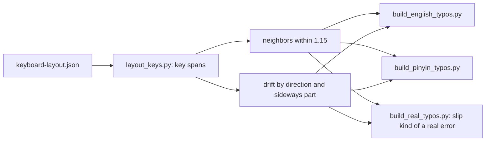

# Typo set: design

## Summary

The typo set is a new group of evaluation cases for the English and the Pinyin keyboard. It adds
to the existing cases of `scripts/typing-evaluation/cases/`, and it changes none of them.

The set holds the slips that the user reported. The first is the hand one key off for a whole
word or part of a word, as "yjod [jtsdr" for "this phrase". The second is a slip of a common
short word that stays uncorrected, as "thst" and "dont". The third is Pinyin with a slip. The set
also holds real typing errors from two public studies, and real words that a keyboard must leave
as typed.

The test half is for decisions only. No tuning, no choice of a setting and no look at single
cases reads it. The workflows type and score the dev half only.

Table 1. The four case files of the typo set.

| File | Language | Source | In git | Dev cases | Test cases |
| --- | --- | --- | --- | --- | --- |
| `cases/english-typos.{dev,test}.jsonl` | English | Generated from Tatoeba sentences | yes | 2,583 | 2,582 |
| `english-typos-aalto.{dev,test}.jsonl` | English | Aalto mobile typing study, real errors | no, built by script | 1,593 | 1,619 |
| `cases/pinyin-typos.{dev,test}.jsonl` | Pinyin | Generated from Tatoeba clauses | yes | 2,222 | 2,215 |
| `pinyin-typos-cscd.{dev,test}.jsonl` | Pinyin | CSCD-NS, real errors with inferred keys | no, built by script | 597 | 599 |

The licences of the two real-data sources do not allow redistribution. So
`scripts/typing-evaluation/typo-set/fetch_real_data.sh` downloads the data on each run, and
`build_real_typos.py` builds the files into `build/typo-set/cases/`.

## Terms

| Term | Meaning |
| --- | --- |
| case | One test input: `context` (the text before the cursor), `typed` (the keys typed), `intended` (the text the person meant). |
| expected | `correct` when `typed` holds a slip, `keep` when `typed` is the intended text. |
| drift | The hand moves by one key and types each key from the moved place. Full drift moves every letter of the word. Partial drift starts inside the word and moves two letters or more. |
| neighbor key | A letter key whose center is at most 1.15 key widths from the center of the intended key, on the real layout. |
| follow words | One or two words typed right after the slip word, in the same case. The keyboard reads the word before again when it corrects the next word, so these cases test that second reading. |
| twin | For a Pinyin slip case, the clean case of the same clause. |
| wide layout | The 13.5-unit layout of the open iPhone Duo, in `Shared/keyboard-layout.json`. |
| compact layout | The 10-unit layout of the closed phone, in the same file. |

## Key positions

`typo-set/layout_keys.py` reads the letters layer of both layouts from
`Shared/keyboard-layout.json`. Each key has a span on its row, from its left edge to its right
edge. A row narrower than the layout is centered, and rows are one key unit apart. These are
the rules of `symbol_keys.py`, which the workflow "Typing evaluation" already checks against the
engine and the keyboard.

A drift has a direction and an offset in key units:

- Left and right: the next key of the same row. In the wide layout the key right of `p` is `[`,
  right of `l` is `;`, and right of `m` is `,`. A word whose drift needs a key past the end of
  the row has no drift case in that layout. In the compact layout `p` is the last key of its row.
- Up and down: one row up or down, with a sideways part of -0.3 or +0.3 key units. The case
  records the sideways part. In the compact layout the center of a home-row key lies on the edge
  between two top-row keys, so a drift straight up has no single key.
- A drift that lands on a function key (shift, tab, return, the space bar) makes no case.
- A drift that lands on `,`, `.` or `;` makes no case, because the keyboard ends the word at
  these keys and corrects it at once.

The user's example comes out of the wide layout as written: `layout_keys.py` turns "this phrase"
drifted right into "yjod [jtsdr".

Figure 1. The layout file feeds every slip rule of the three builders.

## English cases generated from Tatoeba

`typo-set/build_english_typos.py` writes `cases/english-typos.{dev,test}.jsonl`. The seed is
`typo-set-20261114`, and each category draws its sentences in an order seeded by the seed, the
half and the category name. Each case picks the wide or the compact layout with that order.

A sentence enters the pool when it is ASCII and holds 4 to 14 words. Every word must be among
the 60,000 most common words of wordfreq. Inside the sentence only a comma may stand, and at its
end one mark of `. , ? !`. The context is the lower-case words before the slip word. Half the
cases add one or two follow words.

Table 2. The English categories. Zipf is the wordfreq scale: 3 is once per million words.

| Category | Group | Expected | Rule | Example, typed to intended |
| --- | --- | --- | --- | --- |
| `drift_full_left`, `_right`, `_up`, `_down` | drift | correct | Every letter of a word of 3 letters or more, Zipf 3.5 or more, drifted one key | ejrtr to where |
| `drift_partial_left`, `_right`, `_up`, `_down` | drift | correct | The letters from place 1 to the end of a word of 4 letters or more drifted, two letters or more | anythimh to anything |
| `drift_phrase` | drift | correct | Two words, 6 letters or more together, both drifted in one direction, the space kept | kidy esmyd to just wants |
| `short_word_neighbor` | short_words | correct | One neighbor key in a word of 3 to 5 letters at Zipf 5 or more | znd to and |
| `short_word_transposition` | short_words | correct | Two letters swapped in such a word | ehr to her |
| `short_word_listed` | short_words | correct | A hand list of 49 slips of common words: thst, taht, teh, hte, adn, jsut, yuo, wiht, thsi, waht and more | thst to that |
| `apostrophe_missing` | apostrophe | correct | A contraction whose form without the apostrophe is no common word, typed without it: dont, cant, im, ive, youre, theyre, doesnt, isnt, didnt and 20 more | dont want to don't want |
| `letter_omitted` | letter_slips | correct | One letter left out of a word of 3 letters or more at Zipf 3.5 or more | clar to clear |
| `letter_added` | letter_slips | correct | One neighbor key added before or after a letter | hospitasl to hospital |
| `letter_doubled` | letter_slips | correct | One letter typed twice | thesee to these |
| `letters_swapped` | letter_slips | correct | Two different letters side by side swapped | toher to other |
| `space_missing_common` | space_slips | correct | Two words at Zipf 5.5 or more joined | isalways to is always |
| `space_extra` | space_slips | correct | A space inside a word of 4 letters or more | wil l to will |
| `punctuation_after_slip` | punctuation | correct | One letter slip in the word before a mark | sprnig. to spring. |
| `keep_near_common` | keep | keep | A real word at Zipf 3 or more that one slip of the layout turns into a word at least 1.5 Zipf more common | combing (coming is near) |
| `keep_clean_short` | keep | keep | A word of 2 to 5 letters at Zipf 5 or more, typed right | who |
| `keep_clean_punctuation` | keep | keep | A word with its mark, typed right | trees. |
| `ambiguous_apostrophe_keep` | ambiguous | keep | well, its, were, ill, hell or shell, in a sentence that holds this word | well. |
| `ambiguous_apostrophe_correct` | ambiguous | correct | we'll, it's, we're, i'll, won't, he'll or she'll typed without the apostrophe | well learn how to we'll learn how |

Six rules apply to every slip category:

1. The slip must change the text.
2. The typed word is below Zipf 3.0, and the intended word is at least 2.0 Zipf more common. A
   slip that gives a common word is a real-word slip, which the existing set holds in
   `real_word_slip`. The listed short words are the exception: wordfreq counts common
   misspellings as words ("teh" is at 3.04), so a listed slip needs only to stay below Zipf 3.2.
   "amd" and "fro" stay off the list, because both are real words.
3. One typed word appears at most 3 times in a category, and at most 20 times in the two
   apostrophe groups, which have few distinct words.
4. Each of the 7 ambiguous pairs gets up to 20 cases per direction and half. "wont" gets no keep
   case: as a word of its own it is rare, and most Tatoeba sentences with "wont" hold a slip of
   "won't". "shell" has fewer than 20 sentences in each half, so the keep group has 113 dev cases.
5. The ambiguous pairs score in their own group, `ambiguous`. A keyboard that always adds or
   always drops the apostrophe gets about half of the group right, so the group needs the
   sentence.
6. The generator and the engine's word list both read wordfreq. A high score on generated slips
   can partly reflect that shared source. The Aalto cases do not share it.

## English cases from real typing errors: Aalto mobile study

`build_real_typos.py` reads the processed data of the Aalto study (Palin, Feit, Kim, Kristensson
and Oulasvirta, "How do people type on mobile devices? Observations from a study with 37,000
volunteers", MobileHCI 2019). Volunteers copied shown sentences on their own phones. The script
keeps a test section when all of these hold:

1. The volunteer said that they use no autocorrection, prediction or swipe (`USING_FEATURES` is
   `["no"]`), and the section logged none of the three.
2. The device is a phone keyboard (`KEYBOARD_TYPE` "mobile") with the QWERTY layout.
3. The typed text has as many words as the shown sentence.

111,999 of 564,090 sections pass. In a kept section, the first shown word that the volunteer typed
differently, after every word before it was typed right, gives one case. The shown word must be
a plain word at Zipf 3.0 or more, because a rarer shown word can be a typo of the shown sentence
itself. The case keeps the error that the volunteer left in the final text, so the error had
passed the volunteer's own check.

`build_real_typos.py` sorts each error into one category with the real layouts, in this order:

1. A missing apostrophe whose form without it is a word too: the 7 ambiguous pairs, "let's", and
   a possessive such as "nation's" whose plain form is at Zipf 3.0 or more.
2. Any other missing apostrophe.
3. A drift of two letters or more.
4. A real word: the typed word is at Zipf 3.0 or more.
5. One neighbor key, one letter left out, one extra letter, one doubled letter, or two swapped
   letters.
6. Two edits or more. The seed `typo-set-real-20261114` draws up to 200
cases per category and half, with at most 3 cases of one typed and intended pair (15 in the
apostrophe categories). Half the cases add the next one or two words, when the volunteer typed
them right.

The study has 1,525 shown sentences. A sentence with an even id feeds the dev half and one with
an odd id the test half.

## Pinyin cases generated from Tatoeba

`typo-set/build_pinyin_typos.py` writes `cases/pinyin-typos.{dev,test}.jsonl` with the seed
`typo-set-pinyin-20261114`. It reads the clauses of the Tatoeba Mandarin export with the rules of
`build_pinyin_cases.py`: a run of Chinese characters between two marks, Simplified by OpenCC,
with standard toneless syllables from pypinyin. A clause here has 3 to 12 characters and 5 letters
or more. A clause of the existing Pinyin cases stays out. Each slip case names its clean twin.

Table 3. The Pinyin categories.

| Category | Group | Rule | Example, typed to intended |
| --- | --- | --- | --- |
| `pinyin_clean` | clean | The clause typed right, the twin of each slip case | beizilideshuiganjingma to 杯子里的水干净吗 |
| `pinyin_neighbor` | finger_slips | One neighbor key in one syllable | dianhus to 电话 |
| `pinyin_omitted` | finger_slips | One letter left out | zaiaozou to 在澳洲 |
| `pinyin_added` | finger_slips | One neighbor key added | woshenmedoubupaw to 我什么都不怕 |
| `pinyin_swapped` | finger_slips | Two letters side by side swapped | tajaiohuan to 他叫胡安 |
| `pinyin_drift_word` | drift | Two neighboring syllables, the length of a common word, drifted one key, letters only | slxnkshisixiang to 我试试思想 |
| `pinyin_drift_partial` | drift | The same, from a letter after the first one | nenggoufuxgyaixinderen to 能够付出爱心的人 |
| `pinyin_fuzzy_z_zh`, `_c_ch`, `_s_sh`, `_n_l`, `_an_ang`, `_en_eng`, `_in_ing` | fuzzy | One syllable with its sound swapped for the other sound of the pair, in either direction, when the result is a standard syllable | sijieshibenshu to 世界是本书 |
| `pinyin_split_apostrophe` | split | A clause whose letters the longest-first cut reads as other syllables, typed with an apostrophe at the first break where the two cuts part | zheshini'nalinade to 这是你哪里拿的 |
| `pinyin_split_plain` | split | The same clauses typed without the apostrophe | tashoulinazheyibenshu to 他手里拿着一本书 |

The longest-first cut is the cut of `PinyinEngine.longestWholeSyllables`: at each place it takes
the longest syllable that still lets the rest cut into syllables, so "xian" is one syllable. A
`pinyin_split_plain` case types the same letters as its twin. It is the subset of clean clauses
where the person needs a syllable break that the longest-first cut does not make.

## Pinyin cases from real errors: CSCD-NS

`build_real_typos.py` reads the three splits of CSCD-NS (Hu, Meng and Zhou, "CSCD-NS: a Chinese
Spelling Check Dataset for Native Speakers", ACL 2024). Each row holds a Weibo sentence with
errors and the corrected sentence. A row gives a case when all of these hold:

1. The sentence has exactly one wrong character.
2. The toneless Pinyin of the wrong character differs from that of the right character. Most
   errors (13,661 of 18,406) have the same Pinyin: a wrong pick among the candidates, which the
   Pinyin of the keys cannot show.
3. The two syllables differ by one slip: a fuzzy pair, a neighbor key, a letter left out, an
   extra letter or two swapped letters.

The case types the Pinyin of the clause around the error, at most 12 characters, with the
slipped syllable. The intended text is the corrected clause. The keys are an inference: the data
hold the characters, never the keys. A row goes to the dev half when the first byte of the
SHA-256 value of the corrected sentence is even. The seed draws 300 slip cases per half, and each
gets a clean twin.

## Splits and the use of the test half

Table 4. The split rule of each file.

| File | Split rule |
| --- | --- |
| `english-typos` | Tatoeba sentence id: even to dev, odd to test |
| `english-typos-aalto` | Aalto shown-sentence id: even to dev, odd to test |
| `pinyin-typos` | Tatoeba sentence id: even to dev, odd to test |
| `pinyin-typos-cscd` | SHA-256 of the corrected sentence: even first byte to dev |

The test half is for decisions only. The workflows check that no test-half output exists, as the
existing evaluation does.

## Leakage check

The language model of the keyboard is the SmolLM2-135M LoRA fine-tune `dom-s100-seed1`. Its
training lists come from the cases of rounds 1 and 2 (`scripts/lm-finetune`,
`scripts/lm-finetune2`) and of the domain round (`scripts/lm-domain`). Their builders write the
cases to `build/`, outside git. `typo-set/leakage.py` reads these files, which hold every text
that trained, stopped or tuned the model:

- `everyday/cases.train.jsonl`, `cases2.train.jsonl` and `domain/cases.train.jsonl`: the loss.
- `everyday/cases.stop.jsonl`, `cases2.stop.jsonl` and `domain/cases.stop.jsonl`: the stopping lists.
- `everyday/cases.tune.jsonl` and `cases.stream.tune.jsonl`: the setting.
- `pairs.wikipedia.train.jsonl` of round 2: the misspelling pairs.

`reports/english-typos-report.json` records the SHA-256 value of each file. The values of the
everyday files equal those of `build/lm-domain/data/everyday-sha256.txt`, which the domain round
wrote when it trained.

A sentence leaks when a training case names its Tatoeba id. It also leaks when its words equal
the words of a training sentence, or of a training case's context and intended text. The re-ranker setting of
`scripts/lm-rerank` was tuned on the dev halves of `english` and `english-symbols`, so the builder
also leaves out every sentence of an existing English case file.

Table 5. Sentences and cases that the leakage check removed.

| Source | Checked | Removed for training text | Removed for an existing case file |
| --- | --- | --- | --- |
| Tatoeba English pool | 1,631,487 sentences | 120,891 sentences | 19,111 sentences |
| Aalto shown sentences | 1,525 sentences | 4 sentences (ids 305, 348, 562 and 791), with all their errors | none |
| Tatoeba Mandarin clauses | not checked: the model reads no Chinese | 0 | clauses of the existing Pinyin cases |
| CSCD-NS | not checked: the model reads no Chinese | 0 | none |

The check runs on the pool, so no case of the committed English file comes from a training
sentence. The training lists also hold typed and intended pairs. A common real slip such as "teh" for
"the" is in the lists and in every typing log, so the pairs stay in the set.
`english-typos-report.json` counts the slip cases whose first-word pair a training case holds:
838 dev and 808 test cases.

The training files are not in git. `build_real_typos.py` writes the 4 leaking Aalto sentence ids
to `reports/real-leakage.json` when it gets the training files, and the workflows read that file.

## Sources and licences

Table 6. Every source, its licence, and what the repository holds of it.

| Source | Licence | In git |
| --- | --- | --- |
| Tatoeba English and Mandarin exports, https://tatoeba.org | CC BY 2.0 FR | The generated cases, as the existing case files |
| wordfreq, https://github.com/rspeer/wordfreq | Code Apache 2.0, data CC BY-SA 4.0 | Nothing |
| pypinyin, https://github.com/mozillazg/python-pinyin | MIT | Nothing |
| OpenCC (opencc-python-reimplemented) | Apache 2.0 | Nothing |
| Aalto mobile typing study, https://userinterfaces.aalto.fi/typing37k/ | The page states no licence. It says "we make the code and dataset openly available". | Nothing: fetch_real_data.sh downloads the files and checks their SHA-256 values |
| CSCD-NS, https://github.com/nghuyong/cscd-ime | The repository code is under MIT. The data files on Google Drive state no licence of their own, and the paper is CC BY 4.0. The sentences are Weibo posts. | Nothing: fetch_real_data.sh downloads the three files with gdown |
| Aalto desktop study (Dhakal et al. 2018), https://userinterfaces.aalto.fi/136Mkeystrokes/ | "free to use for research and non-commercial use with attribution to the authors" | Not used: physical keyboards, and the licence limits use |

No public data of real Pinyin keystrokes with their intended text was found. CHIME (Zheng, Li and
Sun, IJCAI 2011) and KNPTC (2018) used typing logs that are not public. CSCD-NS holds the
characters that the errors gave, so its keys are an inference.

## Integration

Table 7. Where each run of the typo set takes place. All of them type the dev half only.

| Workflow | Job | Run |
| --- | --- | --- |
| Typing evaluation | Duo engine on the typing test cases | The engine alone, through the Python copy of the keyboard's rules with the work area on, and the Pinyin engine of `duo_cli` |
| Language model in the keyboard | Typo set, Linux harness | The engine alone and the tuned rule with the model, x86 |
| Language model in the keyboard | Typo set, the keyboard code | `TypingEvaluationTests` on the simulator, with the model and with the engine alone, and the harness on the same macOS machine |
| Language model in the keyboard | Typo set, compare | Keyboard against the macOS harness case by case (must agree), and against the x86 harness (report) |

The typo-set steps of "Typing evaluation" come after the existing upload. The typo-set jobs of
"Language model in the keyboard" are new jobs. The new tests of `TypingEvaluationTests` run only
when `TYPING_TYPO_CASES_DIR` is set, so the existing job "keyboard" skips them.

`check_unchanged.py` compares the artifacts of a run with those of a reference run, file by file
and case by case, to show that the existing outputs stay as they are.
