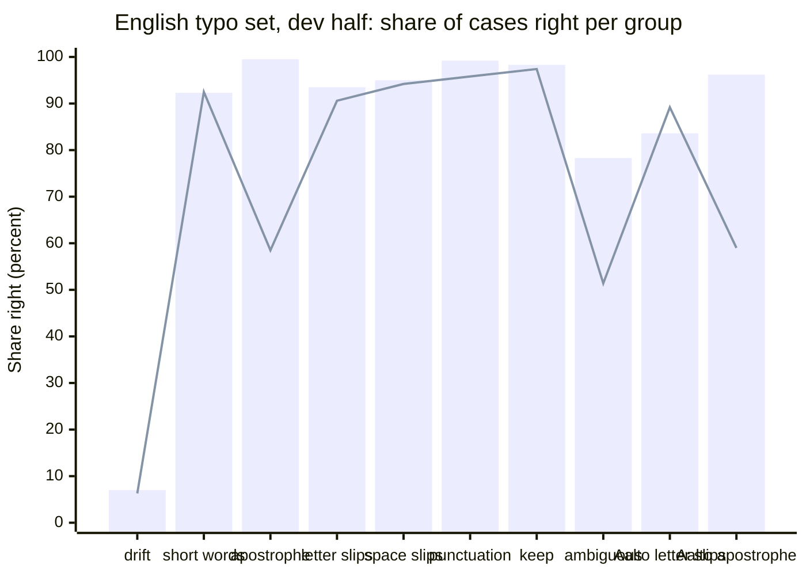

# Typo set: baseline of the build 44 code

## Summary

The typo set of `docs/typo-set-design.md` measures the keyboard code of build 44 on the dev
half. The test half stays unread, for decisions only. All numbers come from the workflow runs on
commit `cbf1d3f`, whose keyboard code is the code of build 44 (commit `29b7427`).

- Whole-word drift is almost never repaired: 0 of 300 full drifts and 0 of 60 drifted phrases,
  with or without the language model. The engine never reads "yjod" as "this".
- The model repairs missing apostrophes well: 199 of 200 generated cases, against 117 for the
  engine alone.
- The model takes back many corrections when the person types the next word. In the real
  errors of the Aalto study, 94 cases that the engine alone repaired go back to the typed slip
  after the next word, as "thst" does.
- Pinyin with a drift is repaired in 2 of 200 cases. The fuzzy pair n and l is repaired in 4 of 50.

Table 1. The runs. Each run types the dev half.

| Workflow | Run | Commit | Result |
| --- | --- | --- | --- |
| Typing evaluation | 43660531982 | `cbf1d3f` | success |
| Language model in the keyboard | 43660532027 | `cbf1d3f` | success |

Table 2. The names of the runs in the tables below.

| Name | What runs |
| --- | --- |
| engine alone | `Engine/duo_engine.c` through the keyboard's correction rules with the work area on. The Typing evaluation run, the two harness runs and the simulator give the same output for every case. |
| keyboard with the model | `TypingEvaluationTests` on the iOS simulator: the shipping Swift code with the SmolLM2 file and the tuned rule. Its outputs equal the macOS harness on the same runner for every case. |
| x86 harness | `run_typos.py` with the model on the ubuntu-24.04 runner. llama.cpp computes other last digits on this processor, so 7 generated and 12 Aalto cases differ from the keyboard. |

Figure 1. The bars are the keyboard with the model, the line is the engine alone, on one scale
from 0 to 100 percent. The model raises the apostrophe groups most, and it lowers the real
letter slips of the Aalto study.

## English cases generated from Tatoeba

Table 3. Right cases of `english-typos.dev.jsonl` per group, category and stratum. "Next words
typed" holds the cases with one or two words typed after the slip word.

| Count | Cases | Engine alone | Keyboard with the model | x86 harness with the model |
| --- | --- | --- | --- | --- |
| group `drift` | 540 | 34 | 38 | 37 |
| group `short_words` | 400 | 370 | 369 | 369 |
| group `apostrophe` | 200 | 117 | 199 | 199 |
| group `letter_slips` | 480 | 435 | 449 | 449 |
| group `space_slips` | 240 | 226 | 228 | 228 |
| group `punctuation` | 120 | 115 | 119 | 119 |
| group `keep` | 350 | 341 | 344 | 343 |
| group `ambiguous` | 253 | 130 | 198 | 198 |
| `drift_full_left` | 60 | 0 | 0 | 0 |
| `drift_full_right` | 60 | 0 | 0 | 0 |
| `drift_full_up` | 60 | 0 | 0 | 0 |
| `drift_full_down` | 60 | 0 | 0 | 0 |
| `drift_partial_left` | 60 | 4 | 7 | 7 |
| `drift_partial_right` | 60 | 12 | 13 | 13 |
| `drift_partial_up` | 60 | 8 | 8 | 7 |
| `drift_partial_down` | 60 | 10 | 10 | 10 |
| `drift_phrase` | 60 | 0 | 0 | 0 |
| `short_word_neighbor` | 150 | 132 | 129 | 129 |
| `short_word_transposition` | 100 | 93 | 95 | 95 |
| `short_word_listed` | 150 | 145 | 145 | 145 |
| `apostrophe_missing` | 200 | 117 | 199 | 199 |
| `letter_omitted` | 120 | 101 | 107 | 107 |
| `letter_added` | 120 | 116 | 117 | 117 |
| `letter_doubled` | 120 | 113 | 115 | 115 |
| `letters_swapped` | 120 | 105 | 110 | 110 |
| `space_missing_common` | 120 | 111 | 110 | 110 |
| `space_extra` | 120 | 115 | 118 | 118 |
| `punctuation_after_slip` | 120 | 115 | 119 | 119 |
| `keep_near_common` | 150 | 142 | 147 | 146 |
| `keep_clean_short` | 120 | 119 | 118 | 118 |
| `keep_clean_punctuation` | 80 | 80 | 79 | 79 |
| `ambiguous_apostrophe_keep` | 113 | 113 | 112 | 112 |
| `ambiguous_apostrophe_correct` | 140 | 17 | 86 | 86 |
| next words typed | 976 | 609 | 706 | 705 |
| slip word alone | 1,607 | 1,159 | 1,238 | 1,237 |
| wide layout | 1,303 | 882 | 970 | 970 |
| compact layout | 1,280 | 886 | 974 | 972 |

The more letters a drift moves, the fewer cases any run repairs: a partial drift gets 4 to 13 of
60, and a full drift 0 of 60 in each direction. The wide and the compact layout give the same
share.

## English cases from the Aalto mobile study

Table 4. Right cases of `english-typos-aalto.dev.jsonl`: real errors that volunteers left in
their text, on their own phones, without autocorrection.

| Count | Cases | Engine alone | Keyboard with the model | x86 harness with the model |
| --- | --- | --- | --- | --- |
| group `real_letter_slips` | 925 | 825 | 773 | 770 |
| group `real_apostrophe` | 156 | 92 | 150 | 149 |
| group `real_ambiguous` | 96 | 6 | 58 | 58 |
| group `real_real_word` | 200 | 38 | 52 | 51 |
| group `real_two_or_more` | 200 | 99 | 100 | 99 |
| group `real_drift` | 16 | 7 | 5 | 5 |
| `real_aalto_neighbor` | 200 | 178 | 171 | 170 |
| `real_aalto_omitted` | 200 | 165 | 154 | 152 |
| `real_aalto_added` | 200 | 180 | 163 | 164 |
| `real_aalto_doubled` | 125 | 117 | 114 | 114 |
| `real_aalto_swapped` | 200 | 185 | 171 | 170 |
| `real_aalto_apostrophe` | 156 | 92 | 150 | 149 |
| `real_aalto_apostrophe_ambiguous` | 96 | 6 | 58 | 58 |
| `real_aalto_real_word` | 200 | 38 | 52 | 51 |
| `real_aalto_two_or_more` | 200 | 99 | 100 | 99 |
| `real_aalto_drift` | 16 | 7 | 5 | 5 |
| next words typed | 656 | 404 | 376 | 373 |
| slip word alone | 937 | 663 | 762 | 759 |

With the slip word alone the model adds 99 right cases. With the next words typed it loses 28.

Table 5. Cases where the keyboard with the model and the engine alone differ in being right.

| Set | Next words typed | Model right, engine wrong | Engine right, model wrong: back to the typed slip | Engine right, model wrong: other text |
| --- | --- | --- | --- | --- |
| generated | no | 89 | 0 | 10 |
| generated | yes | 124 | 26 | 1 |
| Aalto | no | 106 | 2 | 5 |
| Aalto | yes | 67 | 94 | 1 |

The model's losses are almost all one kind: the corrected word goes back to the slip that the
person typed, after the person types the next word.

## Pinyin cases

Table 6. Right cases of `pinyin-typos.dev.jsonl` and `pinyin-typos-cscd.dev.jsonl`. "C engine"
is `duo_cli` in the Pinyin mode. "Keyboard" is `PinyinEngine.candidates` of the shipping Swift
code on the simulator, which adds its own dictionary reading. The last column counts the slip
cases whose clean twin the keyboard converts right.

| Count | Cases | C engine | Keyboard | Keyboard, right of the cases with the twin right |
| --- | --- | --- | --- | --- |
| group `clean` | 1,102 | 730 | 730 | |
| group `finger_slips` | 450 | 250 | 245 | 245 of 310 |
| group `drift` | 200 | 2 | 2 | 2 of 126 |
| group `fuzzy` | 350 | 125 | 125 | 125 of 229 |
| group `split` | 120 | 41 | 71 | 67 of 81 |
| `pinyin_neighbor` | 150 | 94 | 92 | |
| `pinyin_omitted` | 100 | 42 | 42 | |
| `pinyin_added` | 100 | 68 | 65 | |
| `pinyin_swapped` | 100 | 46 | 46 | |
| `pinyin_drift_word` | 100 | 0 | 0 | |
| `pinyin_drift_partial` | 100 | 2 | 2 | |
| `pinyin_fuzzy_z_zh` | 50 | 21 | 21 | |
| `pinyin_fuzzy_c_ch` | 50 | 19 | 19 | |
| `pinyin_fuzzy_s_sh` | 50 | 18 | 18 | |
| `pinyin_fuzzy_n_l` | 50 | 4 | 4 | |
| `pinyin_fuzzy_an_ang` | 50 | 19 | 19 | |
| `pinyin_fuzzy_en_eng` | 50 | 27 | 27 | |
| `pinyin_fuzzy_in_ing` | 50 | 17 | 17 | |
| `pinyin_split_apostrophe` | 60 | 0 | 30 | |
| `pinyin_split_plain` | 60 | 41 | 41 | |
| CSCD-NS group `real_clean` | 297 | 161 | 161 | |
| CSCD-NS group `real_slips` | 300 | 81 | 81 | 81 of 164 |
| `pinyin_cscd_fuzzy` | 171 | 50 | 50 | |
| `pinyin_cscd_neighbor` | 45 | 11 | 11 | |
| `pinyin_cscd_omitted` | 43 | 9 | 9 | |
| `pinyin_cscd_added` | 39 | 11 | 11 | |
| `pinyin_cscd_swapped` | 2 | 0 | 0 | |

The C engine takes no apostrophe, so it gets 0 of 60 cases typed with "'". The keyboard reads
those with its own dictionary and gets 30. Among the slip cases whose clean clause the keyboard
converts right, it repairs 245 of 310 finger slips and 2 of 126 drifts.

## Causes in the code

These causes come from reading the code at commit `29b7427` and from runs of the Linux harness
(`scripts/lm-rerank/rerank.py` with `lm_score` and the shipped model) on the desktop. The numbers
of a single correction below are desktop numbers. The harness gives the same outputs as the
keyboard on the same machine. Nothing in this branch changes the cause.

### "yjod" gets no reading "this"

1. The engine reads a word only within a slip budget. A word of 2 to 4 letters may hold slips
   up to `short_word_budget` 5.6, and a longer word up to `long_word_budget` 11.0
   (`Engine/duo_engine.c:313-314`, used at `Engine/duo_engine.c:594`).
2. A neighbor key costs `adjacent_substitution` 4.5 (`Engine/duo_engine.c:303`, applied at
   `Engine/duo_engine.c:484`). "yjod" for "this" is four neighbor keys: 18.0, above 5.6. The walk
   of the letter tree also stops a branch whose cheapest row passes 11.0
   (`Engine/duo_engine.c:646`), so after three wrong keys the branch of "this" ends.
3. The language model only re-ranks the engine's readings (`Shared/EnglishReranking.swift:202-212`).
   The readings of "yjod" are "yjod", "you'd", "yod", "synod" and four splits such as "y joe", so
   the model can pick none that is "this".

The same budget explains every full drift and drifted phrase in Table 3. A partial drift of two
letters costs 9.0, within the long budget, which is why some partial drifts of longer words are
repaired.

### "thst" goes back to "thst"

"thst" alone becomes "that" in the engine and with the model. The keyboard corrects "thst" at the
space, then reads it again when the next word ends:

1. `Shared/KeyboardTextController.swift:906-911` joins the earlier typed word and the new word into
   one span, "thst is", when the person typed them with one space between.
2. The model reads the span in the typed format "I think | thst is |"
   (`Shared/EnglishReranking.swift:70-82`). The fine-tune gives the text as typed a high score in
   this format: "thst is" gets a log probability of -1.41, and "that is" gets -17.17.
3. The rule adds 1.5 times the model score to the engine score
   (`Shared/KeyboardLanguageModel.swift:140-142`). "thst is" gets -22.24 + 1.5 x -1.41 = -24.36,
   and the engine's choice "that is" gets -5.51 + 1.5 x -17.17 = -31.27. The lead of 6.9 passes
   `marginToTyped` 4 (`Shared/EnglishReranking.swift:210-212`), so the field goes back to
   "thst is".

So "i think thst is right" ends as "i think thst is right". The engine alone gives "that is
right". Table 5 shows the same step in 26 generated and 94 Aalto cases.

### "dont" does not become "don't"

The keyboard with the model corrects "dont" in all 35 dev cases of the typo set that start with
it. The runs did not reproduce "dont" left as typed. The code holds three ways to the reported behavior:

1. Engine alone, with the next word typed: "dont know" becomes "do not know". The engine's word
   pairs come from a list without contractions (`scripts/typing-engine/build_english_lexicon.py:4`,
   and the note at `scripts/lm-rerank/rerank.py:343-345`), so "do not" + "not know" get listed
   pairs and "don't know" gets none. "do not know" scores -13.67 and "don't know" -15.46. The
   keyboard uses the engine alone while the model loads, after a memory warning frees it, or when
   it did not load (`Shared/KeyboardLanguageModel.swift:270-276`, `Keyboard/KeyboardViewController.swift:77-79`).
   The engine alone gets 117 of 200 `apostrophe_missing` cases, and the model 199.
2. The step of "thst" above, for a contraction typed without its apostrophe: "im taking" and
   "hes seen" go back to the typed text after the next word. Only the apostrophe step
   (`Shared/EnglishReranking.swift:215`) brings such a word back, when its lead is 0.5 or more.
3. A word that the person once brought back after a correction stays as typed for good:
   `undoLastCorrection` stores it (`Shared/KeyboardTextController.swift:976`), and
   `correctLastWord` then skips it (`Shared/KeyboardTextController.swift:900`, `:955`). One
   backspace after "dont" became "don't" keeps "dont" from then on. The tests cannot see this
   store, because each run starts with an empty store.

### Pinyin

- A Pinyin drift of two syllables moves 4 to 8 letters at 4.5 each, above both budgets, as in
  English (`Engine/duo_engine.c:594`, `Engine/duo_engine.c:343-365` for the Pinyin costs).
- n and l are not neighbor keys, so "lai" for "nai" costs `far_substitution` 9.0
  (`Engine/duo_engine.c:304`, `:484`), above the short budget. A fuzzy pair with "h" costs one
  left-out or extra letter, 4.0 or 5.5, which is why z, c and s pairs get 18 to 21 of 50.

## Existing outputs

The typo-set steps and jobs leave every existing output as it was.

Table 7. Case-by-case comparison with the reference runs of the build 44 code, by
`scripts/typing-evaluation/typo-set/check_unchanged.py`.

| Workflow | Reference run | This run | Files compared | Same | Differ |
| --- | --- | --- | --- | --- | --- |
| Typing evaluation | 43577930323 | 43660531982 | 6 | 6 | 0 |
| Language model in the keyboard, jobs keyboard, macOS harness and ARM harness | 43577907274 | 43660532027 | 32 | 32 | 0 |
| Language model in the keyboard, x86 harness | 43577907274 | 43660532027 | 6 | 2 | 4 |

Every output of the keyboard is the same as in the reference run: the English, symbol, domain,
apostrophe and Pinyin outputs case by case, the traces of every correction, and every summary.
The macOS and ARM harnesses give the same requests, answers, outputs and traces byte for byte.

The four files of the x86 harness differ because the two runs had other processors. The
reference run had an AMD EPYC 7763, and this run an AMD EPYC 9V74. Both runs send the same
13,928 requests, byte for byte (`requests.tsv`). llama.cpp computes other last digits on each
processor, so the answers differ, and 41 of 14,626 choices and 21 of 13,936 outputs follow. Every
reading, engine score and mark of the trace is the same. This run gives the published x86 numbers
of `scripts/lm-keyboard/compare.py` exactly, with the model 957, 2053, 1388, 1164, 429 and 6539.
The reference run gave 2052, 1387 and 6538 in three of them.

The job "Keyboard against the harness on its own machine" passed: the keyboard and the macOS
harness agree on every case. The new job "Typo set, keyboard against the harness" passed in the
same way on the typo set: 0 outputs differ, and all 3,999 and 2,517 corrections that went to the
model have the same choice.

The files that hold times, memory or machine names are not compared: logs, `runner.txt`,
`result.json`, the reports of `compare.py`, `*.reranker.txt` and `language-model-test-simulator.txt`.
