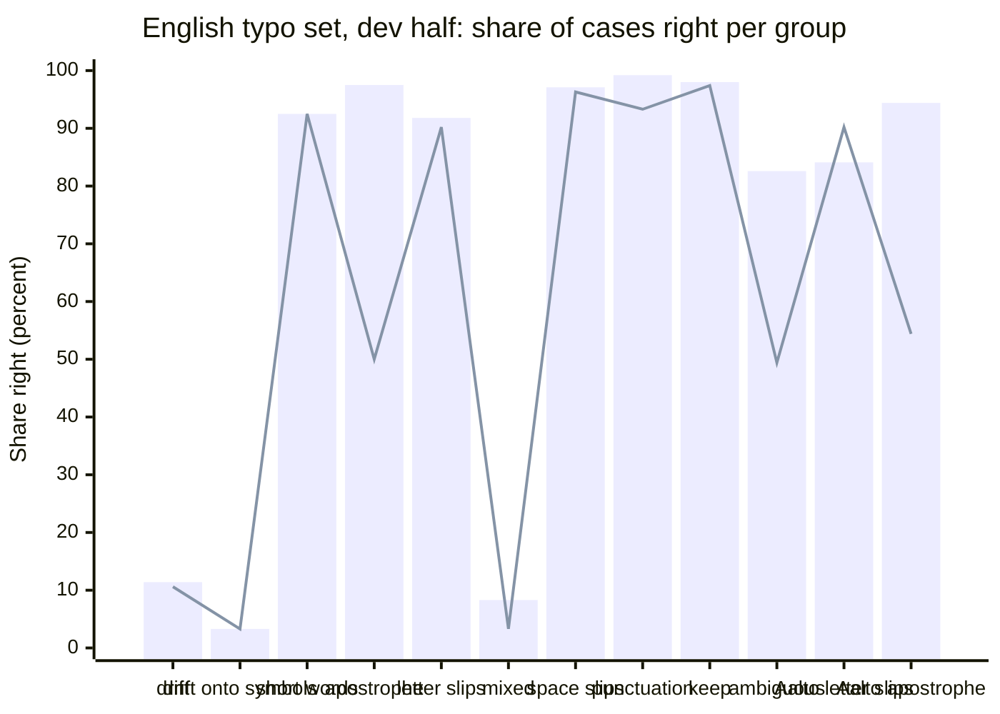

# Typo set: baseline of the build 44 code

## Summary

The typo set of `docs/typo-set-design.md` measures the keyboard code of build 44 on the dev
half. The test half stays unread, for decisions only. All numbers come from the workflow runs on
commit `d7b9758`, whose keyboard code is the code of build 44 (commit `29b7427`).
`scripts/typing-evaluation/typo-set/results_tables.py` writes the tables from the artifacts of
run 43683283633.

- Whole-word drift is never repaired, with or without the language model. The runs repair 0 of
  240 full drifts, 0 of 60 drifted phrases and 0 of 60 drifts that run on into the next word. A
  drift of the last two letters, the only drift in the real data, is repaired in 28 of 60 cases.
- The model repairs missing apostrophes well: 195 of 200 generated cases, against 100 for the
  engine alone.
- The model takes back corrections when the person types the next word. In 147 cases of
  `short_word_listed_next`, as "i think thst is right", the model gets 129 right and the engine
  alone 137. In the real errors of the Aalto study, 96 cases that the engine alone repaired go
  back to the typed slip after the next word.
- Pinyin with a drift is repaired in 7 of 200 cases. Each of the fuzzy pairs n and l, f and h,
  r and l, and u and v is repaired in 3 to 7 of 50 cases.

Table 1. The runs. Each run types the dev half.

| Workflow | Run | Commit | Result |
| --- | --- | --- | --- |
| Typing evaluation | 43683283682 | `d7b9758` | success |
| Language model in the keyboard | 43683283633 | `d7b9758` | success |

Table 2. The names of the runs in the tables below.

| Name | What runs |
| --- | --- |
| engine alone | `Engine/duo_engine.c` through the keyboard's correction rules with the work area on. The simulator, the macOS harness, the x86 harness and the Typing evaluation run give the same output for every English case: 0 of 5,356 differ. |
| keyboard with the model | `TypingEvaluationTests` on the iOS simulator: the shipping Swift code with the SmolLM2 file and the tuned rule. Its outputs equal the macOS harness on the same runner for every case. |
| x86 harness | `run_typos.py` with the model on the ubuntu-24.04 runner. llama.cpp computes other last digits on this processor, so 16 generated, 4 sentence-case and 10 Aalto cases differ from the keyboard. |

Figure 1. The bars are the keyboard with the model, the line is the engine alone, on one scale
from 0 to 100 percent. The model raises the apostrophe groups most, and it lowers the real
letter slips of the Aalto study.

## English cases generated from Tatoeba

Table 3. Right cases of `english-typos.dev.jsonl` per group, category and stratum. "Next words
typed" holds the cases with one or two words typed after the slip word. "A rival word" holds the
slip cases with a rival word (design, Terms).

| Count | Cases | Engine alone | Keyboard with the model | x86 harness with the model |
| --- | --- | --- | --- | --- |
| all cases | 3,147 | 2,029 | 2,240 | 2,239 |
| group `drift` | 660 | 70 | 75 | 75 |
| group `drift_symbols` | 60 | 2 | 2 | 2 |
| group `short_words` | 544 | 503 | 503 | 503 |
| group `apostrophe` | 200 | 100 | 195 | 195 |
| group `letter_slips` | 600 | 541 | 551 | 548 |
| group `mixed` | 120 | 4 | 10 | 10 |
| group `space_slips` | 240 | 231 | 233 | 234 |
| group `punctuation` | 120 | 112 | 119 | 119 |
| group `keep` | 350 | 341 | 343 | 344 |
| group `ambiguous` | 253 | 125 | 209 | 209 |
| `drift_full_left` | 60 | 0 | 0 | 0 |
| `drift_full_right` | 60 | 0 | 0 | 0 |
| `drift_full_up` | 60 | 0 | 0 | 0 |
| `drift_full_down` | 60 | 0 | 0 | 0 |
| `drift_partial_left` | 60 | 9 | 10 | 10 |
| `drift_partial_right` | 60 | 8 | 9 | 9 |
| `drift_partial_up` | 60 | 18 | 19 | 19 |
| `drift_partial_down` | 60 | 9 | 9 | 9 |
| `drift_end_two` | 60 | 26 | 28 | 28 |
| `drift_phrase` | 60 | 0 | 0 | 0 |
| `drift_run_on` | 60 | 0 | 0 | 0 |
| `drift_onto_symbols` | 60 | 2 | 2 | 2 |
| `short_word_neighbor` | 150 | 133 | 136 | 136 |
| `short_word_transposition` | 100 | 94 | 93 | 93 |
| `short_word_listed` | 147 | 139 | 145 | 144 |
| `short_word_listed_next` | 147 | 137 | 129 | 130 |
| `apostrophe_missing` | 200 | 100 | 195 | 195 |
| `letter_neighbor` | 120 | 105 | 103 | 102 |
| `letter_omitted` | 120 | 96 | 99 | 98 |
| `letter_added` | 120 | 111 | 116 | 115 |
| `letter_doubled` | 120 | 118 | 117 | 117 |
| `letters_swapped` | 120 | 111 | 116 | 116 |
| `drift_then_slip` | 60 | 2 | 2 | 2 |
| `drift_and_omission` | 60 | 2 | 8 | 8 |
| `space_missing_common` | 120 | 115 | 116 | 116 |
| `space_extra` | 120 | 116 | 117 | 118 |
| `punctuation_after_slip` | 120 | 112 | 119 | 119 |
| `keep_near_common` | 150 | 141 | 144 | 144 |
| `keep_clean_short` | 120 | 120 | 119 | 120 |
| `keep_clean_punctuation` | 80 | 80 | 80 | 80 |
| `ambiguous_apostrophe_keep` | 113 | 112 | 111 | 111 |
| `ambiguous_apostrophe_correct` | 140 | 13 | 98 | 98 |
| next words typed | 1,354 | 827 | 949 | 948 |
| slip word alone | 1,793 | 1,202 | 1,291 | 1,291 |
| slip cases with a rival word | 312 | 93 | 220 | 220 |
| slip cases without a rival word | 2,372 | 1,483 | 1,566 | 1,564 |
| `drift_onto_symbols`, the keyboard reads the word | 13 | 2 | 2 | 2 |
| `drift_onto_symbols`, the keyboard does not read the word | 47 | 0 | 0 | 0 |
| wide layout | 1,648 | 1,062 | 1,171 | 1,172 |
| compact layout | 1,499 | 967 | 1,069 | 1,067 |

The more letters a drift moves, the fewer cases any run repairs. A drift of the last two letters
gets 26 to 28 of 60, and a partial drift 8 to 19 of 60. A full drift gets 0 of 60 in each
direction.
The wide and the compact layout give about the same share.

### Sentence case

Table 4. Right cases of `english-typos-capitals.dev.jsonl`, typed in a field that capitalizes
sentences.

| Count | Cases | Engine alone | Keyboard with the model | x86 harness with the model |
| --- | --- | --- | --- | --- |
| all cases | 747 | 501 | 678 | 678 |
| `short_word_listed` | 147 | 139 | 145 | 144 |
| `short_word_listed_next` | 147 | 137 | 129 | 130 |
| `apostrophe_missing` | 200 | 100 | 195 | 195 |
| `ambiguous_apostrophe_keep` | 113 | 112 | 111 | 111 |
| `ambiguous_apostrophe_correct` | 140 | 13 | 98 | 98 |

Every category gives the same count as its lower-case cases in Table 3. So "Dont", "Thst" and a
context with "I" change no result of these categories.

### What the model changes

Table 5. Cases where the keyboard with the model and the engine alone differ in being right.

| Set | Next words typed | Model right, engine wrong | Engine right, model wrong: back to the typed slip | Engine right, model wrong: other text |
| --- | --- | --- | --- | --- |
| generated | no | 96 | 0 | 7 |
| generated | yes | 166 | 42 | 2 |
| sentence case | no | 45 | 0 | 2 |
| sentence case | yes | 151 | 17 | 0 |
| Aalto | no | 76 | 2 | 4 |
| Aalto | yes | 47 | 96 | 0 |

The model's losses are almost all one kind. After the person types the next word, the corrected
word goes back to the typed slip. With the listed slips typed before a next
word, the generated cases show this step in 42 cases. The Aalto cases show it in 96.

## English cases from the Aalto mobile study

Table 6. Right cases of `english-typos-aalto.dev.jsonl`: real errors that volunteers left in
their text, on their own phones, without autocorrection.

| Count | Cases | Engine alone | Keyboard with the model | x86 harness with the model |
| --- | --- | --- | --- | --- |
| all cases | 1,462 | 1,045 | 1,066 | 1,063 |
| group `real_letter_slips` | 910 | 821 | 765 | 764 |
| group `real_apostrophe` | 90 | 49 | 85 | 84 |
| group `real_ambiguous` | 48 | 2 | 19 | 19 |
| group `real_real_word` | 200 | 57 | 85 | 85 |
| group `real_two_or_more` | 200 | 110 | 108 | 107 |
| group `real_drift` | 14 | 6 | 4 | 4 |
| `real_aalto_neighbor` | 200 | 187 | 177 | 176 |
| `real_aalto_omitted` | 200 | 169 | 156 | 156 |
| `real_aalto_added` | 200 | 178 | 164 | 165 |
| `real_aalto_doubled` | 110 | 104 | 102 | 102 |
| `real_aalto_swapped` | 200 | 183 | 166 | 165 |
| `real_aalto_apostrophe` | 90 | 49 | 85 | 84 |
| `real_aalto_apostrophe_ambiguous` | 48 | 2 | 19 | 19 |
| `real_aalto_real_word` | 200 | 57 | 85 | 85 |
| `real_aalto_two_or_more` | 200 | 110 | 108 | 107 |
| `real_aalto_drift` | 14 | 6 | 4 | 4 |
| next words typed | 644 | 421 | 372 | 372 |
| slip word alone | 818 | 624 | 694 | 691 |

With the slip word alone the model adds 70 right cases. With the next words typed it loses 49.

## Pinyin cases

Table 7. Right cases of `pinyin-typos.dev.jsonl` and `pinyin-typos-cscd.dev.jsonl`. "C engine"
is `duo_cli` in the Pinyin mode. "Keyboard" is `PinyinEngine.candidates` of the shipping Swift
code on the simulator, which adds its own dictionary reading. The last column counts the slip
cases whose clean twin the keyboard converts right.

| Count | Cases | C engine | Keyboard | Keyboard, right of the cases with the twin right |
| --- | --- | --- | --- | --- |
| group `clean` | 1,318 | 913 | 913 | |
| group `finger_slips` | 450 | 255 | 248 | 248 of 322 |
| group `drift` | 200 | 7 | 7 | 7 of 139 |
| group `fuzzy` | 600 | 172 | 172 | 172 of 412 |
| group `mixed` | 50 | 12 | 12 | 12 of 33 |
| group `split` | 60 | 0 | 28 | 24 of 35 |
| `pinyin_neighbor` | 150 | 84 | 82 | |
| `pinyin_omitted` | 100 | 39 | 39 | |
| `pinyin_added` | 100 | 72 | 68 | |
| `pinyin_swapped` | 100 | 60 | 59 | |
| `pinyin_drift_word` | 100 | 0 | 0 | |
| `pinyin_drift_partial` | 100 | 7 | 7 | |
| `pinyin_fuzzy_z_zh` | 50 | 19 | 19 | |
| `pinyin_fuzzy_c_ch` | 50 | 21 | 21 | |
| `pinyin_fuzzy_s_sh` | 50 | 27 | 27 | |
| `pinyin_fuzzy_n_l` | 50 | 3 | 3 | |
| `pinyin_fuzzy_f_h` | 50 | 5 | 5 | |
| `pinyin_fuzzy_r_l` | 50 | 7 | 7 | |
| `pinyin_fuzzy_an_ang` | 50 | 17 | 17 | |
| `pinyin_fuzzy_ian_iang` | 50 | 11 | 11 | |
| `pinyin_fuzzy_uan_uang` | 50 | 16 | 16 | |
| `pinyin_fuzzy_en_eng` | 50 | 22 | 22 | |
| `pinyin_fuzzy_in_ing` | 50 | 18 | 18 | |
| `pinyin_fuzzy_u_v` | 50 | 6 | 6 | |
| `pinyin_fuzzy_and_neighbor` | 50 | 12 | 12 | |
| `pinyin_split_apostrophe` | 60 | 0 | 28 | |
| clean clauses whose longest-first cut differs | 93 | 52 | 52 | |
| slip cases whose typed letters parse as standard syllables | 807 | 222 | 250 | |
| slip cases whose typed letters do not parse so | 553 | 224 | 217 | |
| CSCD-NS group `real_clean` | 297 | 153 | 153 | |
| CSCD-NS group `real_slips` | 300 | 78 | 78 | 78 of 155 |
| `pinyin_cscd_fuzzy` | 179 | 47 | 47 | |
| `pinyin_cscd_neighbor` | 53 | 14 | 14 | |
| `pinyin_cscd_omitted` | 34 | 8 | 8 | |
| `pinyin_cscd_added` | 32 | 9 | 9 | |
| `pinyin_cscd_swapped` | 2 | 0 | 0 | |

The C engine takes no apostrophe, so it gets 0 of 60 cases typed with "'". The keyboard reads
those with its own dictionary and gets 28. Among the slip cases whose clean clause the keyboard
converts right, it repairs 248 of 322 finger slips and 7 of 139 drifts. The keyboard and the C
engine give other outputs in 71 cases of `pinyin-typos` and in no case of `pinyin-typos-cscd`.

## Causes in the code

These causes come from reading the code at commit `29b7427`, and from runs of the Linux harness
on the desktop. The harness is `scripts/lm-rerank/rerank.py` with `lm_score` and the shipped
model. The numbers
of a single correction below are desktop numbers. The harness gives the same outputs as the
keyboard on the same machine. The typo set changes no code of the keyboard.

### A drift onto a digit or symbol key never reaches the engine

`correctableWord` (`Shared/KeyboardTextLogic.swift:227-268`) reads a word only when it holds one
digit or symbol key at most (lines 253-259). That key must be a digit or "[" (`symbolsInsideWords`,
line 218, read at line 232). It can also be one of "-", ";", "," and "." in front of the word
(lines 236-241). A word such as "=pw7e"
or "3wj6" gets no reading, and the keyboard keeps it as typed. 47 of the 60 cases of
`drift_onto_symbols` are such words, and the keyboard repairs none of them. Of the 13 words that
it reads, it repairs 2.

### "yjod" gets no reading "this"

1. The engine reads a word only within a slip budget (`Engine/duo_engine.c:313-314`, used at
   `Engine/duo_engine.c:594`). A word of 2 to 4 letters may hold slips up to `short_word_budget`
   5.6, and a longer word up to `long_word_budget` 11.0.
2. A neighbor key costs `adjacent_substitution` 4.5 (`Engine/duo_engine.c:303`, applied at
   `Engine/duo_engine.c:484`). "yjod" for "this" is four neighbor keys: 18.0, above 5.6. The walk
   of the letter tree also stops a branch whose cheapest row passes 11.0
   (`Engine/duo_engine.c:646`). So the branch of "this" ends after three wrong keys.
3. The language model only re-ranks the engine's readings (`Shared/EnglishReranking.swift:202-212`).
   The readings of "yjod" are "yjod", "you'd", "yod", "synod" and four splits such as "y joe", so
   the model can pick none that is "this".

The same budget explains every full drift, drifted phrase and run-on drift of letters in Table 3.
A drift of two letters costs 9.0, within the long budget, which is why `drift_end_two` and some
partial drifts of longer words are repaired.

### "thst" goes back to "thst"

"thst" alone becomes "that" in the engine and with the model. The keyboard corrects "thst" at the
space, then reads it again when the next word ends:

1. `Shared/KeyboardTextController.swift:906-911` joins the earlier typed word and the new word into
   one span, "thst is", when the person typed them with one space between.
2. The model reads the span in the typed format "I think | thst is |"
   (`Shared/EnglishReranking.swift:70-82`). The fine-tune gives the text as typed a high score in
   this format. For "thst is" the log probability is -0.72 and the score of the space after it
   -0.69, together -1.41. For "that is" they are -14.39 and -2.77, together -17.16.
3. The rule adds 1.5 times that sum to the engine score (`Shared/EnglishReranking.swift:186-187`,
   with the weight of `Shared/KeyboardLanguageModel.swift:140-142`). "thst is" gets -22.24 + 1.5 x
   -1.41 = -24.36, and the engine's choice "that is" gets -5.51 + 1.5 x -17.16 = -31.25. The lead
   of 6.89 passes `marginToTyped` 4 (`Shared/EnglishReranking.swift:209-215`), so the field goes
   back to "thst is".

So "i think thst is right" ends as "i think thst is right". The engine alone gives "that is
right". `short_word_listed_next` holds such cases: the model gets 129 of 147 right, against 137
for the engine alone. Table 5 shows the same step in 42 generated and 96 Aalto cases.

### "dont" does not become "don't"

The keyboard with the model corrects "dont" in every dev case of `apostrophe_missing` that types
it. The runs did not reproduce "dont" left as typed. The code holds three ways to the reported
behavior:

1. Engine alone, with the next word typed: "dont know" becomes "do not know". The engine's word
   pairs hold no contraction (the note at `scripts/lm-rerank/rerank.py:343-345`), so "do not" and
   "not know" get listed pairs and "don't know" gets none. "do not know" scores -13.67 and "don't
   know" -15.46. The keyboard uses the engine alone while the model loads, after a memory warning
   frees it, or when it did not load (`Shared/KeyboardLanguageModel.swift:270-276`,
   `Keyboard/KeyboardViewController.swift:77-79`). The engine alone gets 100 of 200
   `apostrophe_missing` cases, and the model 195.
2. The step of "thst" above also takes back a contraction typed without its apostrophe. "im
   taking" and "hes seen" go back to the typed text after the next word. Only the apostrophe step
   (`Shared/EnglishReranking.swift:215`) brings such a word back, when its lead is 0.5 or more.
3. A word that the person once brought back after a correction stays as typed for good.
   `undoLastCorrection` stores it (`Shared/KeyboardTextController.swift:976`). `correctLastWord`
   then skips it (`Shared/KeyboardTextController.swift:900`, `:955`). One
   backspace after "dont" became "don't" keeps "dont" from then on. The tests cannot see this
   store, because each run starts with an empty store.

### Pinyin

- A Pinyin drift of two syllables moves 4 to 8 letters at 4.5 each, above both budgets, as in
  English. The budget is read at `Engine/duo_engine.c:594`, and the Pinyin costs are at
  `Engine/duo_engine.c:343-365`.
- n and l are not neighbor keys, so "lai" for "nai" costs `far_substitution` 9.0
  (`Engine/duo_engine.c:304`, `:484`). That is above the short budget. f and h, r and l, and u
  and v are not neighbor keys either, and these pairs get 3 to 7 of 50.
- A fuzzy pair with "h" costs one left-out or extra letter, 4.0 or 5.5. So the z, c and s pairs
  get 19 to 27 of 50.

## Existing outputs

The typo-set jobs leave every existing output as it was. In each workflow the job "Typo set, the
existing outputs against the reference run of the build 44 code" runs
`scripts/typing-evaluation/typo-set/check_unchanged.py`. Table 8 gives its reports.

Table 8. Case-by-case comparison with the reference runs of the build 44 code.

| Workflow | Reference run | This run | Files compared | Same | Differ | Differ where allowed |
| --- | --- | --- | --- | --- | --- | --- |
| Typing evaluation | 43577930323 | 43683283682 | 6 | 6 | 0 | 0 |
| Language model in the keyboard | 43577907274 | 43683283633 | 41 | 41 | 0 | 0 |

Every output of the keyboard is the same as in the reference run. These are the English,
symbol, domain, apostrophe and Pinyin outputs case by case, the traces and every summary. The
files of the x86 harness are the same too. Both runs had an AMD EPYC 7763 (`runner.txt`). The
check lets these files differ, because llama.cpp computes other last digits on another
processor.

The job "Keyboard against the harness on its own machine" compares the existing cases. The job
"Typo set, keyboard against the harness on its own machine and the engine alone on Linux" passed
on the typo set. The keyboard and the macOS harness agree on every case. All 5,256, 1,445 and
2,383 corrections that went to the model have the same choice. The engine alone gives the
same output on the simulator and on the x86 harness for every case.

The files that hold times, memory or machine names are not compared: logs, `runner.txt`,
`result.json`, the `report.md` and `differences.json` of `scripts/lm-keyboard/compare.py`,
`*.reranker.txt` and `language-model-test-simulator.txt`.
