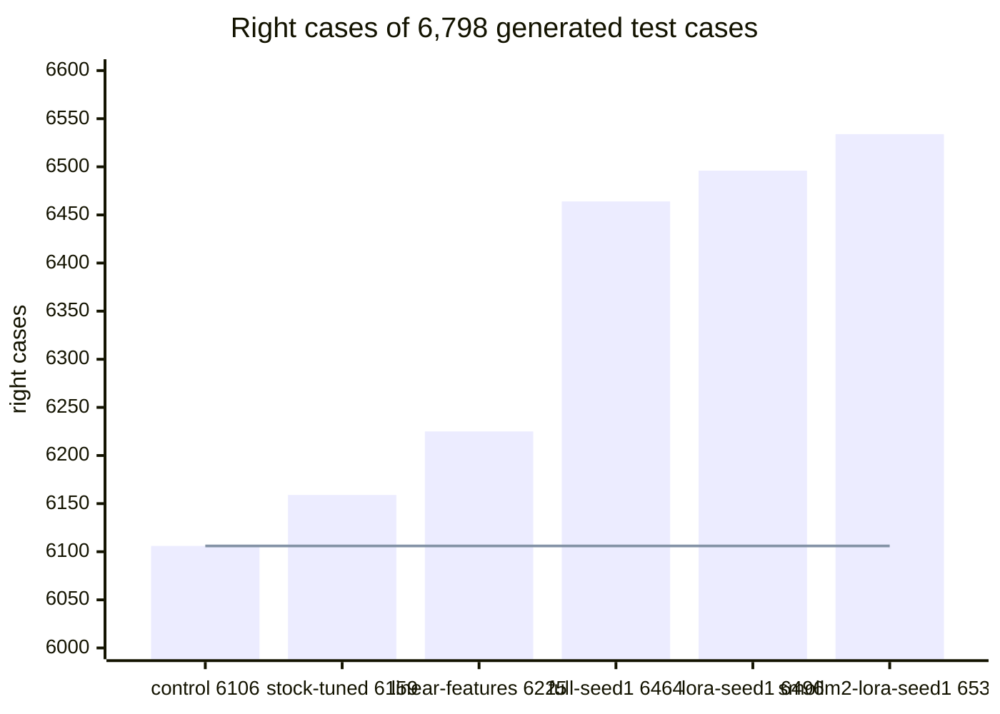
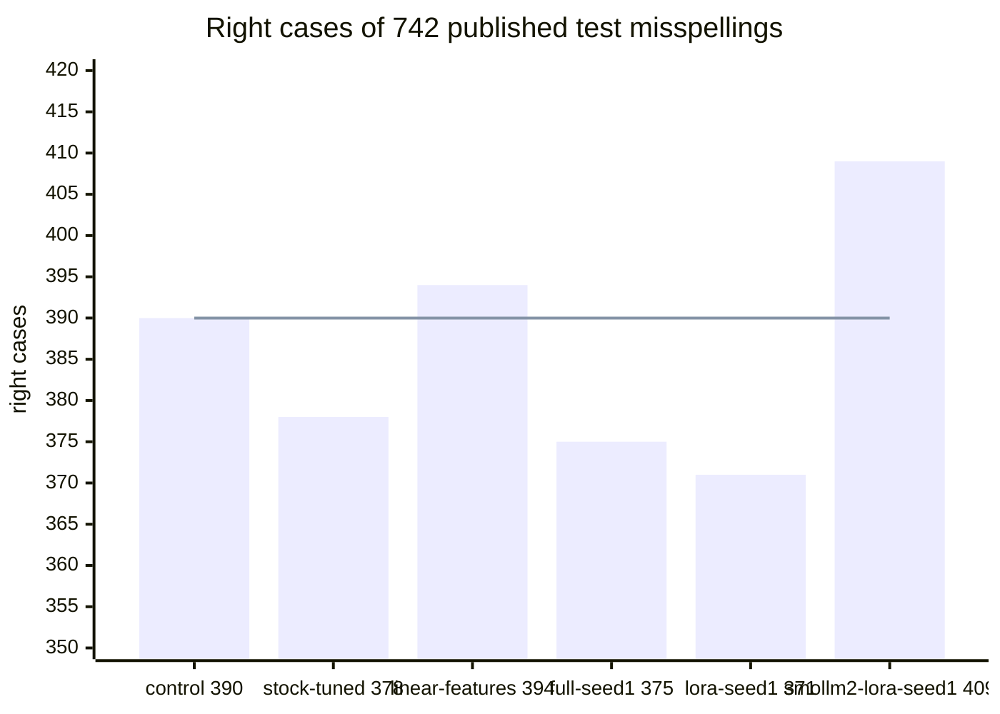

# Fine-tune of distilgpt2 for the English re-ranker

## Summary

On 6,798 generated test cases, a LoRA fine-tune of distilgpt2 gets 337 more right than the
retuned stock re-ranker. Most of that gain is in real-word slips, and the same model changes some
correct words. It does not gain on the published misspellings.

1. Plan the first keyboard build of the re-ranker with the stock distilgpt2 file. Every distilgpt2
   fine-tune keeps fewer published test misspellings than the control: 371 to 377 of 742, against
   390. By the design's rule, that points to our generator.
2. Weigh the real-word gain against the clean loss before any fine-tune ships. Of the 337 test
   cases `lora-seed1` gains, 185 are real-word slips such as "ad" for "and". The generator sets
   those slips at 300 cases, as many as common clean words. `lora-seed1` keeps 7 fewer clean test
   cases than the control.
3. Treat SmolLM2-135M with LoRA as the next candidate to measure. It gets the most test cases
   right. At its tuning-split setting it gains 19 published misspellings and keeps 2 fewer clean
   test cases. At its dev-tuned setting it keeps the clean counts and 7 fewer published
   misspellings. This choice reads the test half, so it is exploratory.
4. Measure that candidate on the phone with the language model test. The stock SmolLM2 estimate is
   47 to 54 ms per correction (`scripts/lm-rerank/README.md`, Table 3).
5. Collect real phone slips in sentences, with their share of real-word slips. Every slip set here
   except the published lists comes from our generator.

This page does not settle the phone time of the typed format, or the gain on real phone typing.

Figure 1. Right generated test cases of the main arms, each at its tuning-split setting. The line
marks the control at 6,106. The axis starts at 6,000.

Figure 2. Right published test misspellings of the same arms. The line marks the control at 390.
The axis starts at 350.

The distilgpt2 fine-tunes stand far above the control in Figure 1, and below it in Figure 2. Of
the fine-tunes, only SmolLM2 with LoRA stands above the control in both.

The pre-set pick rule chose no arm. At its tuning-split setting, each fine-tune keeps fewer clean
dev cases than the control (Table 2).

## Glossary

| Term | Meaning |
| --- | --- |
| reading | One way to read the typed span as words, from `duo_english_readings` in `Engine/duo_engine.c`. |
| list | The readings at one correction, with the text before the span, the typed span and the target. |
| target | The longest reading that keeps the field a prefix of the intended text. |
| setting | The weight, the three margins and the space-after switch of `scripts/lm-rerank/rerank.py`. |
| clean rule | A setting must keep as many right cases as the control in the groups clean and clean symbols. |
| tuning split | 6,748 new cases in the category counts of dev. Its grid gives each arm's setting. |
| stopping split | 6,740 other new cases. Its lists choose the checkpoint of each fine-tune. |
| dev-tuned setting | The setting that the same grid and clean rule pick on dev. The published stock setting comes from there. |
| published misspellings | Roger Mitton's lists (`build_external_english_cases.py`). Our generator did not make them, and they have no context. |

## Arms of the comparison

Table 1. Every arm, named by how it is fit. Later tables use these labels.

| Label | Model and fit | Input format | Setting from |
| --- | --- | --- | --- |
| `control` | The engine's own choice | none | none |
| `no-model` | Margins on the engine score alone | none | tuning split |
| `linear-features` | Linear listwise chooser on 8 engine features, trained by Adam, no language model | none | tuning split |
| `stock-dev` | Shipped distilgpt2 Q3_K_M, not trained | stock | dev, as published |
| `stock-tuned` | Shipped distilgpt2 Q3_K_M, not trained | stock | tuning split |
| `stock-typed` | Shipped distilgpt2 Q3_K_M, not trained | typed | tuning split |
| `stock-converted` | Hugging Face distilgpt2 through our converter, Q3_K_M, not trained | stock | tuning split |
| `lora-seed1` | distilgpt2, LoRA fine-tune (rank 16, AdamW, listwise loss), merged, Q3_K_M | typed | tuning split |
| `lora-seed1-dev` | The same file as `lora-seed1` | typed | dev |
| `full-seed1` | distilgpt2, full fine-tune (AdamW, listwise loss), Q3_K_M | typed | tuning split |
| `full-seed1-dev` | The same file as `full-seed1` | typed | dev |
| `lora-stock-format` | distilgpt2, LoRA fine-tune without the typed span, Q3_K_M | stock | tuning split |
| `lora-no-context` | distilgpt2, LoRA fine-tune without the text before the span, Q3_K_M | typed, no context | tuning split |
| `smollm2-stock` | Shipped SmolLM2-135M Q4_K_M, not trained | stock | tuning split |
| `smollm2-lora-seed1` | SmolLM2-135M, LoRA fine-tune (rank 16, AdamW, listwise loss), merged, Q4_K_M | typed | tuning split |
| `smollm2-lora-seed1-dev` | The same file as `smollm2-lora-seed1` | typed | dev |

Every fine-tune reads the same 118,169 training lists and stops on the same 7,556 stopping lists.
`docs/lm-finetune-design.md` gives the design, and `docs/lm-finetune-design-review.md` the Codex
review of it.

## Dev scores per group

Table 2. Right cases per group on the 6,799 generated dev cases, at the setting from the tuning
split.

| Arm | clean | letter slips | space slips | symbol slips | clean symbols | apostrophe missing | real-word slips | all |
| --- | --- | --- | --- | --- | --- | --- | --- | --- |
| `control` | 957/973 | 1943/2100 | 1299/1500 | 1131/1197 | 427/429 | 250/300 | 62/300 | 6069 |
| `no-model` | 957/973 | 1943/2100 | 1299/1500 | 1131/1197 | 427/429 | 250/300 | 62/300 | 6069 |
| `linear-features` | 957/973 | 1957/2100 | 1348/1500 | 1133/1197 | 427/429 | 299/300 | 79/300 | 6200 |
| `stock-dev` | 958/973 | 1975/2100 | 1316/1500 | 1139/1197 | 427/429 | 247/300 | 64/300 | 6126 |
| `stock-tuned` | 957/973 | 1975/2100 | 1303/1500 | 1134/1197 | 427/429 | 237/300 | 65/300 | 6098 |
| `stock-typed` | 954/973 | 1942/2100 | 1302/1500 | 1126/1197 | 427/429 | 249/300 | 87/300 | 6087 |
| `stock-converted` | 957/973 | 1975/2100 | 1303/1500 | 1134/1197 | 427/429 | 237/300 | 65/300 | 6098 |
| `lora-seed1` | 945/973 | 2041/2100 | 1370/1500 | 1158/1197 | 427/429 | 300/300 | 250/300 | 6491 |
| `full-seed1` | 956/973 | 2035/2100 | 1357/1500 | 1150/1197 | 429/429 | 295/300 | 229/300 | 6451 |
| `lora-stock-format` | 952/973 | 2045/2100 | 1348/1500 | 1150/1197 | 429/429 | 295/300 | 215/300 | 6434 |
| `lora-no-context` | 955/973 | 2004/2100 | 1357/1500 | 1160/1197 | 427/429 | 295/300 | 194/300 | 6392 |
| `smollm2-stock` | 957/973 | 1981/2100 | 1323/1500 | 1145/1197 | 427/429 | 247/300 | 65/300 | 6145 |
| `smollm2-lora-seed1` | 954/973 | 2057/2100 | 1388/1500 | 1165/1197 | 427/429 | 295/300 | 257/300 | 6543 |
| greedy oracle | 973/973 | 2097/2100 | 1413/1500 | 1176/1197 | 429/429 | 300/300 | 300/300 | 6688 |

Every fine-tune gets 294 to 445 more dev cases right than `stock-tuned`. Most of that gain sits in
two categories. `lora-seed1` gains 185 real-word slips and 63 missing apostrophes, 248 of its 393.
A real-word slip gives another common word, such as "ad" for "and".

Every fine-tune also keeps 1 to 12 fewer clean cases than the control. The pre-set pick rule
leaves out an arm with fewer clean cases than the control. So it picked no arm.

## Published misspellings and the generated dev cases with an empty context

Table 3. Right published misspellings of the dev half, per source. The last column counts the
808 generated dev cases with an empty context, which have the same shape.

| Arm | Birkbeck | Holbrook | Aspell | all published | generated, empty context |
| --- | --- | --- | --- | --- | --- |
| `control` | 158/300 | 139/300 | 84/151 | 381/751 | 666/808 |
| `linear-features` | 161/300 | 146/300 | 85/151 | 392/751 | 677/808 |
| `stock-dev` | 160/300 | 134/300 | 82/151 | 376/751 | 665/808 |
| `stock-tuned` | 157/300 | 131/300 | 81/151 | 369/751 | 658/808 |
| `stock-typed` | 157/300 | 145/300 | 84/151 | 386/751 | 675/808 |
| `lora-seed1` | 153/300 | 131/300 | 83/151 | 367/751 | 732/808 |
| `full-seed1` | 150/300 | 135/300 | 84/151 | 369/751 | 729/808 |
| `lora-stock-format` | 148/300 | 129/300 | 82/151 | 359/751 | 718/808 |
| `lora-no-context` | 158/300 | 143/300 | 84/151 | 385/751 | 729/808 |
| `smollm2-stock` | 157/300 | 136/300 | 80/151 | 373/751 | 664/808 |
| `smollm2-lora-seed1` | 163/300 | 153/300 | 87/151 | 403/751 | 736/808 |

The distilgpt2 fine-tunes with context gain 52 to 66 generated cases with an empty context. On
the published misspellings they keep 12 to 22 fewer than the control. By the design's rule, that
pattern points to the generator. The published lists also differ from our slips in their words
and kinds of error. `lora-no-context` keeps 4 more, and the SmolLM2 fine-tune keeps 22 more.

## Paired comparison with the retuned stock re-ranker

Table 4. Dev cases that only one of two arms gets right, against `stock-tuned`. The p value is
the exact McNemar test on those cases. The interval resamples the 6,225 groups of one context and
one intended text.

| Arm | right only by the arm | right only by `stock-tuned` | difference | McNemar p | 95% interval | published: only arm / only `stock-tuned` |
| --- | --- | --- | --- | --- | --- | --- |
| `control` | 68 | 97 | -29 | 0.029 | -55 to -3 | 30 / 18 |
| `linear-features` | 209 | 107 | +102 | 1e-08 | +64 to +142 | 58 / 35 |
| `stock-dev` | 46 | 18 | +28 | 0.00062 | +12 to +45 | 14 / 7 |
| `stock-typed` | 98 | 109 | -11 | 0.49 | -42 to +21 | 33 / 16 |
| `stock-converted` | 0 | 0 | +0 | 1 | +0 to +0 | 0 / 0 |
| `lora-seed1` | 448 | 55 | +393 | 1.2e-77 | +335 to +461 | 39 / 41 |
| `full-seed1` | 403 | 50 | +353 | 1.2e-69 | +298 to +419 | 39 / 39 |
| `lora-stock-format` | 401 | 65 | +336 | 3.9e-60 | +280 to +402 | 36 / 46 |
| `lora-no-context` | 379 | 85 | +294 | 2.4e-45 | +237 to +361 | 53 / 37 |
| `smollm2-stock` | 79 | 32 | +47 | 9.5e-06 | +27 to +68 | 29 / 25 |
| `smollm2-lora-seed1` | 469 | 24 | +445 | 3.2e-108 | +389 to +512 | 62 / 28 |

Each fine-tune passes the pre-set dev gain test (p under 0.025) by a wide margin. Each part of the
input carries a small share of the gain. Without the context, LoRA keeps 294 of its 393. Without
the typed span, it keeps 336.
`linear-features` needs no language model. Against it, `lora-seed1` still gains 291 dev cases
(interval +238 to +355). On the published misspellings `lora-seed1` trails it, 33 cases against
58. `smollm2-lora-seed1` gains 398 over `smollm2-stock` (interval +345 to +463), and 62 against 32
published misspellings.

## Clean dev cases that turn wrong or right against the control

Table 5. Clean dev cases per category, as two counts. The first counts cases the control gets
right and the arm gets wrong. The second counts the reverse.

| Arm | common | rare | names and terms | two words | symbol token | bracket or dot word |
| --- | --- | --- | --- | --- | --- | --- |
| `linear-features` | 0 / 0 | 0 / 0 | 0 / 0 | 0 / 0 | 0 / 0 | 0 / 0 |
| `stock-tuned` | 0 / 0 | 1 / 0 | 0 / 1 | 0 / 0 | 0 / 0 | 0 / 0 |
| `lora-seed1` | 7 / 0 | 12 / 4 | 2 / 5 | 0 / 0 | 1 / 2 | 1 / 0 |
| `full-seed1` | 2 / 0 | 6 / 4 | 1 / 4 | 0 / 0 | 0 / 2 | 0 / 0 |
| `lora-stock-format` | 1 / 0 | 5 / 0 | 1 / 2 | 0 / 0 | 0 / 2 | 0 / 0 |
| `lora-no-context` | 1 / 0 | 6 / 1 | 0 / 4 | 0 / 0 | 0 / 2 | 2 / 0 |
| `smollm2-lora-seed1` | 4 / 0 | 6 / 3 | 1 / 5 | 0 / 0 | 2 / 2 | 0 / 0 |

The fine-tunes change correct common and rare words. `lora-seed1` changes "has" to "had", "our"
to "your", "dog" to "dogs" and "waver" to "water". The generator's `real_word_slip` category
rewards that kind of change. This measurement does not test that link.

## Seen and unseen typed pairs

Table 6. Right dev slip cases, split by whether the same typed and intended pair is also a
training case: 2,417 of 5,397 dev slip cases are.

| Arm | pair in training | pair not in training |
| --- | --- | --- |
| `control` | 2063/2417 | 2622/2980 |
| `stock-tuned` | 2060/2417 | 2654/2980 |
| `linear-features` | 2137/2417 | 2679/2980 |
| `lora-seed1` | 2337/2417 | 2782/2980 |
| `full-seed1` | 2315/2417 | 2751/2980 |
| `smollm2-lora-seed1` | 2350/2417 | 2812/2980 |

The gain of `lora-seed1` over the control is 11.3 points on seen pairs and 5.4 points on unseen
pairs. That fits a memory of generated pairs. Seen and unseen pairs also differ in frequency and
category, so the table does not separate the two.

## Settings and the within-dev check

Table 7. The setting each arm takes from the tuning split. The last three columns hold the
within-dev check of `rerank.py`. They give the dev count at the dev-tuned setting, and the gain on
each held-out half of dev.

| Arm | weight | margins from typed, to typed, other | space after | tuning split right | dev-tuned setting, dev right | fold 0 to 1 | fold 1 to 0 |
| --- | --- | --- | --- | --- | --- | --- | --- |
| `no-model` | 0 | 6, 0, 0 | off | 6020/6748 | 6069 | +0 | +0 |
| `linear-features` | 1.5 | 2, 4, 0 | off | 6157/6748 | 6219 | +70 | +66 |
| `stock-tuned` | 1.5 | 32, 0, 2 | on | 6098/6748 | 6126 | +54 | +23 |
| `stock-typed` | 0.3 | 3, 2, 0 | on | 6057/6748 | 6076 | +1 | +1 |
| `lora-seed1` | 1.5 | 1, 4, 2 | on | 6487/6748 | 6494 | +219 | +198 |
| `full-seed1` | 1.5 | 4, 4, 2 | on | 6405/6748 | 6461 | +198 | +183 |
| `lora-stock-format` | 1.5 | 8, 4, 2 | on | 6413/6748 | 6411 | +180 | +172 |
| `lora-no-context` | 1.0 | 2, 2, 0 | on | 6350/6748 | 6372 | +146 | +148 |
| `smollm2-stock` | 0.75 | 16, 0, 2 | on | 6094/6748 | 6145 | +43 | +12 |
| `smollm2-lora-seed1` | 1.0 | 0, 4, 2 | on | 6501/6748 | 6542 | +242 | +216 |

The dev-tuned settings keep the clean groups of dev at or above the control by construction.

- `lora-seed1-dev`: weight 1.0, margins 1, 2, 0.
- `full-seed1-dev`: weight 1.0, margins 2, 2, 0.
- `smollm2-lora-seed1-dev`: weight 1.0, margins 0, 0, 0.

The tuning split chose weight 1.5 for both distilgpt2 fine-tunes. At that weight the tuning split
keeps its clean count, and dev does not.

## Spread between two seeds

Table 8. Each method with seeds 1 and 2, at the setting each run takes from the tuning split.
Only seed 1 went to the test half.

| Run | setting: weight, margins | tuning split right | dev right | dev clean | published right |
| --- | --- | --- | --- | --- | --- |
| `lora-seed1` | 1.5; 1, 4, 2 | 6487 | 6491 | 945/973 | 367/751 |
| `lora-seed2` | 1.0; 1, 0, 0 | 6444 | 6486 | 950/973 | 328/751 |
| `full-seed1` | 1.5; 4, 4, 2 | 6405 | 6451 | 956/973 | 369/751 |
| `full-seed2` | 1.0; 3, 4, 2 | 6459 | 6503 | 956/973 | 370/751 |

The dev counts of two seeds lie 5 apart for LoRA and 52 apart for the full fine-tune. The
published count of LoRA lies 39 apart. At its setting, `lora-seed2` leaves 54 published
misspellings as typed, such as "pramry" and "cabbge", which the control repairs.

## Test half, read once

`read_test.py` read the test half once, at commit 16ff6fe of `test-plan.json`. Every setting was
fixed before the read. The pre-set pick rule chose no arm, so the plan holds each fine-tuned arm at
both setting sources.

Table 9. Right cases per group on the 6,798 generated test cases.

| Arm | clean | letter slips | space slips | symbol slips | clean symbols | apostrophe missing | real-word slips | all |
| --- | --- | --- | --- | --- | --- | --- | --- | --- |
| `control` | 955/973 | 1945/2100 | 1332/1500 | 1145/1197 | 424/428 | 250/300 | 55/300 | 6106 |
| `stock-dev` | 956/973 | 1984/2100 | 1337/1500 | 1161/1197 | 424/428 | 249/300 | 59/300 | 6170 |
| `stock-tuned` | 956/973 | 1989/2100 | 1330/1500 | 1161/1197 | 424/428 | 240/300 | 59/300 | 6159 |
| `linear-features` | 954/973 | 1949/2100 | 1370/1500 | 1150/1197 | 424/428 | 299/300 | 79/300 | 6225 |
| `lora-seed1` | 948/973 | 2034/2100 | 1383/1500 | 1166/1197 | 423/428 | 298/300 | 244/300 | 6496 |
| `lora-seed1-dev` | 952/973 | 2038/2100 | 1378/1500 | 1171/1197 | 423/428 | 298/300 | 230/300 | 6490 |
| `full-seed1` | 954/973 | 2027/2100 | 1374/1500 | 1165/1197 | 424/428 | 295/300 | 225/300 | 6464 |
| `full-seed1-dev` | 953/973 | 2027/2100 | 1371/1500 | 1167/1197 | 423/428 | 295/300 | 218/300 | 6454 |
| `smollm2-stock` | 956/973 | 1975/2100 | 1345/1500 | 1158/1197 | 424/428 | 246/300 | 60/300 | 6164 |
| `smollm2-lora-seed1` | 953/973 | 2047/2100 | 1395/1500 | 1168/1197 | 424/428 | 293/300 | 254/300 | 6534 |
| `smollm2-lora-seed1-dev` | 957/973 | 2045/2100 | 1382/1500 | 1168/1197 | 424/428 | 297/300 | 254/300 | 6527 |

Every fine-tune gets 295 to 375 more generated test cases right than `stock-tuned`. The
fine-tunes keep their dev order. Of the 337 that `lora-seed1` gains, 185 are real-word slips and 58
are missing apostrophes: 243 in all, or 72 percent. Of the fine-tunes, only
`smollm2-lora-seed1-dev` keeps both clean groups at or above the control.

Table 10. Right published misspellings of the test half, of 742, per source. The last column
counts the 763 generated test cases with an empty context.

| Arm | Birkbeck | Holbrook | Aspell | all published | generated, empty context |
| --- | --- | --- | --- | --- | --- |
| `control` | 169/300 | 128/300 | 93/142 | 390/742 | 633/763 |
| `stock-dev` | 170/300 | 128/300 | 92/142 | 390/742 | 638/763 |
| `stock-tuned` | 163/300 | 125/300 | 90/142 | 378/742 | 637/763 |
| `linear-features` | 173/300 | 131/300 | 90/142 | 394/742 | 641/763 |
| `lora-seed1` | 159/300 | 126/300 | 86/142 | 371/742 | 702/763 |
| `lora-seed1-dev` | 166/300 | 124/300 | 87/142 | 377/742 | 699/763 |
| `full-seed1` | 153/300 | 136/300 | 86/142 | 375/742 | 703/763 |
| `full-seed1-dev` | 159/300 | 135/300 | 83/142 | 377/742 | 699/763 |
| `smollm2-stock` | 171/300 | 129/300 | 90/142 | 390/742 | 630/763 |
| `smollm2-lora-seed1` | 177/300 | 135/300 | 97/142 | 409/742 | 703/763 |
| `smollm2-lora-seed1-dev` | 169/300 | 124/300 | 90/142 | 383/742 | 700/763 |

The distilgpt2 fine-tunes gain 66 to 70 generated test cases with an empty context. They keep 13
to 19 fewer published misspellings than the control. `smollm2-lora-seed1` gains 19 published
misspellings at its tuning-split setting. At its dev-tuned setting it keeps 7 fewer.

Table 11. Test cases that only one of two arms gets right, against `stock-tuned` and against the
control. The p value is the exact McNemar test. The interval resamples groups of one context and
one intended text.

| Arm | against `stock-tuned`: only arm / only reference | difference | McNemar p | 95% interval | published, against `stock-tuned` | published p | published, against `control` | published p |
| --- | --- | --- | --- | --- | --- | --- | --- | --- |
| `stock-dev` | 34 / 23 | +11 | 0.18 | -4 to +27 | 19 / 7 | 0.029 | 10 / 10 | 1 |
| `linear-features` | 184 / 118 | +66 | 0.00017 | +26 to +108 | 54 / 38 | 0.12 | 31 / 27 | 0.69 |
| `lora-seed1` | 393 / 56 | +337 | 2.1e-63 | +276 to +411 | 37 / 44 | 0.51 | 21 / 40 | 0.02 |
| `lora-seed1-dev` | 374 / 43 | +331 | 5.4e-67 | +271 to +403 | 40 / 41 | 1 | 28 / 41 | 0.15 |
| `full-seed1` | 351 / 46 | +305 | 3e-59 | +246 to +377 | 32 / 35 | 0.81 | 19 / 34 | 0.053 |
| `full-seed1-dev` | 348 / 53 | +295 | 2.7e-54 | +237 to +366 | 38 / 39 | 1 | 28 / 41 | 0.15 |
| `smollm2-stock` | 50 / 45 | +5 | 0.68 | -15 to +25 | 33 / 21 | 0.13 | 22 / 22 | 1 |
| `smollm2-lora-seed1` | 404 / 29 | +375 | 1.2e-85 | +314 to +448 | 53 / 22 | 0.00045 | 31 / 12 | 0.0054 |
| `smollm2-lora-seed1-dev` | 421 / 53 | +368 | 3.5e-72 | +306 to +442 | 59 / 54 | 0.71 | 46 / 53 | 0.55 |

On generated test cases, `lora-seed1` gains 337 over `stock-tuned` at p = 2.1e-63. It gains 271
over `linear-features` (interval +212 to +343). On published test misspellings it keeps 19 fewer than
the control (p = 0.02). `smollm2-lora-seed1` gains 370 over `smollm2-stock` (interval +310 to
+442), and 45 against 26 published misspellings (p = 0.032).

Table 12. Clean test cases per category, as two counts. The first counts cases the control gets
right and the arm gets wrong. The second counts the reverse.

| Arm | common | rare | names and terms | two words | symbol token | bracket or dot word |
| --- | --- | --- | --- | --- | --- | --- |
| `stock-tuned` | 0 / 0 | 0 / 0 | 0 / 1 | 0 / 0 | 0 / 0 | 0 / 0 |
| `linear-features` | 1 / 0 | 0 / 0 | 0 / 0 | 0 / 0 | 0 / 0 | 0 / 0 |
| `lora-seed1` | 3 / 0 | 9 / 5 | 5 / 5 | 0 / 0 | 3 / 0 | 0 / 2 |
| `lora-seed1-dev` | 1 / 0 | 7 / 3 | 3 / 5 | 0 / 0 | 2 / 0 | 0 / 1 |
| `full-seed1` | 1 / 0 | 4 / 2 | 0 / 2 | 0 / 0 | 1 / 0 | 0 / 1 |
| `full-seed1-dev` | 3 / 0 | 4 / 2 | 0 / 3 | 0 / 0 | 2 / 0 | 0 / 1 |
| `smollm2-lora-seed1` | 2 / 0 | 6 / 3 | 2 / 5 | 0 / 0 | 2 / 0 | 0 / 2 |
| `smollm2-lora-seed1-dev` | 2 / 0 | 6 / 6 | 2 / 6 | 0 / 0 | 2 / 0 | 0 / 2 |

Each fine-tune turns 6 to 20 clean test cases wrong and 5 to 14 right. The stock re-ranker does
not turn a clean test case wrong.

## Training time and GPU memory

Table 13. Each training run on the RTX 4090. The whole GPU had 15,826 to 17,522 MiB of its 24 GB
in use before each run. PyTorch's allocator had a cap of 3 GB per run, and one run used the GPU at
a time.

| Run | trained weights | steps (epochs) | checkpoint step | training time | peak allocated MiB | peak reserved MiB |
| --- | --- | --- | --- | --- | --- | --- |
| `lora-seed1` | 1,179,648 | 9,500 (2.6) | 7,000 | 70 min | 1,338 | 1,754 |
| `lora-seed2` | 1,179,648 | 8,500 (2.3) | 6,000 | 45 min | 1,340 | 1,756 |
| `full-seed1` | 81,912,576 | 4,500 (1.2) | 2,000 | 19 min | 2,543 | 2,656 |
| `full-seed2` | 81,912,576 | 12,500 (3.4) | 10,000 | 63 min | 2,542 | 2,654 |
| `lora-stock-format` | 1,179,648 | 12,000 (3.2) | 9,500 | 71 min | 1,135 | 1,632 |
| `lora-no-context` | 1,179,648 | 8,500 (2.3) | 6,000 | 46 min | 1,025 | 1,700 |
| `smollm2-lora-seed1` | 4,884,480 | 7,000 (1.9) | 4,500 | 78 min | 2,632 | 3,072 |

The full fine-tune stops at very different steps with two seeds: 4,500 and 12,500.

- Each process also holds a CUDA context of a few hundred MB. Under WDDM, nvidia-smi does not show
  one process's memory, so that part was not measured.
- Every run had below-normal priority and 4 CPU threads. Each distilgpt2 step adds the gradients of
  four micro-batches of 8 lists.
- The SmolLM2 run packs each list into one sequence (`--packed`). The sequence holds the first text
  once, then every reading, with a 4D attention mask. Its micro-batches hold at most 1,500 padded
  tokens. A step takes about 0.7 s, and the packed scores equal the separate scores within 0.00003
  nats.

## Input format of the fine-tuned arms

The model reads the text before the span, the typed span between two bars, then each reading.
`language_model_prompt` in `scripts/lm-rerank/rerank.py` builds the first text for the scorer and
for the training alike.

Table 14. The two formats for the typed span "sutar" after "how much".

| Part | Stock format | Typed format |
| --- | --- | --- |
| First text | start token, then `How much` | start token, then `How much \| sutar \|` |
| One reading | ` sugar` | ` sugar` |
| Empty text before the span | start token, then `sugar` | start token, then `\| sutar \|`, then ` sugar` |

- The keyboard holds all three inputs in `correctLastWord` (`Shared/KeyboardTextController.swift`).
  The text before the span is `before` without `shownSpan`, and the typed span is `typedSpan`.
- The keyboard does not pass the text before the span or the readings to its spell checker yet.
  A keyboard build needs that plumbing.
- A typed span cannot hold a bar, because `correctableWord` takes no bar. The text before the span
  can hold one. The dev and test cases do not.

## Checks of the path the phone runs

The scores come from the path the phone would use. The checks below compare the training code with
`lm_score.c` on samples of the tuning lists.

Table 15. The checks, and what each one found.

| Check | Result |
| --- | --- |
| The extended `rerank.py` in WSL, shipped model, full dev grid | 6,126 right at weight 1.0 and margins 24, 0, 2, the published result, group by group |
| Tokens of the training code against `lm_score tokens`, 2,000 tuning lists | 0 differences for every model in its own format, and for the shipped distilgpt2 in both formats |
| Scores of PyTorch float32 against `lm_score` on the f16 file, 500 lists | largest difference 0.036 to 0.046 nats per model, under the limit of 0.05. `full-seed2` differs by up to 0.052, over the limit, with a mean of 0.012. |
| Our converted stock distilgpt2 against the shipped file | the same score on every one of 16,111 requests, and the same output on every dev case |
| Our converted stock SmolLM2 against the shipped file | the same score on every one of 500 requests |
| Packed lists against one sequence per reading (SmolLM2) | largest difference 0.00003 nats on 64 lists |

Two findings about llama.cpp b4846 shaped the training.

- The start token is token 2 for every GPT-2 style vocabulary. The app's fork
  (azooKey/llama.cpp, `src/llama-vocab.cpp` line 1410) sets it and does not read the model file.
  Token 2 is `#` in GPT-2 and `<|im_end|>` in SmolLM2. The stock re-ranker reads it too, and the
  training uses it.
- `lm_score.c` reads a token's text into 64 bytes. So the two longer space tokens do not count in
  the space-after term (GPT-2 tokens 16529 and 38093). The training leaves them out too.

## Data, splits and leakage

`build_cases.py` and `build_lists.py` ran on GitHub Actions, run 42897760553 at commit fc47c59. The
runner's Tatoeba export has the SHA-256 of the export that built dev and test
(`1a2d75ac07aa…f6020`). Its cases equal a local build byte for byte.

Table 16. Sentences that the leakage rules remove, in the order the rules apply.

| Rule | Sentences removed |
| --- | --- |
| Pass the generator's filter | 1,611,121 kept |
| 1. ID of a dev or test source | 13,541 |
| 2. Same words as a dev or test source | 67 |
| 3. Same words as a dev or test context | 266 |
| 4. Holds a dev or test context and its intended text | 914,154 |
| Left for the new splits | 683,093 |

Table 17. The three new splits.

| Split | Sentences | Cases | Lists | Clean share of lists |
| --- | --- | --- | --- | --- |
| train | 545,990 | 107,145 | 118,169 | 32.9 percent |
| stopping | 68,116 | 6,740 | 7,556 | 21.2 percent |
| tuning | 68,235 | 6,748 | 7,563 | 21.3 percent |

- A training or stopping sentence with the words of an earlier split leaves its split: 711 and 41.
- A case whose typed word is a published misspelling of dev or test leaves its split: 753 in train.
- `check_leakage.py` repeats rules 1 to 4 apart from the build, against the pinned export. It
  finds no case that breaks a rule, and it flags a dev sentence planted in a copy.
- A list without a target leaves training: 5,782 of 125,601 training corrections. Most come from
  the first word of `space_extra` and `letter_to_space` cases.

## Setup

1. On Linux or WSL with gcc, cmake and Python 3, run `bash scripts/lm-rerank/build_on_linux.sh llama`.
   It builds the engine shim, llama.cpp b4846 and `lm_score`.
2. Build the quantizer of the same llama.cpp commit. Configure it with `-DLLAMA_BUILD_EXAMPLES=ON
   -DLLAMA_BUILD_COMMON=ON`, then build the target `llama-quantize`.
3. On Windows with an NVIDIA GPU, run `uv sync --project scripts/lm-finetune`. It installs torch
   2.8.0 for CUDA 12.8, transformers 4.57.1 and peft 0.17.1.
4. Build the published misspellings with `python3 scripts/typing-evaluation/build_external_english_cases.py`.

## Commands

The data build runs on GitHub Actions (`.github/workflows/lm-finetune.yml`, ubuntu-24.04). The same
commands work on any Linux machine, from the repository root:

    python3 scripts/typing-evaluation/build_external_english_cases.py
    python3 scripts/lm-finetune/build_cases.py --out build/lm-finetune/data
    bash scripts/lm-rerank/build_on_linux.sh
    python3 scripts/lm-finetune/build_lists.py --shim build/lm-rerank/libduo_shim.so \
        --data build/lm-finetune/data --workers 4
    gh run download RUN_ID --name lm-finetune-data --dir build/lm-finetune/data
    python3 scripts/lm-finetune/check_leakage.py --data build/lm-finetune/data \
        --export build/typing-evaluation/eng_sentences.tsv.bz2

Training runs on Windows with an NVIDIA GPU and uv, from the repository root:

    uv run --project scripts/lm-finetune python scripts/lm-finetune/train.py --method lora --seed 1 \
        --data build/lm-finetune/data --out build/lm-finetune/models/distilgpt2-lora-seed1
    uv run --project scripts/lm-finetune python scripts/lm-finetune/train.py --base smollm2-135m \
        --method lora --seed 1 --packed --micro-tokens 1500 \
        --data build/lm-finetune/data --out build/lm-finetune/models/smollm2-lora-seed1
    uv run --project scripts/lm-finetune python scripts/lm-finetune/linear_features.py \
        --data build/lm-finetune/data --out build/lm-finetune/models/linear-features.json

`--method full`, `--prompt-format stock` and `--no-context` train the other arms. Conversion uses
the converter and the quantizer of llama.cpp b4846 (commit 10131b23 of azooKey/llama.cpp):

    uv run --project scripts/lm-finetune python llama.cpp/convert_hf_to_gguf.py MODEL/hf \
        --outtype f16 --outfile MODEL/model-f16.gguf
    llama-quantize MODEL/model-f16.gguf MODEL.Q3_K_M.gguf Q3_K_M 2
    uv run --project scripts/lm-finetune python scripts/lm-finetune/check_parity.py prepare \
        --data build/lm-finetune/data --prompt-format typed --model-dir MODEL/hf --out PARITY
    lm_score MODEL.Q3_K_M.gguf 2 tokens < PARITY/requests.tsv > PARITY/llama-tokens.txt
    head -n 500 PARITY/requests.tsv | lm_score MODEL/model-f16.gguf 2 > PARITY/llama-scores.txt
    uv run --project scripts/lm-finetune python scripts/lm-finetune/check_parity.py compare --out PARITY

Scoring runs on Linux against llama.cpp b4846, at low priority:

    LD_LIBRARY_PATH=$PWD/build/lm-rerank/llama/lib python3 scripts/lm-finetune/evaluate.py \
        --shim build/lm-rerank/libduo_shim.so --lm build/lm-rerank/lm_score \
        --model MODEL.Q3_K_M.gguf --prompt-format typed --threads 2 \
        --data build/lm-finetune/data --name NAME --out build/lm-finetune/results/NAME
    python3 scripts/lm-finetune/summarize.py --data build/lm-finetune/data --reference stock-tuned \
        --arm control=RESULTS/stock:control --arm stock-tuned=RESULTS/stock --arm lora-seed1=RESULTS/lora-seed1
    python3 scripts/lm-finetune/read_test.py --plan scripts/lm-finetune/test-plan.json \
        --shim build/lm-rerank/libduo_shim.so --lm build/lm-rerank/lm_score --models MODELS \
        --out build/lm-finetune/results/test
    python3 scripts/lm-finetune/summarize_test.py --test build/lm-finetune/results/test --reference stock-tuned

## Files

| File | Content |
| --- | --- |
| `build_cases.py` | The training, stopping and tuning cases, with the leakage rules |
| `build_lists.py` | The lists of readings, typed through the keyboard rules with the target |
| `check_leakage.py` | Rules 1 to 4 again, apart from the build, against the pinned export |
| `train.py` | The LoRA and full fine-tunes with the listwise loss, and the packed lists |
| `linear_features.py`, `features.py` | The linear listwise chooser on engine features |
| `check_parity.py` | Tokens and scores of the training code against `lm_score` |
| `evaluate.py` | One arm: the grid on the tuning split, dev, the published misspellings, the within-dev check |
| `summarize.py` | The dev tables of this page |
| `test-plan.json` | The arms and settings of the one test read, committed before it ran |
| `read_test.py`, `summarize_test.py` | The test read and its tables |
| `pyproject.toml`, `uv.lock` | The Python environment of the training |
| `../lm-rerank/rerank.py` | The keyboard rules and the grid, with the typed format added |
| `../lm-rerank/lm_score.c` | The scorer, with a mode that prints its token ids |

The model weights, the cases and the lists stay out of the repository. The workflow artifact
`lm-finetune-data` of run 42897760553 holds the cases and the lists.

## Limits of this measurement

- The generator made the training, tuning, dev and test slips. Only the published misspellings
  stand apart, and they have no context. The sets here do not hold real phone slips in sentences.
- The phone time and memory of the typed format were not measured. The typed span adds a few
  tokens to the text the phone reads once per correction.
- The new splits take wordfreq tokens for `clean_names_and_terms`. Dev and test hold hand-picked
  names.
- Rule 4 removed 57 percent of the sentences, mostly those with a common short phrase of dev or
  test. So the training text holds fewer common phrases than dev.
- The fine-tunes chose a checkpoint as well as a setting. The stock re-ranker chose only a setting.
- The design read the test half for the chosen arm. The pick rule chose no arm, so
  `test-plan.json` holds each fine-tuned arm at both setting sources.
- At its published setting, stock SmolLM2 gives 6,145 dev cases in WSL. The GitHub runner gave
  6,146. distilgpt2 gives the runner's numbers exactly.
- Only seed 1 of each method went to the test half. The seed-2 runs skip the within-dev grid.
- The full fine-tune with seed 2 passes the token check and misses the score check by 0.002 nats.

These points were not verified:

- The phone time and memory of any fine-tuned file. Only Linux and WSL ran them.
- The keyboard plumbing that would pass the text before the span and the readings to a re-ranker.
- The memory of the CUDA context of each training process.
- The link between `real_word_slip` training cases and the changed clean words.
- The cause of the one-case SmolLM2 difference between WSL and the runner.
- The cause of the 0.052-nat difference of `full-seed2`. Rounding of its weights to f16 is one
  possible cause.
