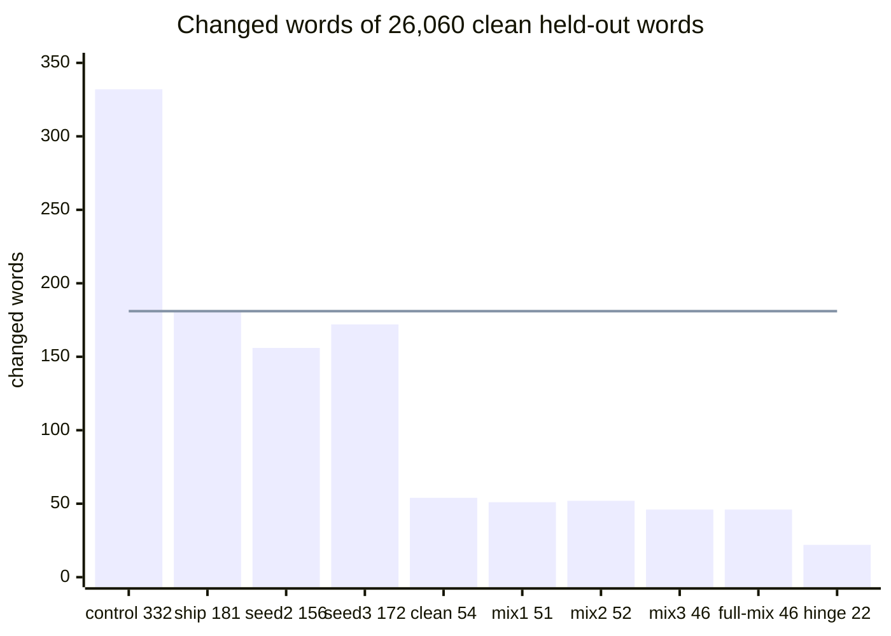
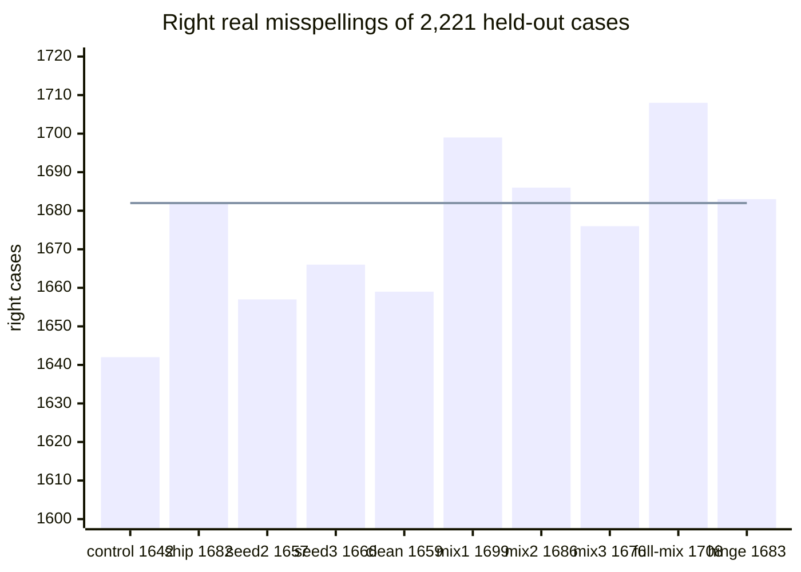

# Round 2 of the re-ranker fine-tune: results on a fresh held-out set

## Summary

Training on clean running text cuts the correct words that the re-ranker changes by about three
quarters, and it keeps the repairs. The pre-set rule still keeps the shipped file `ship`, because
no arm qualified as the candidate on the selection sets.

1. Keep `ship` in the phone experiment if the pre-set rule is binding. The pick named no candidate.
2. Decide whether to replace `ship` outside the rule. On the held-out set `ship` changes 181 of
   26,060 clean words. The six arms with clean running text in training change 22 to 54.
3. If you replace it, take `smollm2-full-mix-seed1` at weight 1.5, margins 0, 8, 2, space-after on.
   It was the nearest miss of the pick, and the held-out set repeats that picture (Table 5).
4. Measure the chosen file on the phone. This round measured Linux only.

This page does not settle the gain on real phone typing, or the phone time of any file.

Figure 1. Changed words of the clean running text, each arm at its own setting. The line marks
`ship` at 181. The more clean running text the training holds, the fewer correct words change.

Figure 2. Right real misspellings (GitHub misspellings and Mitton pairs). The line marks `ship` at
1,682. The axis starts at 1,600. The arms do not differ much here: the range is 1,657 to 1,708.

## Glossary

| Term | Meaning |
| --- | --- |
| reading | One way to read the typed span as words. The text as typed is one reading. |
| setting | The weight, the three margins (from typed, to typed, other) and the space-after switch of the re-ranker. |
| `ship` | `smollm2-lora-seed1.Q4_K_M.gguf` of round 1 at weight 1.0, margins 0, 4, 2, space-after on. |
| clean running text | Whole sentences typed word by word without a slip. |
| changed word | A word of clean running text that the field does not hold as typed. |
| closed and open stream | Clean sentences with only words of the 60,000 most frequent, and sentences with one or two rarer real words. |
| non-word slip | A generated slip case outside `real_word_slip`: letter, space and symbol slips and missing apostrophes. |
| real misspelling | A wrong form that a person wrote: `github_misspelling` cases and Mitton's Birkbeck and Holbrook pairs. |
| selection sets | The dev half, the published dev misspellings, and the select parts of the stream and of the GitHub typos. They picked the candidate. |
| held-out set | Four sets that no model had scored before the one read (Table 2). |

## Arms and their settings

Table 1. Every arm of the held-out read, named by how it is fit. Each SmolLM2 fine-tune is a
Q4_K_M file of 105,453,504 bytes in the typed format. The more new lists a fit reads, the longer it trains.

| Label | Model and fit | Training lists | Setting: weight; margins; space-after | Setting from |
| --- | --- | --- | --- | --- |
| `control` | The engine's own choice | none | none | none |
| `stock-dev` | Shipped distilgpt2 Q3_K_M, not trained, stock format | none | 1.0; 24, 0, 2; on | round 1, dev |
| `linear-features` | Linear listwise chooser on 8 engine features, trained by Adam | round 1 | 1.5; 2, 4, 0; off | round 1, tuning split |
| `lora-seed1` | distilgpt2, LoRA fine-tune, Q3_K_M | round 1 | 1.5; 1, 4, 2; on | round 1, tuning split |
| `full-seed1` | distilgpt2, full fine-tune, Q3_K_M | round 1 | 1.5; 4, 4, 2; on | round 1, tuning split |
| `smollm2-stock` | Shipped SmolLM2-135M Q4_K_M, not trained, stock format | none | 0.75; 16, 0, 2; on | round 1, tuning split |
| `ship` | SmolLM2-135M, LoRA fine-tune (rank 16, AdamW, listwise cross-entropy), seed 1 of round 1 | round 1 | 1.0; 0, 4, 2; on | round 1, tuning split |
| `smollm2-lora-seed1-calibrated` | The file of `ship` | round 1 | 1.0; 0, 4, 2; on | tuning sets, clean-text rule |
| `smollm2-lora-seed2` | The recipe of `ship`, seed 2 | round 1 | 2.0; 1, 8, 2; on | tuning sets, clean-text rule |
| `smollm2-lora-seed3` | The recipe of `ship`, seed 3 | round 1 | 1.5; 0, 8, 2; on | tuning sets, clean-text rule |
| `smollm2-lora-mix-seed1` | SmolLM2-135M, LoRA fine-tune, seed 1 | round 1, clean running text, Wikipedia misspellings | 1.5; 1, 8, 2; on | tuning sets, clean-text rule |
| `smollm2-lora-mix-seed2` | The same fit, seed 2 | the same | 1.5; 0, 4, 2; on | tuning sets, clean-text rule |
| `smollm2-lora-mix-seed3` | The same fit, seed 3 | the same | 1.5; 1, 2, 2; on | tuning sets, clean-text rule |
| `smollm2-lora-mix-hinge-seed1` | The same fit with a keep-typed hinge term (margin 4, weight 1.0) in the loss | the same | 1.5; 0, 8, 2; on | tuning sets, clean-text rule |
| `smollm2-full-mix-seed1` | SmolLM2-135M, full fine-tune (AdamW, listwise cross-entropy) | the same | 1.5; 0, 8, 2; on | tuning sets, clean-text rule |
| `smollm2-lora-clean-seed1` | The LoRA fit without the Wikipedia misspellings | round 1, clean running text | 1.0; 0, 2, 0; on | tuning sets, clean-text rule |
| `...-at-ship-setting` | Five of the files above at the setting of `ship` | | 1.0; 0, 4, 2; on | fixed |

The clean-text rule chose the setting of `ship` for the file of `ship`. So `ship` and
`smollm2-lora-seed1-calibrated` are one arm with two names. `docs/lm-finetune2-design.md` gives the
design, and `docs/lm-finetune2-design-review.md` the Codex review of it.

## Four parts of the held-out set

Table 2. The held-out set. `check_leakage2.py` passes on these files. The one read used the plan
`holdout-plan.json` of commit 6d30d67 (SHA-256 `8659d70c...a962`).

| Part | Cases | Source |
| --- | --- | --- |
| generated | 6,745 cases in the 24 categories of dev | Fresh Tatoeba sentences, the project's slip generator |
| stream | 3,000 closed sentences (19,482 words) and 1,000 open sentences (6,578 words) | Fresh Tatoeba sentences |
| github | 1,500 `github_misspelling` and 1,000 `github_real_word` | GitHub Typo Corpus v1.0.0, a corpus that round 1 did not use |
| mitton | 600 Birkbeck and 121 Holbrook pairs | Roger Mitton's lists, pairs outside every round 1 case |

The read ran in two parts, because a restart of the machine stopped the first run. Each file of
outputs was scored once. `docs/lm-finetune2-results-log.md` holds the record.

## Held-out counts of every arm

Table 3. Changed words of the clean running text, and right cases per group, for all 21 arms.
The arms with clean running text in training change 22 to 54 clean words, against 156 to 181 for
the round 1 recipe at its tuned settings.

| Arm | closed stream, changed of 19,482 words (per 10,000) | open stream, changed of 6,578 words (per 10,000) | clean /972 | clean symbols /429 | letter slips /2,074 | space slips /1,476 | symbol slips /1,196 | apostrophe missing /298 | real word slip /300 | github misspelling /1,500 | lists /721 | github real word /1,000 |
| --- | --- | --- | --- | --- | --- | --- | --- | --- | --- | --- | --- | --- |
| `control` | 253 (129.9) | 79 (120.1) | 945 | 421 | 1941 | 1302 | 1134 | 250 | 63 | 1274 | 368 | 14 |
| `stock-dev` | 247 (126.8) | 77 (117.1) | 946 | 421 | 1970 | 1312 | 1149 | 247 | 67 | 1305 | 364 | 15 |
| `linear-features` | 264 (135.5) | 80 (121.6) | 946 | 421 | 1944 | 1336 | 1144 | 295 | 75 | 1303 | 380 | 29 |
| `lora-seed1` | 127 (65.2) | 76 (115.5) | 935 | 424 | 2026 | 1360 | 1163 | 294 | 245 | 1273 | 355 | 410 |
| `full-seed1` | 69 (35.4) | 68 (103.4) | 948 | 425 | 2020 | 1348 | 1153 | 293 | 224 | 1290 | 362 | 269 |
| `smollm2-stock` | 246 (126.3) | 72 (109.5) | 947 | 421 | 1974 | 1316 | 1147 | 239 | 65 | 1292 | 361 | 17 |
| `ship` | 120 (61.6) | 61 (92.7) | 942 | 425 | 2031 | 1373 | 1165 | 295 | 246 | 1313 | 369 | 393 |
| `smollm2-lora-seed1-calibrated` | 120 (61.6) | 61 (92.7) | 942 | 425 | 2031 | 1373 | 1165 | 295 | 246 | 1313 | 369 | 393 |
| `smollm2-lora-seed2` | 96 (49.3) | 60 (91.2) | 942 | 424 | 2032 | 1368 | 1172 | 296 | 259 | 1303 | 354 | 422 |
| `smollm2-lora-seed2-at-ship-setting` | 134 (68.8) | 77 (117.1) | 945 | 424 | 2019 | 1369 | 1164 | 293 | 248 | 1326 | 373 | 368 |
| `smollm2-lora-seed3` | 111 (57.0) | 61 (92.7) | 946 | 424 | 2037 | 1372 | 1168 | 296 | 254 | 1299 | 367 | 391 |
| `smollm2-lora-seed3-at-ship-setting` | 109 (55.9) | 57 (86.7) | 947 | 424 | 2028 | 1372 | 1165 | 295 | 251 | 1318 | 367 | 346 |
| `smollm2-lora-mix-seed1` | 28 (14.4) | 23 (35.0) | 948 | 425 | 2032 | 1374 | 1170 | 295 | 247 | 1318 | 381 | 413 |
| `smollm2-lora-mix-seed1-at-ship-setting` | 33 (16.9) | 27 (41.0) | 948 | 424 | 2029 | 1372 | 1168 | 295 | 247 | 1333 | 381 | 391 |
| `smollm2-lora-mix-seed2` | 27 (13.9) | 25 (38.0) | 937 | 425 | 2026 | 1367 | 1169 | 296 | 253 | 1313 | 373 | 489 |
| `smollm2-lora-mix-seed2-at-ship-setting` | 36 (18.5) | 29 (44.1) | 943 | 423 | 2024 | 1369 | 1164 | 296 | 246 | 1331 | 376 | 430 |
| `smollm2-lora-mix-seed3` | 25 (12.8) | 21 (31.9) | 947 | 425 | 2036 | 1368 | 1165 | 292 | 254 | 1315 | 361 | 411 |
| `smollm2-lora-mix-seed3-at-ship-setting` | 54 (27.7) | 42 (63.8) | 942 | 422 | 2029 | 1369 | 1167 | 285 | 247 | 1346 | 376 | 390 |
| `smollm2-lora-mix-hinge-seed1` | 12 (6.2) | 10 (15.2) | 958 | 427 | 2029 | 1369 | 1167 | 295 | 246 | 1320 | 363 | 389 |
| `smollm2-full-mix-seed1` | 23 (11.8) | 23 (35.0) | 944 | 424 | 2042 | 1369 | 1172 | 294 | 252 | 1325 | 383 | 454 |
| `smollm2-lora-clean-seed1` | 32 (16.4) | 22 (33.4) | 950 | 424 | 2034 | 1361 | 1169 | 295 | 246 | 1305 | 354 | 363 |

`github real word` holds edits that often fix grammar, such as "notes" to "note". No rule uses it.

Table 4. Real misspellings per source, non-word slips, all generated cases, and changed stream
sentences. The non-word slips of every SmolLM2 fine-tune lie between 4,845 and 4,877 of 5,044.

| Arm | github misspelling with a context /1,160 | github misspelling without a context /340 | birkbeck /600 | holbrook /121 | non-word slips /5,044 | generated, all /6,745 | changed stream sentences |
| --- | --- | --- | --- | --- | --- | --- | --- |
| `control` | 996 | 278 | 324 | 44 | 4627 | 6056 | 257 |
| `stock-dev` | 1026 | 279 | 321 | 43 | 4678 | 6112 | 247 |
| `linear-features` | 1009 | 294 | 329 | 51 | 4719 | 6161 | 271 |
| `lora-seed1` | 1007 | 266 | 310 | 45 | 4843 | 6447 | 151 |
| `full-seed1` | 1014 | 276 | 316 | 46 | 4814 | 6411 | 111 |
| `smollm2-stock` | 1014 | 278 | 319 | 42 | 4676 | 6109 | 246 |
| `ship` | 1025 | 288 | 317 | 52 | 4864 | 6477 | 155 |
| `smollm2-lora-seed1-calibrated` | 1025 | 288 | 317 | 52 | 4864 | 6477 | 155 |
| `smollm2-lora-seed2` | 1029 | 274 | 306 | 48 | 4868 | 6493 | 132 |
| `smollm2-lora-seed2-at-ship-setting` | 1041 | 285 | 321 | 52 | 4845 | 6462 | 183 |
| `smollm2-lora-seed3` | 1022 | 277 | 316 | 51 | 4873 | 6497 | 150 |
| `smollm2-lora-seed3-at-ship-setting` | 1031 | 287 | 314 | 53 | 4860 | 6482 | 146 |
| `smollm2-lora-mix-seed1` | 1030 | 288 | 326 | 55 | 4871 | 6491 | 37 |
| `smollm2-lora-mix-seed1-at-ship-setting` | 1041 | 292 | 325 | 56 | 4864 | 6483 | 45 |
| `smollm2-lora-mix-seed2` | 1037 | 276 | 319 | 54 | 4858 | 6473 | 40 |
| `smollm2-lora-mix-seed2-at-ship-setting` | 1046 | 285 | 324 | 52 | 4853 | 6465 | 51 |
| `smollm2-lora-mix-seed3` | 1033 | 282 | 310 | 51 | 4861 | 6487 | 35 |
| `smollm2-lora-mix-seed3-at-ship-setting` | 1059 | 287 | 323 | 53 | 4850 | 6461 | 76 |
| `smollm2-lora-mix-hinge-seed1` | 1034 | 286 | 313 | 50 | 4860 | 6491 | 15 |
| `smollm2-full-mix-seed1` | 1046 | 279 | 332 | 51 | 4877 | 6497 | 34 |
| `smollm2-lora-clean-seed1` | 1026 | 279 | 305 | 49 | 4859 | 6479 | 40 |

## Six conditions of the replacement rule on the held-out set

The pick on the selection sets named no candidate, so the rule keeps `ship` and the six conditions
decide nothing. Table 5 shows them for every arm, for reading.

Table 5. The six conditions of every arm against `ship`. Condition 1: fewer changed stream
sentences at p < 0.05. Condition 2: changed words of each stream at most those of `ship`.
Condition 3: clean and clean symbols each at least those of `ship`. Condition 4: non-word slips at
least those of `ship` less 25, with an interval floor of -50. Condition 5: real misspellings pooled
at least those of `ship`, each source within 1 percent. Condition 6: half of the real-word gain of
`ship`. Two arms hold all six: `smollm2-lora-mix-seed1` and `smollm2-lora-mix-hinge-seed1`.

| Arm | 1 | 2 | 3 | 4 | 5 | 6 | changed sentences only ship / only arm | p | non-word difference (interval) |
| --- | --- | --- | --- | --- | --- | --- | --- | --- | --- |
| `stock-dev` | no | no | no | no | no | no | 61 / 153 | 1 | -186 (-228 to -152) |
| `linear-features` | no | no | no | no | yes | no | 56 / 172 | 1 | -145 (-176 to -115) |
| `lora-seed1` | no | no | no | yes | no | yes | 71 / 67 | 0.399 | -21 (-38 to -5) |
| `full-seed1` | yes | no | yes | no | no | yes | 91 / 47 | 0.000113 | -50 (-71 to -31) |
| `smollm2-stock` | no | no | no | no | no | no | 59 / 150 | 1 | -188 (-230 to -153) |
| `smollm2-lora-seed1-calibrated` | no | yes | yes | yes | yes | yes | 0 / 0 | 1 | +0 (+0 to +0) |
| `smollm2-lora-seed2` | yes | yes | no | yes | no | yes | 57 / 34 | 0.0103 | +4 (-10 to +17) |
| `smollm2-lora-seed2-at-ship-setting` | no | no | no | yes | yes | yes | 21 / 49 | 1 | -19 (-31 to -7) |
| `smollm2-lora-seed3` | no | yes | no | yes | no | yes | 38 / 33 | 0.318 | +9 (-5 to +22) |
| `smollm2-lora-seed3-at-ship-setting` | no | yes | no | yes | yes | yes | 36 / 27 | 0.157 | -4 (-17 to +8) |
| `smollm2-lora-mix-seed1` | yes | yes | yes | yes | yes | yes | 121 / 3 | 1.49e-32 | +7 (-9 to +23) |
| `smollm2-lora-mix-seed1-at-ship-setting` | yes | yes | no | yes | yes | yes | 112 / 2 | 3.16e-31 | +0 (-14 to +13) |
| `smollm2-lora-mix-seed2` | yes | yes | no | yes | yes | yes | 122 / 7 | 1.56e-28 | -6 (-19 to +7) |
| `smollm2-lora-mix-seed2-at-ship-setting` | yes | yes | no | yes | yes | yes | 109 / 5 | 7.4e-27 | -11 (-21 to +0) |
| `smollm2-lora-mix-seed3` | yes | yes | yes | yes | no | yes | 123 / 3 | 3.92e-33 | -3 (-16 to +10) |
| `smollm2-lora-mix-seed3-at-ship-setting` | yes | yes | no | yes | yes | yes | 85 / 6 | 2.89e-19 | -14 (-27 to -1) |
| `smollm2-lora-mix-hinge-seed1` | yes | yes | yes | yes | yes | yes | 141 / 1 | 2.56e-41 | -4 (-19 to +12) |
| `smollm2-full-mix-seed1` | yes | yes | no | yes | yes | yes | 125 / 4 | 1.67e-32 | +13 (-3 to +29) |
| `smollm2-lora-clean-seed1` | yes | yes | no | yes | no | yes | 115 / 0 | 2.41e-35 | -5 (-22 to +12) |

- Every arm with clean running text in training holds conditions 1, 2, 4 and 6.
- `smollm2-full-mix-seed1` misses condition 3 by one case: 424 clean symbols against 425.
- The misses of conditions 3 and 5 are small counts. Table 6 shows that most lie inside the noise
  of a paired comparison.

Table 6. Cases that only the arm gets right, and cases that only `ship` gets right, per group.
The p value is the two-sided exact McNemar test. The generated groups repeat some contexts, so
their p values read a little too small.

| Arm | clean and clean symbols: only arm / only ship (p) | non-word slips: only arm / only ship (p) | real-word slips: only arm / only ship (p) | real misspellings: only arm / only ship (p) | github misspelling: only arm / only ship (p) | lists: only arm / only ship (p) | github real word: only arm / only ship (p) |
| --- | --- | --- | --- | --- | --- | --- | --- |
| `control` | 15 / 16 (1) | 13 / 250 (4.87e-58) | 0 / 183 (1.63e-55) | 50 / 90 (0.000913) | 29 / 68 (9.34e-05) | 21 / 22 (1) | 0 / 379 (1.62e-114) |
| `stock-dev` | 15 / 15 (1) | 12 / 198 (1.44e-44) | 0 / 179 (2.61e-54) | 69 / 82 (0.329) | 41 / 49 (0.461) | 28 / 33 (0.609) | 0 / 378 (3.25e-114) |
| `linear-features` | 15 / 15 (1) | 42 / 187 (4.99e-23) | 0 / 171 (6.68e-52) | 102 / 101 (1) | 59 / 69 (0.426) | 43 / 32 (0.248) | 0 / 364 (5.32e-110) |
| `lora-seed1` | 12 / 20 (0.215) | 28 / 49 (0.022) | 17 / 18 (1) | 54 / 108 (2.66e-05) | 33 / 73 (0.000128) | 21 / 35 (0.0814) | 64 / 47 (0.128) |
| `full-seed1` | 12 / 6 (0.238) | 25 / 75 (5.64e-07) | 6 / 28 (0.000195) | 54 / 84 (0.0133) | 33 / 56 (0.0192) | 21 / 28 (0.392) | 18 / 142 (4.27e-25) |
| `smollm2-stock` | 16 / 15 (1) | 12 / 200 (4.05e-45) | 0 / 181 (6.53e-55) | 69 / 98 (0.03) | 38 / 59 (0.0417) | 31 / 39 (0.403) | 0 / 376 (1.3e-113) |
| `smollm2-lora-seed1-calibrated` | 0 / 0 (1) | 0 / 0 (1) | 0 / 0 (1) | 0 / 0 (1) | 0 / 0 (1) | 0 / 0 (1) | 0 / 0 (1) |
| `smollm2-lora-seed2` | 8 / 9 (1) | 25 / 21 (0.659) | 19 / 6 (0.0146) | 46 / 71 (0.0261) | 30 / 40 (0.282) | 16 / 31 (0.04) | 60 / 31 (0.00311) |
| `smollm2-lora-seed2-at-ship-setting` | 8 / 6 (0.791) | 11 / 30 (0.00432) | 8 / 6 (0.791) | 47 / 30 (0.0675) | 33 / 20 (0.0984) | 14 / 10 (0.541) | 23 / 48 (0.00407) |
| `smollm2-lora-seed3` | 11 / 8 (0.648) | 29 / 20 (0.253) | 13 / 5 (0.0963) | 39 / 55 (0.121) | 24 / 38 (0.098) | 15 / 17 (0.86) | 37 / 39 (0.909) |
| `smollm2-lora-seed3-at-ship-setting` | 11 / 7 (0.481) | 19 / 23 (0.644) | 9 / 4 (0.267) | 35 / 32 (0.807) | 21 / 16 (0.511) | 14 / 16 (0.856) | 16 / 63 (9.44e-08) |
| `smollm2-lora-mix-seed1` | 11 / 5 (0.21) | 39 / 32 (0.477) | 12 / 11 (1) | 62 / 45 (0.122) | 37 / 32 (0.63) | 25 / 13 (0.073) | 54 / 34 (0.0422) |
| `smollm2-lora-mix-seed1-at-ship-setting` | 11 / 6 (0.332) | 23 / 23 (1) | 11 / 10 (1) | 60 / 28 (0.000846) | 37 / 17 (0.00907) | 23 / 11 (0.0576) | 36 / 38 (0.908) |
| `smollm2-lora-mix-seed2` | 10 / 15 (0.424) | 18 / 24 (0.441) | 12 / 5 (0.143) | 62 / 58 (0.784) | 39 / 39 (1) | 23 / 19 (0.644) | 113 / 17 (1.4e-18) |
| `smollm2-lora-mix-seed2-at-ship-setting` | 9 / 10 (1) | 10 / 21 (0.0708) | 4 / 4 (1) | 53 / 28 (0.00728) | 35 / 17 (0.0175) | 18 / 11 (0.265) | 57 / 20 (2.93e-05) |
| `smollm2-lora-mix-seed3` | 12 / 7 (0.359) | 21 / 24 (0.766) | 13 / 5 (0.0963) | 45 / 51 (0.61) | 29 / 27 (0.894) | 16 / 24 (0.268) | 46 / 28 (0.0474) |
| `smollm2-lora-mix-seed3-at-ship-setting` | 7 / 10 (0.629) | 15 / 29 (0.0488) | 6 / 5 (1) | 59 / 19 (6.42e-06) | 41 / 8 (1.96e-06) | 18 / 11 (0.265) | 34 / 37 (0.813) |
| `smollm2-lora-mix-hinge-seed1` | 19 / 1 (4.01e-05) | 29 / 33 (0.704) | 10 / 10 (1) | 53 / 52 (1) | 35 / 28 (0.45) | 18 / 24 (0.441) | 37 / 41 (0.734) |
| `smollm2-full-mix-seed1` | 10 / 9 (1) | 39 / 26 (0.136) | 15 / 9 (0.307) | 69 / 43 (0.0178) | 43 / 31 (0.201) | 26 / 12 (0.0336) | 81 / 20 (6.93e-10) |
| `smollm2-lora-clean-seed1` | 10 / 3 (0.0923) | 33 / 38 (0.635) | 10 / 10 (1) | 45 / 68 (0.038) | 28 / 36 (0.382) | 17 / 32 (0.0444) | 22 / 52 (0.000643) |

## `smollm2-full-mix-seed1` against `ship` on the held-out set

Table 7. The full fine-tune against the shipped file. It changes about a quarter of the clean
words that `ship` changes, and it does not lose a group of repairs.

| Count | `ship` | `smollm2-full-mix-seed1` | Paired comparison |
| --- | --- | --- | --- |
| Changed words, closed stream of 19,482 | 120 | 23 | |
| Changed words, open stream of 6,578 | 61 | 23 | |
| Changed stream sentences of 4,000 | 155 | 34 | 125 only `ship`, 4 only the arm, one-sided p = 1.7e-32 |
| Clean cases of 972 | 942 | 944 | clean and clean symbols together: 10 only the arm, 9 only `ship`, p = 1 |
| Clean symbol cases of 429 | 425 | 424 | |
| Non-word slips of 5,044 | 4,864 | 4,877 | +13, 95 percent interval -3 to +29 |
| Real-word slips of 300 | 246 | 252 | 15 only the arm, 9 only `ship`, p = 0.31 |
| Real misspellings of 2,221 | 1,682 | 1,708 | 69 only the arm, 43 only `ship`, p = 0.018 |
| GitHub misspellings of 1,500 | 1,313 | 1,325 | 43 only the arm, 31 only `ship`, p = 0.20 |
| Mitton pairs of 721 | 369 | 383 | 26 only the arm, 12 only `ship`, p = 0.034 |

The interval of the non-word slips resamples groups of one context and one intended text.

## Pick on the selection sets

Table 8. Selection sets: changed words and right cases per arm, each at its tuned setting.

| Arm | closed stream, changed of 6,449 words (per 10,000) | open stream, changed of 1,990 words (per 10,000) | clean /973 | clean symbols /429 | letter slips /2,100 | space slips /1,500 | symbol slips /1,197 | apostrophe missing /300 | real word slip /300 | github misspelling /1,500 | lists /751 | github real word /1,000 |
| --- | --- | --- | --- | --- | --- | --- | --- | --- | --- | --- | --- | --- |
| `control` | 66 (102.3) | 30 (150.8) | 957 | 427 | 1943 | 1299 | 1131 | 250 | 62 | 1269 | 381 | 31 |
| `ship` | 41 (63.6) | 27 (135.7) | 954 | 427 | 2057 | 1388 | 1165 | 295 | 257 | 1279 | 403 | 388 |
| `smollm2-lora-seed1-calibrated:tuned` | 41 (63.6) | 27 (135.7) | 954 | 427 | 2057 | 1388 | 1165 | 295 | 257 | 1279 | 403 | 388 |
| `smollm2-lora-seed2:tuned` | 28 (43.4) | 22 (110.6) | 951 | 428 | 2052 | 1380 | 1169 | 299 | 264 | 1252 | 378 | 421 |
| `smollm2-lora-seed3:tuned` | 30 (46.5) | 26 (130.7) | 954 | 428 | 2056 | 1388 | 1163 | 298 | 259 | 1279 | 397 | 395 |
| `smollm2-lora-mix-seed1:tuned` | 6 (9.3) | 13 (65.3) | 950 | 428 | 2062 | 1388 | 1164 | 298 | 258 | 1277 | 400 | 413 |
| `smollm2-lora-mix-seed2:tuned` | 3 (4.7) | 8 (40.2) | 946 | 429 | 2053 | 1384 | 1167 | 297 | 259 | 1264 | 397 | 498 |
| `smollm2-lora-mix-seed3:tuned` | 8 (12.4) | 7 (35.2) | 952 | 427 | 2059 | 1387 | 1166 | 295 | 260 | 1291 | 379 | 411 |
| `smollm2-lora-mix-hinge-seed1:tuned` | 3 (4.7) | 2 (10.1) | 957 | 428 | 2055 | 1383 | 1165 | 297 | 250 | 1280 | 381 | 389 |
| `smollm2-full-mix-seed1:tuned` | 7 (10.9) | 7 (35.2) | 952 | 427 | 2053 | 1392 | 1166 | 299 | 256 | 1296 | 394 | 454 |
| `smollm2-lora-clean-seed1:tuned` | 9 (14.0) | 14 (70.4) | 959 | 426 | 2058 | 1390 | 1166 | 298 | 252 | 1278 | 384 | 364 |

Table 9. The five conditions of the pick. Each arm misses condition 2 or condition 3 by 2 to 21
cases, so the pick named no candidate. `smollm2-full-mix-seed1` misses only condition 2, by 2 clean cases.

| Arm | 1 fewer changed words on the stream | 2 clean and clean symbols each at least ship | 3 real misspellings at least ship | 4 non-word slips at least ship less 25 | 5 real-word slips keep half of the gain of ship | qualifies |
| --- | --- | --- | --- | --- | --- | --- |
| `smollm2-lora-seed1-calibrated:tuned` | no | yes | yes | yes | yes | no |
| `smollm2-lora-seed2:tuned` | yes | no | no | yes | yes | no |
| `smollm2-lora-seed3:tuned` | yes | yes | no | yes | yes | no |
| `smollm2-lora-mix-seed1:tuned` | yes | no | no | yes | yes | no |
| `smollm2-lora-mix-seed2:tuned` | yes | no | no | yes | yes | no |
| `smollm2-lora-mix-seed3:tuned` | yes | no | no | yes | yes | no |
| `smollm2-lora-mix-hinge-seed1:tuned` | yes | yes | no | yes | yes | no |
| `smollm2-full-mix-seed1:tuned` | yes | no | yes | yes | yes | no |
| `smollm2-lora-clean-seed1:tuned` | yes | no | no | yes | yes | no |

## Spread of the seeds and effect of the setting

- Round 1 recipe, three seeds at the setting of `ship`: 181, 211 and 166 changed held-out words.
- Fit with the new lists, three seeds at the setting of `ship`: 60, 65 and 96 changed held-out words.
- So the drop is larger than the spread of the seeds at one fixed setting.
- At the setting of `ship`, the three `mix` seeds keep 1,714, 1,707 and 1,722 real misspellings,
  against 1,682 for `ship`. Their tuned settings have weight 1.5 and keep 1,676 to 1,699.
- `smollm2-lora-clean-seed1` keeps 1,659 real misspellings. The `mix` seeds keep 1,676 to 1,699 at
  their tuned settings. So the Wikipedia misspellings add a little there, with one seed of the clean-only fit.
- The hinge arm changes the fewest clean words (22). On the selection sets it kept 21 fewer real
  misspellings than `ship`, and on the held-out set 1 more.

## Seen and new phrases and pairs

Table 10. Right held-out cases by whether training holds the phrase or the pair. The gain of the
fine-tunes over the control shows on new phrases and new pairs too.

| Arm | slip, phrase in training /1,146 | slip, phrase not in training /3,414 | slip, pair in a training list /2,340 | slip, pair in no training list /3,004 | real misspelling, pair in a training list /120 | real misspelling, pair in no training list /2,101 |
| --- | --- | --- | --- | --- | --- | --- |
| `control` | 1007 | 3047 | 2003 | 2687 | 102 | 1540 |
| `stock-dev` | 1019 | 3094 | 2027 | 2718 | 104 | 1565 |
| `linear-features` | 1032 | 3113 | 2064 | 2730 | 108 | 1575 |
| `lora-seed1` | 1110 | 3270 | 2272 | 2816 | 104 | 1524 |
| `full-seed1` | 1101 | 3240 | 2244 | 2794 | 103 | 1549 |
| `smollm2-stock` | 1014 | 3103 | 2017 | 2724 | 104 | 1549 |
| `ship` | 1116 | 3288 | 2269 | 2841 | 102 | 1580 |
| `smollm2-lora-seed1-calibrated` | 1116 | 3288 | 2269 | 2841 | 102 | 1580 |
| `smollm2-lora-seed2` | 1114 | 3304 | 2287 | 2840 | 103 | 1554 |
| `smollm2-lora-seed2-at-ship-setting` | 1109 | 3276 | 2265 | 2828 | 105 | 1594 |
| `smollm2-lora-seed3` | 1118 | 3297 | 2279 | 2848 | 104 | 1562 |
| `smollm2-lora-seed3-at-ship-setting` | 1116 | 3286 | 2276 | 2835 | 106 | 1579 |
| `smollm2-lora-mix-seed1` | 1118 | 3294 | 2271 | 2847 | 106 | 1593 |
| `smollm2-lora-mix-seed1-at-ship-setting` | 1120 | 3287 | 2273 | 2838 | 106 | 1608 |
| `smollm2-lora-mix-seed2` | 1118 | 3289 | 2273 | 2838 | 103 | 1583 |
| `smollm2-lora-mix-seed2-at-ship-setting` | 1112 | 3281 | 2268 | 2831 | 104 | 1603 |
| `smollm2-lora-mix-seed3` | 1117 | 3289 | 2276 | 2839 | 101 | 1575 |
| `smollm2-lora-mix-seed3-at-ship-setting` | 1111 | 3280 | 2262 | 2835 | 107 | 1615 |
| `smollm2-lora-mix-hinge-seed1` | 1117 | 3285 | 2272 | 2834 | 104 | 1579 |
| `smollm2-full-mix-seed1` | 1117 | 3297 | 2282 | 2847 | 102 | 1606 |
| `smollm2-lora-clean-seed1` | 1106 | 3295 | 2267 | 2838 | 102 | 1557 |

## Weighted estimate

Table 11. Wrong words per 1,000 typed, for a slip share s and a real-word share r that nobody
measured. No rule uses the estimate. A slip case counts as one wrong word.

| Arm | s = 0.02, r = 0.12 | s = 0.05, r = 0.12 | s = 0.1, r = 0.12 | s = 0.05, r = 0.05 | s = 0.05, r = 0.3 |
| --- | --- | --- | --- | --- | --- |
| `control` | 15.84 | 20.48 | 28.22 | 18.00 | 26.85 |
| `stock-dev` | 15.33 | 19.66 | 26.89 | 17.20 | 26.00 |
| `linear-features` | 15.87 | 19.88 | 26.55 | 17.48 | 26.05 |
| `lora-seed1` | 8.78 | 10.25 | 12.72 | 9.75 | 11.54 |
| `full-seed1` | 6.56 | 8.52 | 11.78 | 7.79 | 10.39 |
| `smollm2-stock` | 15.12 | 19.50 | 26.80 | 17.02 | 25.90 |
| `ship` | 7.87 | 9.25 | 11.55 | 8.74 | 10.55 |
| `smollm2-lora-seed1-calibrated` | 7.87 | 9.25 | 11.55 | 8.74 | 10.55 |
| `smollm2-lora-seed2` | 6.81 | 8.04 | 10.10 | 7.69 | 8.96 |
| `smollm2-lora-seed2-at-ship-setting` | 9.05 | 10.47 | 12.84 | 10.00 | 11.67 |
| `smollm2-lora-seed3` | 7.43 | 8.68 | 10.76 | 8.26 | 9.76 |
| `smollm2-lora-seed3-at-ship-setting` | 7.28 | 8.64 | 10.90 | 8.19 | 9.78 |
| `smollm2-lora-mix-seed1` | 2.95 | 4.43 | 6.90 | 3.93 | 5.71 |
| `smollm2-lora-mix-seed1-at-ship-setting` | 3.31 | 4.82 | 7.33 | 4.32 | 6.09 |
| `smollm2-lora-mix-seed2` | 2.98 | 4.46 | 6.92 | 4.04 | 5.54 |
| `smollm2-lora-mix-seed2-at-ship-setting` | 3.54 | 5.12 | 7.74 | 4.62 | 6.39 |
| `smollm2-lora-mix-seed3` | 2.74 | 4.19 | 6.62 | 3.78 | 5.25 |
| `smollm2-lora-mix-seed3-at-ship-setting` | 4.71 | 6.25 | 8.82 | 5.77 | 7.50 |
| `smollm2-lora-mix-hinge-seed1` | 1.90 | 3.49 | 6.13 | 2.98 | 4.78 |
| `smollm2-full-mix-seed1` | 2.70 | 4.09 | 6.42 | 3.65 | 5.24 |
| `smollm2-lora-clean-seed1` | 3.11 | 4.66 | 7.25 | 4.16 | 5.95 |

## File size and cost per request

Every SmolLM2 fine-tune is 105,453,504 bytes as Q4_K_M. The distilgpt2 files are 75,417,280 bytes as Q3_K_M.

Table 12. Cost on the held-out stream for the arms of the second part of the read, in WSL with 2
threads per scorer, while 7 scorers and another worker ran. The typed format reads 28.3 tokens per request.

| Arm | file | bytes | arms on the scorer | requests | tokens per request | model ms per request | highest RssAnon MiB |
| --- | --- | --- | --- | --- | --- | --- | --- |
| `smollm2-lora-seed3` | smollm2-lora-seed3.Q4_K_M.gguf | 105,453,504 | 2 | 21356 | 28.3 | 228.5 | 140 |
| `smollm2-lora-seed3-at-ship-setting` | smollm2-lora-seed3.Q4_K_M.gguf | 105,453,504 | 2 | 21356 | 28.3 | 228.5 | 140 |
| `smollm2-lora-mix-seed1` | smollm2-lora-mix-seed1.Q4_K_M.gguf | 105,453,504 | 2 | 21302 | 28.3 | 229.9 | 144 |
| `smollm2-lora-mix-seed1-at-ship-setting` | smollm2-lora-mix-seed1.Q4_K_M.gguf | 105,453,504 | 2 | 21302 | 28.3 | 229.9 | 144 |
| `smollm2-lora-mix-seed2` | smollm2-lora-mix-seed2.Q4_K_M.gguf | 105,453,504 | 2 | 21314 | 28.3 | 230.3 | 141 |
| `smollm2-lora-mix-seed2-at-ship-setting` | smollm2-lora-mix-seed2.Q4_K_M.gguf | 105,453,504 | 2 | 21314 | 28.3 | 230.3 | 141 |
| `smollm2-lora-mix-seed3` | smollm2-lora-mix-seed3.Q4_K_M.gguf | 105,453,504 | 2 | 21394 | 28.3 | 228.4 | 140 |
| `smollm2-lora-mix-seed3-at-ship-setting` | smollm2-lora-mix-seed3.Q4_K_M.gguf | 105,453,504 | 2 | 21394 | 28.3 | 228.4 | 140 |
| `smollm2-lora-mix-hinge-seed1` | smollm2-lora-mix-hinge-seed1.Q4_K_M.gguf | 105,453,504 | 1 | 21281 | 28.3 | 231.4 | 141 |
| `smollm2-full-mix-seed1` | smollm2-full-mix-seed1.Q4_K_M.gguf | 105,453,504 | 1 | 21281 | 28.3 | 233.0 | 144 |
| `smollm2-lora-clean-seed1` | smollm2-lora-clean-seed1.Q4_K_M.gguf | 105,453,504 | 1 | 21281 | 28.3 | 234.9 | 143 |

- On the select stream with 2 scorers running, the file of `ship` took 83 ms per request for 28.1
  tokens per request. So the 229 to 235 ms of Table 12 show the load of the machine.
- The scorer needs about 140 MiB of resident memory in Linux for every SmolLM2 file.
- The files of one base model have the same size, format and token count. Their phone time is the
  time of `ship`, which this round did not measure.

## File formats on the selection sets

Table 13. `ship` and `smollm2-lora-mix-seed1` in five formats, each at its own tuned setting.
The time is the model time of 500 requests against plain Q4_K_M on the PC. The format moves the
counts less than the setting does, and the importance matrix does not improve on plain Q4_K_M.

| File | Format | Bytes | Setting | Dev right /6,799 | Changed select words /8,439 | Published dev /751 | GitHub misspelling /1,500 | Time against Q4_K_M |
| --- | --- | --- | --- | --- | --- | --- | --- | --- |
| `ship` | f16 | 270,885,312 | 1.5; 1, 4, 2; on | 6,539 | 46 | 390 | 1,232 | 1.10 |
| `ship` | Q8_0 | 144,810,432 | 1.5; 1, 4, 2; on | 6,541 | 46 | 387 | 1,226 | 0.87 |
| `ship` | Q5_K_M | 112,102,848 | 1.5; 0, 4, 2; on | 6,533 | 52 | 390 | 1,233 | 1.22 |
| `ship` | Q4_K_M | 105,453,504 | 1.0; 0, 4, 2; on | 6,543 | 68 | 403 | 1,279 | 1.00 |
| `ship` | Q4_K_M with importance matrix | 105,453,760 | 1.5; 0, 4, 2; on | 6,535 | 50 | 387 | 1,233 | 1.00 |
| `mix-seed1` | f16 | 270,885,312 | 1.0; 0, 4, 2; on | 6,558 | 27 | 410 | 1,294 | 1.07 |
| `mix-seed1` | Q8_0 | 144,810,432 | 1.0; 1, 4, 2; on | 6,558 | 24 | 407 | 1,296 | 0.85 |
| `mix-seed1` | Q5_K_M | 112,102,848 | 1.0; 0, 2, 2; on | 6,562 | 20 | 400 | 1,281 | 1.21 |
| `mix-seed1` | Q4_K_M | 105,453,504 | 1.5; 1, 8, 2; on | 6,548 | 19 | 400 | 1,277 | 1.00 |
| `mix-seed1` | Q4_K_M with importance matrix | 105,453,760 | 1.5; 2, 8, 2; on | 6,541 | 19 | 404 | 1,280 | 1.01 |

The importance matrix comes from 3,000 training lists of round 2 (`imatrix_text.py`).

## Training runs

Table 14. Each training run on the RTX 4090. A step adds the gradients of micro-batches of at most
800 padded tokens. The fits with the new lists stop later than the round 1 recipe.

| Run | Trained weights | Training lists | Stopping lists | Steps | Checkpoint step | Stopping loss at the checkpoint | Training time | Peak reserved MiB |
| --- | --- | --- | --- | --- | --- | --- | --- | --- |
| `smollm2-lora-seed2` | 4,884,480 | 118,169 | 7,556 | 6,000 | 3,500 | 0.1232 | 155 min | 2,354 |
| `smollm2-lora-seed3` | 4,884,480 | 118,169 | 7,556 | 9,000 | 6,500 | 0.1179 | 221 min | 2,350 |
| `smollm2-lora-mix-seed1` | 4,884,480 | 175,831 | 11,076 | 13,500 | 11,000 | 0.1145 | 364 min | 2,354 |
| `smollm2-lora-mix-seed2` | 4,884,480 | 175,831 | 11,076 | 8,500 | 6,000 | 0.1200 | 203 min | 2,354 |
| `smollm2-lora-mix-seed3` | 4,884,480 | 175,831 | 11,076 | 7,500 | 5,000 | 0.1199 | 123 min | 2,354 |
| `smollm2-lora-mix-hinge-seed1` | 4,884,480 | 175,831 | 11,076 | 13,000 | 10,500 | 0.1481 (cross-entropy 0.1298) | 287 min | 2,354 |
| `smollm2-full-mix-seed1` | 134,515,008 | 175,831 | 11,076 | 8,000 | 5,500 | 0.1159 | 109 min | 3,478 |
| `smollm2-lora-clean-seed1` | 4,884,480 | 172,928 | 10,883 | 12,500 | 10,000 | 0.1143 | 301 min | 2,354 |

- Two runs shared the GPU for most of the time, so the training times are not comparable.
- `smollm2-lora-seed3` stopped at its saved state of step 1,500 and went on from it.
- The stopping losses of runs with different stopping lists are not comparable.

## Checks of the path the phone runs

Table 15. Tokens and scores of the training code against `lm_score`. The tokens match for every
arm. Four arms miss the score limit of 0.05 nats on the f16 file, by a few readings each.

| Arm | Token mismatches on 2,000 lists | Largest score difference, nats | Mean difference | Under the limit of 0.05 |
| --- | --- | --- | --- | --- |
| `smollm2-lora-seed2` | 0 | 0.036 | 0.0042 | yes |
| `smollm2-lora-seed3` | 0 | 0.049 | 0.0045 | yes |
| `smollm2-lora-mix-seed1` | 0 | 0.058 | 0.0059 | no |
| `smollm2-lora-mix-seed2` | 0 | 0.131 | 0.0050 | no |
| `smollm2-lora-mix-seed3` | 0 | 0.023 | 0.0038 | yes |
| `smollm2-lora-mix-hinge-seed1` | 0 | 0.119 | 0.0054 | no |
| `smollm2-full-mix-seed1` | 0 | 0.050 (0.0503) | 0.0058 | no |
| `smollm2-lora-clean-seed1` | 0 | 0.046 | 0.0055 | yes |

- The large differences sit on a few contexts, such as "Nevertheless many are choosing | earl6 |".
- Weights rounded to 16 bits move a score by at most 0.03 nats (`parity_f16.py`). A 32-bit cache
  and flash attention off move the same few readings up or down (`wsl_kv_test.sh`).
- The tests did not find one cause. Tokens, the 96-token cut and the start token agree.
- At the setting of `ship`, 0 to 4 of 2,000 tuning decisions lie within 0.05 nats of a flip (`parity_gaps.py`).
- Every reported count comes from the Q4_K_M file through `lm_score`. Q4_K_M differs from f16 by
  0.46 to 0.61 nats on average.

## Commands

    python3 scripts/lm-finetune2/build_real_typo_cases.py --corpora build/lm-finetune2/corpora \
        --round1-external ROUND1/build/typing-evaluation/external --out build/lm-finetune2/data
    python3 scripts/lm-finetune2/build_cases2.py --round1 ROUND1 --out build/lm-finetune2/data
    python3 scripts/lm-finetune2/build_lists2.py --shim SHIM --data build/lm-finetune2/data --workers 7
    python3 scripts/lm-finetune2/check_leakage2.py --round1 ROUND1 --data build/lm-finetune2/data --self-test
    uv run --project scripts/lm-finetune python scripts/lm-finetune2/run_slots.py \
        --queue scripts/lm-finetune2/train-queue.json --lock D:/Github/iphone-duo-keyboard/build/gpu.lock
    bash scripts/lm-finetune2/post_arm.sh NAME          # convert, check, tune and score one arm
    bash scripts/lm-finetune2/wsl_pick.sh               # the pick on the selection sets
    bash scripts/lm-finetune2/wsl_plan.sh               # holdout-plan.json
    bash scripts/lm-finetune2/wsl_read_holdout.sh SHA256_OF_THE_PLAN [resume]
    python3 scripts/lm-finetune2/write_readme.py --summary ~/lmft2/holdout/summary/holdout-summary.md

The held-out read gives one number per arm, once. To score another model on it, write a plan with
that model's file and setting first, and give `read_holdout.py` a new output folder.

## Limits of this measurement

- The generator made the generated cases. The real misspellings come from desktop text. The sets do
  not hold phone slips.
- The clean running text is Tatoeba sentences of 4 to 12 words in lower case, without punctuation.
- The pick named no candidate, so the choice in the Summary is a judgement after the read.
- `smollm2-full-mix-seed1` and `smollm2-lora-clean-seed1` have one seed each.
- A `mix` fit also stops on more lists and trains longer than the round 1 recipe.
- Four arms miss the score limit of the f16 check, and the cause is not found.

These points were not verified:

- The phone time and memory of any file of round 2.
- The cost per request of the round 1 arms on the held-out stream: the restart lost those counts.
- The link between the few contexts with a large score difference and the new training lists.
