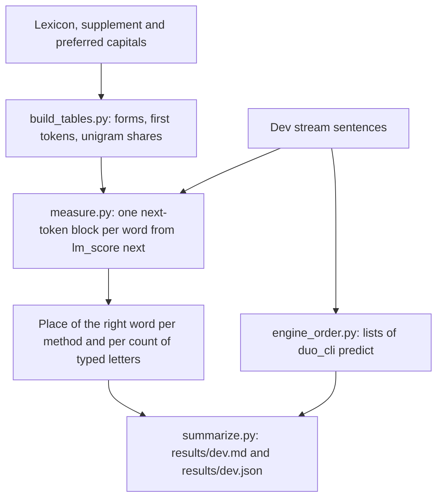

# Predicted words on the dev stream

This folder measures step 1 of the prediction strip plan. The measurement asks how often the
right word is among the first words of the strip. The measurement compares the keyboard's language model
with two word orders that need no model. `results/dev.md` holds the result tables.

## Definitions

| Term | Meaning |
| --- | --- |
| word | One part of a sentence between two spaces. The dev half of `english-domain-stream` holds 2,300 sentences and 26,453 words. |
| typed letters | The first k letters of the word, for k from 0 to the length of the word less 1. |
| candidates | The words of `Shared/lexicon-english.bin` with `Shared/supplement-ai-software.bin` laid over them. A word of both files gets the higher of its two log probabilities. |
| list | The candidates that start with the typed letters, without the word that equals the typed letters, in the order of a method. |
| found | The list holds the right word among its first N words. The match ignores letter case. A word outside the candidates is never found. |
| form | A way to write a candidate for the model: lower case, first letter capital, or the preferred capitals of the work area. |

- Each sentence opens an empty field, as in the stream harness (`scripts/lm-domain/harness.py`).
- The model reads the text before the word in the plain format of `LanguageModelPrompt.makeStock`:
  the first letter of the field is a capital, and "i" is "I". The model reads the last 96 tokens.
- A word counts for k typed letters only when it has more than k letters.
- When the first typed letter is a capital, the model methods use only forms that start with a capital.

## Methods

| Method | Order of the list |
| --- | --- |
| F | The log probability of the word in the lexicon. |
| F2 | `duo_predict_english` of `Engine/duo_engine.c`: the engine's value of the word after the previous word. |
| A | The log probability of the first token of the word after the text. Words of one value keep the order of F. |
| A2 | A plus the log of the word's unigram share among the forms with the same first token. |
| B | A2, and one more model request. |
| B0 | B without the term of the next token. |

- The value of a word in A, A2, B and B0 is the highest value of its allowed forms.
- The unigram share of a form is the word's probability over the summed probability of the forms
  of its pool with the same first token. There are three pools: the forms after a space that
  start with a capital, the other forms after a space, and the forms that open the field.
- The request of B scores 8 forms: the words of 2 or more tokens with the highest A2 value before
  any typed letter. Each of these words then gets the log probability of all tokens of its form,
  plus the log probability that the next token starts with a space. The same 8 values stay for
  every count of typed letters, so B asks the model once per word.

## Steps



## Commands

Run the commands in WSL, from the repository root. `LLAMA` is the install folder of llama.cpp
b4846 (`scripts/lm-rerank/build_on_linux.sh llama` builds it).

```
gcc -std=c11 -O2 -Wall -Wextra -Werror -I LLAMA/include scripts/lm-rerank/lm_score.c \
  -L LLAMA/lib -lllama -lggml -lggml-cpu -lggml-base -lm -o ~/predstrip/bin/lm_score
gcc -std=c11 -O2 -Wall -Wextra -Werror -I Engine Engine/duo_engine.c Engine/duo_cli.c -lm \
  -o build/prediction-strip/duo_cli
bash scripts/prediction-strip/run_dev.sh
python3 scripts/prediction-strip/engine_order.py --cli build/prediction-strip/duo_cli \
  --out build/prediction-strip/engine-order.jsonl
python3 scripts/prediction-strip/summarize.py --ranks build/prediction-strip/ranks \
  --engine build/prediction-strip/engine-order.jsonl --out scripts/prediction-strip/results
```

`run_dev.sh` takes about 20 minutes with 6 scorer processes of 2 threads. From Windows, start
it detached:
`powershell -File scripts/lm-domain/detach.ps1 -Name prediction-strip-dev -Where wsl -Script scripts/prediction-strip/run_dev.sh`.

Two more commands check the work and print one case:

```
uv run --with numpy python scripts/prediction-strip/check_next.py --lm ~/predstrip/bin/lm_score \
  --old OLD_LM_SCORE --model MODEL.gguf --tables build/prediction-strip/tables
uv run --with numpy python scripts/prediction-strip/measure.py --lm ~/predstrip/bin/lm_score \
  --model MODEL.gguf --tables build/prediction-strip/tables --show endomstream-dev-everyday-0001:2
```

## Files

| File | Content |
| --- | --- |
| `build_tables.py` | The candidates, their forms, the first token and the unigram share of each form. |
| `measure.py` | The place of the right word for F, A, A2, B and B0, from `lm_score MODEL THREADS next`. |
| `engine_order.py` | The place of the right word for F2, from `duo_cli predict`. |
| `summarize.py` | The result tables. |
| `check_next.py` | The check of the "next" mode of `lm_score.c` against the program before the change. |
| `run_dev.sh` | The job that builds the tables and runs `measure.py` in 6 processes. |
| `results/dev.md`, `results/dev.json` | The result tables of the dev half. |

The large files go to `build/prediction-strip/`: the tables, the places per word and the logs.

## Check of the keyboard's scorer

`check_scorer_next.py` compares the next-token numbers of the keyboard's scorer
(`duo_lm_scorer_next` in `LanguageModel/duo_lm_scorer.c`) with the mode "next" of `lm_score`,
byte for byte. The scorer runs from an empty cache, with the prefix reuse of the cache, and with
the keyboard's reuse. The workflow "Language model in the keyboard" runs the check on Linux.

```
gcc -std=c11 -O2 -Wall -Wextra -Werror -I LLAMA/include -I LanguageModel LanguageModel/duo_lm_scorer.c \
  scripts/lm-keyboard/scorer_cli.c -L LLAMA/lib -lllama -lggml -lggml-cpu -lggml-base -lm -o ~/predstrip/bin/scorer_cli
python3 scripts/prediction-strip/check_scorer_next.py --lm ~/predstrip/bin/lm_score \
  --scorer ~/predstrip/bin/scorer_cli --model MODEL.gguf
```
