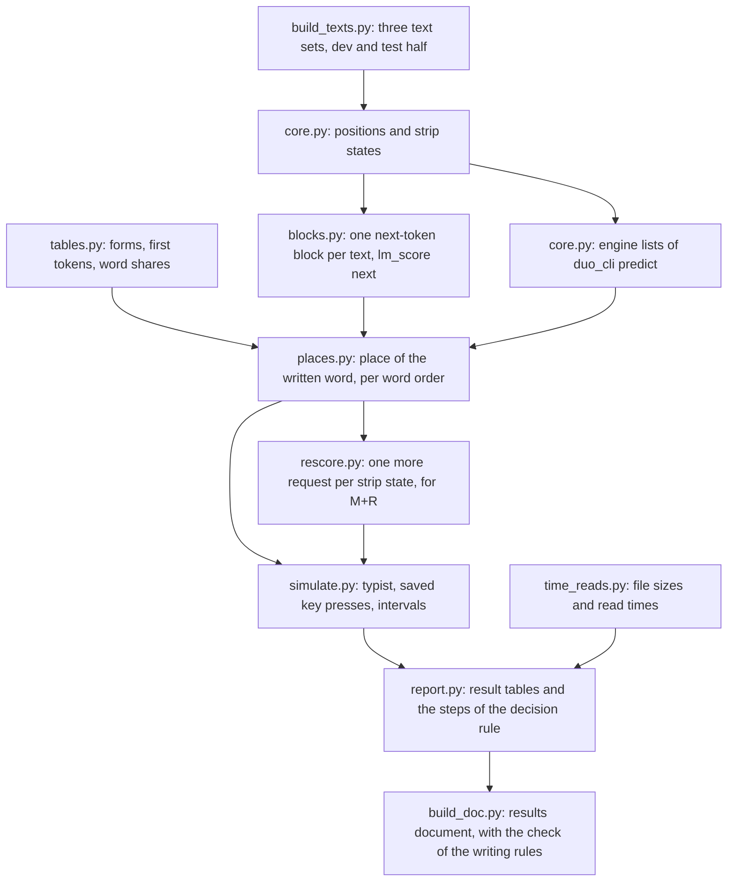

# Benchmark of the predicted words

This folder holds the benchmark that chooses the order of the predicted words of the
prediction strip. `docs/prediction-strip-benchmark-design.md` gives the design, and
`docs/prediction-strip-benchmark-results.md` gives the results.

A simulated typist types three text sets as people write them. The typist taps a predicted
word when the first entries of the strip hold the written word. The benchmark counts the key
presses that the taps save, for each word order.

## Steps



## Files

| File | Content |
| --- | --- |
| `rules.py` | Python copies of the keyboard's rules: the text that the strip predicts for, the form of a predicted word, the emoji, the space after a tap. |
| `build_texts.py` | The text sets technical, everyday and mobile, with their dev and test halves, in `build/prediction-strip/bench/texts/`. |
| `tables.py` | The word tables of one model file: the forms of each candidate word, their first tokens and word shares. |
| `core.py` | The strip states of a text half, the engine's lists and the engine's word values. |
| `blocks.py` | The next-token blocks of one model file for one text half, as 16-bit floats. |
| `places.py` | The place of the written word at every strip state: for E, M and M+E, with four form rules. |
| `rescore.py` | The places of M+R. |
| `simulate.py` | The typist: saved key presses and found share for every word order, with 1,000 bootstrap samples. |
| `time_reads.py` | The size of each model file and the time of one model read on the PC. |
| `report.py` | The result tables as Markdown, and the steps of the decision rule. |
| `build_doc.py`, `results_template.md` | The results document: the template, filled with the numbers. |
| `check_doc.py` | The check of the writing rules on the results document. |
| `trace.py` | The key press check: every key press and tap of the typist, counted one by one. |
| `check_rules.py` | The check of `rules.py` against the cases of the Swift unit tests. |
| `check_pipeline.py` | The check against the first measurement of the folder above. |
| `check_engine_values.py` | The check of the engine's word values against `duo_cli predict`. |
| `check_engine_order.py` | The check of the model orders against `duo_cli predict-model`, the engine's own model order. |
| `job_dev.sh`, `job_blocks.sh`, `job_places.sh`, `job_rest.sh`, `job_rescore.sh` | The jobs of the dev halves. |
| `results/dev.json`, `results/cost.json`, `results/dev-tables.md` | The numbers of the dev halves. The bootstrap samples stay in `build/prediction-strip/bench/results/dev.npz`. |

A script that reads a half for a run stops for the test half until the file `chosen.json` of
this folder names the chosen word order, as `{"order": "shipped|typed|engine|0.3"}`.
`simulate.py` then reads the test halves with that word order and with E only.

## Commands

Run the commands from the repository root. The Python commands run in WSL. `lm_score` and
`duo_cli` are built as the README of the folder above says. `LM` is the path of `lm_score`,
and `LD_LIBRARY_PATH` holds the `lib` folder of llama.cpp b4846.

```
python3 scripts/prediction-strip/benchmark/check_rules.py
python3 scripts/prediction-strip/benchmark/build_texts.py --corpus CORPUS_FOLDER \
  --tatoeba eng_sentences.tsv.bz2 --enron enronmobile.zip
powershell -File scripts/lm-domain/detach.ps1 -Name bench-dev -Where wsl \
  -Script scripts/prediction-strip/benchmark/job_dev.sh
uv run --with numpy python scripts/prediction-strip/benchmark/check_pipeline.py --cli build/prediction-strip/duo_cli
uv run --with numpy python scripts/prediction-strip/benchmark/check_engine_values.py \
  --cli build/prediction-strip/duo_cli --set mobile
uv run --with numpy python scripts/prediction-strip/benchmark/check_engine_order.py \
  --cli build/prediction-strip/duo_cli --set mobile
powershell -File scripts/lm-domain/detach.ps1 -Name bench-rescore -Where wsl \
  -Script scripts/prediction-strip/benchmark/job_rescore.sh -Arguments "typed engine dev"
uv run --with numpy python scripts/prediction-strip/benchmark/time_reads.py --lm LM \
  --model shipped=SHIPPED.gguf --model base135=SMOLLM2-135M.gguf \
  --model smol360=SMOLLM2-360M.gguf --model qwen05=QWEN2.5-0.5B.gguf --requests shipped
uv run --with numpy python scripts/prediction-strip/benchmark/simulate.py --half dev \
  --models shipped base135 smol360 qwen05
uv run --with numpy python scripts/prediction-strip/benchmark/report.py --half dev
uv run --with numpy python scripts/prediction-strip/benchmark/trace.py --set mobile \
  --order "shipped|typed|engine|0.3" --words 3 --typist 1 --print 5
uv run --with numpy python scripts/prediction-strip/benchmark/build_doc.py
```

`check_engine_order.py` needs a `duo_cli` with the mode `predict-model`, so one built at commit
504121c or later.

The jobs write their logs to `build/lm-domain/logs/`. On an Intel i9-13900K, with 6 scorer
processes of 2 threads, `job_dev.sh` ran 58 minutes after the blocks of the shipped model were
in place. Those blocks take about 6 minutes more. The blocks take 17 GB under
`build/prediction-strip/bench/blocks/`.

The Enron Mobile archive comes from https://keithv.com/software/enronmobile/enronmobile.zip.
Its SHA-256 is `bedd81e7002ee2d9b033ce1d31bbce79a6e3258a6a1c2557a8f7e0910922d72e`. The archive
states no license, so the repository holds no sentence of it.
