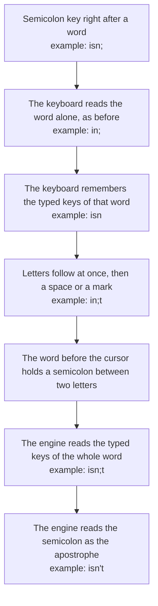

# A semicolon typed in place of the apostrophe

## Summary

The keyboard now reads "don;t" as "don't" at the space, without the proofreader. The wide layout
has the semicolon key right beside the apostrophe key, and each key is 0.7 key widths wide.

## Terms

| Term | Meaning |
| --- | --- |
| engine | The typing engine of `Engine/duo_engine.c`. The engine reads typed text and chooses a correction. |
| keyboard rules | The steps of `KeyboardTextController.correctLastWord`: which typed text the keyboard hands to the engine at each key that ends a word. `scripts/lm-rerank/rerank.py` holds a Linux copy. |
| model step | The language model that picks one of the engine's readings by `KeyboardLanguageModel.rule`. |
| semicolon slip | A semicolon key pressed in place of the apostrophe key, between two letters of a word. |

## What went wrong

The semicolon key ends a word. For "don;t" the keyboard read "don" at the semicolon and "t" at
the space, so no step ever saw "don;t" as one word. The proofreader fixed the sentence later.
For "isn;t" the keyboard also changed "isn" to "in" at the semicolon.

## The change



- `KeyboardTextLogic.correctableWord` takes a semicolon between two letters into the word.
- The engine accepts a semicolon between two letters and reads it only as the apostrophe, at
  the cost `semicolon_for_apostrophe` 2.5. A semicolon after a letter is never read as a letter
  key: "hour;and" would become "hour land".
- The typed text with the semicolon counts as text with an unknown word, so the model step needs
  a lead of 12 to bring it back.
- A delete right after the fix brings "don;t" back, and the keyboard then keeps it.

## The measurement

`scripts/typing-evaluation/build_english_semicolon_cases.py` builds the cases from two existing
case files:

- `semicolon_for_apostrophe`: a contraction typed with a semicolon, and the next word of the
  sentence, as "it;s clear" for "it's clear".
- `clean_semicolon_then_space`: a semicolon typed on purpose with a space after it, as
  "works; then".
- `clean_semicolon_without_space`: a semicolon typed on purpose without a space, as "works;then".

Table 1. Right texts of the engine alone, which gets the whole typed text of a case at once
(`scripts/typing-evaluation/run_duo_engine.py --task english-semicolon`), per cost of the slip,
on the dev half.

| Cost | Semicolon slips, of 1,233 | Semicolons typed on purpose, of 800 |
| --- | --- | --- |
| 0.5 | 1,158 | 798 |
| 1.5 | 1,178 | 800 |
| 2.5 (chosen) | 1,178 | 800 |
| 3.5 | 1,176 | 800 |
| 4.5 | 1,164 | 800 |
| 5.5 | 1,092 | 800 |
| 6.5 | 752 | 800 |

The higher the cost above 2.5, the fewer slips the engine repairs. At 0.5 the engine changes two
semicolons that the person typed on purpose.

Table 2. Right texts through the keyboard rules, key by key
(`check_semicolon_cases.py`, files `results.dev.json` and `results.test.json`).

| Half | Run | Semicolon slips | Semicolon, then space | Semicolon without space |
| --- | --- | --- | --- | --- |
| dev | engine alone | 1,178 of 1,233 | 389 of 400 | 400 of 400 |
| dev | with the model step | 1,201 of 1,233 | 374 of 400 | 399 of 400 |
| test | engine alone | 1,185 of 1,224 | 392 of 400 | 400 of 400 |
| test | with the model step | 1,195 of 1,224 | 384 of 400 | 400 of 400 |

With the model step the keyboard repairs 97.4% of the slips on the dev half and 97.6% on the
test half. The cost of the slip was chosen on the dev half, and the test half was read once.

The model step repairs more slips than the engine alone, because the engine alone turns the
name "tom" after the word into "to,". The model step also changes more of the rare words that
follow a semicolon and a space. The change of this folder does not reach those words: the word
after the space holds no semicolon.

The four English dev sets of `scripts/typing-evaluation` give the same texts with the engine
before and after the change: english, english-symbols, english-apostrophe-words and
english-comma-slip.

## Limits

- The engine reads a semicolon only as the apostrophe. "he;lo" does not become "hello".
- The slip is repaired when the lexicon holds the word with its apostrophe. It holds the usual
  contractions and 3,722 words with an apostrophe in all, such as "today's". A rare form such
  as "who're" can lose against a frequent word.
- The keys "[" above and "/" below the apostrophe key are not read as the apostrophe.
- The measurement ran on Linux. No run of the Swift keyboard typed these cases on a phone.

## How to run

On Linux, from the repository root, after `scripts/lm-rerank/build_on_linux.sh llama`:

```
python3 scripts/typing-evaluation/build_english_semicolon_cases.py
python3 scripts/typing-evaluation/run_duo_engine.py --task english-semicolon --half dev
python3 scripts/semicolon-slip-check/check_semicolon_cases.py --shim "$PWD/build/lm-rerank/libduo_shim.so" \
    --half dev --lm build/lm-rerank/lm_score --model Shared/smollm2-lora-domain-s100-seed1.Q4_K_M.gguf \
    --out scripts/semicolon-slip-check/results.dev.json
```
