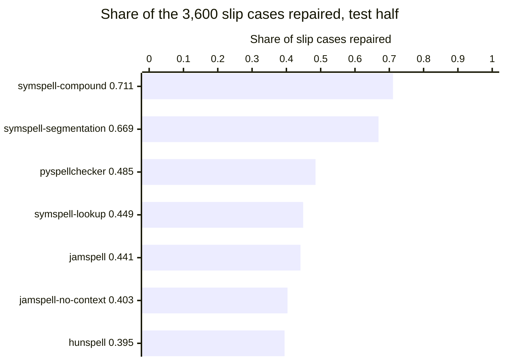
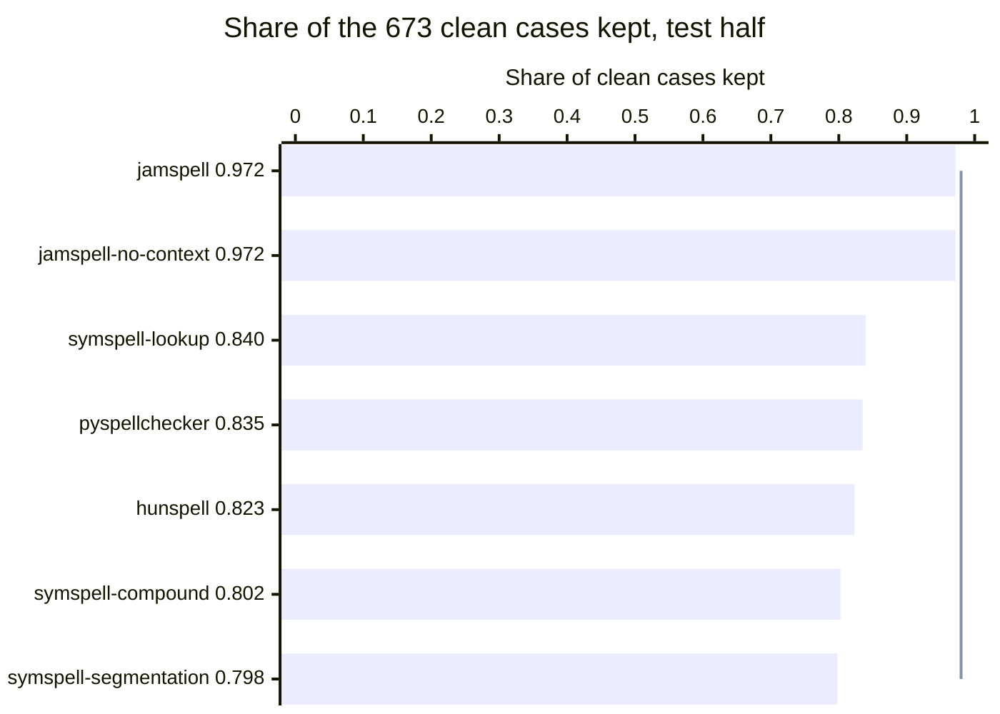
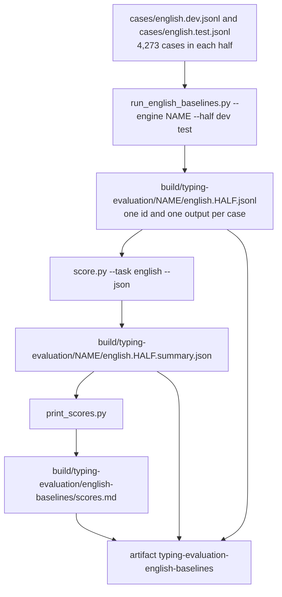

# English baseline engines for the typing evaluation

## Summary

On the test half, each engine name repairs under half of slip cases or changes one clean case in five.

1. Start a run on the Linux runner: `gh workflow run eval-english-baselines.yml --ref eval/english-baselines`.
2. Download the outputs of that run:
   `gh run download RUN_ID --name typing-evaluation-english-baselines --dir build/typing-evaluation-english-baselines`.
3. Read the share per category in `build/typing-evaluation-english-baselines/english-baselines/scores.md`.
4. Use `symspell-compound` and `jamspell` as the two reference lines for our own engine. Figures 1 and 2 give the reason.

This document does not give a score for Apple's keyboard or measure the speed and memory of an engine.

## Terms for the engines and the test cases

Table 1. The terms this document uses. `scripts/typing-evaluation/README.md` defines the task and the case format.

| Term | Meaning |
| --- | --- |
| Slip | A typing error that the case generator put into the intended text |
| Slip case | A case whose typed text holds a slip. A right output equals the intended text. |
| Clean case | A case whose typed text equals the intended text. Any change counts as wrong. |
| Dev half, test half | The two halves of the cases. Each half holds 673 clean cases and 3,600 slip cases. |
| Token | One piece of the typed text between two spaces |
| Context | The 0 to 11 words before the typed text |
| Edit distance | The number of letter changes between two words: add, remove or replace a letter, or swap two neighbors |
| Word-pair table | A list of two-word sequences with their counts, also called a bigram table |
| Engine | One open-source spelling program with its stock data |
| Engine name | One engine with one way of calling it. The outputs of an engine name go to one folder. |

## Seven engine names for four engines

Table 2. The seven engine names. Only `jamspell` reads the context, and the six other names read the typed text alone.

| Engine name | Plain description | Reason for the name |
| --- | --- | --- |
| `symspell-lookup` | SymSpell replaces each token with the most frequent word at the smallest edit distance, up to 2. | The reference for plain edit distance on one word |
| `symspell-compound` | SymSpell reads the whole typed text in one `lookup_compound` call. The call can split a token and join two tokens. | The first SymSpell call for slips around the space key |
| `symspell-segmentation` | SymSpell reads the whole typed text in one `word_segmentation` call. The call places every space again and corrects letters. | The second SymSpell call for slips around the space key |
| `pyspellchecker` | pyspellchecker replaces each unknown token with the most frequent known word at edit distance 1, or else at distance 2. | The simplest known method, from Peter Norvig |
| `hunspell` | Hunspell checks each token. A token that Hunspell marks as misspelled becomes Hunspell's first suggestion. | A desktop spell checker that does not rank by word counts |
| `jamspell` | JamSpell corrects the context followed by the typed text, with a model of word sequences. | The measure of the gain from the words before |
| `jamspell-no-context` | JamSpell corrects the typed text alone. | The comparison line for `jamspell` |

## Scores of the seven engine names on the dev half and the test half

Figure 1. Share of slip cases repaired on the test half. The two SymSpell calls that can move a space repair 67 and 71 percent. The five other engine names repair 39 to 49 percent.

Figure 2. Share of clean cases kept on the test half. The line marks 0.98, the share the task asks an engine to keep. JamSpell keeps 97 percent, and the five other engine names keep 80 to 84 percent.

The two engine names at the top of Figure 1 are the two at the bottom of Figure 2. Tables 3 and 4 give the share per category. `print_scores.py` wrote both tables in run 42753232305.

Table 3. Share of cases with the intended text on the dev half. Each engine name keeps every common clean word and changes rare words and names.

| Category | Cases | hunspell | jamspell | jamspell-no-context | pyspellchecker | symspell-compound | symspell-lookup | symspell-segmentation |
| --- | ---: | ---: | ---: | ---: | ---: | ---: | ---: | ---: |
| `clean_common` | 300 | 1.0000 | 1.0000 | 1.0000 | 1.0000 | 1.0000 | 1.0000 | 1.0000 |
| `clean_rare` | 300 | 0.7800 | 0.9733 | 0.9733 | 0.8033 | 0.7867 | 0.8133 | 0.7800 |
| `clean_names_and_terms` | 73 | 0.4521 | 0.9041 | 0.9041 | 0.5068 | 0.3699 | 0.5205 | 0.3562 |
| `substitution_adjacent` | 300 | 0.5533 | 0.8967 | 0.8167 | 0.8767 | 0.8300 | 0.8433 | 0.8400 |
| `deletion` | 300 | 0.3200 | 0.6767 | 0.5733 | 0.6700 | 0.6733 | 0.6833 | 0.6800 |
| `double_letter` | 300 | 0.8433 | 0.9567 | 0.9300 | 0.9767 | 0.9433 | 0.9567 | 0.9567 |
| `extra_adjacent` | 300 | 0.8133 | 0.9800 | 0.9667 | 0.9733 | 0.9567 | 0.9633 | 0.9633 |
| `transposition` | 300 | 0.8967 | 0.8867 | 0.8333 | 0.8867 | 0.8533 | 0.8733 | 0.8733 |
| `two_errors` | 300 | 0.5267 | 0.7767 | 0.7033 | 0.8367 | 0.7833 | 0.8300 | 0.8133 |
| `space_missing` | 300 | 0.7300 | 0.0000 | 0.0000 | 0.0000 | 0.8667 | 0.0000 | 0.8033 |
| `space_to_letter` | 300 | 0.0000 | 0.0000 | 0.0000 | 0.0000 | 0.9733 | 0.0000 | 0.5767 |
| `space_transposed` | 300 | 0.0367 | 0.1933 | 0.0833 | 0.1467 | 0.1500 | 0.1867 | 0.2433 |
| `space_extra` | 300 | 0.0000 | 0.0000 | 0.0000 | 0.0000 | 0.9667 | 0.0000 | 0.9667 |
| `letter_to_space` | 300 | 0.0000 | 0.0000 | 0.0000 | 0.0000 | 0.4600 | 0.0000 | 0.4633 |
| `apostrophe_missing` | 300 | 0.1533 | 0.0000 | 0.0000 | 0.4367 | 0.1433 | 0.1433 | 0.0033 |
| ALL CLEAN | 673 | 0.8425 | 0.9777 | 0.9777 | 0.8588 | 0.8366 | 0.8648 | 0.8321 |
| ALL SLIPS | 3600 | 0.4061 | 0.4472 | 0.4089 | 0.4836 | 0.7167 | 0.4567 | 0.6819 |

Table 4. Share of cases with the intended text on the test half. `symspell-lookup`, `pyspellchecker` and both JamSpell names repair 0 of the 1,200 cases in `space_missing`, `space_to_letter`, `space_extra` and `letter_to_space`.

| Category | Cases | hunspell | jamspell | jamspell-no-context | pyspellchecker | symspell-compound | symspell-lookup | symspell-segmentation |
| --- | ---: | ---: | ---: | ---: | ---: | ---: | ---: | ---: |
| `clean_common` | 300 | 1.0000 | 1.0000 | 1.0000 | 1.0000 | 0.9967 | 0.9967 | 0.9933 |
| `clean_rare` | 300 | 0.7233 | 0.9667 | 0.9667 | 0.7400 | 0.7167 | 0.7433 | 0.7167 |
| `clean_names_and_terms` | 73 | 0.5068 | 0.8767 | 0.8767 | 0.5479 | 0.3562 | 0.5890 | 0.3288 |
| `substitution_adjacent` | 300 | 0.5867 | 0.8867 | 0.8133 | 0.8533 | 0.8167 | 0.8200 | 0.8200 |
| `deletion` | 300 | 0.2967 | 0.6167 | 0.5233 | 0.6433 | 0.5767 | 0.5900 | 0.5767 |
| `double_letter` | 300 | 0.8733 | 0.9633 | 0.9467 | 0.9567 | 0.9600 | 0.9700 | 0.9700 |
| `extra_adjacent` | 300 | 0.8233 | 0.9700 | 0.9667 | 0.9767 | 0.9700 | 0.9800 | 0.9767 |
| `transposition` | 300 | 0.8833 | 0.8733 | 0.8233 | 0.8967 | 0.8433 | 0.8600 | 0.8567 |
| `two_errors` | 300 | 0.4733 | 0.7967 | 0.7000 | 0.8300 | 0.7867 | 0.8233 | 0.8133 |
| `space_missing` | 300 | 0.6367 | 0.0000 | 0.0000 | 0.0000 | 0.8767 | 0.0000 | 0.7400 |
| `space_to_letter` | 300 | 0.0000 | 0.0000 | 0.0000 | 0.0000 | 0.9667 | 0.0000 | 0.5267 |
| `space_transposed` | 300 | 0.0400 | 0.1867 | 0.0667 | 0.1500 | 0.1700 | 0.2333 | 0.2833 |
| `space_extra` | 300 | 0.0000 | 0.0000 | 0.0000 | 0.0000 | 0.9500 | 0.0000 | 0.9500 |
| `letter_to_space` | 300 | 0.0000 | 0.0000 | 0.0000 | 0.0000 | 0.5033 | 0.0000 | 0.5100 |
| `apostrophe_missing` | 300 | 0.1233 | 0.0000 | 0.0000 | 0.5133 | 0.1100 | 0.1100 | 0.0000 |
| ALL CLEAN | 673 | 0.8232 | 0.9718 | 0.9718 | 0.8351 | 0.8024 | 0.8395 | 0.7979 |
| ALL SLIPS | 3600 | 0.3947 | 0.4411 | 0.4033 | 0.4850 | 0.7108 | 0.4489 | 0.6686 |

## Installed packages and versions of the four engines

The runner image is `ubuntu24` version `20261101.360.1`, with Ubuntu 24.04.5, Python 3.12.3 and uv 0.13.7.

Table 5. The packages the runner installed. Three engines install as packages, and JamSpell builds from its repository.

| Engine | Method of the engine | Package and source | Version |
| --- | --- | --- | --- |
| SymSpell | An index of every dictionary word with up to 2 letters removed, ranked by edit distance and word count | `symspellpy` from PyPI | 6.10.2 |
| pyspellchecker | Known words at edit distance 1 of the token, or else at distance 2, ranked by word count | `pyspellchecker` from PyPI | 0.9.1 |
| Hunspell | A fixed list of single edits, then letter-sequence similarity, on a word list with affix rules | `hunspell` and `libhunspell-1.7-0` from Ubuntu | 1.7.2+really1.7.2-10build3 |
| Hunspell dictionary | The en_US word list and affix rules | `hunspell-en-us` from Ubuntu | 1:2020.12.07-2 |
| JamSpell | Candidates within edit distance 2, ranked by a model of word sequences | `jamspell` built from `github.com/bakwc/JamSpell`, commit `25d3f5c2c76786cc6cbbfcf79b3989fc5e48eaa8` | 0.0.12 |
| JamSpell model | The English model that the JamSpell README links | `https://github.com/bakwc/JamSpell-models/raw/master/en.tar.gz` | file dated 2018-01-14 |

The JamSpell build uses SWIG 4.2.0 and g++ 13.3.0 from the runner image. The JamSpell archive on PyPI asks for SWIG 3 in its `setup.py`, and Ubuntu 24.04 ships SWIG 4.2.0. The workflow builds the repository commit for that reason.

Table 6. The data files the engines read, with their checksums on the runner. A checksum that differs in a later run means the stock data changed.

| Engine | File | Bytes | SHA-256 |
| --- | --- | ---: | --- |
| SymSpell | `frequency_dictionary_en_82_765.txt` in the `symspellpy` wheel | 1,332,879 | `68e9dc81c7e73bd7310b57e516ecaea0d8b6387ff71344a57c04174650a407a7` |
| SymSpell | `frequency_bigramdictionary_en_243_342.txt` in the `symspellpy` wheel | 5,137,213 | `fd892a160184101dd7ae807ac5a302d01fcea1c47304181a8ed7ed9c94545bcd` |
| pyspellchecker | `resources/en.json.gz` in the `pyspellchecker` wheel | 650,750 | `2474a48af86fd81dccea9edd0bba6cd36dd2ecedc0ae217cefcb233bba28613c` |
| Hunspell | `/usr/share/hunspell/en_US.aff` | | `70fe5778717d097ce2f3326baaa5c1e4d2206d81a5a81d3ea8e11c4770806dd5` |
| Hunspell | `/usr/share/hunspell/en_US.dic`, 79,014 lines | | `829a043cf078d1e80e886289a13823454977f442a239a859d2133ea61944aa60` |
| JamSpell | `en.bin` from `en.tar.gz` | 68,422,475 | `eff7940dbe1acacbc397bc0dd32072ed64803ae59625809c1c4a9189159d1550` |

## Licenses of the engine code and the engine data

Table 7. The license of each engine and of its data. The code of all four engines has an open license, and three data files do not have a stated license.

| Engine | Code license | Data license |
| --- | --- | --- |
| SymSpell | MIT, for `symspellpy` and for SymSpell | The SymSpell README names two sources of the word list. The sources are Google Books Ngram data (CC BY 3.0) and the SCOWL word lists. The README does not name a source or a license for the word-pair table. |
| pyspellchecker | MIT | The pyspellchecker README says the word list comes from OpenSubtitles sentences. The README does not state a license for the word list. |
| Hunspell | LGPL, GPL or MPL, at the user's choice | The en_US dictionary comes from the SCOWL word lists. The SCOWL notice in its copyright file permits use, copy, change, distribution and sale when the notice stays. |
| JamSpell | MIT | The repository `bakwc/JamSpell-models` does not hold a license file. The JamSpell README says the model comes from 300,000 Wikipedia sentences and 300,000 news sentences. |

## Calls from the adapter to each engine

Table 8. The calls of `run_english_baselines.py` for each engine name. Every argument is the stock value from the engine's own documentation.

| Engine name | Setup, once per run | Call per case | Output of the adapter |
| --- | --- | --- | --- |
| `symspell-lookup` | `SymSpell(max_dictionary_edit_distance=2, prefix_length=7)`, then `load_dictionary(words, term_index=0, count_index=1)` | `lookup(token, Verbosity.TOP, max_edit_distance=2)` for each token | The first suggestion for each token, joined with spaces |
| `symspell-compound` | The same setup, then `load_bigram_dictionary(pairs, term_index=0, count_index=2)` | `lookup_compound(typed, max_edit_distance=2)` | The one suggestion the call returns |
| `symspell-segmentation` | The setup of `symspell-lookup` | `word_segmentation(typed)` | The field `corrected_string` |
| `pyspellchecker` | `SpellChecker()` | `correction(token)` for each token | The returned word for each token, joined with spaces |
| `hunspell` | `Hunspell_create(en_US.aff, en_US.dic)` in `libhunspell-1.7`, through Python's `ctypes` | `Hunspell_spell(token)`, then `Hunspell_suggest(token)` for a misspelled token | The first suggestion for a misspelled token, and the token itself for a correct one |
| `jamspell` | `TSpellCorrector()`, then `LoadLangModel("en.bin")` | `FixFragment(context + " " + typed)` | The last space-separated pieces, as many as the typed text has |
| `jamspell-no-context` | The setup of `jamspell` | `FixFragment(typed)` | The whole returned text |

## Flow of one run from the case files to the score tables

Figure 3. Flow of one run. `run_and_score.sh` runs the adapter and the scorer for one engine name, and the workflow calls it seven times.

## Limits of the adapter and of the scores

- The adapter passes text only. An engine does not get key positions or touch points.
- Four engine names return as many tokens as they get: `symspell-lookup`, `pyspellchecker`, `jamspell` and `jamspell-no-context`. A slip that changes the number of tokens stays wrong for them.
- `hunspell` changes the number of tokens only when its first suggestion holds a space.
- Only `jamspell` reads the context. The adapter gives the three SymSpell names and the two other engines the typed text alone.
- The adapter keeps the typed token when an engine does not return a suggestion.
- The cases are lower case, and the scorer ignores letter case. Hunspell returns `Mary` for `mary`, and the scorer counts that output as right.
- JamSpell did not return an apostrophe in any output. JamSpell repairs 0 of the 300 `apostrophe_missing` cases in each half.
- Every engine runs with its stock settings. The adapter does not tune a setting on the dev half or on the test half.
- The workflow sets `PYTHONHASHSEED=0`. The seed fixes pyspellchecker's choice among candidates with equal counts.
- The `hunspell` adapter reads `/usr/share/hunspell/en_US.aff` and `en_US.dic`, the paths of the Ubuntu package.
- The adapter does not measure the speed or the memory of an engine.

## Files of the English baseline adapter

Table 9. The files of the adapter. `run_english_baselines.py` holds every engine call, and the four other files serve the workflow.

| File | Content |
| --- | --- |
| `run_english_baselines.py` | The adapter, with one function per engine name |
| `run_and_score.sh` | Runs the adapter and `score.py` for one engine name on both halves |
| `print_versions.sh` | Prints the installed versions and the checksums of the data files |
| `print_scores.py` | Prints one score table per half from the summary files |
| `.github/workflows/eval-english-baselines.yml` | The workflow that installs the engines and runs these files on `ubuntu-24.04` |
