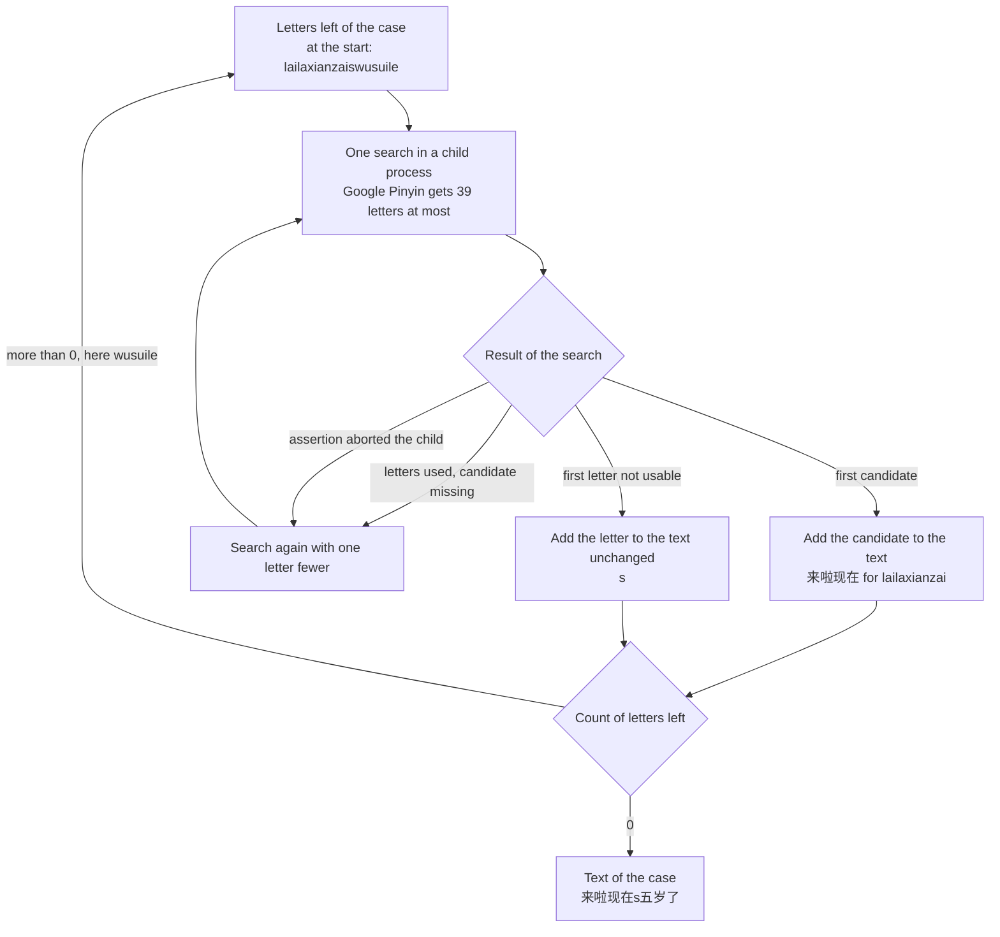

# Google Pinyin and libpinyin adapters for the Pinyin typing evaluation

## Summary

Google Pinyin and libpinyin repair under 2 percent of [slip cases](#terms-of-the-two-engine-adapters "Cases whose typed letters hold a typing slip from the case generator"), or 7 percent with libpinyin's [fuzzy sounds](#terms-of-the-two-engine-adapters "Pairs of sounds that some speakers merge, such as l and n") on.

1. Read Table 4 for the scores of the six engine names on the dev half and the test half.
2. Do not rely on the options of either engine for slip repair. The options repair three fixed patterns. The patterns are an abbreviated syllable, a spelling correction such as `gn` for `ng`, and a fuzzy sound.
3. Keep libpinyin as a comparison only. The package copyright file gives GPL-3.0-or-later for its code and its data.
4. Get the output files of the last run with `gh`, the GitHub command-line tool. The first command prints the run number, and the second command takes that number as `RUN_ID`:
   `gh run list --workflow eval-googlepinyin-libpinyin.yml --branch eval/googlepinyin-libpinyin --limit 1`
   `gh run download RUN_ID -n typing-evaluation-googlepinyin-libpinyin`
5. Start a new run with a push to the branch `eval/googlepinyin-libpinyin`. Merge `main` into the branch first. The scores here use the case files of commit `e997c39`, and `main` rebuilt the case files in commit `26cdf17`.

Open point: the document does not compare these engines with the other groups' engines or with real typing.

## Terms of the two engine adapters

Table 1. The terms that the document uses, each with one meaning.

| Term | Meaning |
| --- | --- |
| Dev half, test half | The two halves of the test cases, with 3,000 Pinyin cases each. `scripts/typing-evaluation/README.md` defines them. |
| Clean case | A case whose typed letters are the correct Pinyin of the intended text. Each half has 900. |
| Slip case | A case whose typed letters hold a typing slip from the case generator. Each half has 2,100 in seven categories. |
| Right case | A case whose output equals the intended text, character for character. A right slip case is a repaired case. |
| Point | One percentage point of the share of right cases. |
| Search | One call of an adapter's search function with a string of letters. |
| First candidate | The text that an engine ranks first for the letters of one search. |
| Comparison line | The engine name that a score is read against: the same engine with its slip options off. |
| Window | The most letters that one search of an engine reads. Google Pinyin has a window of 39 letters. |
| Abbreviated syllable | A syllable typed as its first consonant only, such as `d` for `di`. Google Pinyin's source calls the feature ShouZiMu, and libpinyin calls it incomplete Pinyin. |
| Spelling correction | One of libpinyin's eight fixed repairs of a syllable. Four of them: `gn` for `ng`, `mg` for `ng`, `on` for `ong`, `v` for `u`. The other four: `iou` for `iu`, `uei` for `ui`, `uen` for `un`, `ue` for `ve`. |
| Fuzzy sound | One of libpinyin's ten sound pairs that some speakers merge: c/ch, s/sh, z/zh, f/h, g/k, l/n, l/r, an/ang, en/eng, in/ing. |
| Option value | The sum of libpinyin's option flags, written as a hexadecimal number. |
| Assertion | A check inside a library that aborts the process when its condition is false. |
| User dictionary | The file or folder that holds the words an engine learns from a person's picks. |
| Artifact | The bundle of output files that a GitHub Actions run stores for download. |

The two engines name the abbreviated syllable differently, and this document uses one term.

## Settings behind the six engine names

The later tables use six engine names. Each engine name identifies one engine with fixed options.

Table 2. The six engine names in plain words, with the reason for each name.

| Engine name | Engine and options in plain words | Reason for the name |
| --- | --- | --- |
| `googlepinyin` | Google Pinyin as the package sets it. Abbreviated syllables are on. | The engine as the Ubuntu package ships it. |
| `googlepinyin-no-abbreviation` | Google Pinyin with one-letter abbreviated syllables off. | The comparison line for `googlepinyin`. The gap is the net effect of one-letter abbreviated syllables. |
| `libpinyin-default` | libpinyin with every slip option off. | The comparison line for the three other libpinyin names. |
| `libpinyin-correction` | libpinyin with the eight spelling corrections on. | The effect of the spelling corrections alone. |
| `libpinyin-correction-incomplete` | libpinyin with the spelling corrections and abbreviated syllables on. | The option set of libpinyin's own test program. |
| `libpinyin-correction-incomplete-fuzzy` | libpinyin with the spelling corrections, abbreviated syllables and all ten fuzzy sounds on. | Every slip option of libpinyin on. |

The more options a libpinyin name lists, the more slip patterns libpinyin accepts.

Table 3. The exact setting of each engine name, as `evaluate.sh` and the two programs apply it.

| Engine name | Mode words of the program | Calls or option flags | Option value |
| --- | --- | --- | --- |
| `googlepinyin` | none | none after `im_open_decoder` | not used |
| `googlepinyin-no-abbreviation` | `no-abbreviation` | `im_enable_shm_as_szm(false)`, `im_enable_ym_as_szm(false)` | not used |
| `libpinyin-default` | none | `USE_DIVIDED_TABLE`, `USE_RESPLIT_TABLE`, `DYNAMIC_ADJUST` | `0x380` |
| `libpinyin-correction` | `correction` | the three flags above and `PINYIN_CORRECT_ALL` | `0x1fe00380` |
| `libpinyin-correction-incomplete` | `correction incomplete` | the flags above and `PINYIN_INCOMPLETE` | `0x1fe00388` |
| `libpinyin-correction-incomplete-fuzzy` | `correction incomplete fuzzy` | the flags above and `PINYIN_AMB_ALL` | `0x1fefff88` |

Every engine name uses the packaged dictionary and a new, empty user dictionary. The folder does not tune a setting on either half.

Two facts bound the settings:

- `googlepinyin-no-abbreviation` keeps `zh`, `ch` and `sh` as abbreviated syllables. The source of libgooglepinyin 0.1.2 says so in `spellingtrie.cpp`, function `if_valid_id_update`. The dev case `ninengbangzhwodehua` agrees: the name returns the intended text for it.
- The flags of `libpinyin-correction-incomplete` equal the flags in `tests/test_pinyin.cpp` of libpinyin at tag 2.8.1.

## Scores of the six engine names on the dev half and the test half

```text
Clean cases right, of 900 (one block is 2 percent)
googlepinyin                           ████████████████████████████ 56.0%
googlepinyin-no-abbreviation           ████████████████████████████▏ 56.2%
libpinyin-default                      █████████████████████████▉ 51.7%
libpinyin-correction                   █████████████████████████▉ 51.7%
libpinyin-correction-incomplete        █████████████████████████▉ 51.7%
libpinyin-correction-incomplete-fuzzy  ████████████████████▏ 40.2%

Slip cases repaired, of 2,100 (one block is 2 percent)
googlepinyin                           ▌ 1.0%
googlepinyin-no-abbreviation           ▏ 0.2%
libpinyin-default                        0.0%
libpinyin-correction                   ▎ 0.6%
libpinyin-correction-incomplete        ▊ 1.4%
libpinyin-correction-incomplete-fuzzy  ███▋ 7.2%
```

Figure 1. Shares of right cases on the test half, all bars on one scale. The more libpinyin options are on, the more slip cases libpinyin repairs. The fuzzy sounds also lower libpinyin's clean share by 11.4 points. The task allows a setting that keeps the clean share within 1 point of the comparison line.

Table 4. Right cases and their shares from `score.py` on the case files of commit `e997c39`. Each half has 900 clean cases and 2,100 slip cases. The last column is the clean share minus the clean share of the comparison line, in points.

| Engine name | Dev clean | Dev slips | Test clean | Test slips | Clean change, dev and test |
| --- | --- | --- | --- | --- | --- |
| `googlepinyin` | 487 (0.5411) | 23 (0.0110) | 504 (0.5600) | 20 (0.0095) | -0.2, -0.2 |
| `googlepinyin-no-abbreviation` | 489 (0.5433) | 1 (0.0005) | 506 (0.5622) | 5 (0.0024) | comparison line |
| `libpinyin-default` | 470 (0.5222) | 0 (0.0000) | 465 (0.5167) | 0 (0.0000) | comparison line |
| `libpinyin-correction` | 470 (0.5222) | 13 (0.0062) | 465 (0.5167) | 12 (0.0057) | 0.0, 0.0 |
| `libpinyin-correction-incomplete` | 470 (0.5222) | 37 (0.0176) | 465 (0.5167) | 30 (0.0143) | 0.0, 0.0 |
| `libpinyin-correction-incomplete-fuzzy` | 365 (0.4056) | 141 (0.0671) | 362 (0.4022) | 152 (0.0724) | -11.7, -11.4 |

The engine names within 1 point of their comparison line repair under 2 percent of the slip cases. Each run writes the lines behind Table 4 and Table 5 to `googlepinyin-libpinyin.scores.txt` in the artifact.

Table 5. Right cases of 300 in each slip category, written as dev, test.

| Engine name | `substitution_adjacent` | `deletion` | `double_letter` | `extra_adjacent` | `transposition` | `two_errors` | `fuzzy_sound` |
| --- | --- | --- | --- | --- | --- | --- | --- |
| `googlepinyin` | 0, 0 | 23, 20 | 0, 0 | 0, 0 | 0, 0 | 0, 0 | 0, 0 |
| `googlepinyin-no-abbreviation` | 0, 0 | 1, 5 | 0, 0 | 0, 0 | 0, 0 | 0, 0 | 0, 0 |
| `libpinyin-default` | 0, 0 | 0, 0 | 0, 0 | 0, 0 | 0, 0 | 0, 0 | 0, 0 |
| `libpinyin-correction` | 5, 4 | 3, 1 | 0, 0 | 0, 0 | 5, 7 | 0, 0 | 0, 0 |
| `libpinyin-correction-incomplete` | 5, 4 | 27, 19 | 0, 0 | 0, 0 | 5, 7 | 0, 0 | 0, 0 |
| `libpinyin-correction-incomplete-fuzzy` | 3, 2 | 28, 27 | 0, 0 | 0, 0 | 3, 6 | 0, 0 | 107, 117 |

The six engine names repair 0 of the 600 cases in each of three categories. The categories are a doubled letter, an extra neighbor key, and two slips in one clause.

The repaired dev cases in the output files `pinyin.dev.jsonl` follow three patterns:

- Abbreviated syllable: `wandanlla` gives 完蛋了啦 with `googlepinyin`, and `nidaodxiangshuoshenme` gives 你到底想说什么 with `libpinyin-correction-incomplete`.
- Spelling correction: `libpinyin-correction` repairs 13 dev cases. The cases hold `mg` for `ng` 5 times, `gn` for `ng` 5 times and `on` for `ong` 3 times.
- Fuzzy sound: `zhangsanrisi` gives 张三李四 with `libpinyin-correction-incomplete-fuzzy`, and 章三日四 with the fuzzy sounds off.

## Changed rows of the Pinyin task table

The Pinyin task is Table 2 of `scripts/typing-evaluation/README.md`, with eight rows. The folder changes the Model row, leaves the Training signal row unused, and keeps the other six rows.

Table 6. The rows of the Pinyin task against this folder.

| Row | State in this folder |
| --- | --- |
| Model | Changed. The model is Google Pinyin or libpinyin, each with its packaged data. |
| Training signal | Not used. The folder does not choose a setting from a score. |
| Input, Output, Target, Negatives, Split, Eval | The same. The adapters read the same case files, and `score.py` scores the outputs. |

The scores of this folder are comparable with another engine's scores when both use the same case files.

## Engine packages on the Ubuntu 24.04 runner with their licenses

Google Pinyin is the Pinyin engine of the Android Open Source Project. The package libgooglepinyin is a Linux fork of that engine by Weng Xuetian. Peng Wu's libpinyin is a library for sentence-based Pinyin input. Its sentence guess reads a table of word pairs, `bigram.db`.

Table 7. The packages that `apt-get` installed on the runner image Ubuntu 24.04.5, with the license in each package's copyright file.

| Package | Version | Content that the adapters use | License |
| --- | --- | --- | --- |
| `libgooglepinyin0` | 0.1.2-8build1 | `libgooglepinyin.so.0` and the dictionary `/usr/lib/x86_64-linux-gnu/googlepinyin/data/dict_pinyin.dat`, 1,071,858 bytes | Apache-2.0 for every file |
| `libgooglepinyin0-dev` | 0.1.2-8build1 | The headers in `/usr/include/googlepinyin` and the pkg-config name `googlepinyin` | Apache-2.0 |
| `libpinyin15` | 2.8.1-1build3 | `libpinyin.so.15` | GPL-3.0-or-later for every file |
| `libpinyin15-dev`, `libpinyin-common-dev` | 2.8.1-1build3 | The headers in `/usr/include/libpinyin-2.8.1` and the pkg-config name `libpinyin` | GPL-3.0-or-later |
| `libpinyin-data` | 2.8.1-1build3 | The 22 files in `/usr/lib/x86_64-linux-gnu/libpinyin/data`, with `bigram.db` at 25,853,952 bytes | GPL-3.0-or-later for every file |
| `libglib2.0-dev` | 2.80.0-6ubuntu3.10 | The GLib headers that `pinyin.h` includes | not read |
| `g++`, `pkg-config`, `python3` | 13.3.0, 1.8.1, 3.12.3 | The build of the two programs and the driver script | not read |

Google Pinyin's code and dictionary are Apache-2.0 in the package. The code and data of libpinyin are GPL-3.0-or-later, so libpinyin is a comparison only.

Three facts about the data come from files that the runner printed or that the source holds:

- The Google Pinyin dictionary has the SHA-256 checksum `fb6d866a8dc367691dbe22cd73139080443666eeca285796fbc4c4cec49aa89d`. The source package builds the dictionary from `data/rawdict_utf16_65105_freq.txt`.
- The libpinyin file `table.conf` states binary format version 7, model data version 14 and database format BerkeleyDB. `pinyin_init` loads the tables `gb_char`, `gbk_char`, `opengram` and `merged`.
- The libpinyin 2.8.1 source downloads its model text as `model19.text.tar.gz` (`data/Makefile.am`). The folder's check did not cover a separate license statement inside that archive.

Each run writes the package versions and the checksum of every data file to `googlepinyin-libpinyin.versions.txt` in the artifact.

## Library calls of the two adapter programs

Table 8. The calls of each program, in the order of one run.

| Step | `googlepinyin_cli.cpp` | `libpinyin_cli.cpp` |
| --- | --- | --- |
| Open the engine | `im_open_decoder(dictionary, user dictionary)` | `pinyin_init(data folder, user folder)`, `pinyin_set_options`, `pinyin_alloc_instance` |
| Set the mode | The two calls of Table 3 for `googlepinyin-no-abbreviation` | The option value of Table 3 |
| Start one search | `im_reset_search`, `im_search(letters, count)` | `pinyin_reset`, `pinyin_parse_more_full_pinyins(instance, letters)` |
| Count the letters that the engine used | `im_get_sps_str(&count)` | The return value of `pinyin_parse_more_full_pinyins` |
| Read the first candidate | `im_get_candidate(0, buffer, 128)`, the whole-sentence candidate | `pinyin_guess_sentence`, `pinyin_get_sentence(instance, 0, &sentence)` |
| Apply the window rule | `im_get_spl_start_pos(starts)` | not needed, one search reads every letter |
| Close the engine | `im_close_decoder` | `pinyin_free_instance`, `pinyin_fini` |

The programs do not call `im_choose`, `pinyin_train` or `pinyin_save`. An engine therefore does not learn from one case to the next.

## Steps of the adapter for one Pinyin case

The header `first_candidates.h` builds the text of a case from first candidates, as the task's Output row asks. The flowchart follows the dev case `lailaxianzaiswusuile` through `googlepinyin-no-abbreviation`.



Figure 2. The steps for one case. A slip that stops the engine leaves a Latin letter in the text. The other letters still become Chinese text.

One more rule, the window rule, applies to Google Pinyin when a case has more than 39 letters:

1. The first search gets the 39 letters of the window, and the window can end inside a syllable.
2. A cut syllable has 5 letters at most inside the window, because the longest syllable has 6 letters.
3. The program reads the syllable starts and takes the last start that has 34 letters or fewer before it.
4. The program searches again with the letters before that start, and the next search starts there.

## Limits of the adapter measured in the runs

Table 9. The limits, their size in the runs, and their effect on a score.

| Limit | Size in the runs | Effect |
| --- | --- | --- |
| Window of 39 letters in Google Pinyin | 197 dev cases and 170 test cases have more than 39 letters. 48 and 32 of them are clean. | A search can stop inside a word. Table 10 gives the shares for the cases over 39 letters. |
| Window rule of the adapter | The same 197 and 170 cases | The rule is adapter behavior for one engine. The rule adds 17 right dev cases and 9 right test cases to `googlepinyin`. |
| Assertion in the packaged libgooglepinyin | One dev search of 38 letters aborted. The test half did not abort a search. | The parent process treats the aborted search as a search with a missing candidate. |
| Letters that stay unchanged | `googlepinyin`: 348 letters in 315 dev cases and 345 letters in 318 test cases. `libpinyin-default`: 2,162 letters in 1,359 dev cases. | The Latin letter counts as a wrong character. The clean cases do not hold an unchanged letter. |
| First candidates only | Every case | The score does not show a lower candidate that a person could pick. |
| Empty user dictionary | Every case | The score does not show the learning of an engine. |
| One child process for each search | 3,600 to 8,200 searches for 3,000 cases | The run time is not the engine's latency. A case takes about 1 millisecond with Google Pinyin and 3 to 5 milliseconds with libpinyin. |
| Base flags of libpinyin | `0x380` in every libpinyin engine name | `pinyin_init` alone sets `USE_TONE` only. The three base flags come from libpinyin's own test program. |
| Topic word lists of libpinyin | 12 extra files such as `science.bin`, not loaded | The scores use the four default tables only. |

The window, the window rule and the assertion apply to Google Pinyin only.

Table 10. Right clean cases by the count of typed letters, from `score_by_length.py`.

| Engine name | Dev, 39 letters or fewer | Dev, over 39 letters | Test, 39 letters or fewer | Test, over 39 letters |
| --- | --- | --- | --- | --- |
| `googlepinyin` | 469 of 852 (55.0%) | 18 of 48 (37.5%) | 492 of 868 (56.7%) | 12 of 32 (37.5%) |
| `libpinyin-default` | 447 of 852 (52.5%) | 23 of 48 (47.9%) | 449 of 868 (51.7%) | 16 of 32 (50.0%) |

The share of right clean cases is lower over 39 letters for both engines. The share falls more for Google Pinyin. A longer case also has more places for an error, so the table does not isolate the window.

A plain cut at letter 39 is the comparison for the window rule. The plain cut leaves 1 of the 48 dev cases right, in run 42755386934. The window rule was written from dev outputs of those cases.

The assertion message of the aborted search is:

```text
googlepinyin_cli: ./src/matrixsearch.cpp:1444: size_t ime_pinyin::MatrixSearch::extend_dmi(ime_pinyin::DictExtPara*, ime_pinyin::DictMatchInfo*): Assertion `0 != handles[0]' failed.
```

The Ubuntu package builds the library with assertions on, and every search runs in a child process for that reason.

## Commands for a new run on Ubuntu 24.04

The workflow `.github/workflows/eval-googlepinyin-libpinyin.yml` runs these steps on a push to the branch. The same steps run by hand from the repository root:

1. Install the packages:
   `sudo apt-get install -y --no-install-recommends g++ pkg-config libglib2.0-dev libgooglepinyin0 libgooglepinyin0-dev libpinyin15 libpinyin15-dev libpinyin-common-dev libpinyin-data`
2. Print the versions: `bash scripts/typing-evaluation/engines/googlepinyin-libpinyin/evaluate.sh versions`
3. Build the two programs: `bash scripts/typing-evaluation/engines/googlepinyin-libpinyin/evaluate.sh build`
4. Run the six engine names: `bash scripts/typing-evaluation/engines/googlepinyin-libpinyin/evaluate.sh run dev test`
5. Score the outputs: `bash scripts/typing-evaluation/engines/googlepinyin-libpinyin/evaluate.sh score dev test`

Step 4 first checks that every engine name turns `nihao` into 你好. The outputs go to `build/typing-evaluation/NAME/pinyin.HALF.jsonl`. Step 5 also prints the counts of Table 10.

## Files of the googlepinyin-libpinyin folder

Table 11. The files of the folder and the workflow file.

| File | Content |
| --- | --- |
| `googlepinyin_cli.cpp` | The search function for Google Pinyin, with the window rule |
| `libpinyin_cli.cpp` | The search function for libpinyin, with the three mode words `correction`, `incomplete` and `fuzzy` |
| `first_candidates.h` | The steps for one case, the child process for each search, and the adapter statistics |
| `run_adapter.py` | The driver: it sends the cases to a program and writes `pinyin.HALF.jsonl` and `pinyin.HALF.adapter.txt` |
| `score_by_length.py` | The count of right clean cases with 39 letters or fewer and with more than 39 letters |
| `evaluate.sh` | The four steps `versions`, `build`, `run` and `score`, and the settings behind each engine name |
| `.github/workflows/eval-googlepinyin-libpinyin.yml` | The workflow that installs the engines and uploads `build/typing-evaluation/` as an artifact |

Only `evaluate.sh` maps an engine name to its program and mode words.
