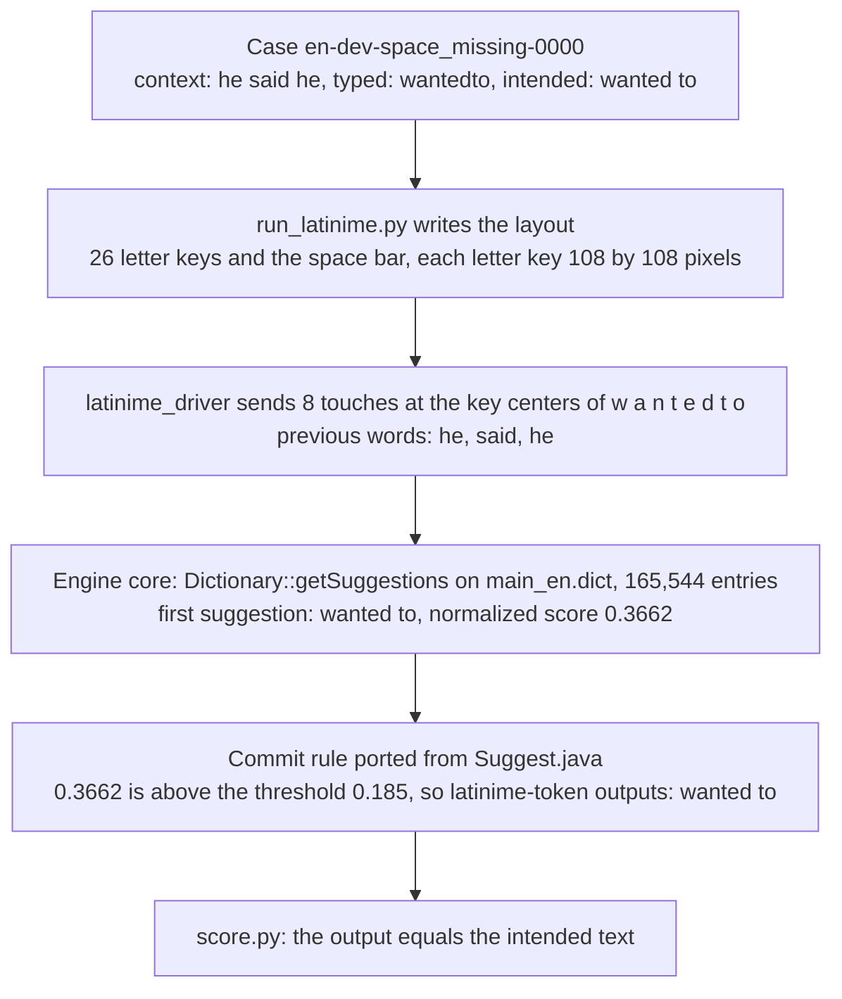
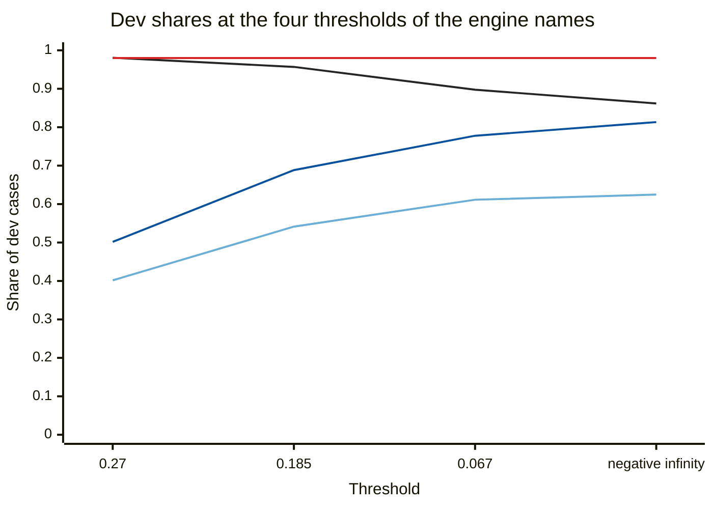
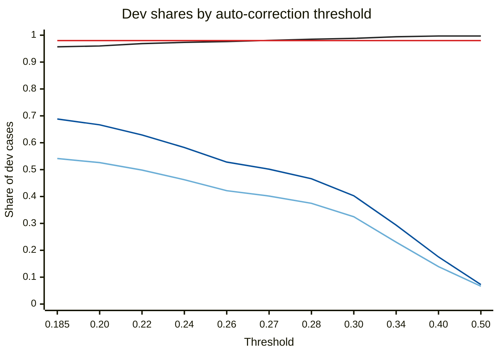

# AOSP LatinIME native suggest engine on the English typing cases

## Summary

Through our adapter, the stock [AOSP](https://source.android.com/ "Android Open Source Project: the public source code of Android") keyboard engine keeps 0.9569 of [clean dev cases](../../README.md "Cases of the dev half whose typed text has no typing error. Any change to them counts as an error.") and repairs 0.5414 of [dev slips](../../README.md "Cases of the dev half whose typed text holds a typing error").

1. Read the row `latinime-token` of Table 3 as the score of the engine at its stock settings. `latinime-token` runs the engine word by word, as an Android phone does.
2. Read the row `latinime-token-tuned` for a comparison under the task's clean floor of 0.98. Its threshold of 0.27 comes from the dev half, and the row repairs 0.4017 of dev slips.
3. Read the four rows with `span` in the name as an experiment on the engine. A phone cannot produce their input.
4. Run the evaluation again from a clone of this repository, with the GitHub CLI signed in. The command is `gh workflow run eval-latinime.yml --ref eval/latinime`.
5. Find a run with `gh run list --branch eval/latinime --limit 1`. Fetch its outputs with `gh run download RUN_ID --name typing-evaluation-latinime`.

This document does not settle the scores on a device, with measured touch points, or with a word-pair dictionary.

Every number below comes from GitHub Actions run 42759559446 on commit `64de497`.

## Terms and engine names

Table 1. Terms of this document. Each term keeps one meaning in every section.

| Term | Meaning |
| --- | --- |
| Engine | The native suggest engine of LatinIME, the keyboard app of AOSP. The engine is C++ code under `native/jni/src`. |
| Engine core | The 82 C++ files that `native/jni/Android.bp` lists as `LATIN_IME_CORE_SRC_FILES`. |
| Stock dictionary | `java/res/raw/main_en.dict`, the English dictionary file in the AOSP source tree. |
| Driver | `latinime_driver.cpp`, our C++ program that calls the engine core. |
| Adapter | The driver, `run_latinime.py`, `fetch_sources.sh` and `build.sh`. |
| Dev half, test half | The two halves of the test cases. [The task README](../../README.md) defines them. Settings are chosen on the dev half only. |
| Composing word | The letters typed since the last committed word. The keyboard can still replace them. |
| Commit | The keyboard writes the composing word, or its replacement, into the text field. A space press commits. |
| Auto-correction | At a commit, the keyboard replaces the composing word with the first suggestion of the engine. |
| Edit distance | The number of letter changes that turn the typed word into a suggestion. A swap of two neighbor letters counts as one change. |
| Normalized score | The engine's score of a suggestion divided by 1,000,000, times 1 minus edit distance over suggestion length. The value is 0 or more. The value is 0 when the score is 0 or less, or when the edit distance reaches the suggestion length. |
| Threshold | The normalized score that the first suggestion needs for auto-correction. The stock value is 0.185. |
| Shortcut | A replacement text that a dictionary entry names for its own spelling. |
| Whitelist entry | A dictionary entry with a shortcut that the keyboard applies at any threshold. |
| Word pair | Two words in sequence with a probability, also named a bigram. |
| Session | The search state that the engine keeps between two lookups. |
| Token mode | Each space-separated token of the typed text is one composing word. |
| Span mode | The whole typed text is one composing word, and a typed space is a touch on the space bar. |

One example of a normalized score uses the typed word `wrofe`. The suggestion `wrote` has a score of 493,685 and an edit distance of 1. The normalized score is 0.493685 times 0.8, which is 0.3949.

Table 2. The eight engine names, from the highest threshold to the lowest. Each name is one mode with one threshold.

| Engine name | Mode | Threshold | Reason for the name |
| --- | --- | --- | --- |
| `latinime-token-tuned` | Token | 0.27 | The lowest threshold of a dev grid that keeps 0.98 of the clean dev cases. |
| `latinime-span-tuned` | Span | 0.27 | Span mode at the tuned threshold. |
| `latinime-token` | Token | 0.185 | The stock mode and the stock threshold of the AOSP keyboard. |
| `latinime-span` | Span | 0.185 | The engine gets the space as input and can move, add or remove the word boundary. |
| `latinime-token-aggressive` | Token | 0.067 | The second threshold of the AOSP resource file. |
| `latinime-span-aggressive` | Span | 0.067 | Span mode at the second threshold. |
| `latinime-token-very-aggressive` | Token | Negative infinity | Every first suggestion passes the threshold. The other steps of the commit rule still apply. |
| `latinime-span-very-aggressive` | Span | Negative infinity | Span mode with every first suggestion passing the threshold. |

Three of the four thresholds stand in `java/res/values/config-auto-correction-thresholds.xml`. `SettingsValues.java` uses 0.185 whenever auto-correction is on, so only 0.185 is a stock setting.

## Path of one dev case through the adapter

The adapter turns typed letters into touches, asks the engine, and applies the commit rule of the Java keyboard.



Figure 1. One dev case from typed text to scored output. The engine proposes `wanted to` with a normalized score of 0.3662. The commit rule accepts the proposal at the threshold 0.185.

## Scores of the eight engine names on both halves

A lower threshold repairs more slips and keeps fewer clean cases. Span mode repairs more slips than token mode at each threshold.

Table 3. Share of cases whose output equals the target as `score.py` compares them, letter case ignored. Each half holds 673 clean cases and 3,600 slip cases.

| Engine name | Dev clean | Dev slips | Test clean | Test slips |
| --- | --- | --- | --- | --- |
| `latinime-token-tuned` | 0.9807 (660 of 673) | 0.4017 (1446 of 3600) | 0.9733 (655 of 673) | 0.3953 (1423 of 3600) |
| `latinime-span-tuned` | 0.9807 (660 of 673) | 0.5017 (1806 of 3600) | 0.9733 (655 of 673) | 0.4967 (1788 of 3600) |
| `latinime-token` | 0.9569 (644 of 673) | 0.5414 (1949 of 3600) | 0.9376 (631 of 673) | 0.5347 (1925 of 3600) |
| `latinime-span` | 0.9569 (644 of 673) | 0.6883 (2478 of 3600) | 0.9376 (631 of 673) | 0.6786 (2443 of 3600) |
| `latinime-token-aggressive` | 0.8975 (604 of 673) | 0.6114 (2201 of 3600) | 0.8990 (605 of 673) | 0.6033 (2172 of 3600) |
| `latinime-span-aggressive` | 0.8975 (604 of 673) | 0.7778 (2800 of 3600) | 0.8990 (605 of 673) | 0.7689 (2768 of 3600) |
| `latinime-token-very-aggressive` | 0.8618 (580 of 673) | 0.6247 (2249 of 3600) | 0.8470 (570 of 673) | 0.6172 (2222 of 3600) |
| `latinime-span-very-aggressive` | 0.8618 (580 of 673) | 0.8133 (2928 of 3600) | 0.8470 (570 of 673) | 0.8075 (2907 of 3600) |

The lower the threshold, the higher the share of slips repaired and the lower the share of clean cases kept. The two tuned names keep 0.9807 of the clean dev cases and 0.9733 of the clean test cases.



Figure 2. Dev shares from Table 3. The black line is the share of clean cases kept, and the red line marks the floor of 0.98. The dark blue line is the share of slips repaired in span mode. The light blue line is that share in token mode.

Span mode repairs 529 more dev slips than token mode at the threshold 0.185. Of these 529 cases, 521 are in the categories `space_extra` and `letter_to_space`.

## Threshold grid on the dev half

The task picks a setting by the share of slips repaired, with 0.98 or more of the clean cases kept. The stock threshold keeps 0.9569 of the clean dev cases. `run_latinime.py --tune-on-dev` therefore scores a grid of thresholds on the dev half.

Table 4. Dev shares at 12 of the 46 grid thresholds. Token mode and span mode keep the same share of clean cases, because each clean case is one word.

| Threshold | Clean cases kept | Slips repaired, token mode | Slips repaired, span mode |
| --- | --- | --- | --- |
| Typed text returned as it is | 1.0000 | 0.0000 | 0.0000 |
| 0.185 | 0.9569 | 0.5414 | 0.6883 |
| 0.20 | 0.9599 | 0.5261 | 0.6667 |
| 0.22 | 0.9688 | 0.4983 | 0.6289 |
| 0.24 | 0.9733 | 0.4625 | 0.5822 |
| 0.26 | 0.9762 | 0.4217 | 0.5281 |
| 0.27 | 0.9807 | 0.4017 | 0.5017 |
| 0.28 | 0.9851 | 0.3747 | 0.4661 |
| 0.30 | 0.9881 | 0.3247 | 0.4028 |
| 0.34 | 0.9941 | 0.2303 | 0.2936 |
| 0.40 | 0.9970 | 0.1392 | 0.1753 |
| 0.50 | 0.9970 | 0.0664 | 0.0725 |
| Infinity | 1.0000 | 0.0211 | 0.0211 |

The higher the threshold, the higher the share of clean cases kept and the lower the share of slips repaired. The grid holds 0.185, then 0.19 to 0.60 in steps of 0.01, then 0.8, 1 and infinity.



Figure 3. Dev shares from Table 4, in the colors of Figure 2. The black line is the share of clean cases kept, and the red line marks the floor of 0.98. The dark blue line is the share of slips repaired in span mode. The light blue line is that share in token mode. The clean share first reaches 0.98 at the threshold 0.27, where token mode repairs 0.4017 of the slips.

The tuned threshold is 0.27, the lowest grid value at which token mode keeps 0.98 of the clean dev cases. The choice does not use the test half.

## Scores of four engine names by category

Token mode and span mode differ in three categories only: the three whose typed text holds a space.

Table 5. Share of cases whose output equals the target, by category, at the thresholds 0.185 and 0.27. Each name has a dev column and a test column.

| Category | Cases | `latinime-token` dev | `latinime-token` test | `latinime-span` dev | `latinime-span` test | `latinime-token-tuned` dev | `latinime-token-tuned` test | `latinime-span-tuned` dev | `latinime-span-tuned` test |
| --- | --- | --- | --- | --- | --- | --- | --- | --- | --- |
| `clean_common` | 300 | 1.0000 | 1.0000 | 1.0000 | 1.0000 | 1.0000 | 1.0000 | 1.0000 | 1.0000 |
| `clean_rare` | 300 | 0.9333 | 0.9067 | 0.9333 | 0.9067 | 0.9667 | 0.9633 | 0.9667 | 0.9633 |
| `clean_names_and_terms` | 73 | 0.8767 | 0.8082 | 0.8767 | 0.8082 | 0.9589 | 0.9041 | 0.9589 | 0.9041 |
| `substitution_adjacent` | 300 | 0.9467 | 0.9367 | 0.9467 | 0.9367 | 0.9367 | 0.9267 | 0.9367 | 0.9267 |
| `deletion` | 300 | 0.6667 | 0.6333 | 0.6667 | 0.6333 | 0.4867 | 0.4667 | 0.4867 | 0.4667 |
| `double_letter` | 300 | 0.8800 | 0.8700 | 0.8800 | 0.8700 | 0.6833 | 0.6200 | 0.6833 | 0.6200 |
| `extra_adjacent` | 300 | 0.6833 | 0.6767 | 0.6833 | 0.6767 | 0.2933 | 0.3467 | 0.2933 | 0.3467 |
| `transposition` | 300 | 0.7900 | 0.8067 | 0.7900 | 0.8067 | 0.5000 | 0.4933 | 0.5000 | 0.4933 |
| `two_errors` | 300 | 0.1433 | 0.1467 | 0.1433 | 0.1467 | 0.0167 | 0.0233 | 0.0167 | 0.0233 |
| `space_missing` | 300 | 0.8400 | 0.7933 | 0.8400 | 0.7933 | 0.6800 | 0.6133 | 0.6800 | 0.6133 |
| `space_to_letter` | 300 | 0.5300 | 0.5233 | 0.5300 | 0.5233 | 0.2233 | 0.2533 | 0.2233 | 0.2533 |
| `space_transposed` | 300 | 0.0167 | 0.0333 | 0.0433 | 0.0200 | 0.0000 | 0.0033 | 0.0167 | 0.0100 |
| `space_extra` | 300 | 0.0000 | 0.0000 | 0.8500 | 0.8467 | 0.0000 | 0.0000 | 0.3967 | 0.4133 |
| `letter_to_space` | 300 | 0.0000 | 0.0000 | 0.8867 | 0.8933 | 0.0000 | 0.0000 | 0.7867 | 0.7967 |
| `apostrophe_missing` | 300 | 1.0000 | 0.9967 | 1.0000 | 0.9967 | 1.0000 | 0.9967 | 1.0000 | 0.9967 |

Four readings of Table 5:

- Token mode scores 0 on `space_extra` and `letter_to_space`. A space press commits the first part, so the engine sees two separate words.
- `two_errors` scores 0.1433 on dev at the threshold 0.185 and 0.7333 at negative infinity. The engine ranks the target first in 220 or more of the 300 cases. The stock threshold rejects the low scores.
- A clean case changes when the engine does not return the typed word in the same spelling. On dev, `xcode` becomes `score` and `backend` becomes `back end`.
- `apostrophe_missing` scores 0.9967 or more at both thresholds. The stock dictionary holds whitelist entries such as `youd` for `you'd`.

## Four controls on the dev half

`score.py` does not cover four questions about the adapter, so `run_latinime.py --controls` measures them on the dev half.

Table 6. The four controls. A count gives the dev outputs that differ from the scored run.

| Control | Change to the scored run | The four token-mode names | The four span-mode names |
| --- | --- | --- | --- |
| 1. Context removed | Every case gets an empty context. | 0 of 4,273 differ | 0 of 4,273 differ |
| 2. Correct two-word text | The control types each of the 900 two-word targets correctly. | 900 of 900 unchanged | 886, 874, 836 and 801 of 900 unchanged |
| 3. Lookup after every key | One session serves the whole run, and the engine is asked after each key. | 0 of 4,273 differ | 0 of 4,273 differ |
| 4. First letter in upper case | The 493 cases with an empty context start with a capital, as auto-capitalization types it. | 0 of 493 differ | 0 of 493 differ |

Controls 1, 3 and 4 give 0 differing outputs for all eight engine names. Control 4 ignores letter case.

- **Control 1.** The previous words do not change an output, because the stock dictionary does not hold a word pair.
- **Control 2.** Span mode changes correct two-word text. The share unchanged is 0.9844 at the threshold 0.27, 0.9711 at 0.185, 0.9289 at 0.067 and 0.8900 at negative infinity. One of the 26 changes at 0.185: `very early` becomes `very nearly`.
- **Control 3.** The scored run asks the engine once for each word, in a new session. A phone keeps one session and can ask after every key. Control 3 made 35,381 engine calls for the same dev cases. For 12,663 calls, the session held cached search nodes from the previous call. The engine continues a search on that condition.
- **Control 4.** A capital first letter changes the comparison between the typed word and the suggestions. The committed text stays the same apart from its case.

## Engine source and tool versions on the runner

The workflow does not install a package. Every tool is part of the runner image.

Table 7. Sources and tool versions of run 42759559446.

| Item | Value |
| --- | --- |
| Engine source | `https://android.googlesource.com/platform/packages/inputmethods/LatinIME`, tag `android-16.0.0_r4`, commit `efb2760302cb8824ae9fe36f993c48d5adc818b2` |
| Files fetched | `native/jni` as a Gitiles archive: `Android.bp` and 222 files under `src`, of them 82 `.cpp` files in the engine core |
| Source digest | SHA-256 `0a7d9057268b6283e16e1befb3aa335b9b763d03146049847b03ea49749ef4bd` over `Android.bp` and the files under `src` in path order |
| Stock dictionary | `java/res/raw/main_en.dict`, 1,070,485 bytes, SHA-256 `581e0a428fff00d4ac574866596d6de9408bb76d1ce9626e34c887113713253f` |
| Dictionary header | Format 202, dictionary `main:en`, locale `en`, version 54, date 1414726273 (2014-10-31) |
| Dictionary content | 165,544 entries, 99 of them whitelist entries, 46 flagged not-a-word, 1,352 flagged possibly offensive, 0 word pairs |
| Runner | `ubuntu-24.04`, Ubuntu 24.04.5 LTS |
| Compiler | g++ 13.3.0 (Ubuntu 13.3.0-6ubuntu2~24.04.1), GNU ld 2.42 |
| Compiler flags for the core | `-std=gnu++17 -O2 -DHOST_TOOL -w`, with the 82 files unchanged |
| JNI header | `jni.h` of Temurin OpenJDK 17.0.21+9 at `/usr/lib/jvm/temurin-17-jdk-amd64/include` |
| Other tools | Python 3.12.3, curl 8.5.0 |

The driver counts the dictionary content through the engine calls `getNextWordAndNextToken` and `getWordProperty`. The count of 0 word pairs agrees with Control 1.

## Licenses of the engine code and the stock dictionary

Table 8. License of each part that the evaluation uses.

| Part | License | Evidence |
| --- | --- | --- |
| Engine core | Apache License 2.0 | The header of each `.cpp` and `.h` file under `src`. `Android.bp` at the repository root declares `SPDX-license-identifier-Apache-2.0` with the text `NOTICE`. |
| Stock dictionary | Apache License 2.0 | `java/Android.bp` declares `SPDX-license-identifier-Apache-2.0` for the `java` folder. The folders `java/res/raw` and `dictionaries` do not hold a license file of their own. |
| `jni.h` | GPL version 2 with the Classpath exception | Line 8 of the runner's copy names the exception, and the workflow prints that line. The build uses the file for type declarations. |

The engine code and the stock dictionary carry the same license, Apache License 2.0.

## Calls from the driver into the engine core

This section serves a reader who ports the driver. The driver follows the five [JNI](https://docs.oracle.com/en/java/javase/17/docs/specs/jni/index.html "Java Native Interface: the bridge between Java code and C++ code") glue files of `native/jni` and leaves them out of the build.

1. `DictionaryStructureWithBufferPolicyFactory::newPolicyForExistingDictFile(path, 0, fileSize, false)`, then `new Dictionary(env, policy)`.
2. `new ProximityInfo(env, 1080, 432, 32, 16, 108, 108, proximityChars, 27, keyX, keyY, keyWidths, keyHeights, keyCodes, null, null, null)`.
3. `DicTraverseSession::getSessionInstance(env, null, fileSize)` and `session->init(dictionary, emptyContext, null)`, once for each lookup.
4. `Dictionary::getSuggestions(proximityInfo, session, x, y, times, pointerIds, codePoints, inputSize, ngramContext, suggestOptions, -1.0f, results)`.
5. `SuggestionResults::outputSuggestions(env, ...)`, which returns at most 18 suggestions with scores and kinds.
6. `AutocorrectionThresholdUtils::calcNormalizedScore(typedWord, suggestion, score)` for the commit rule.
7. `DicTraverseSession::releaseSessionInstance(session)`.

The engine core takes a `JNIEnv` in calls 1, 2, 3 and 5. The driver passes a `JNIEnv` whose array functions read and write C++ vectors. The core uses seven JNI functions on this path: `GetArrayLength`, `GetIntArrayRegion`, `GetFloatArrayRegion`, `SetIntArrayRegion`, `SetFloatArrayRegion`, `FindClass` and `ExceptionClear`.

Table 9. Values that the driver passes in call 4, with their source in the Java keyboard.

| Argument | Value | Source |
| --- | --- | --- |
| `x`, `y` | The center of the key of each typed letter, or -1 and -1 for an apostrophe | `Keyboard.getCoordinates` |
| `times`, `pointerIds` | 0 for each touch | `WordComposer.applyProcessedEvent` |
| `codePoints` | The typed word in lower case, with trailing apostrophes removed | `ComposedData.copyCodePointsExceptTrailingSingleQuotesAndReturnCodePointCount` |
| `ngramContext` | Up to 3 previous words from the last 40 characters before the cursor, composing word included | `NgramContextUtils.getNgramContextFromNthPreviousWord` |
| `suggestOptions` | Gesture 0, full edit distance 0, block offensive words 1, weight for locale 1000 | `BinaryDictionary.getSuggestions` |
| Language weight | -1.0, so the engine sets the weight | `DictionaryFacilitatorImpl.getSuggestionResults` |

Each value in Table 9 comes from one method of the Java keyboard. The engine gets the input that the keyboard builds.

## Commit rule ported from the Java keyboard

The driver ports `Suggest.getSuggestedWordsForNonBatchInput` and `InputLogic.commitCurrentAutoCorrection`. For a word typed in lower case the rule has five steps.

1. Order the suggestions by score, then by length, then by spelling.
2. Mark the typed word as known when it equals one suggestion, letter case included.
3. Allow auto-correction when the first suggestion is a whitelist entry. Allow auto-correction also when the typed word has two or more letters and is not known.
4. Commit the first suggestion when it is a whitelist entry, or when its normalized score reaches the threshold.
5. Commit the typed word in every other case.

Step 4 never commits a first suggestion of the shortcut kind. Step 4 also never commits one that the engine flags as unfit for auto-correction. Step 3 keeps a typed word that the engine returns in the same spelling. A whitelist entry is the exception: the stock dictionary maps `hid` to `his`.

## Keyboard layout handed to the engine

The layout holds 26 letter keys and the space bar, with the key centers of `keyboard_noise.py`.

```text
x in pixels: 0    108  216  324  432  540  648  756  864  972  1080
row 1, y 0:   | q  | w  | e  | r  | t  | y  | u  | i  | o  | p  |
row 2, y 108:    | a  | s  | d  | f  | g  | h  | j  | k  | l  |
row 3, y 216:         | z  | x  | c  | v  | b  | n  | m  |
row 4, y 324:                   |      space bar      |
```

Figure 4. The 27 key boxes. Each letter key is 108 by 108 pixels. Row 2 starts at x 54, row 3 at x 162, and the space bar spans x 378 to 918.

Table 10. Layout values and their origin.

| Value | Setting | Origin |
| --- | --- | --- |
| Key centers | One key width apart in a row, rows one key width apart | `keyboard_noise.KEY_POSITION` |
| Space bar | Below the keys c, v, b, n and m | `keyboard_noise.SPACE_NEIGHBORS` |
| Key size | 108 by 108 pixels | One tenth of a screen 1,080 pixels wide |
| Proximity grid | 32 by 16 cells over the keyboard. Each cell lists the keys closer than 1.2 key widths to its center. | `ProximityInfo.java`, ported to the driver |
| Sweet spots | The driver passes null for these touch targets of a theme | Every AOSP keyboard theme sets `touchPositionCorrectionData` to null |

The engine and the slip generator share the key centers and use different rules for near keys. The generator takes key centers within 1.15 key widths of a key center. The engine takes keys whose edge is within 1 key width of the touch.

## Cost of one lookup on the runner

Table 11. Time, memory and size, measured on the GitHub-hosted `ubuntu-24.04` runner.

| Quantity | Value | Run it comes from |
| --- | --- | --- |
| Time for one word lookup | 2.53 ms | Dev half, 6,177 lookups in 15.63 s |
| Time for one engine call with a lookup after every key | 1.68 ms | Control 3, 35,381 calls in 59.38 s |
| Peak resident memory, the most main memory the process held | 6,320 kB | Control 3, which keeps the results of one case at a time |
| Code size of the linked driver | 572,034 bytes of text | `size latinime_driver` |
| Stock dictionary | 1,070,485 bytes | `main_en.dict` |

One word lookup takes 2.53 ms on the runner. We have not measured the time on a phone.

## Limits of the adapter

- **Device.** The adapter has not been compared with the Java keyboard on a phone or an emulator.
- **Touch points.** Each touch lands on a key center. Real touches land off center, and the engine scores that distance.
- **Key boxes.** The keys are squares. The AOSP phone layout has taller keys and also a comma key and a period key.
- **Dictionary.** The stock dictionary dates from 2014 and does not hold a word pair. The previous-word input of the driver has not been checked with a dictionary that holds word pairs.
- **Other dictionaries.** A phone also asks the user history, the contacts and the user dictionary. The adapter asks the stock dictionary only.
- **Letter case.** The scored run types lower-case letters. Control 4 covers a capital first letter and does not cover other capitals.
- **Apostrophes.** A typed word that starts with an apostrophe stops the driver. The keyboard does not start a composing word on an apostrophe.
- **Span mode.** A phone commits at a space, so a phone cannot produce the input of span mode. For the previous words, the driver counts the whole span as one word.
- **Clean cases.** The clean categories hold one word each. Control 2 covers correct two-word text on the dev half only.
- **Tuned threshold.** The value 0.27 fits the dev half. The two tuned names keep 0.9733 of the clean test cases, below the floor of 0.98.
- **Platform.** The driver reads `/proc/self/status` and uses `execinfo.h`, so the driver builds on Linux only.

## Files of the adapter

Table 12. Files of `scripts/typing-evaluation/engines/latinime` and the workflow.

| File | Content |
| --- | --- |
| `fetch_sources.sh` | Fetches `native/jni` and `main_en.dict` at the pinned commit and checks both digests |
| `build.sh` | Compiles the 82 core files and the driver with g++ |
| `latinime_driver.cpp` | The driver: host `JNIEnv`, proximity grid, engine calls, commit rule |
| `run_latinime.py` | Writes the layout, tunes the threshold on dev, runs the driver on a half, runs the controls |
| `.github/workflows/eval-latinime.yml` | Builds, tunes on dev, runs both halves, runs the controls, scores, uploads `typing-evaluation-latinime` |

A run writes `build/typing-evaluation/NAME/english.dev.jsonl`, `english.test.jsonl`, two summary files and `settings.json` for each engine name.
