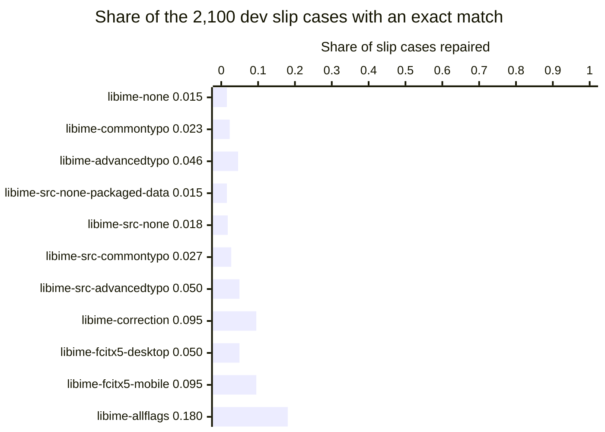

# libime adapter for the Pinyin typing evaluation

## Summary

With the fcitx5 phone defaults, libime 1.1.17 converts 73.4 percent of [clean](#terms-of-the-libime-evaluation "A clean case holds correct Pinyin") [dev](#terms-of-the-libime-evaluation "The dev half is the half of the cases where settings may be chosen") cases and repairs 9.5 percent of [slips](#terms-of-the-libime-evaluation "A slip case holds one or two typing mistakes that the case generator put in").

1. Use the engine name `libime-fcitx5-mobile` as the libime row of the engine comparison. Its dev scores are in the file `libime-fcitx5-mobile/pinyin.dev.summary.json` of the artifact `typing-evaluation-libime`.
2. Plan a typo layer outside libime for doubled letters and extra letters. On the dev half, libime repairs 0 to 0.7 percent of those cases. The slip operators in `scripts/typing-evaluation/keyboard_noise.py` list the slips that such a layer must undo.
3. Start a new run with a push to the branch `eval/libime`. Find the run with `gh run list --branch eval/libime --limit 1`. Read its scores with `gh run download RUN_ID --name typing-evaluation-libime --dir DIR`, where `DIR` is an empty folder.

The scores do not give slip rates in real typing, latency on a phone, or memory on a phone.

## Terms of the libime evaluation

Each term below keeps one meaning in every section.

Table 1. Terms that this document uses with one fixed meaning.

| Term | Meaning |
| --- | --- |
| libime | The Pinyin engine library of [fcitx5](https://github.com/fcitx/fcitx5 "fcitx5 is an open-source input method framework"). The libime source is at https://github.com/fcitx/libime. |
| case | One test input: the typed Pinyin letters, and the Chinese text the person meant. |
| clean case | A case with correct Pinyin. |
| slip case | A case with one or two typing mistakes that the case generator put in. |
| dev half, test half | The two halves of the cases. Settings may be chosen on the dev half only. |
| fuzzy flag | A libime option of the type `PinyinFuzzyFlag`. Each flag lets more spellings match a syllable. |
| correction profile | A libime table that lists, for each key, the keys a finger may hit in its place. |
| decoder | The part of libime that searches for the most likely sentence for the typed letters. |
| language model | The table that the decoder uses to rank sentences. The table scores sequences of 1, 2 and 3 words. The field calls such a table a trigram model. |
| KenLM | The open-source library whose binary file format holds the libime language model. The KenLM source is at https://github.com/kpu/kenlm. |
| engine name | The label of one libime build with one set of fuzzy flags. The output files use this label. |
| address layout | The memory addresses that a process gets. Linux picks them at random for each process by default. |

## Eleven engine names for libime builds and flag sets

An engine name is one libime build with one set of fuzzy flags. Three names repeat the packaged flag sets on the source build, and one name is a control. These four names separate flag effects from code effects and data effects.

Table 2. The eleven engine names, in plain words.

| Engine name | libime build and settings | Reason the name exists |
| --- | --- | --- |
| `libime-none` | libime 1.1.5 from the Ubuntu packages, with every fuzzy flag off | The baseline of the packaged version |
| `libime-commontypo` | libime 1.1.5 with the flag CommonTypo | The first of the two typo flags |
| `libime-advancedtypo` | libime 1.1.5 with CommonTypo and AdvancedTypo | The second typo flag, which exists from libime 1.1.3 |
| `libime-src-none-packaged-data` | The libime 1.1.17 code with the packaged dictionary and language model, with every fuzzy flag off | The control that separates the newer code from the newer data |
| `libime-src-none` | libime 1.1.17 built from source with its own data, with every fuzzy flag off | The baseline of the source build |
| `libime-src-commontypo` | libime 1.1.17 with CommonTypo | The CommonTypo effect on the source build |
| `libime-src-advancedtypo` | libime 1.1.17 with CommonTypo and AdvancedTypo | The control for `libime-correction`: same code, same data, Correction off |
| `libime-correction` | libime 1.1.17 with CommonTypo, AdvancedTypo and Correction, and the built-in QWERTY correction profile | The Correction flag, which exists from libime 1.1.7 |
| `libime-fcitx5-desktop` | libime 1.1.17 with the decoder options that the fcitx5 Pinyin input method sets on a desktop | The decoder settings of a desktop user of fcitx5 |
| `libime-fcitx5-mobile` | The desktop options plus Correction with the QWERTY correction profile | The decoder settings of fcitx5 on Android and iOS |
| `libime-allflags` | The phone options plus PartialFinal and the 13 sound-pair flags | The most tolerant setting that libime offers |

Table 3 gives the spellings that each flag accepts, in plain words. The first three rows come from probe strings that the workflow types.

Table 3. Fuzzy flags in the engine names. A quoted text is the label of the option in fcitx5.

| Fuzzy flag | Spellings that the flag accepts |
| --- | --- |
| `CommonTypo` | Fixed letter swaps such as `gn` for `ng`: the probe `zhognguo` gives 中国 |
| `AdvancedTypo` | More swaps inside one syllable, such as `oa` for `ao`: the probe `nihoa` gives 你好 |
| `Correction` | One key replaced by its left or right neighbor: the probe `nihso` gives 你好 |
| `VE_UE` | "ue -> ve" |
| `Letter` | "Match Letter in lower case" |
| `Inner` | "Inner Segment (xian -> xi'an)" |
| `InnerShort` | "Inner Segment for Short Pinyin (qie -> qi'e)" |
| `PartialFinal` | "Match partial finals (e -> en, eng, ei)" |
| 13 sound-pair flags | Two sounds read as one, such as "l <-> n", "z <-> zh" and "an <-> ang" |

Table 4 gives the exact flags of each engine name. The more flags a name has, the more spellings libime accepts for one syllable.

Table 4. The flags that the adapter passes to `PinyinIME::setFuzzyFlags`, and the other settings of each engine name.

| Engine names | Fuzzy flags | Other settings |
| --- | --- | --- |
| `libime-none`, `libime-src-none-packaged-data`, `libime-src-none` | `None` | Library defaults |
| `libime-commontypo`, `libime-src-commontypo` | `CommonTypo` | Library defaults |
| `libime-advancedtypo`, `libime-src-advancedtypo` | `CommonTypo`, `AdvancedTypo` | Library defaults |
| `libime-correction` | `CommonTypo`, `AdvancedTypo`, `Correction` | Library defaults, QWERTY correction profile |
| `libime-fcitx5-desktop` | `VE_UE`, `CommonTypo`, `AdvancedTypo`, `Letter`, `Inner`, `InnerShort` | fcitx5 settings |
| `libime-fcitx5-mobile` | The desktop flags and `Correction` | fcitx5 settings, QWERTY correction profile |
| `libime-allflags` | The phone flags, `PartialFinal`, `V_U`, `AN_ANG`, `EN_ENG`, `IAN_IANG`, `IN_ING`, `U_OU`, `UAN_UANG`, `C_CH`, `F_H`, `L_N`, `L_R`, `S_SH`, `Z_ZH` | fcitx5 settings, QWERTY correction profile |

The library defaults are 1 sentence, beam size 20 and frame size 40, as the adapter printed them. Beam size and frame size limit the candidates that the decoder keeps.

The fcitx5 settings are five calls that fcitx5-chinese-addons adds to the library defaults:

- `setNBest(2)` keeps 2 sentences, the fcitx5 option "Number of Sentences".
- `setWordCandidateLimit(15)` is the fcitx5 option "Number of Phrase Candidates".
- `setPartialLongWordLimit(4)` is the fcitx5 option "Prompt long word length when input length over (0 for disable)".
- `setScoreFilter(1.0)` is a fixed call in `pinyin.cpp`, with the argument name `maxDistance` in libime.
- `setMaxSentenceLength(35)` makes libime refuse more letters once the sentence holds more than 35 syllables. The longest case has 20 characters.

The flag defaults come from `im/pinyin/pinyin.h` and `im/pinyin/pinyin.cpp` of fcitx5-chinese-addons, master branch, read on 2026-11-09. The two fcitx5 names copy the decoder options only. The fcitx5 app also loads its own dictionary `chaizi.dict`, and `extb.dict` on a desktop. The adapter loads neither file.

## Scores of the eleven engine names on the dev half and the test half

Every engine name repairs less than 19 percent of the slip cases. The more fuzzy flags are on, the more slip cases libime repairs in total.

Table 5. Share of cases with an exact match, as `score.py` printed it in workflow run 42759199191. Each half has 900 clean cases and 2,100 slip cases.

| Engine name | Clean, dev | Slips, dev | Clean, test | Slips, test |
| --- | --- | --- | --- | --- |
| `libime-none` | 0.6889 | 0.0152 | 0.6856 | 0.0114 |
| `libime-commontypo` | 0.6889 | 0.0229 | 0.6856 | 0.0162 |
| `libime-advancedtypo` | 0.6878 | 0.0457 | 0.6833 | 0.0371 |
| `libime-src-none-packaged-data` | 0.6889 | 0.0152 | 0.6856 | 0.0114 |
| `libime-src-none` | 0.7367 | 0.0176 | 0.7122 | 0.0129 |
| `libime-src-commontypo` | 0.7356 | 0.0271 | 0.7111 | 0.0195 |
| `libime-src-advancedtypo` | 0.7356 | 0.0495 | 0.7122 | 0.0443 |
| `libime-correction` | 0.7344 | 0.0952 | 0.7100 | 0.0848 |
| `libime-fcitx5-desktop` | 0.7344 | 0.0495 | 0.7133 | 0.0443 |
| `libime-fcitx5-mobile` | 0.7344 | 0.0952 | 0.7111 | 0.0848 |
| `libime-allflags` | 0.6567 | 0.1805 | 0.6511 | 0.1614 |

Figure 1. Slip cases repaired on the dev half, one bar per engine name, on one scale from 0 to 1. A bar at 1 means every slip case repaired. The longest bar, `libime-allflags`, ends at 0.180.

Five comparisons in Table 5 change one group of settings at a time. The runs do not separate the flags inside one group.

- Correction raises the dev slip share from 0.0495 to 0.0952. Clean dev accuracy changes by 1 of 900 cases.
- The sound-pair flags and PartialFinal raise the dev slip share from 0.0952 to 0.1805. The same flags lower clean dev accuracy from 0.7344 to 0.6567.
- The fcitx5 settings and four more flags change the dev scores by at most 1 of 3,000 cases. The four flags are `VE_UE`, `Letter`, `Inner` and `InnerShort`.
- The newer data raises clean accuracy by 4.8 points on dev and 2.7 points on test.
- The newer code leaves every exact-match score of Table 5 and Table 6 unchanged. `libime-src-none-packaged-data` and `libime-none` differ in 11 of 6,000 outputs, and both miss each of those cases.

The evaluation allows a setting to lower clean accuracy by 1 point against the engine with slip handling off. `libime-allflags` lowers clean dev accuracy by 8.0 points against `libime-src-none`. The name therefore serves as an upper reference, and `libime-fcitx5-mobile` is the libime row.

Table 6. Share of dev slip cases with an exact match, by slip category. Each category has 300 cases.

| Engine name | `substitution_adjacent` | `deletion` | `double_letter` | `extra_adjacent` | `transposition` | `two_errors` | `fuzzy_sound` |
| --- | --- | --- | --- | --- | --- | --- | --- |
| `libime-none` | 0.0000 | 0.1067 | 0.0000 | 0.0000 | 0.0000 | 0.0000 | 0.0000 |
| `libime-commontypo` | 0.0000 | 0.1167 | 0.0000 | 0.0000 | 0.0433 | 0.0000 | 0.0000 |
| `libime-advancedtypo` | 0.0000 | 0.1167 | 0.0000 | 0.0000 | 0.2033 | 0.0000 | 0.0000 |
| `libime-src-none-packaged-data` | 0.0000 | 0.1067 | 0.0000 | 0.0000 | 0.0000 | 0.0000 | 0.0000 |
| `libime-src-none` | 0.0000 | 0.1233 | 0.0000 | 0.0000 | 0.0000 | 0.0000 | 0.0000 |
| `libime-src-commontypo` | 0.0000 | 0.1367 | 0.0000 | 0.0000 | 0.0533 | 0.0000 | 0.0000 |
| `libime-src-advancedtypo` | 0.0000 | 0.1367 | 0.0000 | 0.0000 | 0.2067 | 0.0033 | 0.0000 |
| `libime-correction` | 0.3000 | 0.1367 | 0.0000 | 0.0000 | 0.2200 | 0.0100 | 0.0000 |
| `libime-fcitx5-desktop` | 0.0000 | 0.1367 | 0.0000 | 0.0000 | 0.2067 | 0.0033 | 0.0000 |
| `libime-fcitx5-mobile` | 0.3000 | 0.1367 | 0.0000 | 0.0000 | 0.2200 | 0.0100 | 0.0000 |
| `libime-allflags` | 0.2467 | 0.2000 | 0.0033 | 0.0067 | 0.1933 | 0.0200 | 0.5933 |

Each flag repairs mainly one slip category, and two categories stay near zero under every flag set:

- Correction repairs 30.0 percent of the neighbor-key substitutions. The QWERTY correction profile lists the left and right neighbor of each key. The case generator also uses neighbors in the row above and the row below.
- Correction adds 96 repaired dev cases: 90 neighbor-key substitutions, 4 swapped-letter cases and 2 two-slip cases.
- AdvancedTypo repairs 20.3 to 20.7 percent of the swapped letters. CommonTypo alone repairs 4.3 to 5.3 percent.
- The sound-pair flags repair 59.3 percent of the `fuzzy_sound` cases. With these flags on, libime repairs fewer substitutions (0.3000 to 0.2467) and fewer swapped letters (0.2200 to 0.1933).
- Every engine name repairs 0 to 0.7 percent of the doubled letters and the extra letters.
- A deleted letter is repaired in 10.7 to 20.0 percent of cases. One cause is that libime reads a lone consonant as the start of a syllable.

## Repeatable outputs through a fixed address layout

The scored runs start the adapter with a fixed address layout, so two processes give the same outputs. With the normal random layout, libime 1.1.17 with its 2026 data gives a different first sentence for a few cases.

Table 7. Dev outputs that differ between two adapter processes, of 3,000 cases, in workflow run 42759199191.

| libime build and flags | Random address layout | Fixed address layout |
| --- | --- | --- |
| libime 1.1.5 packages, every flag off | 0 | 0 |
| libime 1.1.17 source build, every flag off | 5 | 0 |
| libime 1.1.17 source build, fcitx5 phone options | 16 | 0 |

One case shows the effect. For the letters `zheshigeguanzi`, `libime-src-none` gave 这是个管子 in run 42753887385 and 这是个罐子 in run 42757015202. Both runs used the random layout.

The file `src/libime/core/decoder.cpp` of libime gives a mechanism that fits these counts:

1. The function `buildLattice` keeps the word candidates in a hash table whose keys are memory addresses.
2. The function moves the candidates out in the order of that table.
3. The search compares scores, and the code does not give a second key for equal scores.

Candidates with equal scores can therefore change order when the addresses change. A phone app also gets a random layout, so the same effect is possible there. The runs measured Linux processes only.

With the packaged data, the outputs did not change between workflow runs. The three names on libime 1.1.5 gave the same outputs in runs 42753887385, 42757015202 and 42759199191. `libime-src-none-packaged-data` gave the same outputs under the random layout of run 42757015202 and the fixed layout of run 42759199191.

The build file of libime 1.1.17 passes `-q 4` to the model builder, and the build file of 1.1.5 passes `-q 8`. The option sets the bits for each stored probability. A coarser model can make equal scores more common. The runs did not test this difference as the cause.

The adapter gets the fixed layout from `setarch -R`. `check_repeatability.py` makes the counts of Table 7.

## Versions and packages on the ubuntu-24.04 runner

The runner installed libime 1.1.5 from Ubuntu packages and built libime 1.1.17 from source in one job.

Table 8. Packages that `apt-get install` put on the runner for the engine names on libime 1.1.5.

| Package | Version |
| --- | --- |
| `libimepinyin-dev`, `libimepinyin0` | 1.1.5-1 |
| `libimecore-dev`, `libimecore0` | 1.1.5-1 |
| `libime-bin`, `libimetable0` | 1.1.5-1 |
| `libime-data` | 1.1.5-1 |
| `libime-data-language-model` | 1.1.5-1 |
| `libfcitx5utils-dev`, `libfcitx5utils2` | 5.1.7-1build3 |
| `libboost-dev` | 1.83.0.1ubuntu2 |
| `libboost1.83-dev` | 1.83.0-2.1ubuntu3.2 |
| `g++` | 13.3.0-6ubuntu2~24.04.1 |

CMake 3.31.6 and Ninja come from the runner image.

Table 9. Sources and packages of the libime 1.1.17 build.

| Part | Version |
| --- | --- |
| libime | Tag `1.1.17`, commit `171edcf137001e8eb8274f53ec010058cda70b09`, from https://github.com/fcitx/libime |
| KenLM inside libime | Submodule commit `4cb443e60b7bf2c0ddf3c745378f76cb59e254e5` |
| fcitx5 utility library | Tag `5.1.23`, commit `27cca6e0239938b2d53937061d0980c087856b22`, target `Fcitx5Utils` only |
| `gcc-14`, `g++-14` | 14.2.0-4ubuntu2~24.04.1 |
| `extra-cmake-modules` | 5.115.0-0ubuntu5 |
| `gettext` | 0.21-14ubuntu2 |
| `libboost-iostreams-dev` | 1.83.0.1ubuntu2 |
| `libzstd-dev`, `zstd` | 1.5.5+dfsg2-2build1.1 |

libime 1.1.17 needs the fcitx5 utility library 5.1.20 or later, and Ubuntu 24.04 packages 5.1.7. The job builds both libraries into the folder `build/libime-source/prefix`. The adapter for the source build runs with `LD_LIBRARY_PATH` set to that folder. The job checks the loaded libraries with `ldd`.

Table 10. Data files that the adapter loads. Both language models are trigram models.

| Property | libime 1.1.5 packages | libime 1.1.17 source build |
| --- | --- | --- |
| Dictionary file | `/usr/share/libime/sc.dict`, 3,170,345 bytes | `share/libime/sc.dict` in the prefix folder, 4,524,344 bytes |
| Dictionary source | The package `libime-data` | `dict-20260907.tar.zst`, where `dict_sc.txt` has 300,624 lines |
| Language model file | `/usr/lib/x86_64-linux-gnu/libime/zh_CN.lm`, 22,138,741 bytes | `lib/libime/zh_CN.lm` in the prefix folder, 34,736,327 bytes |
| Language model source | The package `libime-data-language-model` | `lm_sc.arpa-20260629.tar.zst` |
| n-gram order | 3 | 3 |
| Entries of 1, 2 and 3 words | 199,870, 2,522,964 and 1,000,002 | 270,714, 4,789,953 and 2,189,434 |

The n-gram order comes from the KenLM header of each file, read by `kenlm_header.py`. For the source build, the header of the text file `lm_sc.arpa` shows the same three counts. The libime build sets `KENLM_MAX_ORDER=3`, which limits the largest order to 3. The libime build downloads both archives from https://download.fcitx-im.org/data/ and checks each against a pinned SHA-256 value.

## Licenses of the libime code and data

The libime code and the libime data carry the license LGPL-2.1-or-later.

Table 11. License of each part, and the file that states it.

| Part | License | File that states the license |
| --- | --- | --- |
| libime code, versions 1.1.5 and 1.1.17 | LGPL-2.1-or-later | The SPDX line at the top of each source file, and `LICENSES/LGPL-2.1-or-later.txt` |
| Language model archive `lm_sc.arpa-*.tar.*` | LGPL-2.1-or-later | `REUSE.toml` at tag 1.1.17 |
| Dictionary archive `dict-*.tar.*` | LGPL-2.1-or-later | `REUSE.toml` at tag 1.1.17 |
| Ubuntu packages `libime-data` and `libime-data-language-model` | LGPL-2.1+ | The entry `Files: *` of `/usr/share/doc/libime-data/copyright` on the runner |
| KenLM inside libime | LGPL for most files, with other licenses for a few utility files | `LICENSE` in https://github.com/kpu/kenlm |
| fcitx5 utility library | LGPL-2.1-or-later | The SPDX line at the top of each source file |

## libime calls in the adapter

The adapter `libime_adapter.cpp` makes seven kinds of libime calls, in this order:

1. `PinyinIME ime(std::make_unique<PinyinDictionary>(), std::make_unique<UserLanguageModel>(LM_PATH))` builds the engine with the stock language model.
2. `ime.dict()->load(PinyinDictionary::SystemDict, DICT_PATH, PinyinDictFormat::Binary)` loads the stock dictionary.
3. `ime.setCorrectionProfile(std::make_shared<PinyinCorrectionProfile>(BuiltinPinyinCorrectionProfile::Qwerty))` loads the QWERTY correction profile, for the engine names with Correction.
4. `ime.setFuzzyFlags(flags)` sets the flags of Table 4. The fcitx5 names also get the four `PinyinIME` setters listed under Table 4.
5. `PinyinContext context(&ime)` makes a new context for each case. The fcitx5 names also call `context.setMaxSentenceLength(35)`.
6. `context.type(&letter, 1)` types the case one letter at a time, as a keyboard does. The adapter stops when libime does not accept a letter.
7. `context.select(0)` takes the first candidate while `context.selected()` is false. `context.selectedSentence()` then gives the output.

In every run the first candidate covered all the letters, so step 7 made one pick per case. The first candidate is the sentence that `PinyinContext::sentence()` returns.

Seven files of this folder and one workflow file make the evaluation run.

Table 12. Files of the adapter folder.

| File | Content |
| --- | --- |
| `libime_adapter.cpp` | The C++ program that types the cases into libime |
| `CMakeLists.txt` | The build file, which finds the installed libime through `find_package(LibIMEPinyin)` |
| `run_libime.py` | Feeds the cases to the adapter and writes `build/typing-evaluation/NAME/pinyin.HALF.jsonl` |
| `check_repeatability.py` | Counts the outputs that differ between two adapter processes |
| `kenlm_header.py` | Prints the n-gram order and the n-gram counts of a language model file |
| `summarize.py` | Prints the score tables from the summary files of `score.py` |
| `probes.tsv` | Fifteen strings that the workflow types before the scored runs, such as `nihao` |
| `.github/workflows/eval-libime.yml` at the repository root | The workflow that installs, builds, runs, scores and uploads |

## Limits of the adapter and of the scores

- The adapter reads the first sentence only. A person can also pick a lower candidate.
- The adapter loads the stock dictionary and the stock language model only. The adapter does not load a user dictionary, a typing history, `chaizi.dict`, `extb.dict` or `zh_CN.lm.predict`, and never calls `learn()`.
- Each case starts in a new context, so libime does not see the text before the clause.
- The packaged libime 1.1.5 does not have the Correction flag, so `libime-correction` exists for the source build only.
- The scores hold for the fixed address layout and for this order of the cases. Table 7 gives the size of the change under a random layout.
- With the packaged data, typing letter by letter and typing all letters in one call give the same outputs. With the 2026 data the two outputs differ in 5 to 27 of 3,000 cases per run. The scores use one letter at a time.
- The adapter took 0.8 to 1.7 milliseconds per letter with Correction off, and 3.0 to 4.1 milliseconds with Correction on. Four adapter processes ran at the same time on one runner, so these times do not predict phone latency.
- The corpus behind the libime language model is not stated in the files read for this work. An overlap with the Tatoeba sentences of the cases is therefore possible.
- The scores come from a slip generator and do not give the rate of each slip in real typing.
