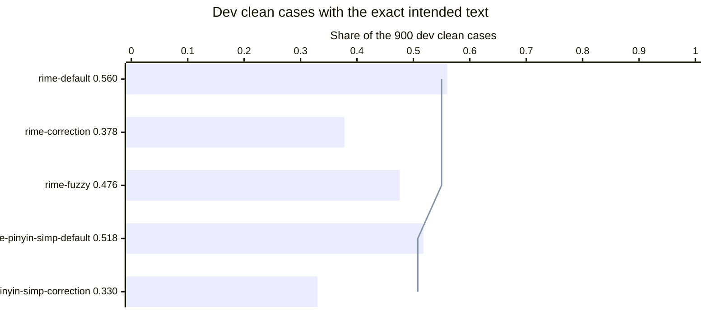
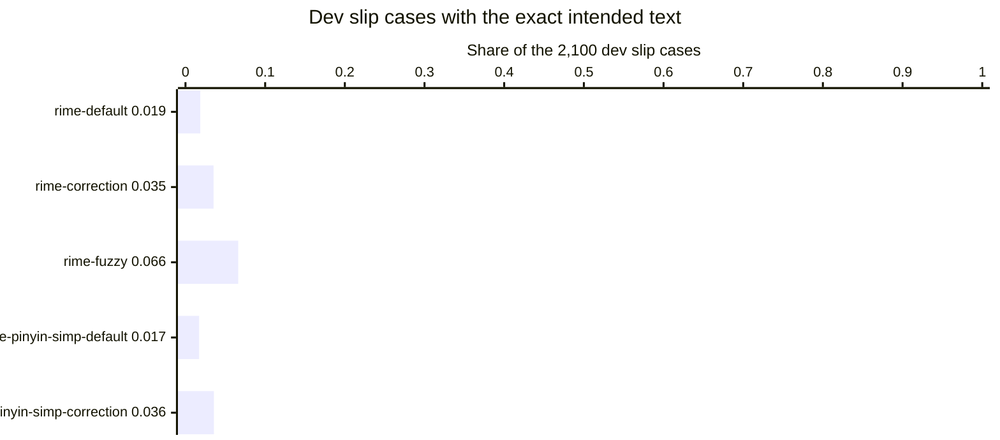
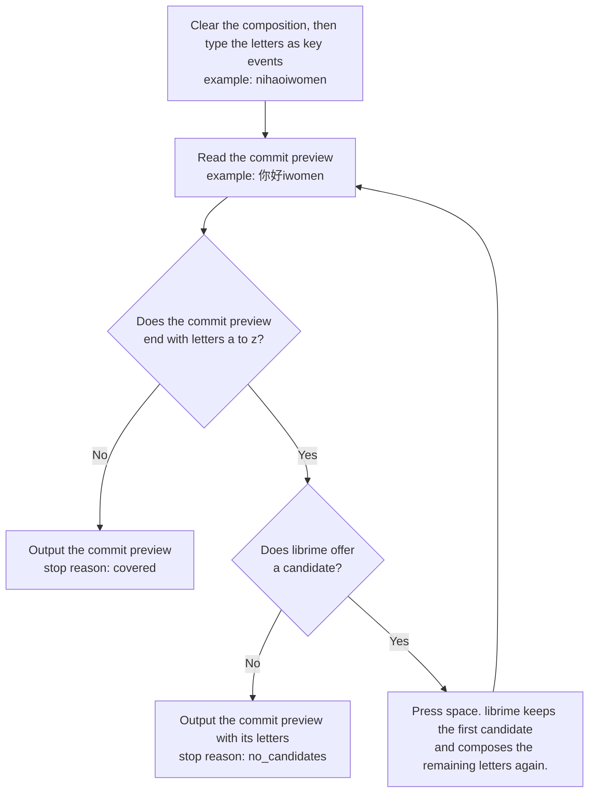

# librime adapter for the Pinyin typing evaluation

## Summary

librime 1.10.0 with stock data repairs at most 6.6 percent of the dev slip cases in five settings.

1. Read the scores in Table 4 and the two figures under it.
2. Run the evaluation again with `gh workflow run "Typing evaluation of librime" --ref eval/librime`.
3. Download the outputs of a run with `gh run download RUN_ID --name typing-evaluation-librime`.
4. Use these scores for librime 1.10.0 with the five settings of Table 2 only. Each patched setting lowers the dev clean accuracy by 8 to 19 percentage points.

The scores do not cover librime 1.16 or later, a grammar model, or a user dictionary with typing history.

## Terms of librime in this document

Table 1. The terms of this document. Each term keeps one meaning in every section below.

| Term | Meaning |
| --- | --- |
| librime | The C++ engine of the Rime input method, <https://github.com/rime/librime>. |
| Schema | A YAML file that defines one input method for librime: its spelling rules, its dictionary and its output filters. |
| Stock data | The schema files, the dictionaries and the prebuilt binary files in `/usr/share/rime-data`, as the Ubuntu packages install them. |
| Shared folder | The folder where librime reads the stock data. The adapter uses a copy of `/usr/share/rime-data`. |
| User folder | The folder where librime reads custom patches and writes the files that the deployment builds. |
| Custom patch | A file `NAME.custom.yaml` in the user folder. librime applies its `patch` entries on top of the stock file `NAME`. |
| Deployment | The step where librime compiles a schema and its dictionary into binary files. |
| Spelling rule | One line of the list `speller/algebra` in a schema. A spelling rule adds one accepted spelling of a syllable, such as `dagn` for `dang`. |
| Candidate | One conversion that librime offers for the typed letters. A space press selects the first candidate. |
| Commit preview | The text that librime would put in the text field now. The commit preview is the first candidate, followed by the letters that the first candidate does not cover. |
| Unigram word model | A model that scores a sentence by the frequency of each word alone. The model does not look at the neighboring words. |
| User dictionary | The store where librime records each text that a person commits. librime ranks a recorded text higher later. |
| Slip case, clean case | A test case with a typing slip, and a test case with correct Pinyin. [The evaluation README](../../README.md) defines both. |

## Five engine names for the librime settings

Each engine name is one stock schema with at most one custom patch.

Table 2. The five engine names. The three patched engine names differ from their default engine name by one custom patch each.

| Engine name | Setting in plain words | Reason for the engine name |
| --- | --- | --- |
| `rime-default` | The stock schema `luna_pinyin_simp`. Its dictionary is `luna_pinyin`, with the word frequencies of `essay.txt`. OpenCC converts the Traditional Chinese candidates to Simplified Chinese. | The stock schema of Rime for Simplified Chinese with the stock essay data |
| `rime-correction` | `rime-default` plus the custom patch `translator/enable_correction: true` | The neighbor-key correction that librime has built in |
| `rime-fuzzy` | `rime-default` plus five fuzzy-sound templates from the stock file `pinyin.yaml`. The five are the templates for the sound pairs of the category `fuzzy_sound`. | The fuzzy-sound templates that Rime ships, matched to the category `fuzzy_sound` |
| `rime-pinyin-simp-default` | The stock schema `pinyin_simp`. Its dictionary comes from the Android Pinyin input method. | A second stock schema, whose data has the Apache-2.0 license |
| `rime-pinyin-simp-correction` | `rime-pinyin-simp-default` plus the custom patch `translator/enable_correction: true` | The neighbor-key correction on the second schema |

The two stock schemas already hold five spelling rules for key slips. Examples are `dagn` for `dang`, `zhon` for `zhong`, `hoa` for `hao` and `tain` for `tian`. Every engine name keeps these five spelling rules.

The adapter writes these files into the user folder. Every engine name gets the first file, with its own schema name.

```yaml
# default.custom.yaml: deploy one schema only
patch:
  schema_list:
    - schema: luna_pinyin_simp
```

```yaml
# luna_pinyin_simp.custom.yaml of rime-correction, and pinyin_simp.custom.yaml of rime-pinyin-simp-correction
patch:
  translator/enable_correction: true
```

```yaml
# luna_pinyin_simp.custom.yaml of rime-fuzzy
patch:
  speller/algebra:
    __patch:
      - pinyin:/zh_z_bufen
      - pinyin:/n_l_bufen
      - pinyin:/r_l_bufen
      - pinyin:/hu_f_buhun
      - pinyin:/en_eng_bufen
      - pinyin:/abbreviation
      - pinyin:/spelling_correction
      - pinyin:/key_correction
```

The first five lines of the `rime-fuzzy` list are the fuzzy-sound templates. The last three lines are the stock spelling rules of `luna_pinyin_simp`. The stock file `pinyin.yaml` shows this list form in its `usage` block.

The Pinyin task is Table 2 of [the evaluation README](../../README.md). The adapter fills two rows of that table.

Table 3. The two task rows that the librime adapter fills. The five engine names differ in the Model row only.

| Row | librime |
| --- | --- |
| Model | librime 1.10.0. The spelling rules turn the letters into a graph of syllables. The dictionary gives the words for each path. When one dictionary entry spells all the letters that librime reads as syllables, that entry is the first candidate. In the other cases a unigram word model picks the sentence with the highest total word score. librime does not train during the run. |
| Output | One string: the commit preview at the end of the steps in Figure 3. The string holds Chinese characters, plus the letters a to z that librime did not convert. |

## Scores of the five engine names on the Pinyin cases

Each patched engine name repairs more slip cases than its default engine name, and keeps fewer clean cases.

Table 4. Share of cases with the exact intended text, with the count of cases in parentheses. `rime-fuzzy` has the highest slip share, 0.0662 on the dev half.

| Engine name | Dev clean, of 900 | Dev slips, of 2,100 | Test clean, of 900 | Test slips, of 2,100 |
| --- | --- | --- | --- | --- |
| `rime-default` | 0.5600 (504) | 0.0186 (39) | 0.5711 (514) | 0.0162 (34) |
| `rime-correction` | 0.3778 (340) | 0.0352 (74) | 0.3556 (320) | 0.0286 (60) |
| `rime-fuzzy` | 0.4756 (428) | 0.0662 (139) | 0.4889 (440) | 0.0633 (133) |
| `rime-pinyin-simp-default` | 0.5178 (466) | 0.0171 (36) | 0.5444 (490) | 0.0167 (35) |
| `rime-pinyin-simp-correction` | 0.3300 (297) | 0.0357 (75) | 0.3511 (316) | 0.0281 (59) |



Figure 1. Share of the 900 dev clean cases with the exact intended text. The line marks the lowest clean share that the evaluation accepts. That share is 1 percentage point under the default engine name of the same schema. The three patched engine names are 7 to 18 percentage points under the line.



Figure 2. Share of the 2,100 dev slip cases with the exact intended text. Every engine name stays under 0.07. The figure does not draw a reference line, because the measurement of Apple's keyboard is still open.

Table 5. Count of dev cases with the exact intended text, of 300 per category. The largest gain of `rime-correction` is in `substitution_adjacent`, and the largest gain of `rime-fuzzy` is in `fuzzy_sound`.

| Category | `rime-default` | `rime-correction` | `rime-fuzzy` | `rime-pinyin-simp-default` | `rime-pinyin-simp-correction` |
| --- | --- | --- | --- | --- | --- |
| `clean_short` | 191 | 149 | 172 | 171 | 126 |
| `clean_medium` | 179 | 116 | 153 | 166 | 109 |
| `clean_long` | 134 | 75 | 103 | 129 | 62 |
| `substitution_adjacent` | 0 | 47 | 0 | 0 | 51 |
| `deletion` | 26 | 15 | 33 | 23 | 13 |
| `double_letter` | 0 | 0 | 0 | 0 | 0 |
| `extra_adjacent` | 0 | 0 | 0 | 0 | 0 |
| `transposition` | 13 | 12 | 12 | 13 | 11 |
| `two_errors` | 0 | 0 | 0 | 0 | 0 |
| `fuzzy_sound` | 0 | 0 | 94 | 0 | 0 |

The numbers come from workflow run 42755280003 on commit `2e7e471`. The scorer `score.py` wrote them to `pinyin.HALF.summary.json` in the artifact `typing-evaluation-librime`. Workflow runs 42754169971 and 42756613694 give the same output files, byte for byte, for the engine names they hold.

## Ubuntu 24.04 packages of librime and its data

The runner installs every part of the engine from the Ubuntu 24.04 package archive.

Table 6. The packages that the runner installed on the image `ubuntu24 20261101.360.1`. The engine is librime 1.10.0, and its data dates from 2022 and 2023.

| Package | Version | Content that the adapter uses |
| --- | --- | --- |
| `librime1t64` | 1.10.0+dfsg1-2build2 | The engine library `librime.so` |
| `librime-dev` | 1.10.0+dfsg1-2build2 | The header `rime_api.h` |
| `rime-prelude` | 0.0~git20220409.dd84abe-1 | `default.yaml`, `key_bindings.yaml`, `punctuation.yaml`, `symbols.yaml` |
| `rime-essay` | 0.0~git20230204.e0519d0-1 | `essay.txt`, the word frequencies, 313,021 lines |
| `rime-data-luna-pinyin` | 0.0~git20230204.79aeae2-4 | `luna_pinyin_simp.schema.yaml`, `luna_pinyin.schema.yaml`, `pinyin.yaml`, `luna_pinyin.dict.yaml` with 70,799 lines, and the prebuilt `luna_pinyin.table.bin` |
| `rime-data-pinyin-simp` | 0.0~git20230104.52b9c75-2 | `pinyin_simp.schema.yaml`, `pinyin_simp.dict.yaml` with 65,138 lines, and the prebuilt `pinyin_simp.table.bin` |
| `rime-data-stroke` | 0.0~git20231207.65fdbbf-1 | The schema `stroke`, which both Pinyin schemas name as a dependency |
| `libopencc1.1`, `libopencc-data` | 1.1.7+ds1-1ubuntu0.1 | The conversion `t2s.json` from Traditional to Simplified Chinese |
| `libmarisa0`, `libleveldb1d`, `libyaml-cpp0.8`, `libgoogle-glog0v6t64` | 0.2.6-14ubuntu4, 1.23-5build1, 0.8.0+dfsg-6build1, 0.6.0-2.1build1 | Libraries that `librime1t64` loads |
| `g++` | 4:13.2.0-7ubuntu1, which gives g++ 13.3.0 | The compiler of the adapter |

The install command is in `.github/workflows/eval-librime.yml`. The command passes `--no-install-recommends`, so the runner does not install a librime plugin. The workflow log prints the size and the SHA-256 of every stock data file.

The deployment reuses the prebuilt dictionary tables of the packages. The deployment builds only the compiled YAML files and the spelling indexes `*.prism.bin` in the user folder.

## Licenses of the librime code and data

The data of `luna_pinyin_simp` has the LGPL-3 license, and the data of `pinyin_simp` has the Apache-2.0 license.

Table 7. The license of each part, from two sources. The two sources disagree on the librime code.

| Part | License in the upstream repository | License in the copyright file of the Ubuntu package |
| --- | --- | --- |
| librime code | BSD-3-Clause, file `LICENSE` at tag 1.10.0 | GPL-3 for `Files: *` in `librime1t64` |
| `luna_pinyin` dictionary and schemas | LGPL-3.0 | LGPL-3 |
| `essay.txt` | LGPL-3.0 | LGPL-3 |
| `default.yaml` and the other prelude files | LGPL-3.0 | LGPL-3 |
| `pinyin_simp` dictionary and schema | Apache-2.0 | Apache-2.0 |
| `stroke` schema | LGPL-3.0 | The workflow log does not print this copyright file |
| OpenCC code and conversion data | Apache-2.0 | Apache-2 |

The upstream column comes from the GitHub license field of each repository, read on 2026-11-09. The package column comes from `/usr/share/doc/PACKAGE/copyright`, which the workflow log prints.

## librime calls of the adapter for one case

The adapter types the letters of a case as key events and reads the commit preview. The adapter does not commit a case.



Figure 3. The steps of the adapter for one case, with the case `nihaoiwomen` on `rime-default`. librime converts `nihao` to 你好 and does not offer a candidate for `iwomen`, so the output is `你好iwomen`.

The program `rime_cli.cc` calls the C interface in `rime_api.h` in this order:

1. Setup: `rime_get_api`, `setup`, `set_notification_handler`, `initialize`. The traits name the shared folder and the user folder.
2. Deployment, once for each engine name: `start_maintenance(True)`, `join_maintenance_thread`, `finalize`. The program stops when librime does not send the message `deploy success`.
3. Session: `create_session`, `select_schema`, `get_current_schema`.
4. Check of the settings: `schema_open`, `config_get_bool` on `translator/enable_correction`, `config_get_cstring` on `translator/dictionary`, `config_close`. The program stops when the deployed schema does not match the engine name.
5. One case: `clear_composition`, then `process_key` for each letter, then `get_input` to confirm the letters. A call to `get_commit` confirms that librime did not commit a text.
6. Reading: `get_context` gives `commit_text_preview` and `menu.num_candidates`, then `free_context`.
7. A space press, only while letters remain and librime offers a candidate: `process_key` with key code `0x20`, then `get_commit`.
8. End: `destroy_session`, `finalize`.

The script `run_librime.py` runs the program for the probe strings and for each half. The script stops when `nihao` does not give 你好 or `zhongguo` does not give 中国.

## Limits of the librime adapter

- The scores belong to librime 1.10.0. The release notes of librime 1.16.0 list two new features for correction, and the adapter does not score that version.
- The user dictionary stays empty. A person who types for weeks gets candidates that the adapter does not see.
- Two checks guard the empty user dictionary. The program stops when librime commits a text. The script also types each half in reverse order and counts the outputs that change. The workflow run ends with an error when that count is above zero.
- The packages do not install a grammar model, and the adapter does not add one. The sentence model is the unigram word model.
- The adapter reads the first candidate only. A person can pick the second candidate, and the scores do not count that.
- With the neighbor-key correction off, librime does not offer a candidate at a letter that cannot start a syllable. The output keeps the letters from that point on. `rime-default` gives such an output for 311 of the 3,000 dev cases. The first kept letter is `i` in 194 cases, `u` in 101 and `v` in 16.
- The scorer counts each kept letter as one edit, which lowers the character accuracy of such an output.
- The neighbor-key correction of librime 1.10.0 swaps a key for its left or right neighbor only. The slip generator also uses the neighbors in the row above and the row below.
- The template list of `rime-fuzzy` follows the definition of the category `fuzzy_sound`. `rime-fuzzy` is therefore a setting made for this evaluation. A score did not choose the list. The stock templates do not cover three sound pairs of the category. The three are `an` with `ang`, `r` typed for `l`, and `h` with `f` outside the `hu` syllables.
- `rime-default` gets Simplified Chinese from OpenCC, so a conversion choice of OpenCC can change a character.
- A score did not choose a setting of an engine name. Each engine name has fixed settings, so the dev half and the test half measure the same thing.

## Files of the librime adapter

Table 8. The files of the adapter. Three files run on the runner, and the workflow file starts them.

| File | Content |
| --- | --- |
| `rime_cli.cc` | The C++ program that deploys a schema and types cases into librime |
| `run_librime.py` | The script that prepares the folders of one engine name and writes `build/typing-evaluation/NAME/pinyin.HALF.jsonl` |
| `summarize_runs.py` | The script that prints the stop reasons, compares patched and default engine names, and reports the two user dictionary checks |
| `../../../../.github/workflows/eval-librime.yml` | The workflow that installs the packages, builds the program, runs the five engine names, scores them and uploads the artifact |

Each engine name also gets four files beside its predictions: `pinyin.dev.details.tsv`, `pinyin.test.details.tsv`, `probes.tsv` and `run-info.json`. A details file holds the typed letters, the output, the stop reason and the first candidate of every case.
