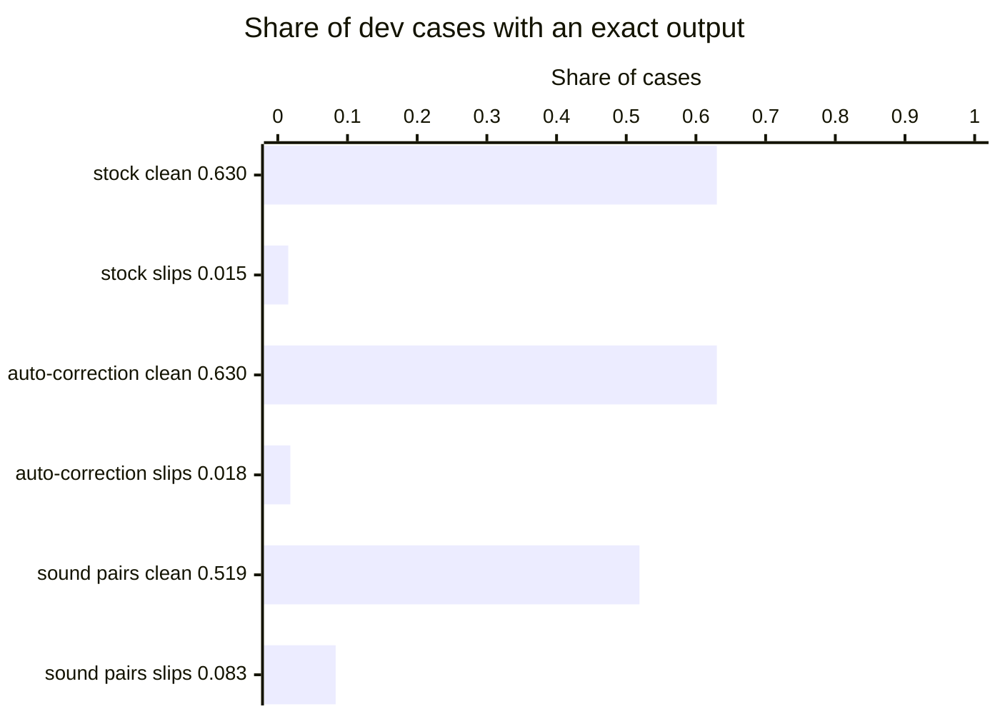
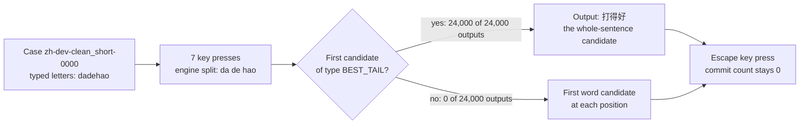

# sunpinyin adapter for the Pinyin typing evaluation

## Summary

Stock sunpinyin 3.0.0~rc2 converts 63 to 65 percent of clean cases exactly and repairs under 2 percent of slip cases.



Figure 1. Share of dev cases with an exact output, for the three modes of sunpinyin. The dev half holds 3,000 of the 6,000 cases. The sound-pair mode reads n and l, and 11 more pairs of sounds, as one sound. That mode repairs 8.3 percent of slip cases and converts 11 points fewer clean cases than the stock mode.

1. Read the sunpinyin scores in Table 2 as a comparison row for clean conversion.
2. Plan slip repair outside these modes, for example in our engine `Engine/duo_engine.c`. Each mode repairs 0 of 600 `double_letter` cases and 0 of 600 `extra_adjacent` cases.
3. Check the CC BY-SA 3.0 license of the model and the dictionary before you reuse the data.
4. Run the evaluation again with `gh workflow run "Typing evaluation of sunpinyin" --ref eval/sunpinyin`. The log step "Score every engine name on both halves" prints the scores.

The scores do not cover sunpinyin after it learns from a person, because every run starts with an empty history.

## Four engine names for the sunpinyin settings

sunpinyin is an open-source Pinyin input method engine in C++, first written at Sun Microsystems.
The engine picks the Chinese sentence with a trigram language model[^trigram].
The evaluation runs the engine in three modes and in one control, and each has one engine name.

Table 1. The four engine names. The auto-correction mode and the sound-pair mode each switch on one option, and the control changes two other values.

| Engine name | Setting in plain words | Reason for the name |
| --- | --- | --- |
| `sunpinyin-default` | The library's own settings. Auto-correction is off and sound pairs are off. | The stock mode: the engine as the library starts it. |
| `sunpinyin-correction` | Auto-correction on, with five spelling pairs: gn to ng, uen to un, img to ing, iou to iu, uei to ui. | The auto-correction mode: the engine's one option aimed at a typing slip. |
| `sunpinyin-fuzzy` | Sound pairs on, with the 14 pairs of the ibus settings window: sh and s, zh and z, ch and c, an and ang, on and ong, en and eng, in and ing, eng and ong, ian and iang, uan and uang, n and l, f and h, l and r, k and g. | The sound-pair mode: the option aimed at the `fuzzy_sound` category. |
| `sunpinyin-ibus-defaults` | The stock mode with two values of the ibus front end[^ibus]: history weight level 3 and the GBK character set. | The front-end control: a check of the two front end values against the stock mode. |

Four terms from Table 1 need a definition.

- Auto-correction rewrites the end of a syllable when the typed letters end in the first spelling of a pair.
- A sound pair is two sounds that the engine reads as one. sunpinyin calls the option fuzzy Pinyin.
- The history weight is the share that the engine gives to a person's earlier text against the language model. The levels run from 0 to 10, and the library starts at level 5.
- GBK is a Chinese character set with Simplified and Traditional characters. The library starts at level 3, which admits every character of the dictionary.

The library supplies two empty pair lists.
The adapter passes the lists that the settings window of the ibus front end offers.
That window is `wrapper/ibus/setup/main.py` at tag `v3.0.0-rc2` of https://github.com/sunpinyin/sunpinyin.

The library keeps only the first mapping of each sound (`initFuzzyMap` in `pinyin/syllable.h`).
With the 14 pairs in the window's order, 12 pairs work in both directions.
The engine reads r as l and does not read l as r.
The engine keeps eng and ong apart.

## Scores of the four engine names on the dev half and the test half

The task, the case categories and the scorer are in [the evaluation README](../../README.md).
A clean case holds correct Pinyin, and a slip case holds one or two typing slips.
A mode repairs a slip case when its output equals the intended text exactly.

Table 2. Cases with an exact output, copied from the lines `ALL CLEAN` and `ALL SLIPS` of `score.py`. Auto-correction leaves every clean output the same and repairs 6 more dev slip cases.

| Engine name | Half | Clean cases with an exact output, of 900 | Clean share | Slip cases with an exact output, of 2,100 | Slip share |
| --- | --- | --- | --- | --- | --- |
| `sunpinyin-default` | dev | 567 | 0.6300 | 31 | 0.0148 |
| `sunpinyin-default` | test | 583 | 0.6478 | 26 | 0.0124 |
| `sunpinyin-correction` | dev | 567 | 0.6300 | 37 | 0.0176 |
| `sunpinyin-correction` | test | 583 | 0.6478 | 36 | 0.0171 |
| `sunpinyin-fuzzy` | dev | 467 | 0.5189 | 174 | 0.0829 |
| `sunpinyin-fuzzy` | test | 485 | 0.5389 | 180 | 0.0857 |
| `sunpinyin-ibus-defaults` | dev | 567 | 0.6300 | 31 | 0.0148 |
| `sunpinyin-ibus-defaults` | test | 583 | 0.6478 | 25 | 0.0119 |

Four facts explain the last four rows.

- The sound-pair mode repairs 152 dev slip cases that the stock mode does not repair, 137 of them in `fuzzy_sound`.
- The sound-pair mode does not repair 9 dev `deletion` cases that the stock mode repairs. The net change is 143 cases.
- For clean dev cases, the sound-pair mode adds 3 exact outputs and removes 103.
- The front-end control changes 64 of 3,000 dev outputs of the stock mode. Its count of exact outputs differs by one case, in the test half.

Table 3. Exact outputs of 300 cases in each category, written as dev and then test. The stock mode repairs a slip only in `deletion`.

| Category | `sunpinyin-default` | `sunpinyin-correction` | `sunpinyin-fuzzy` | `sunpinyin-ibus-defaults` |
| --- | --- | --- | --- | --- |
| `clean_short` | 205, 211 | 205, 211 | 183, 192 | 205, 211 |
| `clean_medium` | 188, 194 | 188, 194 | 156, 169 | 188, 194 |
| `clean_long` | 174, 178 | 174, 178 | 128, 124 | 174, 178 |
| `substitution_adjacent` | 0, 0 | 0, 1 | 0, 0 | 0, 0 |
| `deletion` | 31, 26 | 31, 26 | 37, 35 | 31, 25 |
| `double_letter` | 0, 0 | 0, 0 | 0, 0 | 0, 0 |
| `extra_adjacent` | 0, 0 | 0, 0 | 0, 0 | 0, 0 |
| `transposition` | 0, 0 | 6, 9 | 0, 0 | 0, 0 |
| `two_errors` | 0, 0 | 0, 0 | 0, 0 | 0, 0 |
| `fuzzy_sound` | 0, 0 | 0, 0 | 137, 145 | 0, 0 |

Three facts explain the slip rows.

- In every `deletion` case that the stock mode repairs, the slip removed the one-letter ending of a syllable. sunpinyin reads the letters that stay, such as `d` for `di`, as a short form of the syllable.
- Every `transposition` case that the auto-correction mode repairs holds the pair gn to ng, such as `zhagn` for `zhang`.
- The stock mode and the auto-correction mode give the same output for all 900 clean cases of each half.

On the runner, the stock mode takes under 10 milliseconds for one case on average. The sound-pair mode takes about 2.5 times as long.

## Output of each mode on 17 probe strings

We wrote the probe strings by hand, independently of the test cases.

Table 4. Output of each mode on 17 probe strings. The engine split shows the syllables that sunpinyin reads in the stock mode. Auto-correction repairs the five probe strings that end in a pair and leaves `zhognguo` unrepaired.

| Typed | Engine split, stock mode | `sunpinyin-default` | `sunpinyin-correction` | `sunpinyin-fuzzy` |
| --- | --- | --- | --- | --- |
| `nihao` | ni hao | 你好 | 你好 | 你好 |
| `zhongguoren` | zhong guo ren | 中国人 | 中国人 | 中国人 |
| `dagn` | da g n | 大姑娘 | 当 | 大姑娘 |
| `zhognguo` | zh o g n guo | 中哦跟你过 | 中哦跟你过 | 在哦个难过 |
| `shuen` | shu en | 殊恩 | 顺 | 殊恩 |
| `dimg` | di m g | 地美国 | 顶 | 地美国 |
| `jiou` | ji ou | 及偶 | 就 | 及偶 |
| `guei` | gu ei | 古诶 | 鬼 | 古诶 |
| `nihso` | ni h s o | 你划算哦 | 你划算哦 | 理发师哦 |
| `niha` | ni ha | 你哈 | 你哈 | 立法 |
| `nihaoo` | ni hao o | 你好哦 | 你好哦 | 你好哦 |
| `nihoa` | ni h o a | 你好哦啊 | 你好哦啊 | 厉害哦啊 |
| `lixihuan` | li xi huan | 里喜欢 | 里喜欢 | 你喜欢 |
| `zongguoren` | zong guo ren | 总过人 | 总过人 | 中国人 |
| `raoshi` | rao shi | 扰时 | 扰时 | 老师 |
| `liben` | li ben | 立本 | 立本 | 你本 |
| `dengxi` | deng xi | 等戏 | 等戏 | 等戏 |

The front-end control gives the stock mode's output for every probe string.
The sound-pair mode reads `raoshi` as 老师 (lao shi) and does not read `dengxi` as 东西 (dong xi).
The same mode reads `liben` as 你本 (ni ben) and does not reach 日本 (ri ben).
The workflow step "Show each mode on a few probe strings" prints these rows and three more.

## Packages and versions on the ubuntu-24.04 runner

Table 5. Packages that the runner installed or used. All three sunpinyin packages come from the `noble/universe` archive of Ubuntu 24.04.

| Package | Version | Content that the adapter uses |
| --- | --- | --- |
| `libsunpinyin3v5` | 3.0.0~rc2+ds1-5 | `/usr/lib/x86_64-linux-gnu/libsunpinyin.so.3.0` |
| `libsunpinyin-dev` | 3.0.0~rc2+ds1-5 | Headers in `/usr/include/sunpinyin-2.0`, and the pkg-config name `sunpinyin-2.0`, which reports version 2.0.4 |
| `sunpinyin-data` | 0.1.22+20170109-2 | `lm_sc.t3g`, 39,188,868 bytes, and `pydict_sc.bin`, 3,954,372 bytes, in `/usr/lib/x86_64-linux-gnu/sunpinyin/data` |
| `libsqlite3-0` | 3.45.1-1ubuntu2.8 | The library that sunpinyin links for its user dictionary |
| `g++` | 13.3.0 | The compiler for `sunpinyin_cli.cpp` |
| `python3` | 3.12.3 | The interpreter for `run_sunpinyin.py` and `score.py` |

The workflow installs the engine with one command.

```
sudo apt-get install -y --no-install-recommends g++ pkg-config libsunpinyin-dev sunpinyin-data
```

The workflow builds the adapter program with the two commands below.
The library's headers test the three `HAVE_` names at compile time.
The library's own build sets the same three names on Linux.

```
mkdir -p build/engines/sunpinyin
g++ -std=gnu++11 -O2 -Wall -DHAVE_LOG2 -DHAVE_UNISTD_H -DHAVE_SYS_MMAN_H \
  $(pkg-config --cflags sunpinyin-2.0) scripts/typing-evaluation/engines/sunpinyin/sunpinyin_cli.cpp \
  $(pkg-config --libs sunpinyin-2.0) -o build/engines/sunpinyin/sunpinyin_cli
```

## Licenses of the sunpinyin code and of the sunpinyin data

Table 6. Licenses as the package copyright files on the runner state them. The data carries a share-alike license that differs from the license of the code.

| Part | License | File on the runner that states the license |
| --- | --- | --- |
| Engine code, packages `libsunpinyin3v5` and `libsunpinyin-dev` | LGPL-2.1 only, or CDDL, at the choice of the person who uses the code | `/usr/share/doc/libsunpinyin3v5/copyright` |
| Language model and dictionary, package `sunpinyin-data` | Creative Commons Attribution-Share Alike 3.0 Unported | `/usr/share/doc/sunpinyin-data/copyright` |

The data copyright file names https://sourceforge.net/projects/open-gram/files/ as the download source.
The workflow step "Print the license files of the packages" prints both files in full.

## Calls from the adapter into the sunpinyin library



Figure 2. Path of one case through the adapter program. The first candidate was the engine's whole-sentence candidate for every output of the eight runs.

`sunpinyin_cli.cpp` makes these calls, in this order.

1. `AQuanpinSchemePolicy::instance()` receives the mode. The auto-correction mode calls `setAutoCorrectionPairs` and `setAutoCorrecting(true)`. The sound-pair mode calls `setFuzzyPinyinPairs` and `setFuzzyForwarding(true)`. The front-end control calls `setFuzzyForwarding(false)`, as the ibus front end does.
2. `ASimplifiedChinesePolicy::instance().setUserDataDir(folder)` names a new, empty folder for the history file and the user dictionary.
3. `CSunpinyinSessionFactory::getFactory()` receives three settings. `setLanguage(SIMPLIFIED_CHINESE)` selects the Simplified Chinese model. `setPinyinScheme(QUANPIN)` selects full Pinyin spelling. `setInputStyle(CLASSIC_STYLE)` selects the one view type that the factory offers.
4. `createSession()` returns a `CIMIView`. The front-end control then calls `setHistoryPower(3)` and `setCharsetLevel(1)` on the view's context.
5. `view->attachWinHandler(&handler)` attaches a handler that does not draw. The view computes its whole-sentence candidate only while a handler is attached.
6. `view->onKeyEvent(CKeyEvent(letter, letter, 0))` types each letter of the case.
7. `view->getCandidateList(list, 0, size)` reads the candidates. `ICandidateList::BEST_TAIL` is the library's type for the whole-sentence candidate. The output is `list.candiString(0)` when `list.candiType(0)` equals that type.
8. `context->getCandidates(position, words)` supplies the first word candidate at each position for any other first candidate.
9. `view->getPreeditString(preedit)` reads the engine split of the letters, for the details file.
10. `view->onKeyEvent(CKeyEvent(IM_VK_ESCAPE, 0, 0))` empties the session. The program stops with exit code 6 when a commit happened. A commit puts a candidate into the text field, and the engine learns from that text.
11. `factory.destroySession(view)` ends the session after the last case.

`run_sunpinyin.py` starts the program once for each engine name and half.
The script first types `nihao` and stops the run when the output differs from 你好.

## Limits of the sunpinyin adapter

- The engine never learns in these runs. The program does not commit text, so the history and the user dictionary stay empty.
- The front-end control copies two values of the ibus front end from the sunpinyin source at tag `v3.0.0-rc2`. The control changes both values at once, so the runs do not separate their effects. The adapter did not run the ibus front end itself.
- Both character set levels admit Traditional characters. With either level, 3 of 900 clean dev outputs hold one, such as 已經 for 已经.
- A letter that cannot start a syllable (i, u or v) stays in the output as a letter. 321 of 3,000 outputs in each half hold such a letter.
- The library keeps the typed letters after an auto-correction repair. A later letter can make the library split those letters again, as in `zhognguo` in Table 4.
- The auto-correction mode and the sound-pair mode use the pair lists of the ibus settings window. A different list gives different scores, and the adapter did not score a shorter list.
- sunpinyin has two more options for a syllable border with two readings, such as `fangan`. Both stay off, and the adapter did not score them.
- The path through `getCandidates` in step 8 did not run for any of the 24,000 outputs. That path reads each word candidate and does not select it, so the path differs from a person's selections.
- The run time is an average over a batch of 3,000 cases. The adapter did not time one key press.
- A case where the program stops does not get an output line, and `score.py` counts the case as wrong. The eight runs did not have such a case.

## Files of the sunpinyin adapter and of one evaluation run

Table 7. Files in this folder, and files that one run writes for each engine name. `score.py` reads only the first output file.

| File | Content |
| --- | --- |
| `sunpinyin_cli.cpp` | The C++ program that types the cases into a sunpinyin session |
| `run_sunpinyin.py` | The script that runs the program for each engine name and half |
| `.github/workflows/eval-sunpinyin.yml` | The workflow that installs the engine, runs both halves and scores them |
| `build/typing-evaluation/NAME/pinyin.HALF.jsonl` | The case id and the output, one JSON object per line |
| `build/typing-evaluation/NAME/pinyin.HALF.details.jsonl` | The typed letters, the engine split, and the way the output was read |
| `build/typing-evaluation/NAME/pinyin.HALF.run.json` | Counts for the run, and every case where the program stopped |
| `build/typing-evaluation/NAME/pinyin.HALF.summary.json` | The scores that `score.py` wrote |
| `build/typing-evaluation/NAME/probes.tsv` | The probe strings with the output of one mode |

The workflow uploads `build/typing-evaluation/` as the artifact `typing-evaluation-sunpinyin`.

[^trigram]: A trigram language model scores each word from the two words before it.
[^ibus]: ibus is an input method framework for Linux desktops. The sunpinyin source tree holds a front end for ibus.
